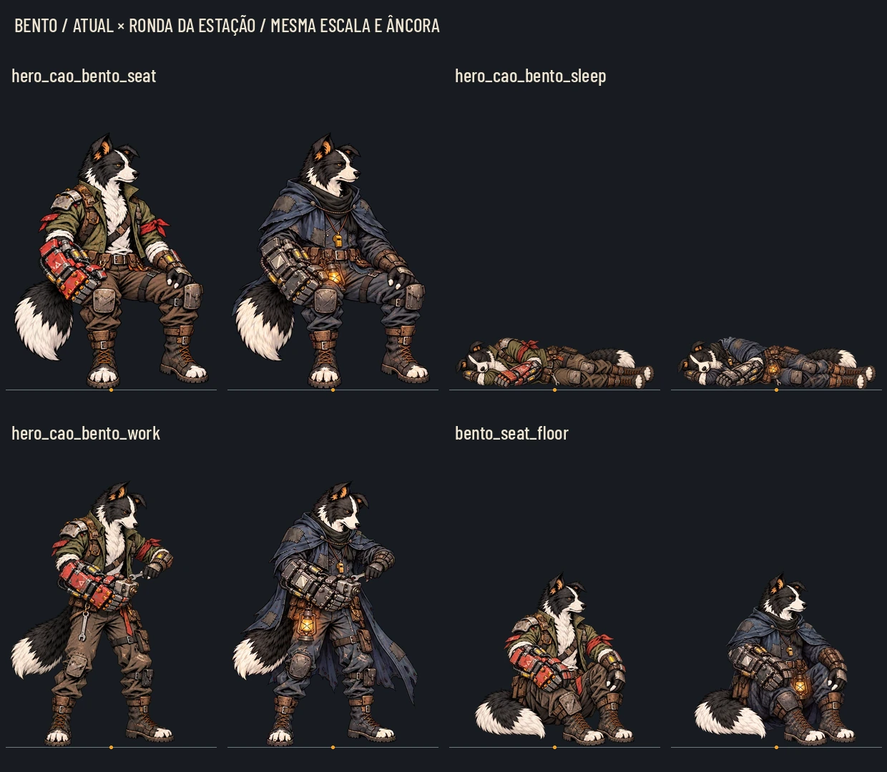

# Bento — Ronda da Estação (#137)

A escolha corrigida do Lucas é **Ronda da Estação (`watch`)**, conforme o último comentário da #137. O Mergulhador fica somente como proposta histórica. A referência de identidade e roupa continua sendo o [idle aprovado](skins/watch/idle.webp) e o [retrato aprovado](skins/watch/portrait.webp).

**Entrega:16 poses de corpo +1 retrato =17 WebP RGBA**, em `art/skins/bento/watch/`. Os efeitos e sons são os de hoje. A pose `wounded` vem na #195, separadamente desta lista. A aprovação artística final das pranchas é do Lucas.

[Prancha completa](skins/watch/poses.webp) · [40%](skins/watch/poses_40.webp) · [Cinza40%](skins/watch/poses_gray_40.webp) · **[Leitura na noite e no claro](skins/watch/night_readability.webp)** · [Cinza da leitura](skins/watch/night_readability_gray.webp) · [Borda da bota antes/depois](skins/watch/boot_edge.webp).

Para ver maior: [1 — idle e defesa/impacto](skins/watch/poses_1.webp), [2 — apoio e punho](skins/watch/poses_2.webp), [3 — preparação e reações](skins/watch/poses_3.webp), [4 — Estação e acampamento](skins/watch/poses_4.webp). Cada par usa a mesma escala e a mesma marca da âncora em âmbar; a linha cinza é a linha da âncora.

## Identidade e acabamento

Mantidos o cão preto e branco, a faixa branca da cara, o focinho, as orelhas, a ponta branca da cauda e o tamanho do punho. A Ronda usa a capa com capuz abaixado de lona anil/carvão remendada, o cachecol, o apito, o cinto com bolsas e o lampião âmbar. O punho de sucata tem aço escurecido e bordas gastas, sem a pintura vermelha do traje antigo. As botas mantêm os dedos brancos, como a proposta aprovada da Ronda; não são as botas fechadas do Mergulhador.

O lampião fica visível e pinta uma reflexão pequena na roupa, sem aura flutuante. Na pose de item, o punho grande está retirado como no original, permitindo usar a faixa; isso é deliberado. Dormindo, a capa fica dobrada junto ao corpo. Na pose sentada no chão, não se espalha para fora e não obriga a encolher o Bento.

A franja magenta/verde residual da proposta foi neutralizada nos pixels da borda, inclusive a bota da frente. A prova amplia a bota sobre claro e escuro. Os arquivos aprovados de referência em docs foram preservados; a correção está nos arquivos de entrega e fontes.

## Canvas e âncoras

O [contrato completo](skins/watch/contract.json) lista arquivos de referência, tamanhos, canvas/âncora canônicos, altura de referência do corpo, fontes e hashes. **Não remedir o centro pelo volume da capa.** Reutilizar o canvas, a âncora e `body_reference_pixels` da pose original. O motor converte as duas coordenadas pela razão da **largura** da textura/canvas canônico; a tabela abaixo usa esse mesmo cálculo.

| Arquivo dentro de art/skins/bento/watch | Canvas WebP | Âncora canônica x,y | Âncora na textura x,y |
|---|---|---|---|
| `idle.webp` | 543×724 | 473, 1429 | 236.500, 714.500 |
| `cao_fique_atras_de_mim_execucao.webp` | 589×668 | 595, 1323 | 297.500, 661.500 |
| `cao_fique_atras_de_mim_preparacao.webp` | 550×716 | 580, 1378 | 290.264, 689.627 |
| `cao_impacto_hidraulico_execucao.webp` | 590×667 | 610, 1292 | 305.259, 646.548 |
| `cao_impacto_hidraulico_preparacao.webp` | 589×668 | 615, 1298 | 307.500, 649.000 |
| `cao_nao_estamos_sos_execucao.webp` | 550×716 | 580, 1417 | 290.264, 709.145 |
| `cao_nao_estamos_sos_preparacao.webp` | 549×716 | 595, 1420 | 297.500, 710.000 |
| `cao_punho_sucata_execucao.webp` | 589×668 | 610, 1212 | 305.000, 606.000 |
| `cao_punho_sucata_preparacao.webp` | 589×668 | 600, 1248 | 300.000, 624.000 |
| `hurt.webp` | 543×724 | 590, 1428 | 295.000, 714.000 |
| `death.webp` | 627×627 | 680, 1198 | 340.000, 599.000 |
| `item.webp` | 608×647 | 700, 1274 | 350.000, 637.000 |
| `hero_cao_bento_seat.webp` | 543×724 | 283, 710 | 283.000, 710.000 |
| `hero_cao_bento_sleep.webp` | 887×443 | 445, 336 | 445.000, 336.000 |
| `hero_cao_bento_work.webp` | 543×724 | 302, 716 | 302.000, 716.000 |
| `bento_seat_floor.webp` | 543×724 | 473, 1429 | 236.500, 714.500 |

O retrato tem256×256, no enquadramento aprovado, nome `portrait.webp`. Sem9-slice: são sprites de personagem. As fontes PNG usam os tamanhos de origem declarados por pose; alguns canvases da Estação já são do tamanho final. Na conversão, usar o tamanho final de cada linha do contrato, sem aplicar0,5 indiscriminadamente a todas as poses.

## Leitura noturna

A [prova](skins/watch/night_readability.webp) compõe amostras de seis poses sobre um recorte real de `docs/qa/grid/flooded-depot-night.jpg` e um recorte claro de `docs/design/loop-screens/before/combat_clean.webp`. Usa a mesma imagem RGBA nos dois fundos, com referência de corpo260px; a queda e o assento ficam menores conforme suas medidas canônicas. O lampião, a cara branca, as botas e os reflexos do aço separam a silhueta escura, inclusive em cinza.

É uma **composição de leitura**, não uma captura da skin integrada nem uma simulação de luz dinâmica. A captura dentro do jogo fica para a integração #138. O lampião já tem o ponto quente pintado; eventual luz no cenário depende da implementação do Claude.

## Originais fora da main

As fontes PNG normalizadas ficam somente na tag `codex-pr<N>-originals`, pasta `art/combat/source/bento_watch_20261028/`, com contrato e `.gdignore`. O Release da mesma tag entrega um ZIP com essa pasta. O número/tag/link serão preenchidos ao abrir o PR. O commit de originais é destacado, fora do histórico da branch enviada para a main.

O Claude pode extrair com `git archive <tag> art/combat/source/bento_watch_20261028 | tar -x`. Para reproduzir os WebP e pranchas: `python docs/design/skins/watch/build_delivery.py --sources art/combat/source/bento_watch_20261028`. Pillow, numpy e scipy. As edições desta entrega usaram a ferramenta de geração de imagens do Codex, com a pose canônica e a roupa aprovada como referências; o fundo magenta foi recortado e as medidas normalizadas por código. Os brutos de geração ficam fora do Git; a tag contém os PNG individuais utilizáveis pelo pipeline.

## QA de design

Checklist: [qa.md](qa.md), aplicado a personagem (texto de tela e ícones22/32px não se aplicam aos sprites). Comparadas as16 poses e o retrato com suas referências; conferidos nome, canvas, alfa, medidas, coerência de personagem/roupa, escala, lado, dedos, mãos, punho e leitura reduzida.

### Rodada1 — VEREDITO: REPROVADO

- **Média — `hero_cao_bento_sleep.webp`:** a capa aumentou o volume e a normalização pela altura reduziu o comprimento/cabeça do personagem. Refeita a imagem individualmente e alinhada pelo comprimento original do corpo e base.
- **Média — `bento_seat_floor.webp`:** capa aberta demais no chão forçava redução do personagem. Refeita com a capa dobrada junto ao corpo, mantendo o enquadramento e a escala.
- **Média — alinhamento:** a mediana de todos os pixels da base variava com a capa e com o peso de uma bota. Referência alterada para os extremos dos dedos claros na faixa inferior, com fallback para o apoio visível.
- **Média — borda da bota:** a franja da proposta aprovada precisava ser removida na entrega. Aplicado despill de borda, sem redesenhar a pose aprovada.

### Rodada2 — VEREDITO: REPROVADO

- **Média — recorte do magenta:** uma geração tinha variação do magenta na última linha; o alfa residual fazia a caixa chegar à borda e deslocava a imagem dormindo para cima. Corrigida a classificação do fundo e a conservação do componente principal com antialias. A prova passou a usar um recorte real noturno, sem personagem por baixo da montagem.
- **Baixa — pranchas:** excesso de espaço vazio foi reduzido; a conversão da âncora em y foi corrigida para a razão uniforme da largura, como o motor.

### Rodada3 — VEREDITO: APROVADO

Conferidas as quatro páginas de pares, o retrato, o40%, cinza, a prova noturna/clara e a bota ampliada. Dormir mantém o comprimento, a base e o lado; acampamento mantém tamanho da cabeça e pés; as outras poses preservam suas ações. O lampião e os claros da cara/metal mantêm a leitura sobre a noite. Os17 WebP têm canvas exato e alfa, sem fundo magenta ou texto, com âncoras canônicas preservadas no contrato. Nenhum problema alto ou médio pendente na entrega de design. A aprovação do Lucas e a QA da integração ainda são necessárias.

## Verificação e escopo

Auditoria de arquivos em [audit.json](skins/watch/audit.json):17 arquivos RGBA, canvas conferido, referências originais intactas por hash e nenhum pixel magenta detectado no critério da borda. `git diff --check` limpo; nada próprio em scripts/data/tests.

**Base177c70d, antes da entrega:** importação Godot4.7.2 concluída; `tests/run_all.gd` executado inteiro, **78/79 em506,628s**. Falha de `test_faces`: os novos recrutas Guaxinim e Tatu não têm retratos em art/ui/portraits nem entradas de face_boxes.json. A base já apresentava essa falha; nenhum arquivo desta entrega foi ligado ao código do jogo. Avisos de recursos/ObjectDB no encerramento e lambda liberada no teste de Treino ficaram no log. A paridade de combate passou48/48. Não houve correção em scripts/data/tests, conforme o escopo.
