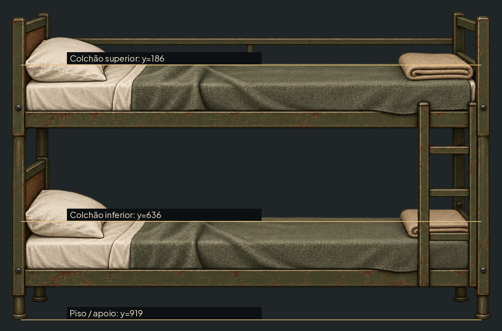

# Beliche inteiro — #1

Card novo, armação verde enferrujada única, quatro apoios, grade traseira e escada à direita; travesseiros à esquerda como as poses aprovadas. Referência: Dormitory_BedLinen.webp (DM01). Não substitui o arquivo legado nem muda IDs.

| Arquivo | Canvas | Papel |
|---|---|---|
| art/station/source/dormitory_bunk.png |1441×952 RGBA| fonte preservada com alfa limpo |
| art/station/cards/dormitory_bunk.webp |1024×677 RGBA| conversão igual ao pipeline station_cards |

Coordenadas na fonte, origem topo esquerdo: colchão superior y=186; inferior y=636; piso y=919; centro horizontal x=720; âncora de apoio(720,919). Posição do corpo: alinhar a âncora do sono ao centro de cada linha do colchão, sem recortar as poses. Colchões separados por450px. Medição na zona central livre de travesseiro. Margem transparente32px; sem9-slice.

Na WebP: fator0.71061763; linhas superior/inferior=132.17/451.95px; piso=653.06px; âncora(511.64,653.06). Se mantiver a escala de cm por pixel da cama anterior, recalcular BUNK_UPPER pela distância entre as linhas; não copiar125cm sem conferir a largura final. Não alterei constantes, ferramentas ou manifestos.

## Transferência para Unreal / Claude

O checkout Unreal não está disponível no ambiente. A fonte PNG está neste repositório para revisão; destino solicitado: SourceArt/RootStation/Dormitory/DM02_Bunk_Linen_D.png no repositório Unreal. Claude deve copiar a fonte, acrescentar a entrada nova na tabela station_cards de tools/sync_assets.py e converter pelo pipeline. WebP entregue foi gerado com os mesmos limites1024px/quality90/method4; a configuração da fonte fica para a integração #16. Não executei a sincronização global que regrava dados protegidos.

## QA de design

Rodada1 — VEREDITO: REPROVADO. Alta: PNG gerado tinha pixels de alfa isolados fora do beliche, comprometendo recorte e âncora. Correção: manter componente conectado principal em alfa>24 e acrescentar margem32; conservar alfa do corpo.

Rodada2 — VEREDITO: REPROVADO. Alta: linha de piso medida abaixo da base real dos pés. Correção: y1003 na imagem original, recalculada após recorte. Baixa: contraste das legendas sobre lençol; acrescentado fundo escuro.

Rodada3 — VEREDITO: APROVADO. Armação coesa, apoio único no piso, travesseiros à esquerda e colchões livres para as poses; alfa limpo e linhas medidas na fonte e derivado. Sem problemas altos/médios. Observação baixa: escada fica à direita e pode passar à frente dos pés; composição dos sleepers e captura noturna serão validadas pelo Claude. Transferência ao checkout Unreal permanece pendente.
