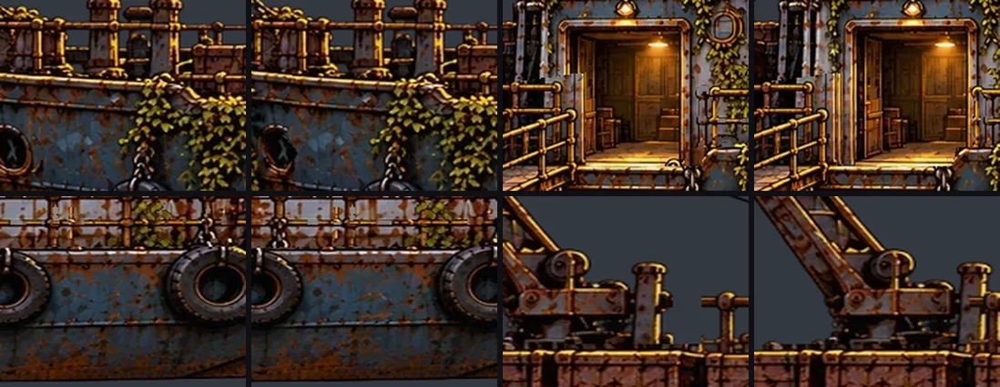
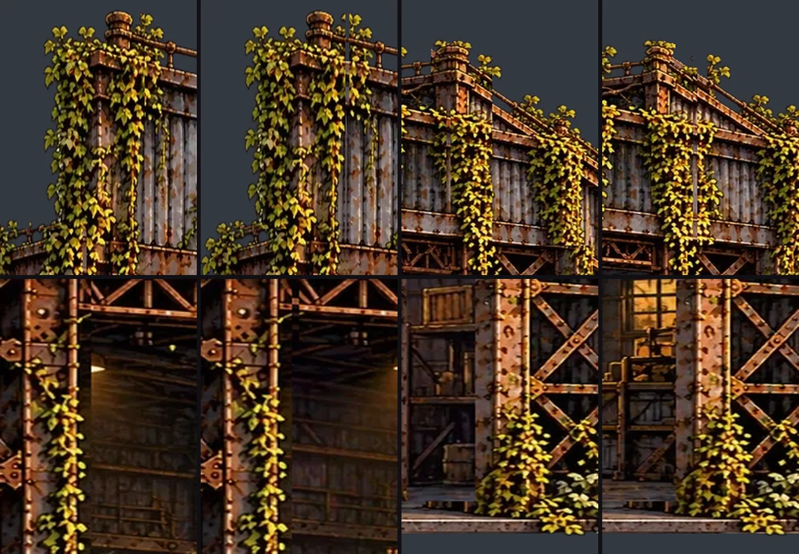
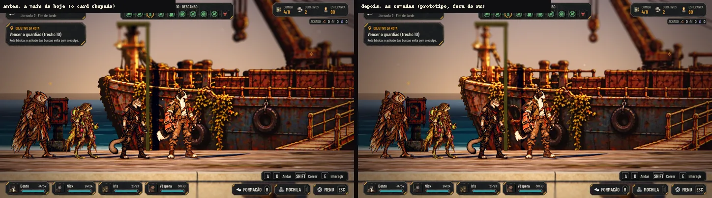
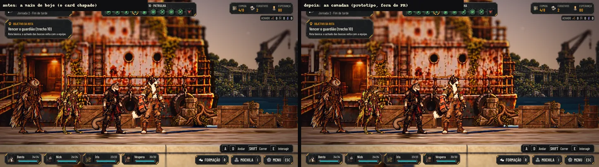
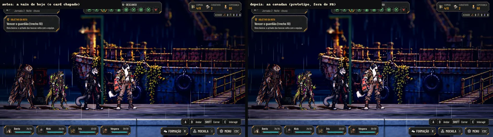
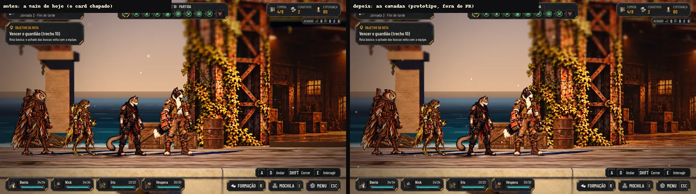
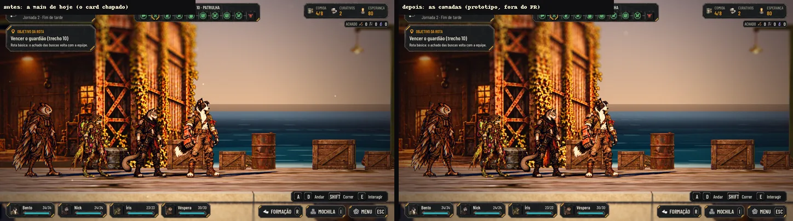
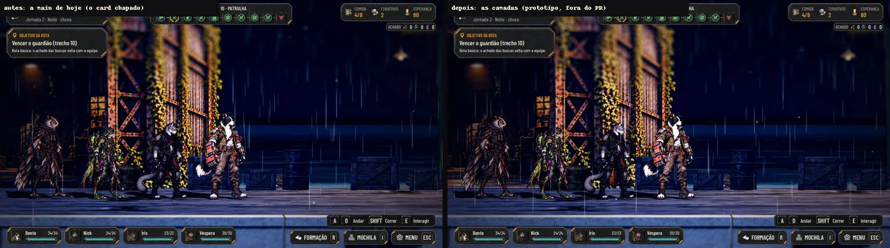

# O Armazém e o Navio do Cais em camadas (#164, para a #141)

O pedido da #164: as duas pinturas chapadas do Cais do Rio (`T_CD15`, o Armazém, e `T_CD14`, o Navio) separadas em
camadas, cada uma num WebP com alfa **no mesmo quadro e no mesmo enquadramento da pintura de hoje**, para encaixar no
lugar sem medir de novo. A integração é do Claude 2, pelo `tools/build_riverdock_depth.py` (a #141 e
[docs/qa/dock-depth.md](../qa/dock-depth.md)).

Só arte e docs: nada em `scripts/`, `data/` nem `tests/`. As pinturas de hoje (`T_CD14.webp` e `T_CD15.webp`) não mudam.

## O que entra

São 10 arquivos novos em `art/scenarios/` (cerca de 609 KB), com o `.import` dos outros cenários (`lossy_quality` 0,75):

| Arquivo | O que tem | Caixa na pintura (px: x0, y0, x1, y1) | Profundidade sugerida |
|---|---|---|---|
| **O Navio** (1024 × 576) | | | |
| `T_CD14_HullMid` | o meio do casco, com a linha d'água, os pneus, as correntes e a prancha | 129, 383, 892, 539 | o plano de hoje |
| `T_CD14_HullBow` | a proa (a curva da esquerda) | 11, 368, 172, 529 | 0,25 m atrás |
| `T_CD14_HullStern` | a popa (a curva da direita) | 849, 437, 1020, 536 | 0,25 m atrás |
| `T_CD14_Deck` | o convés: a amurada, as caixas e os postes; desce 10 px por baixo da borda do casco | 32, 312, 1017, 471 | 0,15 m atrás |
| `T_CD14_Cabin` | a cabine e a casa do leme, com a porta acesa inteira | 540, 140, 1012, 455 | 0,5 m atrás |
| `T_CD14_Mast` | o mastro alto, o guindaste com o gancho, o mastro da proa e os cabos | 48, 6, 872, 401 | 0,7 m atrás |
| **O Armazém** (1024 × 683) | | | |
| `T_CD15_Front` | os pilares e as treliças da frente (a coluna alta da esquerda inteira, com a hera), e a soleira | 90, 8, 875, 645 | o plano de hoje |
| `T_CD15_Roof` | a parede de cima (o telhado) e a viga treliçada | 148, 10, 787, 301 | 0,17 m atrás |
| `T_CD15_Interior` | o interior (o vão), pintado sem a moldura e mais largo que ela | 241, 237, 811, 642 | 1,6 m atrás (o vão de hoje) |
| `T_CD15_Sides` | as duas laterais em perspectiva (as "bochechas") | 16, 90, 1009, 646 | 0,5 m atrás, ou em volume |

As caixas também estão em [cais-camadas/layers.json](cais-camadas/layers.json). As profundidades são só uma sugestão
para a integração; o gerador manda.

**A ordem é a da profundidade:** no Navio, o meio do casco na frente, o convés, a proa e a popa, a cabine e o mastro;
no Armazém, a frente, o telhado, as laterais e o interior. A prancha e as correntes ficam no meio do casco porque estão
penduradas nele, na frente de tudo.

**O casco em três:** a proa e a popa saem da mesma camada do casco, cortadas numa chapa lisa, fora da hera e dos pneus
(em x = 150 e x = 870), num zigue-zague de ±5 px para a emenda não ser uma linha reta. Cada pedaço vai **16 px por
baixo do vizinho**: recuadas na curva, a emenda não abre.

## O encaixe

As camadas empilhadas devolvem a pintura de hoje: cada pixel dela é de uma camada só, e nenhuma camada sai da
silhueta de hoje. Um pedaço escondido só cobre o que é de uma camada da frente, nunca o de uma de trás. A diferença que
sobra é a da compressão do WebP: a média fica abaixo de 3 em 255, e no canal mais diferente só 1 px do Navio e 15 do
Armazém passam de 60 (no máximo 81), soltos, sem forma.

## As camadas separadas

Onde uma camada da frente cobre a de trás, a de trás vem pintada por inteiro:
- **a cabine:** a parede de baixo atrás da amurada e da prancha, até a linha do convés;
- **o mastro e o guindaste:** o pé do guindaste atrás das caixas, a coluna do mastro atrás da amurada da casa do leme e o
  pé do mastro da proa;
- **o convés:** a amurada atrás da prancha, até a porta da cabine;
- **o interior do Armazém:** o vão uns 60 px mais largo de cada lado e em cima, e 27 px embaixo (até a soleira), por
  trás dos pilares, da viga e da soleira;
- **o telhado:** a parede de cima atrás da coluna alta da esquerda e do poste do canto da direita;
- **as laterais:** as duas paredes em perspectiva continuam por trás dos pilares e, na direita, por trás do poste do canto
  e da ponta do telhado (de x = 740 a 786);
- **o convés:** 10 px por baixo da borda do meio do casco, para a emenda não abrir do lado da prancha;
- **a cabine:** a parede da quina esquerda (x 540 a 556), que fica no convés, na frente, para não abrir fresta entre as
  caixas e a cabine.

## A câmera passando de lado

Uma prova em 2D: cada camada desloca pela profundidade sugerida, uns 26 px por metro, o quanto a câmera da exploração
anda (meia abertura de 15° e o card a 18,3 m). Nenhum buraco abre: o pedaço escondido aparece pintado. **Não é a cena 3D:** a prova de verdade é a captura do jogo depois da integração
(`tools/capture_141.gd`).

As emendas de perto (x2), cada uma com a câmera à esquerda e à direita: no Navio, a proa, a porta da cabine, a popa e o
pé do guindaste; no Armazém, a coluna da esquerda, a quina do telhado, a borda do vão e o pé do pilar da direita.

## No jogo, antes e depois (protótipo)

Capturas da cena de verdade (`tools/capture_141.gd`, só as fachadas), com a mesma câmera, a mesma equipe e o mesmo
momento (com a arte da rodada 2; as correções da rodada 3 são de poucos pixels e não aparecem nesse enquadramento).
O antes é a `main` de hoje. O depois carrega as camadas por um **protótipo fora deste PR**: o
`build_riverdock_depth.py` com um card por camada, no quadro inteiro e no z da tabela acima. A integração de verdade é do
Claude 2.

**Sem placa de vídeo:** a nuvem da Awesomic roda a Godot em software, e o pedido de Forward+ cai no Compatibility. A
prova no Forward+ fica para o Orquestrador PC.

## Para integrar (é do Claude 2, na #141)

1. No `build_riverdock_depth.py`, cada camada vira um pedaço de `layered_cards` com o retângulo inteiro do card
   (`[0, 0, 1, 1]`) e a textura da camada, em vez de um retângulo cortado da pintura chapada. O alfa (cortado em 0,333,
   como os cards de hoje) faz o recorte.
2. A correção da perspectiva que o gerador já faz (`VIEW_DISTANCE`) vale igual: cada camada mais funda cresce na mesma
   razão, e as camadas batem vistas de frente.
3. O Armazém: os volumes do recuo (os batentes, o teto e o piso) podem ficar como estão; o interior novo é mais largo
   que o vão, então a borda dele fica escondida atrás dos batentes.
4. As laterais em perspectiva podem ficar num plano só, um pouco atrás, ou virar dois quads girados, um de cada lado.
5. A colisão não muda: tudo fica atrás da faixa de andar (o `test_dock_depth` confere).

## Como refazer

As edições ficam fora do Git, em `images/cais-camadas/` do projeto na Awesomic: a cabine sozinha
(`ship-cabin-only.png`), os pedaços escondidos do Navio (`ship-deck-fill.png` e `ship-mast-fill.png`) e do Armazém
(`warehouse-interior-fill.png`, `warehouse-roof-fill.png` e `warehouse-sides-fill.png`, montados dos recortes em
`crops/`). O script grava as máscaras do que fica escondido em `masks/`. Todas são edições da pintura de hoje no Nano Banana Pro, no mesmo quadro.

Da raiz do repositório:
1. `python3 -B docs/design/cais-camadas/cut_layers.py <pasta images/cais-camadas>`: as 10 camadas e `layers.json`.
   As regiões de cada camada estão no script, da frente para trás;
2. `python3 -B docs/design/cais-camadas/preview.py`: as pranchas desta página.

## QA de design

- **Rodada 1, reprovada:**
  - (alta) o interior tinha uma moldura de 1 px sem dono nas bordas do vão, que abriria um risco com a câmera de lado.
    Agora cada pedaço escondido é a forma inteira da camada menos o que ela já tem da pintura;
  - (alta) a coluna alta da esquerda era cortada em x = 148, com a hera partida: ela vai inteira na frente, com a hera, e
    a lateral continua por trás dela;
  - (alta) a quina do telhado, à direita, abria um buraco: a lateral agora continua pintada por trás do poste do canto e
    da ponta do telhado (x 740 a 786);
  - (alta) a máscara da amurada levava a metade de baixo da porta acesa para o convés: a porta fica inteira na cabine,
    e a máscara do latão ficou mais justa;
  - (média) o interior passava da soleira, fora da silhueta de hoje: agora para em y = 641;
  - (média) o casco era cortado em linha reta no meio da hera: o corte agora é em zigue-zague numa chapa lisa (x = 150
    e x = 870), com a hera inteira no meio;
  - (média) o convés acabava na borda do casco: agora desce 10 px por baixo dela;
  - (média) faltava o antes e o depois no jogo: a seção acima, com o protótipo;
  - (baixas) o tamanho e a ordem na página, a ordem do `preview.py` (agora pela profundidade), a franja rosada dos
    pedaços escondidos (o alfa da edição encolhe 1 px) e as máscaras, que agora vão para `masks/`.
- **Rodada 2, reprovada:**
  - (média) a quina esquerda da cabine abria uma fresta entre as caixas e a cabine, e o batente esquerdo da porta ficava
    também no convés: a faixa escura da quina vai para o convés (a cabine tem a parede pintada por trás) e a porta, com
    os dois batentes, fica só na cabine;
  - (média) o alto da coluna esquerda abria uma fresta no corrimão do telhado: o pedaço escondido do telhado vai até
    o topo (y = 0);
  - (média) as folhas da hera do pilar esquerdo na borda do vão ficavam no interior e se soltavam: vão para a frente,
    e o piso do interior aparece pintado por baixo delas;
  - (baixa) o convés por baixo do casco passava por cima da proa: agora só por baixo do meio do casco;
  - (baixa) o número da diferença na página. Ficam como observação: a faixa um pouco mais clara na quina direita com a
    câmera à direita (sem buraco) e um pixel transparente em cada ponta do zigue-zague do casco (fica por baixo do
    vizinho).
