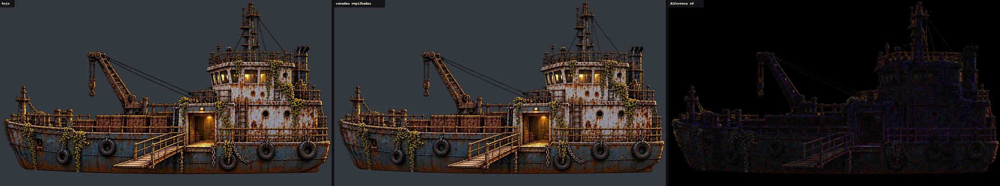
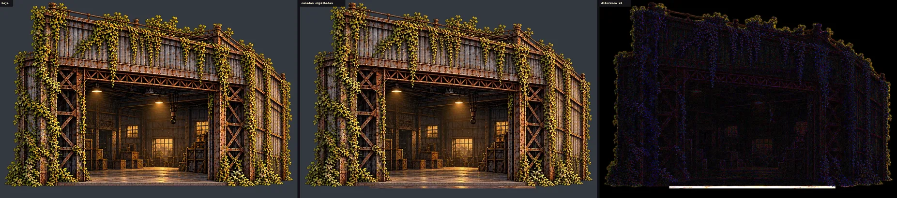
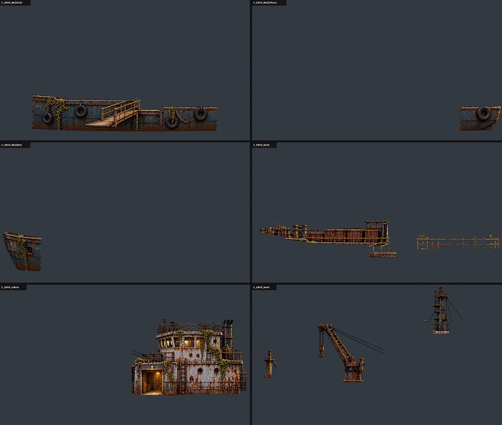
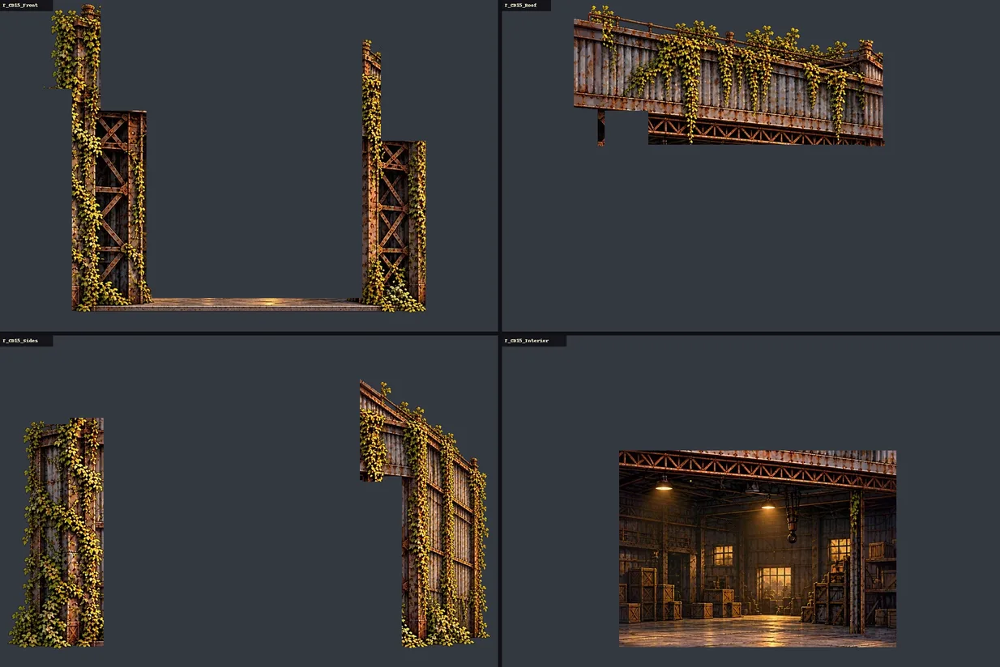
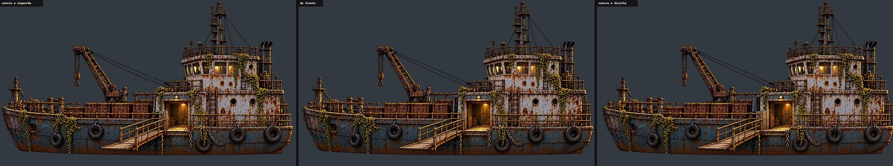
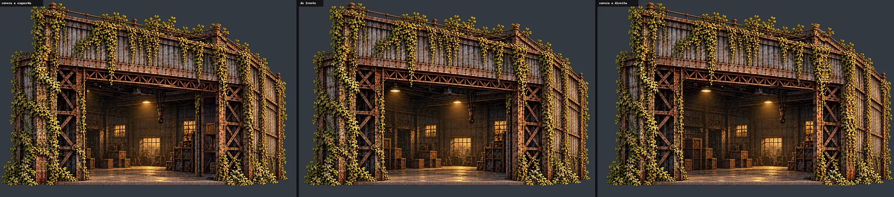

# O Armazém e o Navio do Cais em camadas (#164, para a #141)

O pedido da #164: as duas pinturas chapadas do Cais do Rio (`T_CD15`, o Armazém, e `T_CD14`, o Navio) separadas em
camadas, cada uma num WebP com alfa **no mesmo quadro e no mesmo enquadramento da pintura de hoje**, para encaixar no
lugar sem medir de novo. A integração é do Claude 2, pelo `tools/build_riverdock_depth.py` (a #141 e
[docs/qa/dock-depth.md](../qa/dock-depth.md)).

Só arte e docs: nada em `scripts/`, `data/` nem `tests/`. As pinturas de hoje (`T_CD14.webp` e `T_CD15.webp`) não mudam.

## O que entra

São 10 arquivos novos em `art/scenarios/` (608 KB), com o `.import` dos outros cenários (`lossy_quality` 0,75):

| Arquivo | O que tem | Caixa na pintura (px: x0, y0, x1, y1) | Profundidade sugerida |
|---|---|---|---|
| **O Navio** (1024 × 576) | | | |
| `T_CD14_HullMid` | o meio do casco, com a linha d'água, os pneus, as correntes e a prancha | 214, 383, 886, 539 | o plano de hoje |
| `T_CD14_HullBow` | a proa (a curva da esquerda) | 11, 368, 246, 533 | 0,25 m atrás |
| `T_CD14_HullStern` | a popa (a curva da direita) | 854, 437, 1021, 536 | 0,25 m atrás |
| `T_CD14_Deck` | o convés: a amurada, as caixas e os postes | 32, 312, 1017, 471 | 0,15 m atrás |
| `T_CD14_Cabin` | a cabine e a casa do leme, com a porta acesa | 540, 140, 1010, 456 | 0,5 m atrás |
| `T_CD14_Mast` | o mastro alto, o guindaste com o gancho, o mastro da proa e os cabos | 48, 6, 872, 401 | 0,7 m atrás |
| **O Armazém** (1024 × 683) | | | |
| `T_CD15_Front` | os pilares e as treliças da frente, e a soleira | 148, 8, 875, 645 | o plano de hoje |
| `T_CD15_Roof` | a parede de cima (o telhado) e a viga treliçada | 148, 10, 783, 301 | 0,17 m atrás |
| `T_CD15_Interior` | o interior (o vão), pintado sem a moldura e mais largo que ela | 240, 236, 812, 650 | 1,6 m atrás (o vão de hoje) |
| `T_CD15_Sides` | as duas laterais em perspectiva (as "bochechas") | 16, 20, 1009, 646 | 0,5 m atrás, ou em volume |

As caixas também estão em [cais-camadas/layers.json](cais-camadas/layers.json). As profundidades são só uma sugestão
para a integração; o gerador manda.

**A ordem, da frente para trás:** casco, convés, cabine, mastro; frente, telhado, laterais, interior. A prancha e as
correntes ficam no casco porque estão penduradas nele, na frente de tudo.

**O casco em três:** a proa e a popa saem da mesma camada do casco, cortadas em x = 230 e x = 870, e cada pedaço vai
**16 px por baixo do vizinho** (a proa até x = 246, o meio de 214 a 886, a popa de 854). Recuadas na curva, a emenda
não abre.

## O encaixe

As camadas empilhadas devolvem a pintura de hoje: cada pixel dela é de uma camada só. A diferença que sobra é a da
compressão do WebP (a média fica abaixo de 3 em 255, sem forma nenhuma).

## As camadas separadas

Onde uma camada da frente cobre a de trás, a de trás vem pintada por inteiro:
- **a cabine:** a parede de baixo atrás da amurada e da prancha, até a linha do convés;
- **o mastro e o guindaste:** o pé do guindaste atrás das caixas, a coluna do mastro atrás da amurada da casa do leme e o
  pé do mastro da proa;
- **o convés:** a amurada atrás da prancha, até a porta da cabine;
- **o interior do Armazém:** o vão uns 60 px mais largo de cada lado, em cima e embaixo, por trás dos pilares, da viga e
  da soleira;
- **o telhado:** a parede de cima atrás da coluna alta da esquerda e do poste do canto da direita;
- **as laterais:** as duas paredes em perspectiva continuam por trás dos pilares.

## A câmera passando de lado

Uma prova em 2D: cada camada desloca pela profundidade sugerida, exagerada (34 px por metro). Nenhum buraco abre: o
pedaço escondido aparece pintado. **Não é a cena 3D:** a prova de verdade é a captura do jogo depois da integração
(`tools/capture_141.gd`).

## Para integrar (é do Claude 2, na #141)

1. No `build_riverdock_depth.py`, cada camada vira um pedaço de `layered_cards` com o retângulo inteiro do card
   (`[0, 0, 1, 1]`) e a textura da camada, em vez de um retângulo cortado da pintura chapada. O alfa (cortado em 0,333,
   como os cards de hoje) faz o recorte.
2. A correção da perspectiva que o gerador já faz (`VIEW_DISTANCE`) vale igual: cada camada mais funda cresce na mesma
   razão, e as camadas batem vistas de frente.
3. O Armazém: os volumes do recuo (os batentes, o teto e o piso) podem ficar como estão; o interior novo é mais largo
   que o vão, então a borda dele fica escondida atrás dos batentes.
4. As laterais em perspectiva podem ficar num plano só, um pouco atrás, ou virar dois quads girados, um de cada lado.
5. A colisão não muda: tudo fica atrás da faixa de andar (o `test_dock_depth` confere).

## Como refazer

As edições ficam fora do Git, em `images/cais-camadas/` do projeto na Awesomic: a cabine sozinha
(`ship-cabin-only.png`), os pedaços escondidos do Navio (`ship-deck-fill.png` e `ship-mast-fill.png`) e do Armazém
(`warehouse-interior-fill.png`, `warehouse-roof-fill.png` e `warehouse-sides-fill.png`, montados dos recortes em
`crops/`). Todas são edições da pintura de hoje no Nano Banana Pro, no mesmo quadro.

Da raiz do repositório:
1. `python3 -B docs/design/cais-camadas/cut_layers.py <pasta images/cais-camadas>`: as 10 camadas e `layers.json`.
   As regiões de cada camada estão no script, da frente para trás;
2. `python3 -B docs/design/cais-camadas/preview.py`: as pranchas desta página.

## QA de design
