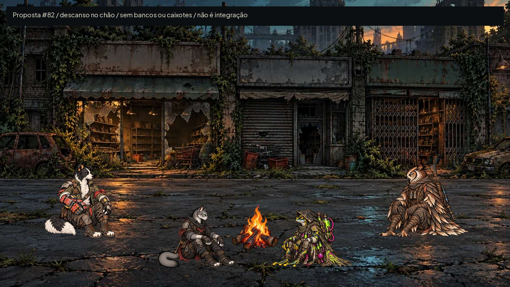
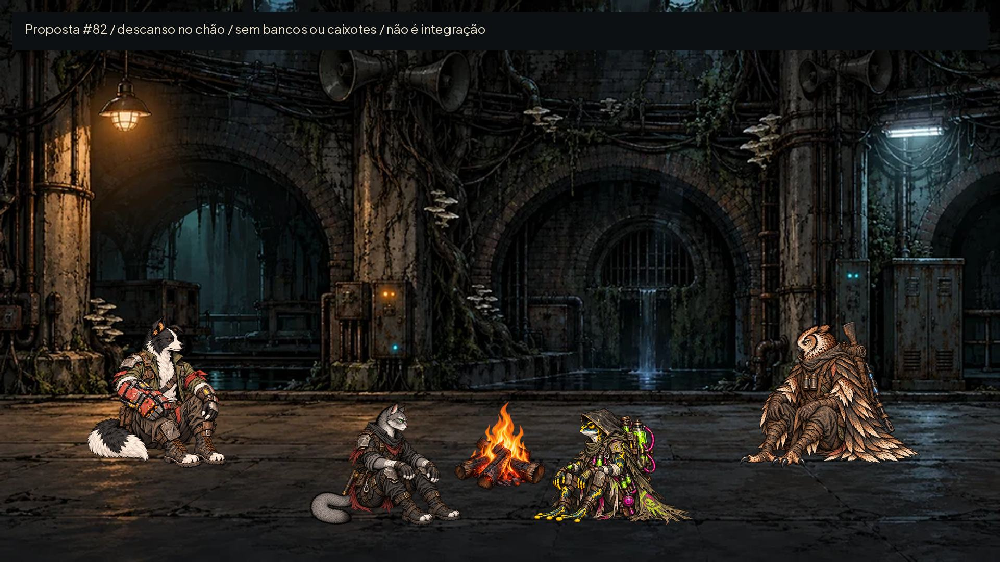
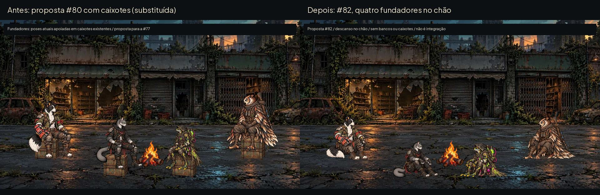
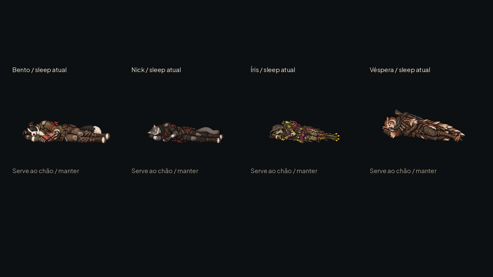
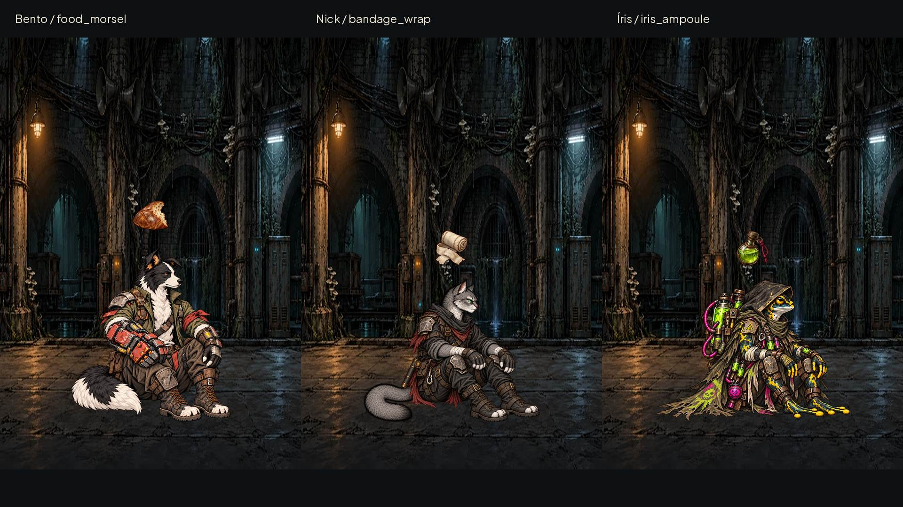
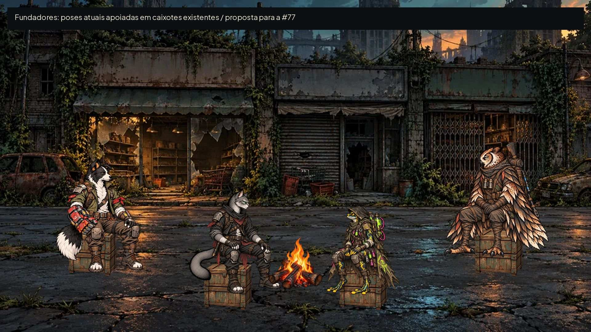

# Acampamento: descanso no chão — #82 (com histórico da #80)

## Entrega ativa da #82 — quatro fundadores no chão

Base de referência: e2afa4a. **QA de design: APROVADO na rodada2.** Esta entrega atende à correção explícita do Lucas: Bento, Nick, Íris e Véspera sentados diretamente no chão, sem banco, caixote ou apoio invisível. A antiga solução da #80 está substituída, não é alternativa aprovada para a fogueira.

Pinturas existentes Rua das Vitrines/Túneis do Eco e fogueira já usada no jogo, sem alteração. São composições de design para a futura integração da #77, não capturas de um sistema já implementado. Não revelam textos ou regras novos; nomes e equipamento seguem os fundadores existentes, conforme a consistência narrativa (§14).

### Arquivos, escala e âncoras

Quatro WebPs RGBA finais em art/camp/, já na resolução das texturas de idle; **não reduzir pela metade novamente**. Fontes PNG e cópias de composição ficam em /workspace/scratch/round82/originals/ e /workspace/generated_images/, fora do Git. Todas as prévias novas são JPG até300KB; sem texto pintado nos assets.

| Arquivo | Canvas WebP | Âncora na textura | Referência corporal original | Canvas / âncora originais, usados por show_art |
|---|---|---|---|---|
| bento_seat_floor.webp | 543×724 | 236,5;714,5 | 1419px | 1086×1448 /473;1429 |
| nick_seat_floor.webp | 589×668 | 244,25;643 | 1255px | 1178×1335 /488,5;1286 |
| iris_seat_floor.webp | 589×668 | 293,75;632 | 1208px | 1178×1335 /587,5;1264 |
| vespera_seat_floor.webp | 589×668 | 225,5;648,5 | 1271px | 1178×1335 /451;1297 |

Origem superior esquerda; sem9-slice. **Único payload oficial: poses[].show_art** no [contrato atualizado](camp/contract.json), com os mesmos canvas, âncora e body_reference_pixels ORIGINAIS do idle de cada fundador. AHSpriteCard já aplica a razão textura/canvas; não usar os campos texture_* como segundo payload. Nenhum id ou dado de produção foi alterado.

[Comparação física Bento/Nick](camp/founder_scale_bento_nick.jpg) · [Comparação física Íris/Véspera](camp/founder_scale_iris_vespera.jpg). Escala comum240px/m, linha de chão idêntica e nenhuma normalização pela altura da pose. Joelhos/cauda/capa recolhidos, sem aumentar a cabeça. Bento mantém o braço mecânico vermelho; Nick mantém a cauda cinza e lenço vermelho; Íris mantém capuz, cilindros e mangueiras; Véspera mantém rifle na mochila e binóculos.

Na Véspera, o alfa fica assimétrico no canvas, como no idle: isso permite conservar o tamanho do equipamento sem diminuir a personagem só para centralizar a capa. O pivô do manifesto permanece225,5;648,5 na textura. Não recalcular o pivô pelo centro da bbox. O apoio de chão conserva as coordenadas fracionárias; a rasterização do alfa pode arredondar até0,5px.

### Pranchas, clique e grupo misto

Mesmas âncoras de chão da #80: (300,900), (740,1010), (1180,1010), (1620,900). A densidade das novas composições é260px/m, aplicada igualmente a fundadores e recrutas: deixa os retângulos completos das texturas separados mesmo com os pivôs assimétricos dos fundadores, sem mudar sua escala física relativa. A ordem é fundo (Bento/Véspera), frente (Nick/Íris), fogo por último; à direita o sprite é espelhado com âncora X=largura−X.

O contrato registra bboxes, retângulos de textura, espelhamento e ordem de desenho em founder_layouts.founders e founder_layouts.mixed. São apoios2D da proposta, não coordenadas3D universais. Clique no corpo/alfa visível, sem deixar o canvas transparente bloquear outro herói. A entrada real é da #77.

| Composição | Normal | Cinza | Redução real a40% |
|---|---|---|---|
| Quatro fundadores / rua | [Prancha](camp/founders_floor_street.jpg) | [Cinza](camp/founders_floor_street_gray.jpg) | [40%](camp/founders_floor_street_40.jpg) |
| Quatro fundadores / cenário | [Prancha](camp/founders_floor_tunnel.jpg) | [Cinza](camp/founders_floor_tunnel_gray.jpg) | [40%](camp/founders_floor_tunnel_40.jpg) |
| Bento + Íris + gato/coruja recrutas / rua | [Prancha](camp/mixed_floor_street.jpg) | [Cinza](camp/mixed_floor_street_gray.jpg) | [40%](camp/mixed_floor_street_40.jpg) |
| Mesmo grupo misto / cenário | [Prancha](camp/mixed_floor_tunnel.jpg) | [Cinza](camp/mixed_floor_tunnel_gray.jpg) | [40%](camp/mixed_floor_tunnel_40.jpg) |

Antes: proposta histórica da #80, não um screenshot do acampamento no runtime. Depois: proposta corrigida da #82, com os quatro fundadores no piso. A área central da fogueira fica livre; nenhum corpo ou pé é cortado pelo fogo ou por outro personagem.

### Deitados: reaproveitar, sem refazer

Os quatro *_sleep atuais de art/station/poses/ servem ao piso: corpo inteiro de lado, olhos fechados, sem cama incorporada. **Não foram refeitos nem sobrescritos.** Preservar o show_art de data/presentation/station_poses.json para cada um; essas fontes têm seu próprio canvas e sua referência corporal, não os da nova pose de chão. founder_sleep_review no contrato registra decisão, payload e SHA256 dos quatro arquivos existentes. A checagem falha se essas fontes mudarem.

### Efeitos sobre fundadores no chão

[Cinza](camp/founder_floor_effects_gray.jpg) · [40%](camp/founder_floor_effects_40.jpg). Peças existentes da #80, sem novos arquivos de efeito: comer sobre Bento, curativo sobre Nick, ampola sobre a própria Íris. Os três estão sentados diretamente no piso. Os símbolos ficam acima do alfa visível da cabeça, sem cobrir rosto ou braço mecânico; não atribuem habilidade nem consumo novo. A cor não é a única pista (mordida, rolo de tecido, frasco). Tempos e Reduzir efeitos permanecem os da #80.

### QA de design da #82

**Rodada1 — VEREDITO: REPROVADO.** Média — vespera_seat_floor.webp: o enquadramento simétrico comprimia visualmente rifle/binóculos e deixava a fundadora pequena diante do idle e de Bento. Sugestão: usar a largura livre do canvas com alfa assimétrico, sem mudar pivô nem deformar o corpo. Corrigido por escala uniforme e reposicionamento do alfa (altura356→419px; bbox final8;230;521;649), preservando os metadados do idle. Não foi necessário refazer a pintura nem cortar a capa.

**Rodada2 — VEREDITO: APROVADO.** Conferidos os quatro finais contra os idles, poses inteiras sentadas no chão, sem suportes, marcas de identidade/equipamento preservadas e proporções compatíveis. Retângulos separados nas composições de quatro fundadores e no grupo misto, inclusive na redução40% e em cinza sobre rua/cenário; a leitura não depende de verde/vermelho. Contrato oficial, nomes, alfas e medidas completos. Os sleep existentes servem ao chão e permanecem inalterados. As três peças de efeito aparecem sobre fundadores, ampola na Íris. Sem problemas altos/médios restantes. Observação baixa: seleção/input, animações e adaptação de câmera precisam da integração e QA do Claude na #77; a composição não certifica runtime.

Validação de documentação: python docs/design/camp/check_contract.py compara os12 payloads (8 recrutas +4 fundadores) ao manifesto atual, dimensões nativas, âncoras e referências; confere as três composições e os quatro sleep sem alteração. Dados e checagens específicos da #82 em [founder_floor_checks.json](camp/founder_floor_checks.json). Godot4.7.2: **40/40 testes**, paridade48/48, saída0 em118,3s (avisos de recursos/RIDs no encerramento). Prova real com AHSpriteCard.show_art: quatro novas poses carregadas e comparadas ao idle, com **quad.size e center_offset idênticos**. O controle negativo de âncora de fundador incorreta foi rejeitado. Nada em scripts/,data/,tests/,tools/ ou ids foi modificado. A integração continua com Claude; a entrega de arte antes dela segue o pedido explícito da #82.

---

## Entrega da #80 e histórico (recrutas continuam válidos; caixotes substituídos)

Entrega para integração pelo Claude na #77, base `83e2717`. **QA de design: APROVADO na rodada4.** A proposta segue a decisão de selecionar o herói pelo corpo; esta entrega fornece arte e medidas para a futura integração da #77, sem implementar input.

As miniaturas acima servem à inspeção. Comparações na **mesma escala física e linha de chão**, sem normalizar altura de pose: [cão/gato](camp/scale_dog_cat.jpg) e [sapo/coruja](camp/scale_frog_owl.jpg), a210px/m. As referências são os idles atuais em `art/combat/recruits/`, não os fundadores nem personagens de outra espécie.

## Oito poses finais

WebP RGBA em `art/camp/`, na resolução nativa das texturas usadas pelo jogo. Originais das folhas geradas em `/workspace/generated_images/`, referências e cópias de trabalho em `/workspace/scratch/round79_80/originals/`, fora do repositório. Não há PNG novo nem fonte pesada no Git. Prévias JPG abaixo de300KB, isoladas do jogo por `docs/.gdignore`.

| Arquivos em `art/camp/` | Canvas de cada WebP | Âncora textura x,y | Referência corporal textura | Referência no manifesto original |
|---|---|---|---|---|
| `dog_recruit_01_seat.webp`, `dog_recruit_01_sleep.webp` | 543×724 | 271;712,5 | 692,5px | canvas1086×1448; âncora542;1425; corpo1385px |
| `cat_recruit_01_seat.webp`, `cat_recruit_01_sleep.webp` | 589×668 | 294,75;656 | 630px | canvas1178×1336; âncora589,5;1312; corpo1260px |
| `frog_recruit_01_seat.webp`, `frog_recruit_01_sleep.webp` | 589×668 | 294,25;655,5 | 609,5px | canvas1178×1336; âncora588,5;1311; corpo1219px |
| `owl_recruit_01_seat.webp`, `owl_recruit_01_sleep.webp` | 589×668 | 294,75;656 | 636px | canvas1178×1336; âncora589,5;1312; corpo1272px |

Origem superior esquerda; sem9-slice. Os valores são **os mesmos dos idles** de `data/presentation/combat_art.json`, divididos por2 para a textura final. O [contrato](camp/contract.json) registra ambos os espaços de coordenadas, bbox, arquivo e estado. **Entrada oficial do runtime: somente poses[].show_art**, marcada por use no contrato. Ela contém os quatro campos file/canvas/anchor/body_reference_pixels, nas mesmas coordenadas ORIGINAIS do idle. AHSpriteCard já calcula a razão textura/canvas (0,5), exatamente como faz no idle atual. Os campos texture_* e manifest_* são apenas diagnóstico, nunca entradas concorrentes. **Não dividir estes WebPs novamente pela metade**; já são produção. Manter `manifest_canvas`, `manifest_anchor` e `body_reference_pixels` originais, como no contrato.

`seat` é descanso **sentado no chão**, com mãos nos joelhos, postura calma e olhos abertos; `sleep` é deitado de lado, olhos fechados, pernas recolhidas. Equipamento permanece preso, sem itens flutuantes. O pivô é a mesma âncora de chão usada pelos pés do idle; na pose deitada não se recalcula a âncora na ponta dos dedos, nem se estica o corpo para ocupar a altura de pé. O arredondamento da colocação do alfa tem tolerância0,5px; os metadados conservam os valores fracionários exatos. Espelhar no runtime exige `anchor_x = largura − anchor_x`; Y não muda.

Identidades preservadas: cão castanho de orelha caída e casaco azul gasto; gato laranja com colete claro, lenço azul e corda; sapo verde sem o capuz/cilindros da Íris, com capa de rede e frasco âmbar; coruja de disco facial claro em coração e capa cinza com fechos de latão. Descanso não representa dano, derrota nem novo estado de regra. Nenhum nome de personagem foi inventado.

## Em volta da fogueira

Pinturas existentes: `art/ui/scenarios/rua-das-vitrines.webp` e `art/ui/scenarios/tuneis-do-eco.webp`; fogueira existente `art/street/campfire-v1.png`, sem alteração. Não há fundo novo duplicado. As personagens à direita são espelhadas apenas na composição. A ordem de desenho é cão/coruja ao fundo, gato/sapo à frente e fogueira por último. O contrato registra a bbox visível e o retângulo inteiro da textura de cada personagem; nenhum desses quatro retângulos se sobrepõe na composição final. A área clicável deve usar o alfa visível (corte24), sem deixar a transparência da textura bloquear outro corpo. A rua e o cenário são estudos de encaixe, não capturas da implementação nem autorização para revelar cenário bloqueado.

| Posição de exemplo | Âncora de chão na prancha1920×1080 | Orientação |
|---|---|---|
| Cão, fundo/esquerda | (300,900) | Direita |
| Gato, frente/esquerda | (740,1010) | Direita |
| Sapo, frente/direita | (1180,1010) | Esquerda, espelhado |
| Coruja, fundo/direita | (1620,900) | Esquerda, espelhada |

Pranchas a300px/m com as alturas físicas atuais1,72/1,50/1,38/1,66m e referência corporal do idle de cada classe. A fogueira ocupa aproximadamente(850,750)–(1070,970), à frente do grupo. As posições da frente foram afastadas para que os pés não invadam o fogo e cada corpo continue alcançável. A câmera e os pontos do cenário real determinam o posicionamento final; o contrato traz os apoios de composição, não coordenadas3D universais.

[Rua em cinza](camp/camp_street_gray.jpg) · [Rua a40%](camp/camp_street_40.jpg) · [Cenário em cinza](camp/camp_tunnel_gray.jpg) · [Cenário a40%](camp/camp_tunnel_40.jpg)

Antes: captura real da exploração desta base. Depois: composição de descanso sobre a pintura existente. Não é uma captura do sistema de acampamento já integrado. Não houve mudança na rua, colisão, inventário ou save.

### Fundadores: revisão original da #80 — caixotes SUBSTITUÍDOS pela #82

Os quatro `*_sleep` de `art/station/poses/` já servem ao piso, preservando suas próprias âncoras e referências de `station_poses.json`. Reusar essas fontes, sem novos arquivos de fundador.

**SUBSTITUÍDO pela #82:** a proposta de fundadores apoiados em caixotes foi recusada pelo Lucas. A imagem abaixo é somente histórico; não usá-la para integrar a fogueira. A solução ativa são os quatro arquivos *_seat_floor.webp e founder_floor_seat_solution no contrato. As poses antigas *_seat continuam próprias para banco/vagão e não foram sobrescritas.

O contrato mantém founder_seat_solution com active=false e status=superseded_by_issue_82 para evitar consumo acidental. Não usar caixotes ou banco na encenação de descanso desta entrega.

## Comer e curar: três peças para animação

[Sobre heróis em cinza](camp/effects_on_heroes_gray.jpg) · [Sobre heróis a40%](camp/effects_on_heroes_40.jpg)

| Arquivo | Canvas/âncora | Forma que identifica a ação |
|---|---|---|
| `art/camp/food_morsel.webp` | 192×192; centro(96,96) | Pedaço de alimento com mordida e miolo claro |
| `art/camp/bandage_wrap.webp` | 192×192; centro(96,96) | Rolo de tecido claro com pontas cruzadas |
| `art/camp/iris_ampoule.webp` | 192×192; centro(96,96) | Ampola arredondada com tampa e laço, linguagem verde/magenta da Íris |

São peças animáveis, opção permitida pela issue, não atlas de quadros nem novos itens do inventário. Sem letras, números de cura, símbolos de HUD ou texto pintado. Na prancha histórica da #80, a Íris usava um caixote (proposta substituída); na prancha ativa da #82, a ampola está sobre a **Íris fundadora sentada no chão**, para não atribuir sua identidade/habilidade ao recruta sapo. A imagem não define se outros aliados podem usar o item: disponibilidade, alvo e consumo vêm das regras existentes. A regra de consistência narrativa (§14) foi reconferida, sem criar capacidade nova por ilustração. Nenhuma tintura global é necessária; o rolo, a mordida e a silhueta da ampola identificam a ação em cinza. A cor verde da ampola não significa por si só cura/bom. Dica/rótulo da ação vêm do jogo e seguem o kit.

Área ativa contida em(20,20)–(172,172); respiro mínimo20. Tamanho sugerido na tela64×64, até96×96 na aproximação. A prancha pequena testa32/48/64 de verdade em fundos escuro/claro e cinza. A prévia sobre heróis usa96 para mostrar o acabamento, com ponto acima da cabeça visível, não acima da borda vazia do canvas do personagem. Sem9-slice.

Animação proposta600ms, ease-out: em0ms opacidade0/escala0,8; em100ms opacidade1/escala1/deslocamento−4px; em400ms mantém opacidade1/deslocamento−12; em600ms opacidade0/deslocamento−20. Ancorar sobre a cabeça do **herói selecionado**, com folga16; não cobrir rosto, nome nem alvo. `Reduzir efeitos`: peça estática400ms, sem deslocamento ou escala. A resposta visual acompanha a ação realmente confirmada; não antecipa consumo, não cria cura ou comida grátis, não altera nenhum valor.

## Integração pela #77 e pipeline

Proposta de engenharia para o Claude, **a validar na #77, não uma mudança de ferramenta já decidida**: **estender `tools/sync_combat_art.py` com um registro de fontes já convertidas em WebP**, preservando os arquivos finais de `art/camp/` e as chaves de variante atuais. Esse ramo não deve buscar PNG no projeto Unreal nem reduzir novamente a textura. O contrato fornece uma entrada oficial show_art pronta, com file/canvas/anchor/body_reference_pixels, para gerar as entradas de apresentação de descanso; o consumidor usa a mesma estrutura `{file,canvas,anchor,body_reference_pixels}` já aceita por `AHSpriteCard.show_art` e pelas poses da Estação. A #77 define o registro de apresentação no jogo e o usa ao entrar/sair do acampamento, mantendo o idle como fallback até a integração.

Assim, o sync futuro preserva os novos registros em vez de apagá-los por procurar apenas fontes antigas. Não foi criado um segundo importador, editado o manifesto nem executado o sync neste PR. Efeitos ficam no registro visual do acampamento da #77, sem virar ícones/itens de inventário. Esse é o encaminhamento de integração, não uma afirmação de que as pastas novas já são consumidas pelo jogo.

## Histórico de QA da #80 — não aprova a solução de caixotes após a #82

**Rodada1 — VEREDITO: REPROVADO.** Alta — folhas geradas originais de sapo/coruja: dedos cortados na borda direita da pose deitada. Sugestão: corrigir as fontes com margens reais, antes da conversão; fontes regeneradas e extração refeita, sem tentar esconder o corte com transparência. Média — primeira composição de acampamento: pés de gato/sapo muito próximos da fogueira; reposicionados para660/1260. Média — prévia inicial dos efeitos: ponto calculado pela borda do canvas transparente deixava o efeito longe da cabeça; passou a usar o topo do alfa visível. Correções aplicadas às versões normal, cinza e40%.

**Rodada2 — VEREDITO: APROVADO.** Oito corpos completos, equipamento e identidades coerentes com os idles, quatro sentado/deitado; canvas, referência e âncoras conservados; sem borda alfa cortada nem componentes fortes soltos. Comparadas pranchas físicas a210px/m sem equalizar alturas e composições sobre duas pinturas existentes. Conferidos cinza e40%: corpos separados, seleção pelo corpo viável visualmente, fogo sem cortar pés. Três efeitos distintos por forma em32/48/64 e sobre heróis. Todos os finais são WebP na resolução de uso; prévias abaixo de300KB; originais fora do Git. Sem problema alto/médio restante. Observações baixas: o foco real, câmera, animação, som e consumo/cura dependem do Claude na #77; os assentos dos fundadores precisam de apoio físico se forem reutilizados na fogueira.

[Checagens finais](camp/checks.json) registram dimensões, hashes e invariantes do alfa/manifesto. Godot4.7.2:39/39 testes da base, paridade48/48, saída0; nova validação final do lote indicada no PR. Não há alteração em scripts/,data/,tests/ nem ids. A referência #73 ainda não chegou; nenhum projeto Unreal foi baixado.

Validação final do lote: **39/39**, paridade48/48, saída0 em122,4s. Os15 WebPs novos foram carregados como Texture2D na Godot4.7.2: dimensões corretas, janelas alfa0 e emenda do túnel0 após a importação. Metadados de importação sem perdas e mipmaps incluídos para preservar esses invariantes. Avisos de recursos/RIDs no encerramento permanecem; nenhuma mudança no código para tratá-los.

**Rodada3 — VEREDITO: REPROVADO (revisão independente).** Média — na composição anterior, gato/sapo encobriam partes do cão/coruja, apesar de a escolha ocorrer pelo corpo. Média — faltava explicitar como a #77 incorporaria as poses ao pipeline. Baixa — ampola da Íris mostrada sobre recruta podia sugerir uma capacidade não confirmada; faltava uma solução concreta de apoio aos fundadores.

**Rodada4 — VEREDITO: APROVADO.** Âncoras refeitas para300/740/1180/1620: retângulos de textura e bboxes visíveis disjuntos, com ordem de desenho e regra de clique no contrato; pranchas normal/cinza/40% regeneradas em ambos os cenários. Ampola agora ilustrada sobre a própria Íris com apoio físico; nenhuma regra de uso por recruta inferida. Nova prancha dos quatro fundadores mostra caixotes existentes sob os quadris. Encaminhamento da #77 explícito: ampliar sync_combat_art.py para WebPs prontos, sem dupla redução ou dependência de originais no Git, usando o contrato de AHSpriteCard. Sem problemas altos/médios restantes. A prova é de geometria/arte; input real continua a cargo da integração. Os15 WebPs não mudaram nesta revisão; checagens e39/39 testes seguem válidos.

Esclarecimento final de integração, sem nova mudança de arte: poses[].show_art é a única entrada oficial. Preserva canvas/âncora/referência originais do idle; Texture2D continua na metade, como já ocorre no jogo. Os outros campos são diagnóstico. A proposta de extensão do sync fica pendente de validação técnica do Claude na #77, sem bloquear a revisão destes arquivos de design nem afirmar que o código existe.

Checagem reproduzível: executar python docs/design/camp/check_contract.py. Compara os payloads oficiais ao manifesto atual, as dimensões das texturas, as coordenadas auxiliares e os seis pares de retângulos da composição; retorna erro em qualquer divergência. A checagem foi exercitada também com uma cópia temporária de contrato contendo âncora errada, que foi rejeitada.
