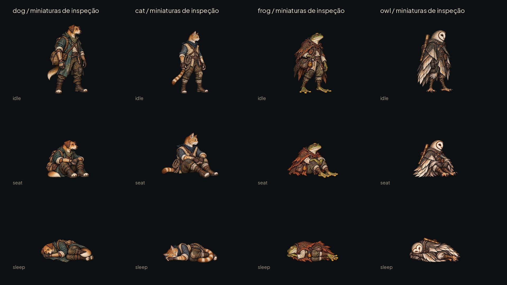
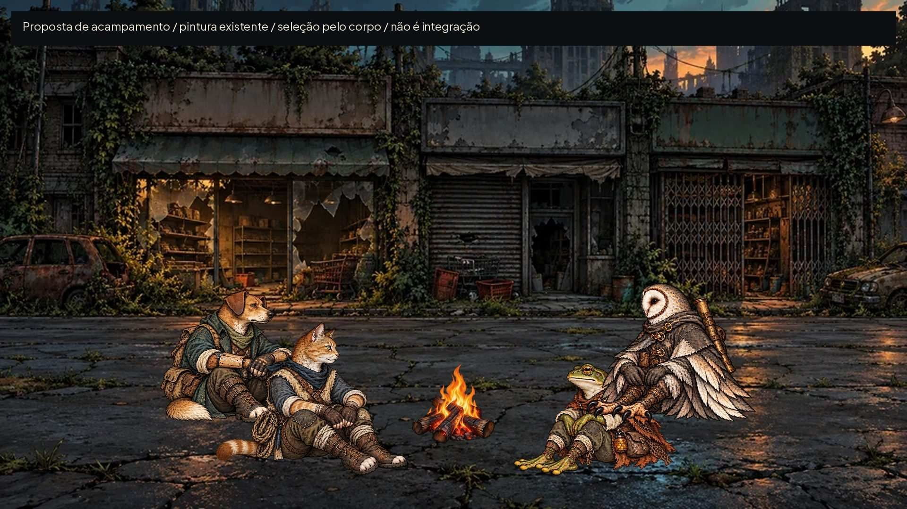
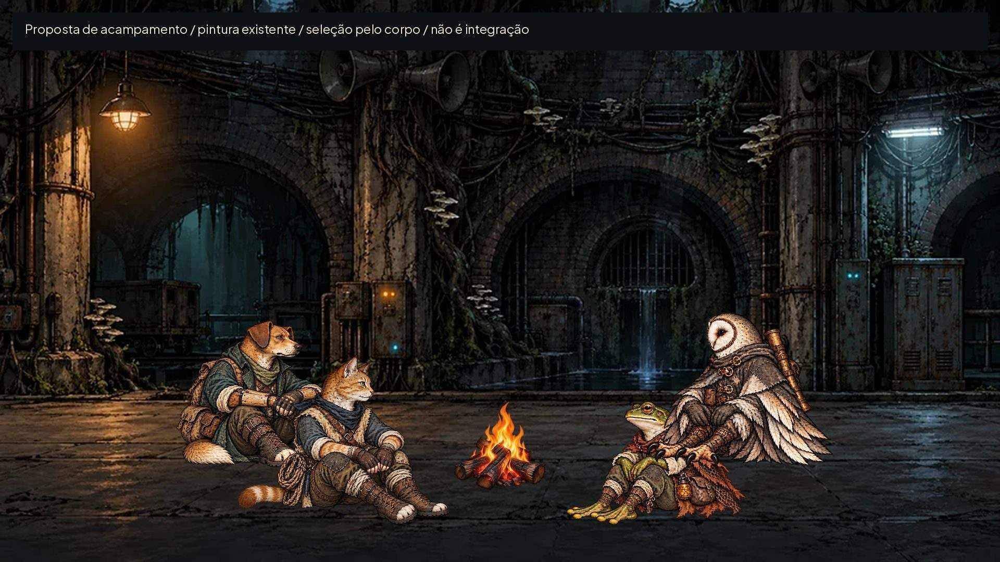
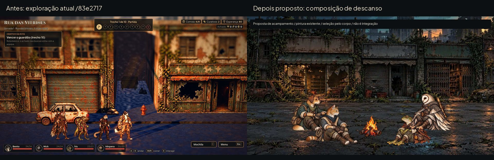
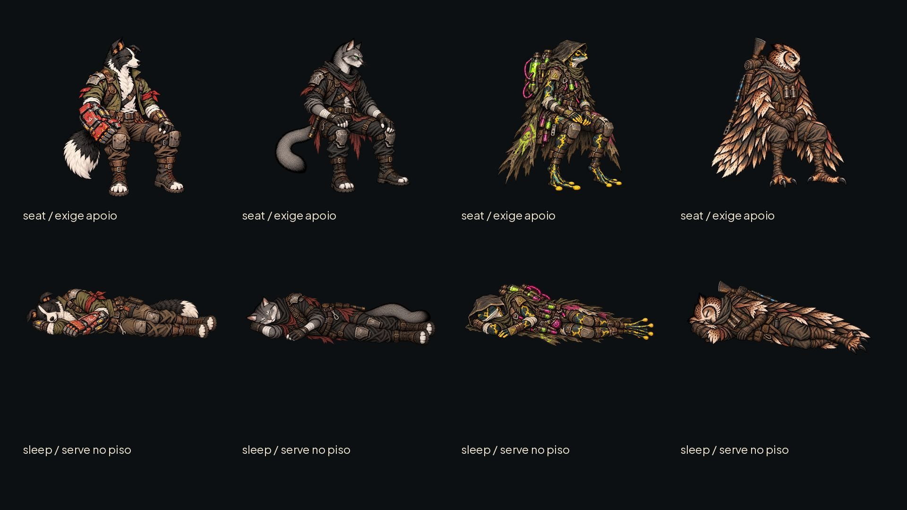
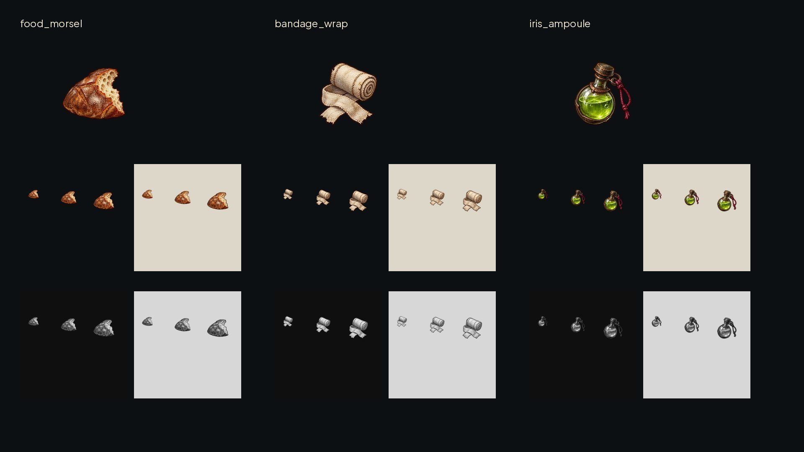
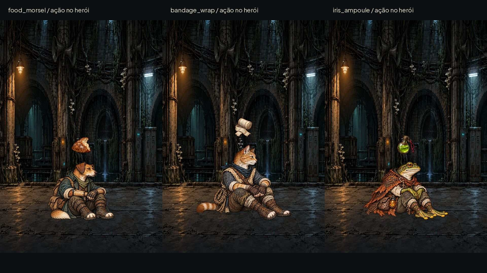

# Acampamento: descanso e efeitos — #80

Entrega para integração pelo Claude na #77, base `83e2717`. **QA de design: APROVADO na rodada2.** O jogo continua selecionando o herói pelo corpo; esta entrega fornece arte e medidas, sem alterar esse comportamento.

As miniaturas acima servem à inspeção. Comparações na **mesma escala física e linha de chão**, sem normalizar altura de pose: [cão/gato](camp/scale_dog_cat.jpg) e [sapo/coruja](camp/scale_frog_owl.jpg), a210px/m. As referências são os idles atuais em `art/combat/recruits/`, não os fundadores nem personagens de outra espécie.

## Oito poses finais

WebP RGBA em `art/camp/`, na resolução nativa das texturas usadas pelo jogo. Originais das folhas geradas em `/workspace/generated_images/`, referências e cópias de trabalho em `/workspace/scratch/round79_80/originals/`, fora do repositório. Não há PNG novo nem fonte pesada no Git. Prévias JPG abaixo de300KB, isoladas do jogo por `docs/.gdignore`.

| Arquivos em `art/camp/` | Canvas de cada WebP | Âncora textura x,y | Referência corporal textura | Referência no manifesto original |
|---|---|---|---|---|
| `dog_recruit_01_seat.webp`, `dog_recruit_01_sleep.webp` | 543×724 | 271;712,5 | 692,5px | canvas1086×1448; âncora542;1425; corpo1385px |
| `cat_recruit_01_seat.webp`, `cat_recruit_01_sleep.webp` | 589×668 | 294,75;656 | 630px | canvas1178×1336; âncora589,5;1312; corpo1260px |
| `frog_recruit_01_seat.webp`, `frog_recruit_01_sleep.webp` | 589×668 | 294,25;655,5 | 609,5px | canvas1178×1336; âncora588,5;1311; corpo1219px |
| `owl_recruit_01_seat.webp`, `owl_recruit_01_sleep.webp` | 589×668 | 294,75;656 | 636px | canvas1178×1336; âncora589,5;1312; corpo1272px |

Origem superior esquerda; sem9-slice. Os valores são **os mesmos dos idles** de `data/presentation/combat_art.json`, divididos por2 para a textura final. O [contrato](camp/contract.json) registra ambos os espaços de coordenadas, bbox, arquivo e estado. **Não dividir estes WebPs novamente pela metade**; já são produção. Se o manifesto continuar usando pixels originais, manter `manifest_canvas`, `manifest_anchor` e `body_reference_pixels` originais, como no contrato.

`seat` é descanso **sentado no chão**, com mãos nos joelhos, postura calma e olhos abertos; `sleep` é deitado de lado, olhos fechados, pernas recolhidas. Equipamento permanece preso, sem itens flutuantes. O pivô é a mesma âncora de chão usada pelos pés do idle; na pose deitada não se recalcula a âncora na ponta dos dedos, nem se estica o corpo para ocupar a altura de pé. O arredondamento da colocação do alfa tem tolerância0,5px; os metadados conservam os valores fracionários exatos. Espelhar no runtime exige `anchor_x = largura − anchor_x`; Y não muda.

Identidades preservadas: cão castanho de orelha caída e casaco azul gasto; gato laranja com colete claro, lenço azul e corda; sapo verde sem o capuz/cilindros da Íris, com capa de rede e frasco âmbar; coruja de disco facial claro em coração e capa cinza com fechos de latão. Descanso não representa dano, derrota nem novo estado de regra. Nenhum nome de personagem foi inventado.

## Em volta da fogueira

Pinturas existentes: `art/ui/scenarios/rua-das-vitrines.webp` e `art/ui/scenarios/tuneis-do-eco.webp`; fogueira existente `art/street/campfire-v1.png`, sem alteração. Não há fundo novo duplicado. As personagens à direita são espelhadas apenas na composição. A rua e o cenário são estudos de encaixe, não capturas da implementação nem autorização para revelar cenário bloqueado.

| Posição de exemplo | Âncora de chão na prancha1920×1080 | Orientação |
|---|---|---|
| Cão, fundo/esquerda | (500,900) | Direita |
| Gato, frente/esquerda | (660,1010) | Direita |
| Sapo, frente/direita | (1260,1010) | Esquerda, espelhado |
| Coruja, fundo/direita | (1420,900) | Esquerda, espelhada |

Pranchas a300px/m com as alturas físicas atuais1,72/1,50/1,38/1,66m e referência corporal do idle de cada classe. A fogueira ocupa aproximadamente(850,750)–(1070,970), à frente do grupo. As posições da frente foram afastadas para que os pés não invadam o fogo e cada corpo continue alcançável. A câmera e os pontos do cenário real determinam o posicionamento final; o contrato traz os apoios de composição, não coordenadas3D universais.

[Rua em cinza](camp/camp_street_gray.jpg) · [Rua a40%](camp/camp_street_40.jpg) · [Cenário em cinza](camp/camp_tunnel_gray.jpg) · [Cenário a40%](camp/camp_tunnel_40.jpg)

Antes: captura real da exploração desta base. Depois: composição de descanso sobre a pintura existente. Não é uma captura do sistema de acampamento já integrado. Não houve mudança na rua, colisão, inventário ou save.

### Fundadores: o que já serve

Os quatro `*_sleep` de `art/station/poses/` já servem ao piso, preservando suas próprias âncoras e referências de `station_poses.json`. Reusar essas fontes, sem novos arquivos de fundador.

Os quatro `*_seat` atuais são **poses para assento**, com pernas pendentes; servem ao vagão da #79 e a um acampamento com banco, caixa ou apoio físico compatível. **Não pousá-las diretamente no chão**, pois os quadris ficariam suspensos. Se a encenação da #77 exigir todos os fundadores sentados diretamente no piso, ela pede uma versão própria; esta issue entrega as classes/recrutas que ainda não tinham descanso. Essa necessidade fica explícita para o Claude, sem aprovar uma pose flutuante. Os novos `*_seat` dos recrutas são poses de chão, não substituições automáticas das poses de banco.

## Comer e curar: três peças para animação

[Sobre heróis em cinza](camp/effects_on_heroes_gray.jpg) · [Sobre heróis a40%](camp/effects_on_heroes_40.jpg)

| Arquivo | Canvas/âncora | Forma que identifica a ação |
|---|---|---|
| `art/camp/food_morsel.webp` | 192×192; centro(96,96) | Pedaço de alimento com mordida e miolo claro |
| `art/camp/bandage_wrap.webp` | 192×192; centro(96,96) | Rolo de tecido claro com pontas cruzadas |
| `art/camp/iris_ampoule.webp` | 192×192; centro(96,96) | Ampola arredondada com tampa e laço, linguagem verde/magenta da Íris |

São peças animáveis, opção permitida pela issue, não atlas de quadros nem novos itens do inventário. Sem letras, números de cura, símbolos de HUD ou texto pintado. Nenhuma tintura global é necessária; o rolo, a mordida e a silhueta da ampola identificam a ação em cinza. A cor verde da ampola não significa por si só cura/bom. Dica/rótulo da ação vêm do jogo e seguem o kit.

Área ativa contida em(20,20)–(172,172); respiro mínimo20. Tamanho sugerido na tela64×64, até96×96 na aproximação. A prancha pequena testa32/48/64 de verdade em fundos escuro/claro e cinza. A prévia sobre heróis usa96 para mostrar o acabamento, com ponto acima da cabeça visível, não acima da borda vazia do canvas do personagem. Sem9-slice.

Animação proposta600ms, ease-out: em0ms opacidade0/escala0,8; em100ms opacidade1/escala1/deslocamento−4px; em400ms mantém opacidade1/deslocamento−12; em600ms opacidade0/deslocamento−20. Ancorar sobre a cabeça do **herói selecionado**, com folga16; não cobrir rosto, nome nem alvo. `Reduzir efeitos`: peça estática400ms, sem deslocamento ou escala. A resposta visual acompanha a ação realmente confirmada; não antecipa consumo, não cria cura ou comida grátis, não altera nenhum valor.

## QA de design

**Rodada1 — VEREDITO: REPROVADO.** Alta — folhas geradas originais de sapo/coruja: dedos cortados na borda direita da pose deitada. Sugestão: corrigir as fontes com margens reais, antes da conversão; fontes regeneradas e extração refeita, sem tentar esconder o corte com transparência. Média — primeira composição de acampamento: pés de gato/sapo muito próximos da fogueira; reposicionados para660/1260. Média — prévia inicial dos efeitos: ponto calculado pela borda do canvas transparente deixava o efeito longe da cabeça; passou a usar o topo do alfa visível. Correções aplicadas às versões normal, cinza e40%.

**Rodada2 — VEREDITO: APROVADO.** Oito corpos completos, equipamento e identidades coerentes com os idles, quatro sentado/deitado; canvas, referência e âncoras conservados; sem borda alfa cortada nem componentes fortes soltos. Comparadas pranchas físicas a210px/m sem equalizar alturas e composições sobre duas pinturas existentes. Conferidos cinza e40%: corpos separados, seleção pelo corpo viável visualmente, fogo sem cortar pés. Três efeitos distintos por forma em32/48/64 e sobre heróis. Todos os finais são WebP na resolução de uso; prévias abaixo de300KB; originais fora do Git. Sem problema alto/médio restante. Observações baixas: o foco real, câmera, animação, som e consumo/cura dependem do Claude na #77; os assentos dos fundadores precisam de apoio físico se forem reutilizados na fogueira.

[Checagens finais](camp/checks.json) registram dimensões, hashes e invariantes do alfa/manifesto. Godot4.7.2:39/39 testes da base, paridade48/48, saída0; nova validação final do lote indicada no PR. Não há alteração em scripts/,data/,tests/ nem ids. A referência #73 ainda não chegou; nenhum projeto Unreal foi baixado.

Validação final do lote: **39/39**, paridade48/48, saída0 em122,4s. Os15 WebPs novos foram carregados como Texture2D na Godot4.7.2: dimensões corretas, janelas alfa0 e emenda do túnel0 após a importação. Metadados de importação sem perdas e mipmaps incluídos para preservar esses invariantes. Avisos de recursos/RIDs no encerramento permanecem; nenhuma mudança no código para tratá-los.
