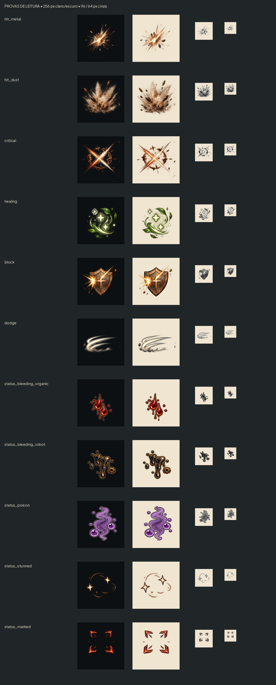
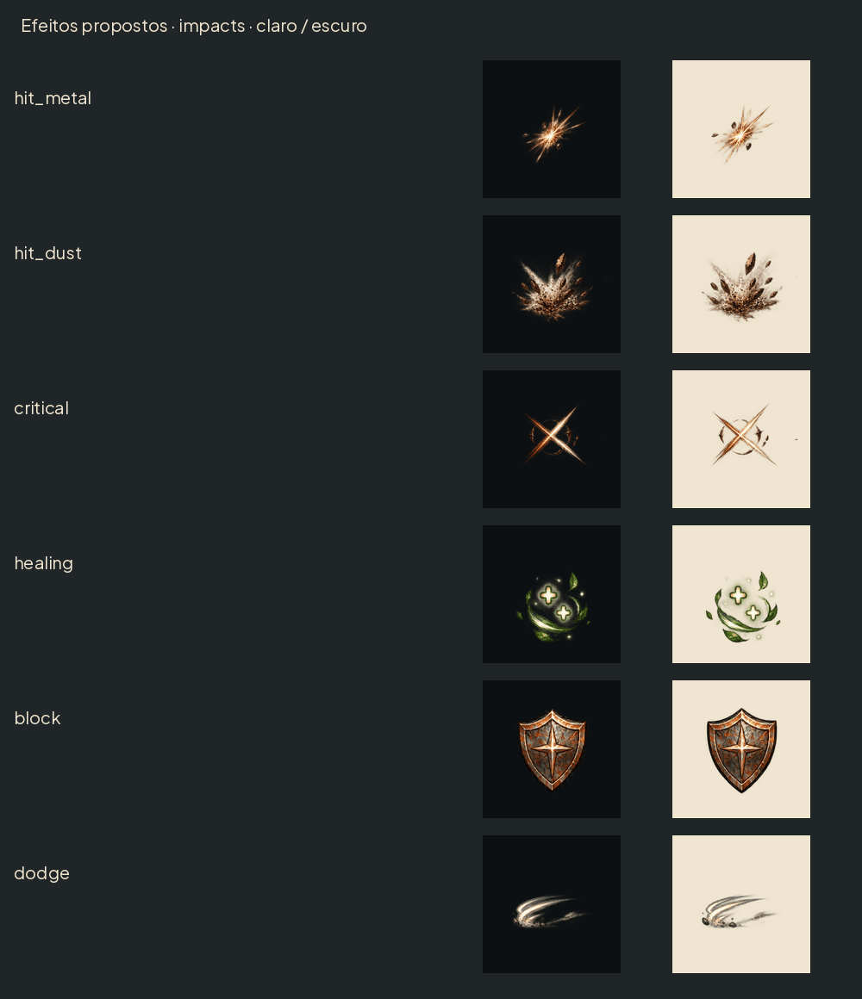
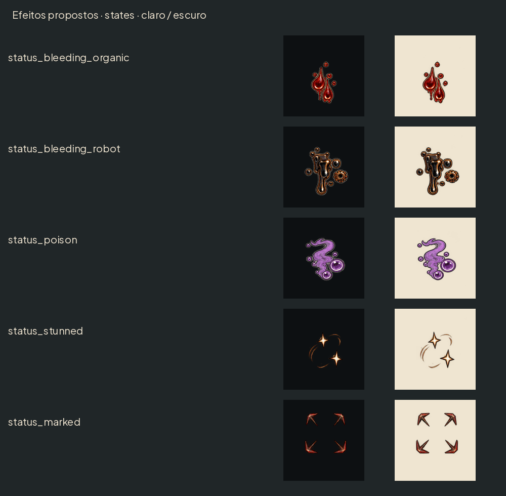
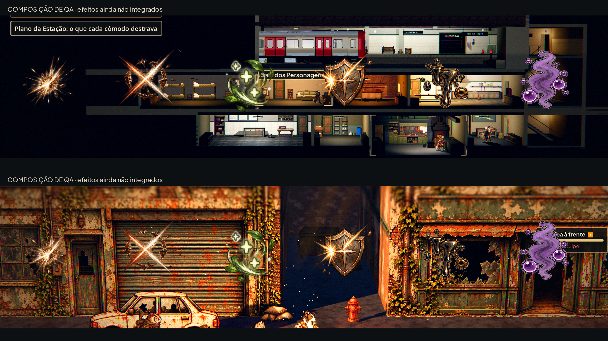

# Efeitos de impacto e estados — #41

Onze folhas PNG RGBA em art/combat/effects/, sem letras e sem fundo. Formas pintadas de cobre, poeira e materiais envelhecidos; não são ícones de HUD. Cada quadro256×256, linha única, ordem esquerda→direita. Todos têm24px de margem transparente; centro geométrico(128,128). Sem9-slice.

| Arquivo | Quadros | Folha | Âncora local px | FPS | Reprodução |
|---|---|---|---|---|---|
| hit_metal.png | 6 | 1536×256 | (128,128) | 12 | uma vez |
| hit_dust.png | 6 | 1536×256 | (128,208) | 12 | uma vez |
| critical.png | 6 | 1536×256 | (128,128) | 12 | uma vez |
| healing.png | 6 | 1536×256 | (128,128) | 12 | uma vez |
| block.png | 6 | 1536×256 | (128,128) | 12 | uma vez |
| dodge.png | 6 | 1536×256 | (128,192) | 12 | uma vez |
| status_bleeding_organic.png | 4 | 1024×256 | (128,128) | 4 | loop |
| status_bleeding_robot.png | 4 | 1024×256 | (128,128) | 4 | loop |
| status_poison.png | 4 | 1024×256 | (128,128) | 4 | loop |
| status_stunned.png | 4 | 1024×256 | (128,128) | 4 | loop |
| status_marked.png | 4 | 1024×256 | (128,128) | 4 | loop |

Os rects são [i×256,0,256,256], i de0 a n−1. Os efeitos curtos duram0,5s a12fps e devem desaparecer ao terminar; não tocar em loop. Estados duram1s a4fps, com retorno a desenhos intermediários para evitar salto do máximo para o mínimo. Não há deslocamento ou efeito fora do canvas.

## Identidade sem depender de cor

- Acerto em robô: faíscas finas e lascas; acerto em outros: nuvem irregular de poeira e fragmentos largos.
- Crítico: corte diagonal cruzado e anel angular quebrado.
- Cura: folhas ascendentes e sinais de mais; verde suave, não usar verde como único significado.
- Bloqueio: escudo de cobre com contato curto; não confundir com crítico.
- Esquiva: trilhas paralelas horizontais perto dos pés.
- Sangramento orgânico: gotas arredondadas; robô: óleo viscoso escuro com detalhe de engrenagem.
- Veneno: vapor e bolhas; atordoado: estrelas em órbita; marcado: quatro cantos angulares vazados.

O contorno escuro e os reflexos claros permitem leitura sobre o claro e o escuro. As cores não são um mapeamento de regra: no modo daltonismo, manter as formas e o texto/dica do estado, sem recolorir toda a pintura por um único tom. As pranchas também mostram os efeitos em cinza e reduzidos a96/64px.

## Tamanho e ancoragem no jogo

Recomendação inicial: impactos128–192px na projeção1080p, cura/bloqueio128px, esquiva128px no piso; loops de estado64–96px, sem ocupar a ficha de vida nem o rosto. Impacto/cura/bloqueio no centro do tronco; poeira e esquiva usam âncora mais baixa. Estados: gotas ao lado do corpo, veneno baixo/lateral, estrelas e marca acima da cabeça. A integração deve evitar empilhar vários efeitos opacos no mesmo ponto.

As posições são recomendações visuais, não mudanças nos tempos de combate. Claude decide o gatilho real do acerto na #33 e a leitura do estado existente; nenhum id foi criado. Em reduzir efeitos: desativar loops decorativos, manter o estado textual/ícone existente e usar só um quadro curto de confirmação por acerto, sem pulsação de tela. Evitar somar flashes/zoom a estes quadros por padrão.

## Origem e entrega

Três atlas iniciais e uma revisão das primeiras três linhas de estados foram separados por linhas e colunas iguais, convertidos para células208px e acomodados em256px com margem24. As fontes têm resolução variável por célula; a entrega é ajustada a256px, sem alegação de detalhe nativo maior. O fundo é alfa real; conferir por composição, não pela cor RGB escondida em pixels transparentes. GIFs são só prévias e usam fundo opaco.

O painel sobre cenários é composição de QA com capturas reais; esses efeitos ainda não estão no jogo. Não alterei scripts/,data/,tests/ ou manifestos. Integração pelo Claude em #16/#33.

## QA de design

Avaliação registrada após inspeção das pranchas.

Rodada 1 — VEREDITO: REPROVADO. Média — `status_bleeding_organic.png`, `status_bleeding_robot.png` e `status_poison.png`: formas muito escuras sobre o painel escuro, sobretudo quando reduzidas. Sugestão: reflexo claro contínuo com contorno externo escuro, mantendo a forma própria de cada estado. Correção: três linhas redesenhadas com esse tratamento; sem recolorir apenas por matiz. Baixa: anotação da prova de cenário se misturava ao HUD; aplicada faixa opaca própria e usada captura nova da rua.

Rodada 2 — VEREDITO: APROVADO. Conferidos11 PNG RGBA,56 quadros, margens transparentes24px, centros/FPS e loops documentados. Inspetadas as composições sobre fundo claro/escuro, captura real e reduções96/64px em cinza. Acerto, poeira, crítico, cura, escudo e rastro têm silhuetas distintas; os cinco loops mantêm a leitura sem depender só da cor. Sem problema alto/médio restante. Observação baixa: estes são efeitos decorativos; texto/ícone de estado continua obrigatório e reduzir efeitos precisa ser respeitado na integração do Claude.

## Validação

Importação das11folhas concluída; `tests/run_all.gd`:21/21 testes aprovados, incluindo48/48 lutas de paridade, saída0. Verificação de arquivo conferiu56células256×256 RGBA e margem24px. Como na rodada da #40, o log também emitiu erros de chamadas diferidas `_restyle` e recursos/RIDs retidos ao desmontar cenas. O código responsável está intacto; essa triagem permanece com Claude. Não declarar o log livre de erros.
