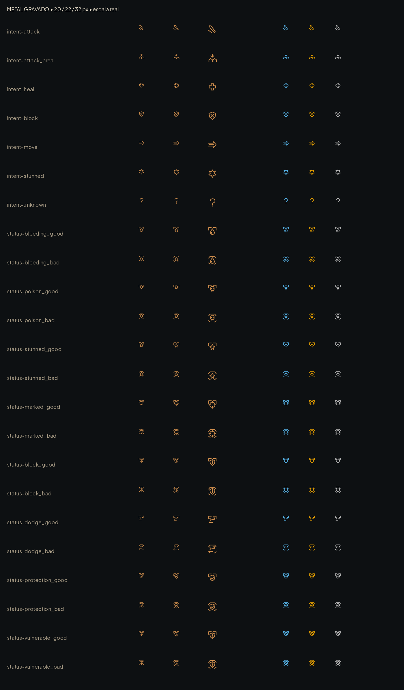

# Intenções e estados — #18

7 intenções e 16 estados (8 pares) em SVG branco monocromático. Mesma linguagem gravada dos ícones da #17. Os arquivos intent-attack_area, heal, block, move, stunned e unknown complementam intent-attack. O ponto de interrogação é um glifo vetorial, não depende de fonte.

- Canvas/viewBox: 32×32; âncora (16,16); sem 9-slice. Traço 2,4. Usar 20–32 px, com margem externa de 4 px e rótulo a 8 px.
- Estados: bleeding, poison, stunned, marked, block, dodge, protection, vulnerable, cada qual com sufixos _good e _bad. Mantém-se o mesmo símbolo; benefício tem cantoneiras superiores retas, prejuízo tem topo chanfrado e duas marcas inferiores. Essa forma permanece ao perder a cor.
- A forma indica benefício/prejuízo para quem recebe o estado; não confundir a intenção do inimigo com um estado ruim do jogador. Claude decide a semântica pela regra existente, sem trocar ids.
- Tintas no jogo: bom #86c98f / #56b4e9; ruim #e2675b / #e69f00. Comparações em azul/laranja/cinza na prancha. Texto da dica permanece obrigatório; não substituir a informação apenas por cor.
- Nenhum estado ou comportamento de combate foi criado. Integração em #16.

## QA de design

Rodada 1 — VEREDITO: APROVADO. Formato, monocromia e bordas por forma conferidos; prancha rasterizada a 20/22/32 px e sem dependência de vermelho/verde. Sem problemas altos ou médios. Observação baixa: manter dicas textuais para aprendizado dos símbolos.
