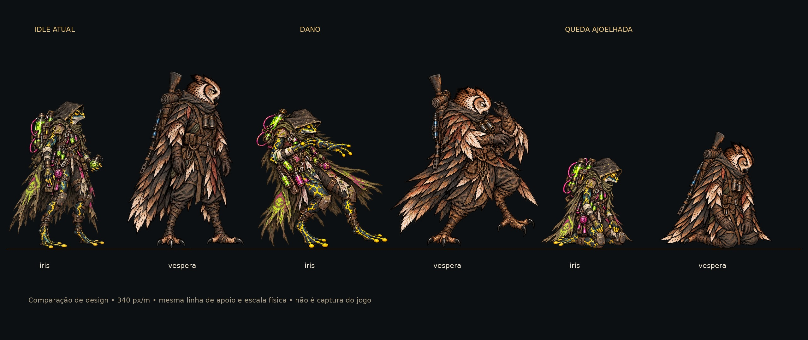
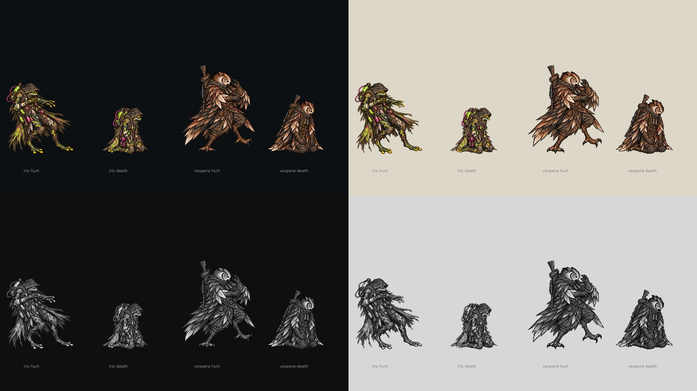

# Reações da Íris e da Véspera — #13

Entrega de 23/10/2026: **quedas ajoelhadas e compactas**, conforme [decisão do Lucas](https://github.com/lucasyemz/after-humans-godot/issues/13#issuecomment-6348095794). QA de design: **APROVADO na rodada 2 desta revisão**. Integração e captura final na arena: Claude, #16.

Prancha de design, não captura do jogo. Escala comum de 340 px/m; pivôs separados por 408 px dentro de cada par (1,20 m), mesma linha de chão. Íris 1,38 m e Véspera 1,66 m, conforme `character_heights.gd`. As cabeças e os equipamentos foram comparados aos idles atuais, sem esticar a queda até a altura de pé.

## Arquivos e decisões

Os quatro PNG RGBA (`art/combat/source/reactions/kneeling_20261023/`) ficam na tag `codex-pr54-originals`, fora da `main` (`git checkout codex-pr54-originals -- art/combat/source/reactions/kneeling_20261023`): são fontes para o pipeline, e a integração converte para WebP o que o jogo usa. As duas quedas foram geradas a partir dos idles locais: Íris continua sapo alquimista, com capuz, cilindros e mangueiras; Véspera continua coruja com binóculos, penas dobradas e rifle preso à mochila. Ambas ajoelhadas, olhos fechados, cabeça baixa, mãos próximas ao corpo; sem sangue, cenário, texto ou sombra pintada.

As poses de dano reaproveitam a arte da entrega anterior, com limpeza de alfa e registro no canvas/pivô atual. Não são poses novas. Esquiva e defesa eram opcionais e ficam fora deste lote.

Nenhuma fonte do projeto Unreal foi baixada ou alterada. A [revisão do acervo](unreal-art-review.md) registra a evidência textual de Bento/Nick ajoelhados e a existência das reações legadas da coruja. Estas últimas não foram comparadas pixel a pixel; as novas poses usam a identidade do idle Godot atual.

## Medidas para integração

Origem no topo esquerdo. **Todos os PNG: 1178×1335 px**. Conversão esperada: WebP 589×668 px pelo pipeline de meia resolução; as medidas do manifesto continuam nas coordenadas da fonte. Sem 9-slice, sem margens de conteúdo de UI. Bounding box com máximo exclusivo; âncora na linha imediatamente abaixo do último pixel de apoio.

| Arquivo PNG | Âncora fonte x,y | Referência corporal de pé | Bbox alfa x0,y0,x1,y1 | Largura física |
|---|---|---|---|---|
| `iris_death.png` | 587,5;1264 | 1208 px | 208;518;967;1264 | 0,867 m |
| `iris_hurt.png` | 587,5;1264 | 1208 px | 47;114;1128;1264 | 1,235 m |
| `vespera_death.png` | 451;1297 | 1271 px | 48;456;855;1297 | 1,054 m |
| `vespera_hurt.png` | 451;1297 | 1271 px | 8;44;1088;1297 | 1,411 m |

**Âncoras, canvas e referência corporal são exatamente os do idle atual** em `data/presentation/combat_art.json`. Contrato legível por ferramenta: [combat_reactions_contract.json](combat_reactions_contract.json). Não usar a altura visível ajoelhada como referência: isso ampliaria indevidamente a personagem. Os pés/capa têm apoios assimétricos nas reações; a âncora é o pivô estável do ator, não o centro automático de cada bbox.

Para as quedas, o envelope lateral máximo a partir do pivô é 0,434 m na Íris e 0,528 m na Véspera: mesmo entre duas Vésperas há cerca de 0,145 m de folga com pivôs a 1,20 m. As reações de dano têm gestos mais largos, como as anteriores; não representam a silhueta persistente da derrota. Validar ordenação e sobreposição durante o estado transitório na arena.

Claude: registrar estas fontes na tabela do pipeline `tools/sync_combat_art.py`, converter e ligar `hurt`/`death` nos ids existentes `hero_sapo_iris` e `hero_coruja_vespera`. A ferramenta não foi executada nesta entrega porque regrava `data/`. Os WebPs antigos `art/combat/heroes/{iris,vespera}/death.webp` **continuam horizontais e superados: não integrar**. Nenhum arquivo já consumido pelo jogo foi renomeado ou sobrescrito.

## Leitura e QA de design

Cada painel foi composto em 1920×1080 e reduzido de verdade a 768×432. Nas duas linhas, dano recua/abre o gesto enquanto queda forma um volume baixo com cabeça caída e pernas recolhidas. A leitura de estado funciona em cinza e nos dois fundos, sem depender de verde contra vermelho. As cores são as dos equipamentos existentes; não há semântica nova de bom/perigo para recolorir. Os testes de ícones de 22/32 px e texto de HUD não se aplicam a estes sprites sem texto.

**Rodada 1 — VEREDITO: REPROVADO.** Alta — `vespera_hurt.png`: centralizar toda a silhueta no pivô do idle colocava a borda esquerda em x=-89, cortando penas. Sugestão: reenquadrar sem reduzir a personagem, preservando canvas e pivô. Corrigido com bbox x=8..1088 e corpo completo. Média — prancha inicial `reactions_kneeling_comparison.jpg`: distância de 240 px entre personagens não representava os 1,20 m de combate e causava sobreposição artificial. Corrigido para 408 px a 340 px/m, ampliando a prancha para 2560×1080.

**Rodada 2 — VEREDITO: APROVADO.** Acabamento baixo encontrado na checagem automatizada: componente de dois pixels no alfa forte da queda da Véspera, removido antes da aprovação final. Conferidos os quatro PNG finais e as duas pranchas contra o checklist de `qa.md`: identidade e acabamento compatíveis com idles, quedas ajoelhadas compactas, escala corporal coerente, canvas/pivôs iguais aos atuais, sem cortes ou componentes alfa soltos relevantes, leitura a 40% e em cinza sobre fundos claro/escuro, nomes e medidas completos. Sem problemas altos ou médios. Observação baixa: a QA de design usa composição estática; a troca de estado, o enquadramento da câmera e a oclusão real serão validados pelo Claude na integração #16.

Validação técnica: Godot 4.7.2, `tests/run_all.gd`: **25/25**, paridade **48/48**, saída 0 (72,3 s). O log ainda contém erros diferidos de `_restyle` e avisos de RIDs/recursos no encerramento; não são um teste da integração destas poses. Nenhuma alteração em `scripts/`, `data/`, `tests/` ou ids.

## Histórico superado

Na entrega anterior, a rodada 1 corrigiu extração do atlas, a rodada 2 aprovou o recorte técnico e a rodada 3 reprovou as quedas horizontais após a consulta ao acervo Unreal. Essa aprovação técnica antiga não libera os WebPs horizontais. A decisão posterior do Lucas é atendida pelos PNG versionados acima. A issue permanece aberta para integração e QA em jogo.
