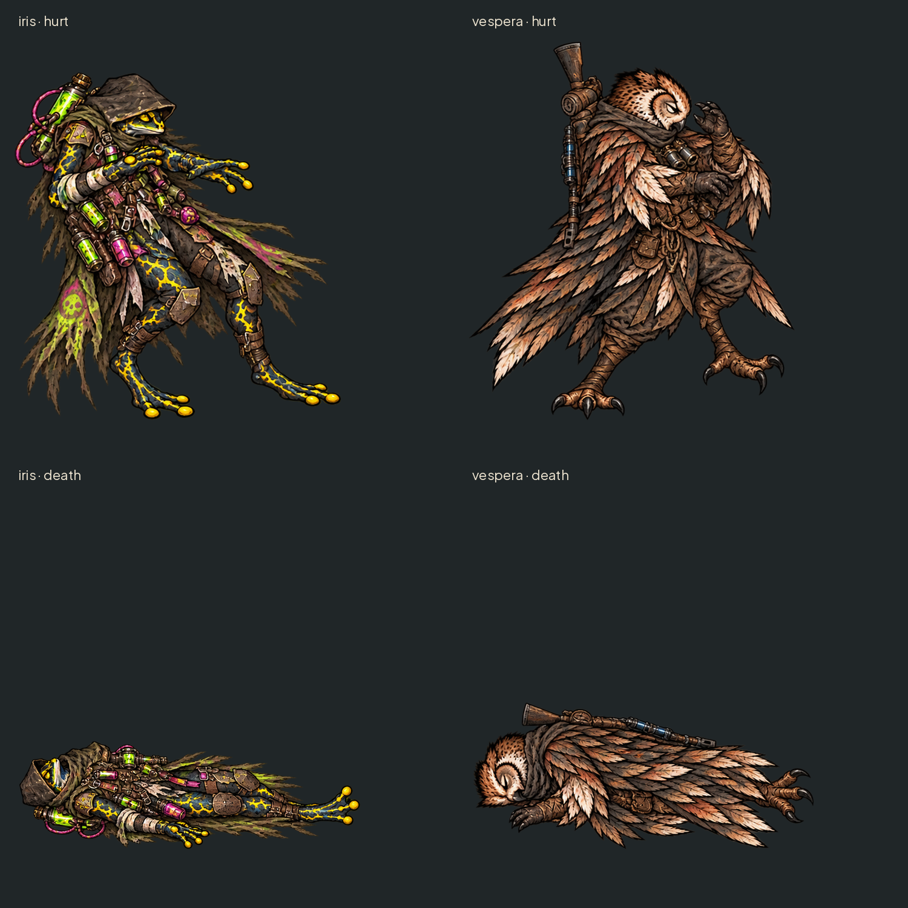

# Reações da Íris e da Véspera — #13

> Estado após consulta ao acervo Unreal: proposta para revisão, ainda não liberada para integração das quedas. A aprovação da rodada 2 abaixo foi anterior à descoberta da direção de derrota ajoelhada. Ver a rodada 3 e [a revisão do acervo](unreal-art-review.md).

Quatro poses novas, comparadas aos idles atuais. Dano de frente para direita, corpo recuando; queda de cabeça à esquerda e pés à direita. Sem sangue. Equipamento e cores da Íris/Véspera preservados. Nenhum arquivo existente foi substituído. Esquiva e defesa eram opcionais e não fazem parte desta entrega.

WebP em art/combat/heroes/<hero>/<pose>.webp; PNG de transferência em art/combat/source/reactions/<hero>/<pose>.png. Os PNG têm canvas2× do WebP, para o pipeline de meia resolução. Isso é ampliação da imagem gerada, não detalhe nativo adicional. Sem9-slice.

| Pose | Canvas WebP | Âncora em px (apoio) | Altura visível px |
|---|---|---|---|
| iris/hurt | 589×668 | 294,643 | 575 |
| vespera/hurt | 589×668 | 294,643 | 626 |
| iris/death | 627×627 | 313,602 | 179 |
| vespera/death | 627×627 | 313,602 | 243 |

Origem de coordenadas: topo esquerdo; âncora no centro inferior do alfa com corte24/255. Multiplicar medidas por2 no manifesto da fonte; tools/sync_combat_art.py divide a textura pela metade, mantendo referência nas medidas originais. Para queda, a âncora é contato com o piso, não a cabeça. A altura de referência de pé deve continuar vindo do idle; não esticar a pose deitada pela própria altura. Mesmos canvases de dano589×668 e queda627×627 das referências do Nick/Bento.

Claude: antes de importar, comparar com as fontes legadas da coruja e preservar a direção aprovada de derrota compacta. Não sobrescrever fontes existentes em SourceArt/AllyActions/Reactions20261020. Se as propostas forem aprovadas, registrar fontes novas em uma pasta versionada própria e medir nos manifestos de origem. Não executei a ferramenta porque ela regrava data/presentation/combat_art.json, fora do escopo. Composição de arena e troca de estado ficam para #16.

## QA de design

Rodada1 — VEREDITO: REPROVADO. Alta: o atlas não respeitava rigidamente as colunas; cortar pela metade poderia amputar extremidades. Correção: extração por componente alfa conectado em vez de corte de quadrante, seguida de enquadramento com margem24.

Rodada2 — VEREDITO: APROVADO. Quatro corpos completos, equipamento coerente com referência, alfa limpo, canvas e âncoras documentados. Sem problemas altos/médios. Observação baixa: escala final em arena e oclusões serão validadas por Claude; a queda usa apoio no piso e não altura de personagem de pé.

Rodada3 — VEREDITO: REPROVADO para integração das quedas. Alta — `iris/death.webp` e `vespera/death.webp`: pose horizontal pode invadir posições vizinhas e diverge da direção compacta ajoelhada documentada nas reações recentes de Bento/Nick na Unreal. Sugestão: revisar a pose de derrota e comparar as fontes antigas da coruja antes de produzir substituições. Os arquivos permanecem propostas isoladas, sem registro no manifesto nem uso no jogo. A issue #13 continua aberta; merge dos arquivos para revisão não representa aprovação de integração. A existência das fontes legadas foi confirmada por caminhos e documentação, sem comparação dos pixels.
