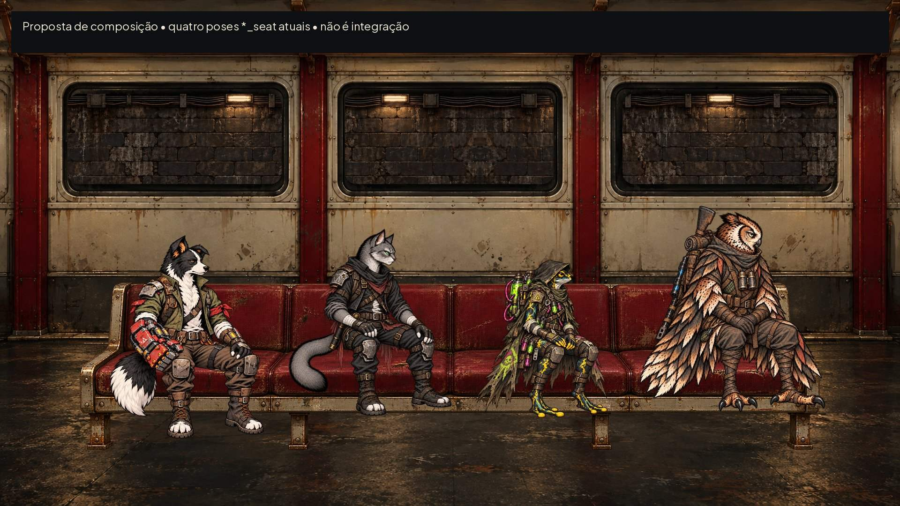
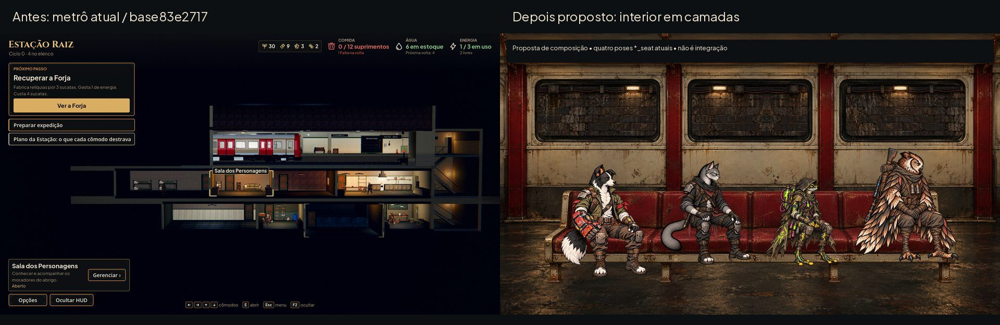
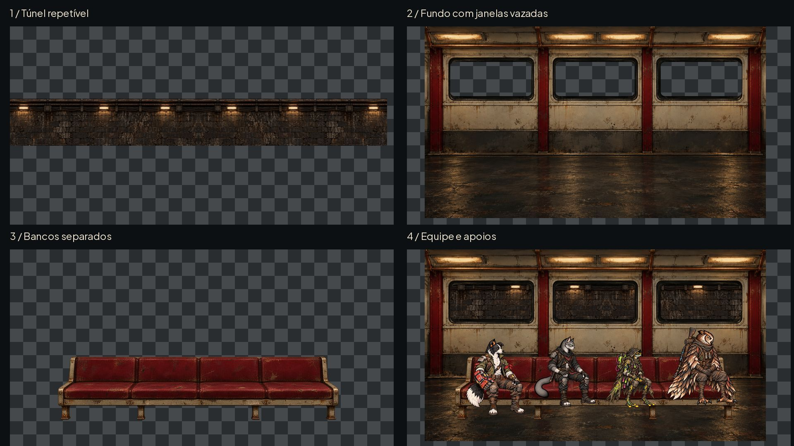
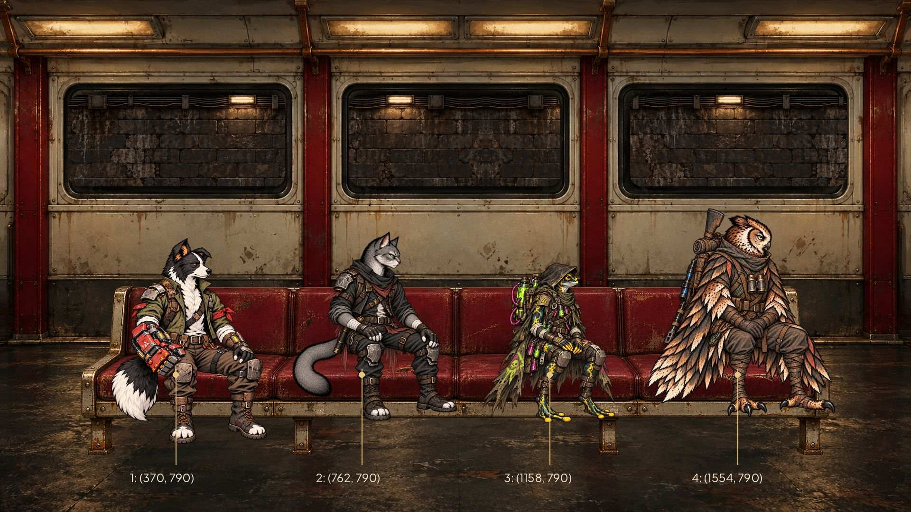
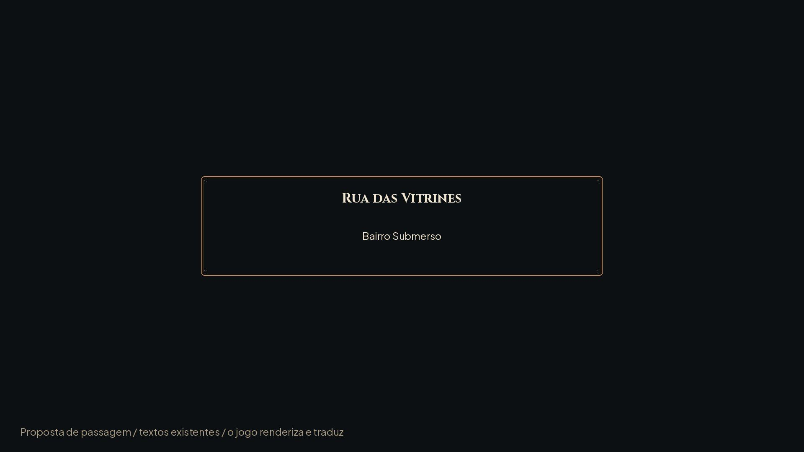

# Partida e cartão de passagem — #79

> **Interior substituído pela #149 (29/10):** o trem oficial passou a ser o vagão verde do Tutorial. O fundo e o banco
> daqui deram lugar ao interior dele, com os bancos presos à parede e as barras na frente: ver [trem-2d.md](trem-2d.md).
> O cartão, o túnel e o tempo da animação continuam valendo.

Proposta de arte para integração pelo Claude nas #74/#75. Base `83e2717`. **QA de design: APROVADO na rodada4.** Não altera o fluxo do jogo nem o metrô3D existente.

À esquerda, captura real da Estação desta base; à direita, composição proposta com as novas camadas e as poses sentadas atuais. Não é captura da integração. O modelo de referência local é `art/station/metro`, conforme seus créditos (Bombardier S Stock, timblewee, CC BY4.0); a pintura usa metal claro desgastado, montantes vermelhos e iluminação quente, sem marcas ou texto. O jogo continua tendo sua própria iluminação3D; esta cena é uma composição2D de passagem.

## Camadas e contrato

Origem superior esquerda, coordenadas em pixels finais. [Contrato completo](departure/contract.json). Sem ids novos; arquivos sem texto. **Somente WebP final entra em `art/`**, com alfa sem perdas mesmo quando o RGB é comprimido. Fontes geradas permanecem em `/workspace/generated_images/`; cópias de trabalho e prévias originais em `/workspace/scratch/round79_80/originals/`, fora do repositório. Não são fontes disponíveis no Git.

| Arquivo | Resolução | Posição/âncora | Uso |
|---|---|---|---|
| `art/transitions/train/tunnel_loop.webp` | 2048×256 | canto superior em(0,160) | Primeiro, atrás de tudo; repetir horizontalmente |
| `art/transitions/train/carriage_background.webp` | 1920×1080 | (0,0) | Parede/piso; três vãos com alfa0 (**trocado pela #149**: o interior do vagão verde) |
| ~~`art/transitions/train/carriage_bench.webp`~~ | 1920×1080 | (0,0) | **Removido pela #149**: os bancos agora são da parede do vagão |
| `art/transitions/passage_title_frame.webp` | 960×240 | centro(480,120), na tela(960,540) | Cartão sem texto, derivado da moldura do kit #59 |

O túnel é opaco (alfa255), os outros assets têm transparência real; não adicionar transparência artificial no túnel que revelaria o vazio. O strip foi montado em ida/espelho para fechar o ciclo: primeira/última coluna e a junção central coincidem exatamente. O strip final recorta só a faixa visível e usa paleta de256 cores, codificada sem perdas, reduzindo1.321.534 para447.476 bytes (−66%). Isso cria ritmo simétrico de alvenaria, sem salto de luminosidade na emenda. Sugestão96px/s: ciclo21,333s; em `Reduzir efeitos`, congelar o deslocamento e as luzes, sem pulsos. Usar Repeat em X, sem compressão de alfa; o fundo inteiro não se move.

Vãos arredondados (raio24): `(144,200)–(600,392)`, `(736,200)–(1180,392)`, `(1328,200)–(1784,392)`. O túnel ocupa y160..416 e fica totalmente atrás dos vãos. As bordas pintadas escuras são o rebaixo do vidro, não franja clara. Para telas que não sejam16:9, ajustar o conjunto com aspecto preservado e preenchimento escuro, sem esticar as personagens.

## Assentos e escala

Quatro lugares, da esquerda para a direita. O **apoio do assento é o quadril**, enquanto os sprites existentes usam âncora no pé; são pontos diferentes. O contrato traz os dois, a escala e o canto superior do sprite de exemplo. Claude deve alinhar o quadril ao apoio do banco, preservando a escala física do manifesto, e não igualar o tamanho das caixas das quatro espécies.

| Lugar | Apoio no banco | Pose existente usada | Quadril medido na textura atual | Referência corporal existente | Escala da prévia |
|---|---|---|---|---|---|
| 1 | (370,790) | `hero_cao_bento_seat.webp` | (240,480) | 948px | 0,635021 |
| 2 | (762,790) | `hero_gato_nick_seat.webp` | (260,490) | 804px | 0,652985 |
| 3 | (1158,790) | `hero_sapo_iris_seat.webp` | (275,490) | 924px | 0,522727 |
| 4 | (1554,790) | `hero_coruja_vespera_seat.webp` | (285,500) | 784px | 0,741071 |

Escala =350px/m × altura física / referência corporal de `data/presentation/station_poses.json`. Usadas alturas atuais1,72/1,50/1,38/1,66m. Não alterar o manifesto nesta entrega. Os apoios de quadril são marcações de composição, não novas âncoras de gameplay. As poses e seus arquivos não foram modificados. Os pés de espécies menores podem ficar suspensos, coerentemente com o banco alto; não alongar as pernas para tocar o piso. Mostrar só os integrantes escolhidos (1–4), sem preencher vagas com fundadores ausentes. Recrutas novos da #80 usam a mesma lógica de assento, com medição específica de quadril pelo integrador; não inferir pelo centro do alfa.

## Cartão: três tamanhos, texto separado

[Grande115%](departure/title_large.jpg) · [Maior130%](departure/title_largest.jpg)

Moldura do kit corrigido #59: 9-slice E/T/D/B16, conteúdo32, sem expand margin. Área de título local `[32,32,928,112]`; área de subtítulo `[32,128,928,208]`; título Cinzel32/37/42, subtítulo Plus Jakarta24/28/31, nos modos Normal/Grande/Maior. Centro na tela(960,540); caixa global(480,420)–(1440,660). O subtítulo nunca é parte da textura. Não criar nova tipografia para passagem.

As prévias usam somente nomes existentes: “Rua das Vitrines” e “Bairro Submerso”. Revisada a regra de consistência de `docs/narrative/narrative-design.md`, seção14: não inventam lugar, evento ou revelação e não antecipam fase bloqueada. No jogo, título/subtítulo vêm do destino conhecido e passam por `tr()`. Nome longo quebra em duas linhas e o cartão cresce em múltiplos de8, sem diminuir fonte nem invadir a área do subtítulo.

### Animação proposta para #74

1. Fechar fade para preto em200ms (ease-out), sem sacudir a câmera. O carregamento começa em paralelo.
2. Partida opcional mostra a equipe sentada; túnel rola continuamente a96px/s. O cartão do destino aparece depois, sobre o preto do fade, não cobrindo os rostos enquanto a equipe é mostrada.
3. Cartão entra por opacidade em160ms, permanece por até1,2s de leitura **ou pelo tempo de carregamento necessário**, e sai em100ms. Abertura para a cena pronta em200ms. Tempos são proposta nova, não medição da Unreal.
4. Interagir, Esc/controle e toque podem solicitar pular desde o início; a solicitação é guardada e termina a passagem assim que o destino estiver carregado. Nunca liberar cena incompleta. Não gravar um estado intermediário no save; ao retomar, abrir o destino.
5. `Reduzir efeitos`: sem rolagem, deslocamento, pulsos ou zoom, trocas sem animação; título estático enquanto carrega. “Pular” e o estado de carregamento são textos do jogo, em detalhe18/21/23, com comando/binding real, fora das texturas e dentro da margem48.

A #73 ainda não entregou `docs/reference/unreal-passages.md` nesta base. Não foi clonado nem baixado o projeto Unreal; revisar tempos contra essa referência quando chegar, sem bloquear o uso destas camadas.

## QA de design

**Rodada1 — VEREDITO: REPROVADO.** Média — `train_team.jpg` (480KB) e `train_team_gray.jpg` (408KB): acima do limite de prévia até~300KB da issue. Sugestão: recomprimir somente documentação e guardar originais fora do Git. Correção aplicada; todas as prévias finais ficam abaixo de300KB, sem mudar a resolução1920×1080 nem as medidas dos assets. Inspeção de encaixe: quatro apoios alinhados ao banco; poses atuais preservadas.

**Rodada2 — VEREDITO: APROVADO.** Mesma linguagem envelhecida do metrô e das personagens; quatro corpos completos, assentos medidos, escala física do manifesto respeitada; janelas vazadas e bancos separados, ciclo sem corte de borda; cartão sem letras com três tamanhos documentados. Conferidas prévia em cinza e redução real a40%: espécies, lugares e hierarquia continuam distintos sem depender de cor. Sem problemas altos/médios. Observação baixa: rolagem real, pular, carregamento, responsive e encaixe da equipe variável exigem integração/QA do Claude (#74/#75); composição estática não certifica runtime.

Testes da base83e2717: Godot4.7.2,39/39, paridade48/48, saída0; avisos de recursos no encerramento registrados. Esta entrega só acrescenta arte e documentação; não executa o sincronizador nem altera scripts/,data/,tests/ ou ids.

**Rodada3 — VEREDITO: REPROVADO (revisão independente do PR).** Média — túnel de1,3MB excessivo para o trecho visto pelo vidro; descrição do PR ainda apontava só o kit, embora já incluísse a #79. Correção: recorte vertical para2048×256, paleta256 sem dithering e WebP sem perdas (447.476bytes), sem alterar a faixa vista pelos vãos; título/escopo do PR atualizados para as três entregas em commits separados. A entrega de arte antes da integração é o fluxo solicitado expressamente nesta rodada e nas #79/#80; não é apresentada como arte já conectada ao jogo.

**Rodada4 — VEREDITO: APROVADO.** Conferidos novamente o loop após decodificação (delta0 nas duas emendas), os três vãos de alfa0, a cobertura vertical y160..416, as dimensões e hashes em [checks.json](departure/checks.json); prévias regeneradas e abaixo de300KB. Sem problema alto/médio. Observação baixa mantida: os pés suspensos das espécies menores fazem parte da proposta de banco alto e estão visíveis para a aprovação do Lucas. Integração permanece com Claude.

Validação final do lote: **39/39**, paridade48/48, saída0 em122,4s. Os15 WebPs novos foram carregados como Texture2D na Godot4.7.2: dimensões corretas, janelas alfa0 e emenda do túnel0 após a importação. Metadados de importação sem perdas e mipmaps incluídos para preservar esses invariantes. Avisos de recursos/RIDs no encerramento permanecem; nenhuma mudança no código para tratá-los.
