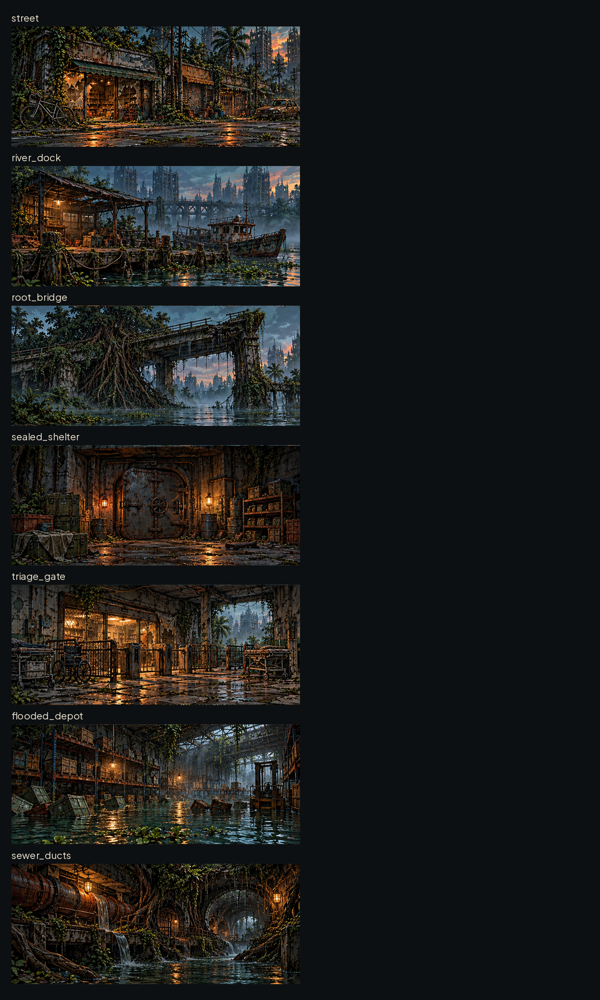

# Cartões de evento por cenário — #22

Sete pinturas novas em art/ui/events/, WebP RGB1200×500, sem texto. Referência direta: art/ui/scenarios/rua-das-vitrines.webp; mesma pincelada, ferrugem, verdes dessaturados e luz âmbar. Nenhum personagem ou escolha de evento aparece embutido; o jogo escreve a narrativa abaixo.

| Arquivo | Cenário existente (não alterar id) | Foco |
|---|---|---|
| street.webp | rua inicial / Rua das Vitrines | vitrine quebrada e bicicleta |
| river_dock.webp | RiverDock | píer, barco e cordas |
| root_bridge.webp | RootBridge | concreto rompido por raízes |
| sealed_shelter.webp | SealedShelter | porta de pressão lacrada |
| triage_gate.webp | TriageGate | catracas e macas abandonadas |
| flooded_depot.webp | FloodedDepot | caixas e prateleiras submersas |
| sewer_ducts.webp | SewerDucts | tubulações e canal de esgoto |

Medidas comuns: âncora topo esquerdo(0,0), centro visual(600,250), área útil inteira. Sem9-slice nem margens para letras: não sobrepor texto na pintura. Uso sugerido600×250 no desktop e360×150 no celular, preservar aspecto12:5. Cantos e borda são do cartão #20. Os nomes snake_case dos arquivos não substituem os ids PascalCase do jogo.

Origem: atlas gerado2×4, recortado nas divisórias iguais; sete células aproveitadas, oitava descartada. Cada célula original tem aproximadamente687×286px, redimensionada a1200×500; não alegar detalhe nativo1200px. Revisar a nitidez na escala de uso600×250.

## QA de design

Rodada1 — VEREDITO: APROVADO. Sete cenas conferidas com a referência atual; focalização distinta, formato e resolução conferidos, sem texto nem bordas de atlas nos cortes. Redução600×250 preserva cenário e ponto de interesse. Sem problemas altos/médios. Observação baixa: a resolução de origem é menor que a de entrega, documentada; integração e aprovação contextual #16 pendentes.
