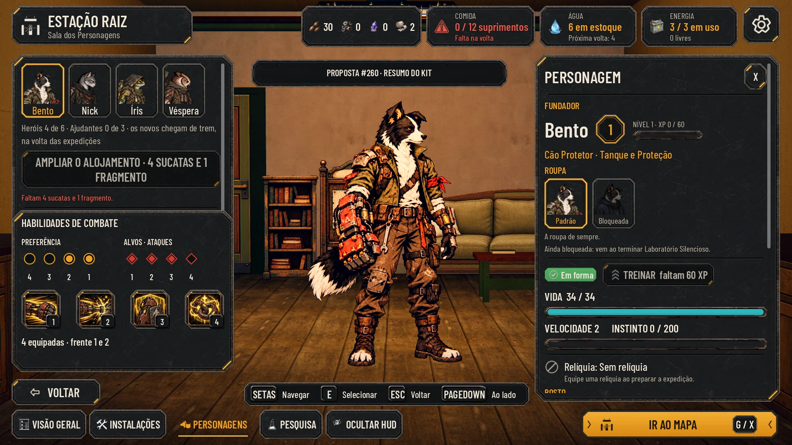
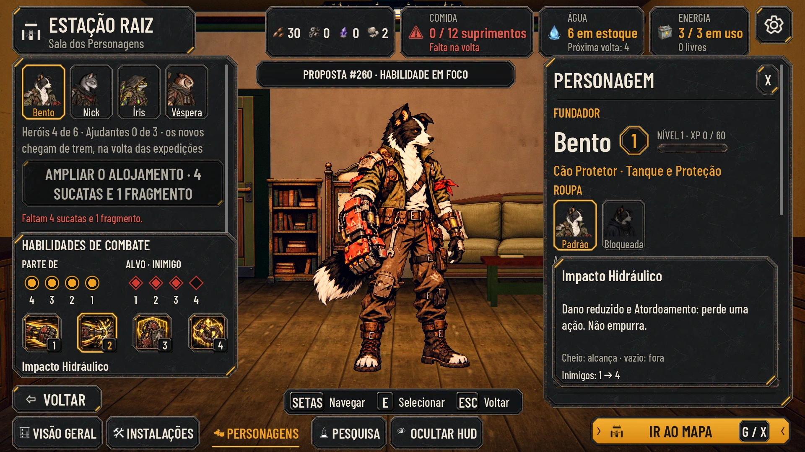
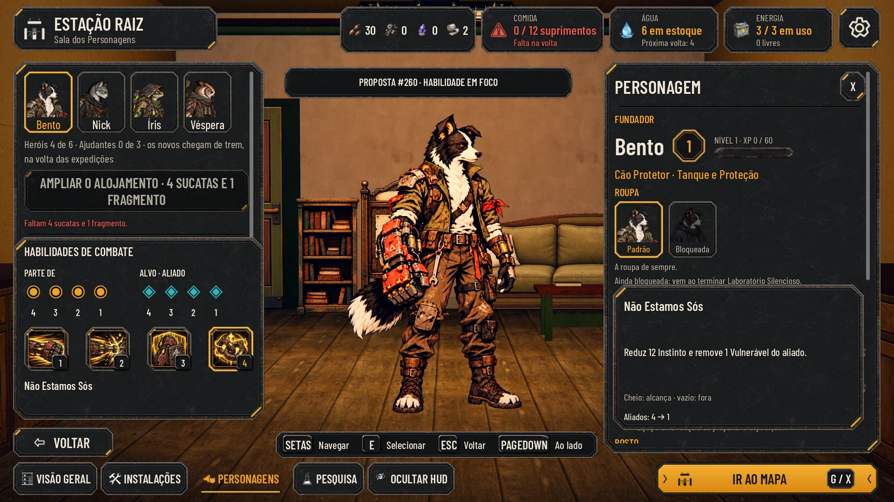
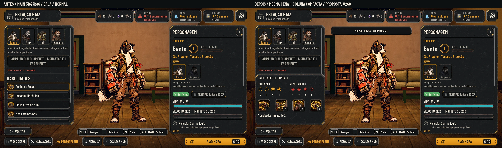
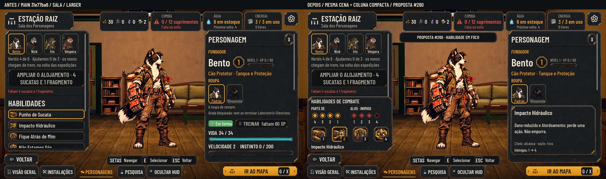
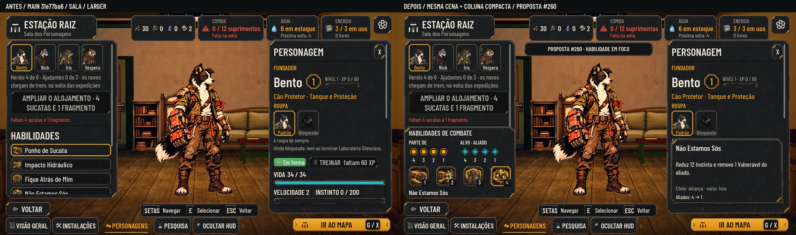

# Formação e alcance junto das habilidades (#260)

**Revisão para o Lucas**, a partir das referências enviadas no comentário da conversa. O estudo usa a organização compacta das referências: quatro marcadores de posição, quatro de alvo, ícones de habilidades lado a lado e o personagem grande. As molduras, a Barlow e os ícones continuam sendo os do After Humans.

A proposta substitui visualmente **só o bloco HABILIDADES da Sala**. Preserva os retratos para trocar de personagem, o elenco, a ação de Alojamento, o personagem central, a ficha e os botões existentes. Não é um painel que cobre a tela inteira. É um protótipo documental, sem mudança em código, dados, save, ids ou balanceamento de produção. Base: `main` **31e77ba6ae91d599fee8712f02238fe8e7b55ad0**, ainda atual na revisão.

## Ver as pranchas

| Situação | Normal | Maior 130% | Daltonismo |
|---|---|---|---|
| Resumo do kit, sem habilidade em foco | [Abrir](formation_positions/overview_normal.webp) | [Abrir](formation_positions/overview_larger.webp) | [Abrir](formation_positions/overview_colorblind.webp) |
| Impacto Hidráulico em foco | [Abrir](formation_positions/attack_normal.webp) | [Abrir](formation_positions/attack_larger.webp) | [Abrir](formation_positions/attack_colorblind.webp) |
| Não Estamos Sós em foco | [Abrir](formation_positions/support_normal.webp) | [Abrir](formation_positions/support_larger.webp) | [Abrir](formation_positions/support_colorblind.webp) |







[A 40%: resumo](formation_positions/overview_40.webp) · [ataque](formation_positions/attack_40.webp) · [apoio](formation_positions/support_40.webp) · [Três vistas em cinza](formation_positions/grayscale.webp)

## Como funciona a leitura

**Sem apontar uma habilidade:** o grupo esquerdo diz **PREFERÊNCIA**, com as quatro posições próprias na ordem **4 · 3 · 2 · 1**; os círculos preenchidos indicam a preferência do kit. O grupo direito diz **ALVOS · ATAQUES** e mostra a união dos ranks de alvo dos ataques contra inimigos, na ordem **1 · 2 · 3 · 4**. Não mistura cura/proteção nessa faixa de inimigos. A linha “4 equipadas · frente 1 e 2” reforça o resumo do Bento sem exibir frações ou uma tabela.

**Ao apontar ou focar uma habilidade:** a primeira legenda muda para **PARTE DE**. Os círculos passam a mostrar exatamente `OriginRanks` daquela habilidade; deixam de representar preferência. A segunda legenda muda para **ALVO · INIMIGO**, **ALVO · ALIADO** ou **SI MESMO**, conforme `TargetType`. O ícone em foco ganha a moldura âmbar. Uma dica temporária mostra nome, descrição e a orientação dos ranks. Ao sair do foco de habilidade, a dica some e as faixas voltam ao resumo do kit.

Não usar a legenda “Preferência” para as origens de uma habilidade. **Preferência não restringe a formação; origem restringe aquela ação.** No resumo, preenchimento significa preferência à esquerda e alcance agregado de ataques à direita; os cabeçalhos distinguem essas funções. Na habilidade em foco, preenchido significa que alcança e vazio significa que não alcança. Os números das posições permanecem visíveis nos dois modos.

As posições próprias usam **círculos âmbar**. Os alvos usam **losangos**, vermelhos para inimigos e cianos para aliados, com as cores reais de `AHKit.enemy_hp()` / `hero_hp()` e suas opções de daltonismo. Preenchido/vazio, forma, legenda e números sustentam a leitura em cinza; cor é reforço. As formas são indicadores vetoriais de UI do protótipo, não novas texturas de arte.

### Casos das capturas

| Vista | Preferência do kit | Origem em foco | Alvo em foco |
|---|---|---|---|
| Resumo do Bento | 1 e 2 | Não há habilidade em foco | Ataques atuais: inimigos 1, 2 e 3 |
| Impacto Hidráulico | Continua 1 e 2, mas não é o que a faixa em foco exibe | 1, 2, 3 e 4 | Inimigos 1, 2 e 3 |
| Não Estamos Sós | Continua 1 e 2 | 1, 2, 3 e 4 | Aliados 1, 2, 3 e 4; permite o próprio herói |

Isso demonstra a diferença: Bento prefere a frente, mas **Impacto Hidráulico parte das quatro posições**. Não mostrar a preferência como bloqueio desse golpe. Os quatro ícones são os existentes, na ordem atual dos dados: Punho de Sucata, Impacto Hidráulico, Fique Atrás de Mim e Não Estamos Sós. Os números 1–4 nas plaquetas dos ícones indicam sua ordem no kit; não criam atalhos novos na Sala.

O [snapshot auditado](formation_positions/examples.json) conserva os ids, as origens e os alvos das 24 habilidades das seis classes atuais. A preferência proposta continua sendo o máximo positivo da quantidade de habilidades equipadas que partem de cada posição: Bento 1/2, Íris 3/4, Guaxinim 2/3, por exemplo. A contagem fica interna, não ocupa a interface como `4/4`. É um critério simples **a aprovar**, não mede dano, cura ou a composição ideal. Empates positivos mostram todas as posições empatadas; empate completo recebe “Sem preferência”. Sem kit definido: indicadores neutros e “Kit ainda não definido”, sem recomendação inventada.

## Interação e estados para a integração

- **Mouse:** apontar o ícone revela os ranks e a dica. A moldura identifica a habilidade consultada, não a confunde com equipada. As capturas mostram quatro habilidades já equipadas; não inventam um sistema de marcar/desmarcar o kit.
- **Teclado/controle:** o foco existente percorre os ícones e revela o mesmo conteúdo. Preserve a ação de voltar, o foco do personagem e a possibilidade de consultar a dica sem clique.
- **Toque:** toque no ícone consulta e mantém o detalhe; tocar fora fecha. Na integração, confirmar a distinção entre consultar e equipar de acordo com a #259. Não atribuir duplo sentido silencioso ao mesmo toque.
- **Leitor de tela, quando suportado:** expor nomes e listas de posições (“Parte das posições 1, 2, 3 e 4; atinge inimigos 1, 2 e 3”), não anunciar apenas cor ou “quatro pontos”.
- **Origem/alvo não é disponibilidade neste turno:** recarga, estado incapacitante e falta de alvo legal têm motivos próprios; não apagar os ranks estáticos por isso. `SingleOtherAlly` continua excluindo o próprio ator, mesmo que o rank apareça nos dados. `Self` usa a legenda SI MESMO e o marcador do ator; não pinta uma linha de inimigos. Alvos múltiplos/conectados precisam de indicação de grupo, sem fingir alvos independentes.
- **Deslocamento e edição:** deslocamento atualiza a posição atual e a legalidade da ação; a preferência só muda quando muda o kit. Na edição, recalcular a prévia pelo conjunto em edição, identificá-la como não confirmada e restaurar o equipado ao cancelar. Sete habilidades no catálogo não significam sete equipadas.
- **Sem origem no rank atual:** “Nenhuma habilidade parte desta posição. Reveja o kit ou a formação.” Não bloquear o rank por preferência. Os seis kits completos atuais cobrem todas as posições; esse é um estado limite para contratos futuros, não um kit inválido apresentado como funcional.

A dica sobrepõe temporariamente a parte inferior da ficha direita, como uma consulta contextual; não cobre o personagem, seu rosto ou os controles do elenco. Ao fechar, devolve a leitura dos atributos. No Maior, manter quebra de linha e rolagem quando o conteúdo superar a área. Não diminuir a fonte. Mais habilidades conhecidas/desbloqueadas e seus estados dependem da #259; não desenhar cadeados fictícios ou inventar custos.

## Medidas e peças

Coordenadas em pixels na base **1920×1080**, ancoragem superior esquerda `(0,0)`:

| Elemento | Retângulo / especificação |
|---|---|
| Bloco compacto | `(28,510,540,394)` no Normal; `(28,554,540,350)` no Maior, preservando também o aviso de recursos do Alojamento |
| Cabeçalho | local `(24,8,492,46)` |
| Legendas de origem/preferência e alvo | locais `(24,60,220,34)` e `(272,60,242,34)` |
| Marcadores | 32×32 Normal, 40×40 Maior; passo 48; posição própria começa em `(28,102)`, alvo em `(276,102)` |
| Números dos ranks | 20 px, 26 px no Maior; abaixo dos marcadores, sem usar tamanho minúsculo como único sinal |
| Ícones de habilidade | quatro peças de 96×96; conteúdo 80×80; x local `24 + i×132`, y `193` |
| Ordem dos ícones | plaqueta de 36×36 no canto inferior direito do ícone, fonte 20 px; não é uma nova tecla fixa |
| Linha final | local `(24,297,492,46)`; resumo ou nome em foco |
| Dica temporária | `(1316,612,540,314)`; nome 28 px, corpo 23 px, notas 20 px; Maior 130% |
| Plaqueta documental | `(610,144,620,68)`; “PROPOSTA #260”; somente para revisão, não integrar |

Sem fonte ou textura nova: Barlow Condensed Medium/SemiBold em `art/ui/fonts` (OFL), peças de `AHKit`, ícones existentes retornados por `AHCombatArena.icon_of()`. Mantêm-se as margens originais de 9-slice: `panel_large` **44/44/44/44**, `panel_inset` **24/24/24/24**, `selected_frame` **16/16/16/16**. Botão de ícone e plaqueta `key_tab` usam os estilos já expostos pelo kit; `key_tab` mantém o 9-slice próprio do manifesto. A composição usa recuos explícitos e não soma as margens do container duas vezes. Não há sprite novo ou âncora no pé.

## Antes/depois e reprodução







Sala real da Godot 4.7.2; mesma campanha seed 6, elenco, câmera e tempo congelado por par. Antes: main intacta. Depois: só bloco compacto e dica em memória. **CPU/Mesa llvmpipe, Compatibility, sem GPU física**; não é uma aprovação da luz Forward+ nem uma integração funcional. Textos nas WebP são capturas de revisão, não texturas de produção com texto gravado. PNG de captura fora do Git.

[Protótipo](formation_positions/capture_proposal.gd), excluído do projeto por `docs/.gdignore`. Executar manualmente, com perfil isolado e pasta de saída externa:

```bash
Godot --path . --rendering-method gl_compatibility --audio-driver Dummy \
  --resolution 1920x1080 --script docs/design/formation_positions/capture_proposal.gd \
  -- --out=/tmp/formation_260
python docs/design/formation_positions/build_review.py /tmp/formation_260
```

O empacotador requer Pillow. Na nuvem, use `XDG_DATA_HOME`, `XDG_CONFIG_HOME` e `XDG_CACHE_HOME` isolados. O save da fixture vai na saída, sem tocar o save do jogador. Protótipo e capturas são casos programados de consulta; não implementam os eventos de foco/toque no jogo.

## QA e decisões pendentes

[Registro da QA de design](formation_positions/qa.md). A suíte da mesma base **31e77ba6** passou **100/100**, com paridade **48/48**, na rodada anterior desta entrega; não foi repetida porque esta revisão altera somente documentos, capturas e o protótipo excluído da Godot. A revisão compacta tem sua própria auditoria de layout e capturas.

Aprovar a linguagem visual não define os pesos da recomendação nem o contrato de seleção de habilidades. Continuam pendentes a aprovação do critério calculado pelo kit e o contrato da #259, considerando a #258. A proposta recomenda colocar o componente na Sala/ficha primeiro e reutilizar o resumo nas cartas de preparação; a formação de batalha não recebe outro painel permanente. A issue fica aberta para o Lucas.
