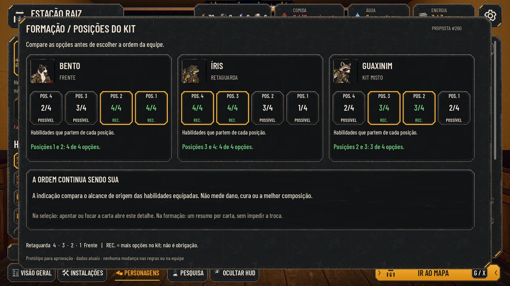
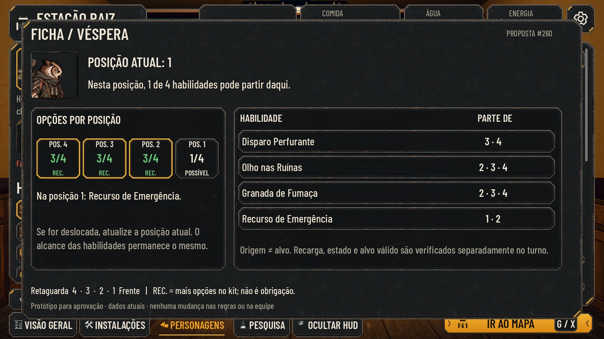
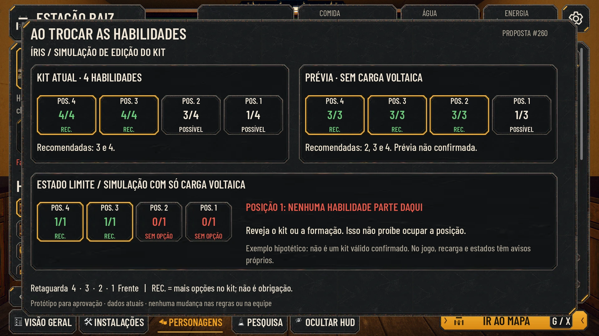
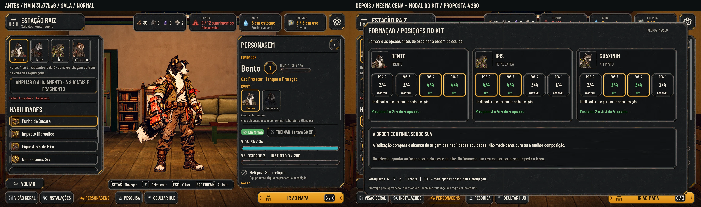
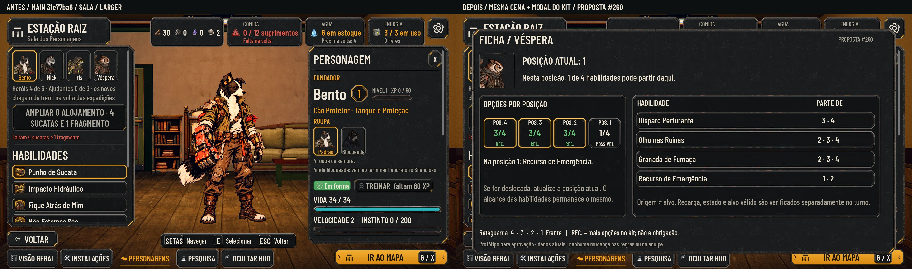
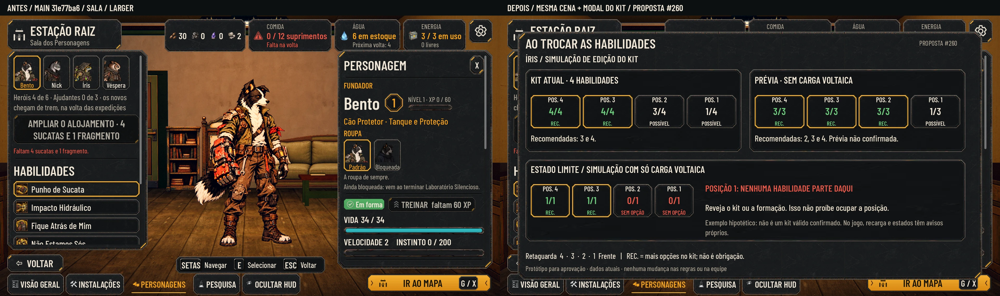

# Posições do kit — proposta de interface (#260)

**Para aprovação do Lucas.** Esta entrega propõe como consultar a formação; não implementa recomendação, troca de habilidades, restrição de posição ou balanceamento. Base: `main` **31e77ba6ae91d599fee8712f02238fe8e7b55ad0**. O contrato definitivo depende da #259 (habilidades) e da #258 (atributos/papel). Não pressupõe que sete habilidades conhecidas sejam sete equipadas.

## Prévias

A proposta usa os componentes e as texturas existentes do `AHKit`, com Barlow Condensed, aço escuro e cantos âmbar, conforme [hud-direction.md](hud-direction.md). Sem peça nova nem fonte nova. São modais de estudo sobre a Sala real, não telas já integradas. As legendas externas distinguem o que existe da proposta.

| Vista | Normal | Maior (130%) | Daltonismo |
|---|---|---|---|
| Comparação da equipe | [Abrir](formation_positions/formation_normal.webp) | [Abrir](formation_positions/formation_larger.webp) | [Abrir](formation_positions/formation_colorblind.webp) |
| Detalhe da ficha | [Abrir](formation_positions/sheet_normal.webp) | [Abrir](formation_positions/sheet_larger.webp) | [Abrir](formation_positions/sheet_colorblind.webp) |
| Edição do kit e estado sem opção | [Abrir](formation_positions/kit_change_normal.webp) | [Abrir](formation_positions/kit_change_larger.webp) | [Abrir](formation_positions/kit_change_colorblind.webp) |







[Comparação a 40%](formation_positions/formation_40.webp) · [Ficha a 40%](formation_positions/sheet_40.webp) · [Edição a 40%](formation_positions/kit_change_40.webp) · [Três vistas em cinza](formation_positions/grayscale.webp)

## Antes e depois na Godot

O antes é a Sala da `main` acima, sem patch de produção. O depois mantém a mesma cena, câmera, elenco e tempo congelado, acrescentando **apenas o modal de estudo do kit**, na memória. Não representa a integração final na partida. As nove propostas foram renderizadas na Godot 4.7.2, em 1920×1080, OpenGL Compatibility/Mesa llvmpipe por CPU, sem GPU física. Luz/Forward+ finais precisam do PC; esta tarefa avalia UI.







## O que o jogador lê

As posições acompanham a orientação já usada na partida: **4 · 3 · 2 · 1**, retaguarda à esquerda, frente à direita. Não inverter as posições ao abrir a ficha.

Cada posição mostra o número da posição, **quantas habilidades equipadas partem dela / total equipado** e uma palavra:

- **REC.**: uma das posições com a maior quantidade positiva de opções do kit; tem também moldura de seleção. A legenda expande: “mais opções no kit; não é obrigação”.
- **POSSÍVEL**: pelo menos uma habilidade parte dali, mas há outra posição com mais opções. Sem cadeado, sem desabilitar a posição.
- **SEM OPÇÃO**: nenhuma habilidade equipada tem aquela origem. O detalhe diz “Nenhuma habilidade parte daqui. Reveja o kit ou a formação.” O lugar continua disponível.

Contagem, palavra e moldura permanecem no daltonismo e em cinza. A cor é reforço: `AHKit.good()` e `AHKit.alert_text()` respeitam as opções atuais; não congelar uma paleta paralela no componente futuro. O âmbar já usado pelo kit assinala a moldura, sem substituir o texto.

**Não chamar a contagem de eficácia, dano ou melhor posição.** A comparação dá o mesmo peso a ataque, proteção, cura e suporte; uma opção decisiva pode valer mais que três opções circunstanciais. Não somar os ranks de alvo à contagem de origem. Na ficha, “PARTE DE” corresponde a `OriginRanks`; a informação de alvos continua separada, como já existe nas habilidades.

## Exemplos conferidos nos dados atuais

A tabela está na ordem numérica **1 a 4** para auditar; as imagens mostram a ordem visual **4 a 1**. Números extraídos de `data/classes.json.AbilityIds` e `data/abilities.json.OriginRanks`, sem editar esses arquivos. [Snapshot com ids, origens, alvos, hashes e contagens](formation_positions/examples.json).

| Personagem/classe atual | P1 | P2 | P3 | P4 | Recomendação proposta |
|---|---:|---:|---:|---:|---|
| Bento / cão | 4/4 | 4/4 | 3/4 | 2/4 | 1 e 2 — exemplo de frente |
| Nick / gato | 3/4 | 4/4 | 4/4 | 1/4 | 2 e 3 |
| Íris / sapo | 1/4 | 3/4 | 4/4 | 4/4 | 3 e 4 — exemplo de retaguarda |
| Véspera / coruja | 1/4 | 3/4 | 3/4 | 3/4 | 2, 3 e 4 |
| Guaxinim / rato | 2/4 | 3/4 | 3/4 | 2/4 | 2 e 3 — exemplo de kit misto |
| Tatu / tatu | 3/4 | 4/4 | 2/4 | 2/4 | 2 |

Na ficha de estudo, a Véspera foi simulada na posição **1**, com **1/4** (o modal não muda a equipe real da campanha): apenas Recurso de Emergência parte dali. Disparo Perfurante parte de 3/4; Olho nas Ruínas e Granada de Fumaça partem de 2/3/4. Nenhuma dessas três fica disponível só porque tem alvos na posição 1.

### Edição e deslocamento

A vista de edição compara o kit atual da Íris com uma **prévia hipotética de remoção de Carga Voltaica**: passa de `[1,3,4,4]/4` para `[1,3,3,3]/3`; as posições recomendadas passam de 3/4 para 2/3/4. A demonstração não afirma que confirmar três habilidades seja permitido. A #259 decidirá capacidade, seleção e validação. A contagem deve acompanhar o kit em prévia e ser rotulada “não confirmada”; cancelar restaura a leitura do equipado.

Se alguém for deslocado em combate, o destaque de **posição atual** muda, sem recalcular a recomendação por causa do deslocamento: o kit não mudou. Se o kit mudar, recalcular a partir dos ids efetivamente equipados. Atualizar a ficha aberta/focada sem perder o foco e anunciar a alteração quando houver suporte a leitor de tela na integração.

### Sem habilidade utilizável não é um único estado

Todos os seis kits completos atuais cobrem as quatro posições. Por isso, o exemplo vermelho é **hipotético**, com apenas Carga Voltaica na prévia da Íris: `[0,0,1,1]/1`. Na posição 1, nenhuma habilidade parte dali. Não é um novo kit autorizado e não descreve uma condição que hoje aparece com o kit completo.

Na integração, separar os motivos:

| Situação | Texto do detalhe | Efeito na contagem/recomendação |
|---|---|---|
| Nenhuma origem válida | Nenhuma habilidade parte daqui. Reveja o kit ou a formação. | `0/n`; SEM OPÇÃO |
| Origem válida, todas as opções em recarga | As habilidades desta posição estão em recarga. | Contagem do kit permanece; mostrar recargas individuais |
| Origem válida, sem alvo legal | Nenhum alvo válido para as habilidades desta posição. | Contagem permanece; explicar o alvo por habilidade |
| Estado impede agir | Texto do estado já usado pelo jogo | Não transformar a posição em SEM OPÇÃO |
| Sem habilidades equipadas / dados ausentes | Kit ainda não definido. | Sem REC.; `—`, nunca `0/0` ou recomendação inventada |

Fugir, item, passar a vez e ações universais continuam com as regras atuais; não entram no denominador das habilidades equipadas. A proposta não impede arrastar, trocar ou confirmar uma posição por preferência. Bloqueios reais de partida continuam sendo os definidos pelo jogo.

## Onde entra primeiro — recomendação para aprovação

1. **Seleção de equipe / partida:** resumo abaixo da carta focada, usando a ordem da formação; abrir o detalhe pela mesma interação que abre a ficha (apontar/foco/toque longo), sem nova tecla fixa. Não repetir a matriz de quatro habilidades em cada carta.
2. **Ficha / Sala de Personagens:** detalhe reutilizável com quatro posições e lista das habilidades, rolável quando necessário; na edição, a prévia acompanha o kit selecionado. A tabela detalhada cabe numa expansão/modal, não encolhida dentro do painel atual de 596 px.
3. **Formação durante a luta:** só mostrar contexto de posição atual e motivo de indisponibilidade na ficha; não acrescentar mais um painel permanente à HUD da luta.

Proposta: **calcular pelo kit equipado**, sem gravar uma recomendação fixa de ranks por classe no save. O papel narrativo da classe pode continuar como texto independente, sem sobrepor a contagem. Empates positivos mostram todas as posições empatadas. Se todas tiverem o mesmo número positivo, escrever “Mesmas opções nas quatro posições”, sem anunciar uma falsa vantagem.

O Lucas ainda decide: local inicial (partida ou ficha), aceite dessa contagem simples como recomendação e necessidade de um perfil fixo descritivo por classe. Não foram criados pesos, regras de dano, novos atributos, habilidades ou ids. A decisão da #259 pode mudar o denominador, mas não a distinção visual entre origem, alvo e preferência.

## Medidas e componentes

Base 1920×1080; coordenadas em pixels, ancoragem superior esquerda. Os retângulos abaixo são os pedidos ao kit; a composição usa recuos explícitos compatíveis com o kit, sem somar novamente o recuo do StyleBox no protótipo. Não achatar moldura e texto numa nova textura.

| Elemento do protótipo | Retângulo / medida |
|---|---|
| Modal de estudo | `(68,62,1784,956)`; zona segura externa ≥62 px |
| Área de composição | coordenadas locais do conteúdo do modal; margem adicional 30 px |
| Três cartas comparativas | `(30 + i×570,143,550,407)` |
| Retrato comparativo | `94×94`; cabeça do retrato canônico, sem recorte novo |
| Faixa de posições da carta | largura 520; 4 células, intervalo 8; altura 128 |
| Hierarquia da célula | posição 20 px, contagem 30 px, estado 18 px; o Maior aplica 130% |
| Ficha: retrato | `150×150` |
| Ficha: comparação / matriz | `(30,280,620,520)` / `(675,280,1045,520)` |
| Matriz: linha de habilidade | `1008×73`, passo 82 px; nome à esquerda, origens à direita |
| Edição: comparação de kits | duas caixas `830×319`, intervalo 30 px |
| Edição: estado limite | `(30,493,1690,315)` |
| Fontes | Barlow Condensed Medium / SemiBold já em `art/ui/fonts`, OFL |
| Texto Normal / Maior | corpo 24–28 / 31–36 px; mínimo 18 / 23 px; títulos 40 / 52 px |

As miniaturas a 40% são avaliações da hierarquia, não substituem o modo Maior nem afirmam leitura de cada nota miúda num celular. Uma integração responsiva deve preservar tamanho de toque e rolagem; não diminuir a fonte para fazer caber sete linhas futuras.

Nenhuma margem nova de 9-slice: reutilizar exatamente os metadados do kit existente:

| Peça | Textura | 9-slice L/T/R/B | Conteúdo x/y/w/h |
|---|---|---|---|
| `panel_large` | 320×320 | 44/44/44/44 | 24/22/272/276; centro TILE_FIT |
| `panel_inset` | 240×160 | 24/24/24/24 | 16/14/208/132 |
| `selected_frame` | 120×60 | 16/16/16/16 | sem recuo próprio |
| `square_portrait` | 72×72 | 8/8/8/8 | 4/4/64/64 |

Não há sprite ou âncora no pé nesta entrega; a âncora de layout é `(0,0)` e os retratos são os existentes. O texto nas WebP é parte da **captura de revisão**, nunca textura de produção com texto gravado.

## Reprodução e limites

[Protótipo de captura](formation_positions/capture_proposal.gd), excluído do projeto por `docs/.gdignore`. Executar manualmente na raiz, com instalação importada:

```bash
Godot --path . --rendering-method gl_compatibility --audio-driver Dummy \
  --resolution 1920x1080 \
  --script docs/design/formation_positions/capture_proposal.gd \
  -- --out=/tmp/formation_260
```

Para gerar as pranchas WebP das capturas:

```bash
python docs/design/formation_positions/build_review.py /tmp/formation_260
```

O empacotador requer Pillow, conserva o conteúdo das capturas e acrescenta apenas as legendas externas do antes/depois. Use perfil de usuário isolado via `XDG_DATA_HOME`, `XDG_CONFIG_HOME` e `XDG_CACHE_HOME` na nuvem. O protótipo usa save isolado na pasta de saída e não chama o save do jogador. O parâmetro `--out` é uma pasta de capturas, não destino de arte de produção. A origem PNG das capturas permanece fora do Git em `/workspace/scratch/formation260/captures`; entram somente WebP de revisão, esta especificação, o snapshot e o protótipo documental. Nenhuma alteração em `scripts/`, `data/`, `tests/`, `tools/` ou `art/`.

## QA de design

Suíte completa da base: **100/100 testes passaram** em 694,373 s, incluindo **48/48 lutas de paridade**. O protótipo documental é verificado pelas capturas e medições próprias, não por essas regras de produção.

Registro final após revisão das capturas: ver [qa.md](formation_positions/qa.md). Aprovação da QA significa que a proposta pode ser avaliada; não substitui aprovação de produto do Lucas nem autoriza a integração antes do contrato da #259.
