# Leitura dos ajudantes nos cenários — #45

**16 variantes PNG RGBA, 1178 × 1335 px**, em `art/combat/source/john/`: os três idles pedidos e as 13 poses dos ajudantes entregues na #44. São fontes para o Claude converter; não substituem nem renomeiam as texturas que o jogo já usa.

## Arquivos e integração

| Id | Idle legível | Outras variantes `*-readable.png` | Âncora x,y (px) | Altura fixa (px) |
|---|---|---|---|---|
| `pipoco` | `pipoco-idle-readable.png` | attack1, hurt, defense, death, support | 533, 1254 | 1148 |
| `broto` | `broto-idle-readable.png` | attack1, hurt, defense, death | 580.5, 1220 | 1102 |
| `faisca` | `faisca-idle-readable.png` | attack1, hurt, defense, death | 570, 1237 | 747 |

Tela completa, uma pose por PNG. Origem no canto superior esquerdo; área de conteúdo = alfa do original, sem recorte novo; margem de 9-slice: não se aplica. Preservar todas as medidas da [#44](john-poses.md), inclusive a altura fixa nas derrotas. Na conversão a 50% a textura fica 589 × 668, e as medidas do manifesto continuam em pixels da tela 1178 × 1335. Preferir as variantes `-readable` para os três ajudantes. Os 13 PNGs originais da #44 ficam preservados para comparar. Não integrar as duas variantes ao mesmo tempo.

O `.gdignore` da pasta mantém estas fontes fora da importação/exportação da Godot. A integração por `tools/sync_combat_art.py`, o manifesto e a seleção de poses ficam com o Claude; não foram alterados aqui.

## Tratamento

Luz de borda fria e dessaturada, próxima do marfim azulado das luzes dos cenários, contorno carvão fino interno e pequeno ganho nos meios-tons. A borda não é um halo externo: não aumenta a ocupação do sprite nem colore os pixels transparentes. A iluminação real da cena continua atuando sobre o material do jogo.

A ferramenta de imagem gerou referências de iluminação dos idles. Para impedir que uma regeneração deslocasse olhos, folhas, dentes da serra ou pés, foi transferida **a direção cromática da luz**, com máscaras dentro do alfa original, em vez de substituir a geometria pela versão regenerada. A conversão e o registro mantêm o alfa byte a byte e os detalhes no mesmo pixel. As cores exatas extraídas para cada família estão abaixo; o carvão de referência é `#182025`. Contorno de aproximadamente 2–3 px e filete de luz com queda suave nos 3–28 px internos, antes da redução da textura. Nunca acrescentar borda externa na importação.

Chapéu/bico/chave identificam Pipoco; casco perfurado, broto e sensor identificam Broto; serra e reservatório identificam Faísca. A legibilidade depende de forma e valor, não de vermelho contra verde. Nas derrotas o ganho local é menor para não reacender sensores/reservatório desligados.

| Família | Luz de referência RGB |
|---|---|
| `pipoco` | 180, 201, 227 |
| `broto` | 181, 200, 213 |
| `faisca` | 188, 211, 225 |

## Pranchas de todas as poses

Antes acima, depois abaixo, com a mesma tela e redução por coluna. As ilustrações da #44 recebem exatamente o mesmo tratamento da família, sem um novo desenho por pose.


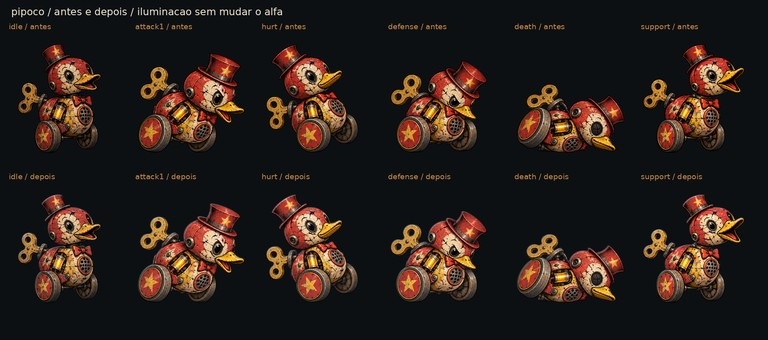

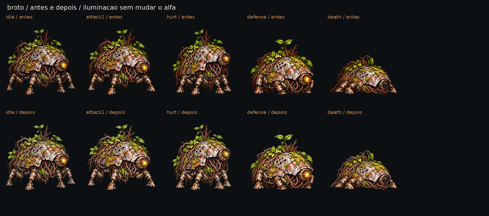


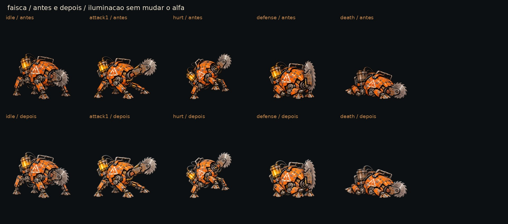

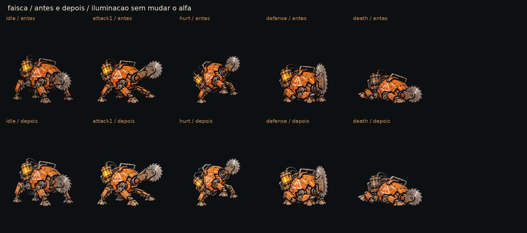

## Prova nos cenários reais

Capturas feitas nesta rodada na **Godot 4.7.2**, base de código `de4cbf4`, Compatibility/llvmpipe, viewport **1920 × 1080**. O `tools/capture_scenarios.gd` original foi executado nos três mapas pedidos, incluindo as quatro zonas do Depósito Inundado. Relatório dessa execução ao final.

Para a prova antes/depois, um script temporário fora do repositório posiciona os três ajudantes juntos numa cópia isolada da campanha. Usa `AHSpriteCard`, as alturas reais do jogo e as âncoras do manifesto; fotografa o idle atual e depois troca **somente a textura em memória**, mantendo a mesma câmera, posição e luz. As texturas novas são reduzidas a 589 × 668 e recebem mipmaps antes de criar a textura temporária, com o mesmo filtro do card; a compressão final de produção ainda é tarefa da integração. Isso é uma **montagem de QA renderizada na engine**, não uma alegação de integração nas patrulhas ou no combate. Nenhuma captura foi pintada ou recebeu um ajudante por colagem 2D. O save do jogador não foi usado.

Cenários escuros: noite, piso úmido, sem chuva nessa comparação para não esconder o contorno com gotas em instantes diferentes; as capturas normais da ferramenta incluem noite com chuva. Rua: fim de tarde seco. Os pares têm **3840 × 1144**: cabeçalho técnico de 64 px e dois quadros completos de 1920 × 1080, sem redimensionamento. As versões a 40% têm **1536 × 458**. Abra o arquivo 100% para inspecionar os pixels; o Markdown pode ajustar a largura à janela. Os recortes de detalhe são 1:1, sem ampliar os personagens.

### RootBridge

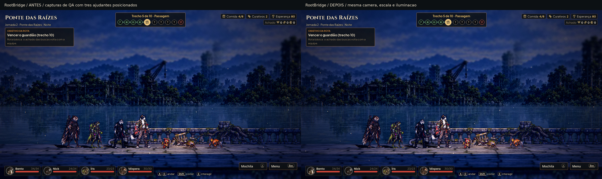

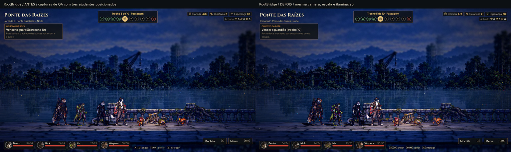

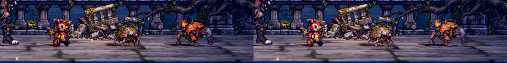

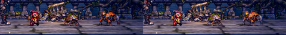

[Prova em cinza a 40%](helpers_root_bridge_comparison_gray_40.jpg).

### SewerDucts

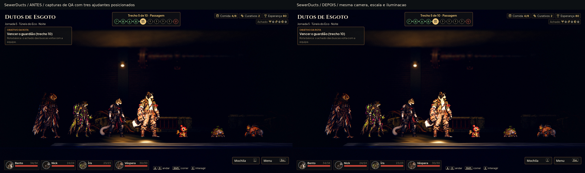

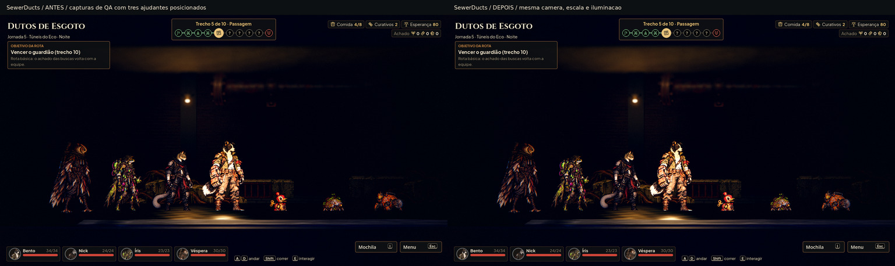

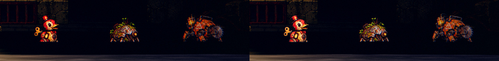

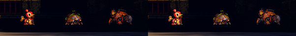

[Prova em cinza a 40%](helpers_sewer_ducts_comparison_gray_40.jpg).

### FloodedDepot

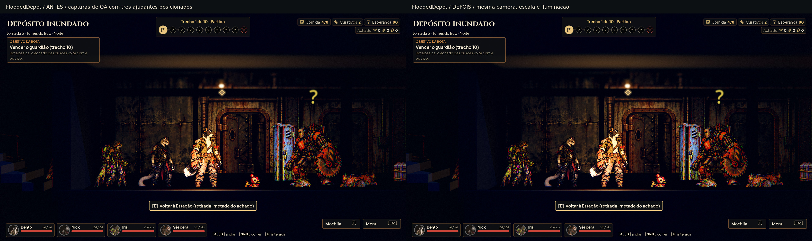

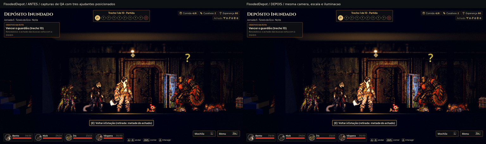

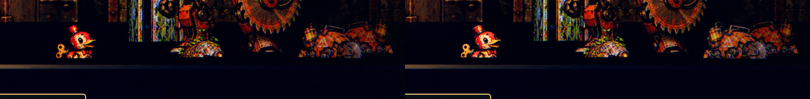

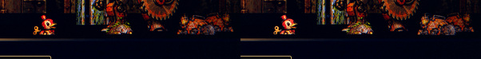

[Prova em cinza a 40%](helpers_flooded_depot_comparison_gray_40.jpg).

### Street

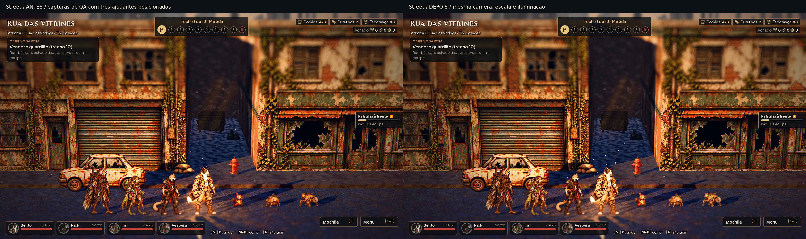

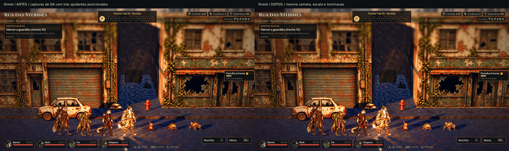

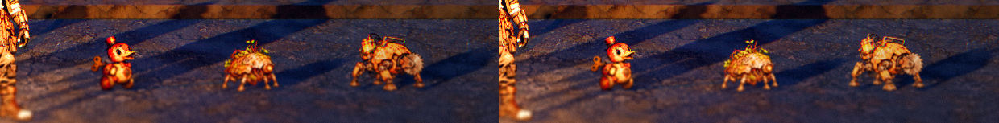

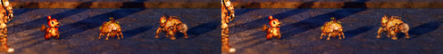

[Prova em cinza a 40%](helpers_street_comparison_gray_40.jpg).

### Posição e escala da prova

Os valores abaixo são projeções medidas pela câmera, não novas regras para posicionar personagens. O piso, o tamanho físico e a âncora são iguais antes/depois. Uma eventual borda mais clara não autoriza aumentar o ajudante.

| Cenário | Ajudante | Pé na captura x,y (px) | Altura do corpo projetada (px) | Altura física (m) |
|---|---|---|---|---|
| FloodedDepot | broto | 1431.79, 860.86 | 92.79 | 0.4920 |
| FloodedDepot | faisca | 1667.69, 860.86 | 105.17 | 0.5576 |
| FloodedDepot | pipoco | 1195.90, 860.86 | 98.98 | 0.5248 |
| RootBridge | broto | 1215.64, 885.58 | 62.92 | 0.4920 |
| RootBridge | faisca | 1375.62, 885.58 | 71.31 | 0.5576 |
| RootBridge | pipoco | 1055.66, 885.58 | 67.12 | 0.5248 |
| SewerDucts | broto | 1431.79, 860.86 | 92.79 | 0.4920 |
| SewerDucts | faisca | 1667.69, 860.86 | 105.17 | 0.5576 |
| SewerDucts | pipoco | 1195.90, 860.86 | 98.98 | 0.5248 |
| Street | broto | 1300.35, 926.13 | 63.60 | 0.4920 |
| Street | faisca | 1470.52, 926.13 | 72.13 | 0.5576 |
| Street | pipoco | 1130.17, 926.13 | 67.86 | 0.5248 |

## Placa de nome: conferência do Claude

A retocagem não resolve uma placa que cobre o personagem. O HUD atual posiciona a placa sob os pés e, quando o painel de ação está aberto, limita seu Y pelo topo do dock; esse limite pode empurrá-la sobre um ajudante baixo. Não foi alterado código de UI. Na integração, conferir as três criaturas com o painel aberto e fechado: não permitir que a placa invada o retângulo visível da silhueta. Proposta de margem mínima: **8 px** entre a borda da placa e o personagem na base 1920 × 1080, preferindo manter a placa abaixo do pé com a folga atual de 10 px ou deslocá-la para uma área livre. A prova acima avalia o asset com a luz real, não simula a placa corrigida. Não cortar ou deslocar a arte para compensar o HUD.

## Oclusão encontrada no Hall do Depósito

A prova preserva um problema real da cena: o piso/elemento frontal cobre a parte inferior dos ajudantes na posição testada, mesmo sem uma placa de nome. A âncora projetada fica em **y = 860,86 px**, mas o corte visível começa aproximadamente em **y = 821 px**; a ordem de grandeza é 40 px ocultos. O arquivo PNG está completo e seu alfa é idêntico ao original. A comparação não esconde esse limite: ver o recorte 1:1 do Depósito.

**Pendência de integração de gravidade alta, fora da fonte de arte:** conferir a faixa útil/profundidade/oclusão do cenário e o HUD na luta real (#16). Não aumentar o ajudante, deslocar seu pé na imagem ou desenhar luz por cima da geometria para disfarçar o corte. Esta entrega aprova as fontes de arte; não aprova a integração do Hall nem afirma que a retocagem resolve oclusão física.

## QA de design

Segunda persona, checklist de [qa.md](qa.md). Ícones tintados de 22/32 px, texto de interface e 9-slice não se aplicam; avaliar a silhueta pequena no tamanho projetado, a redução real a 40%, a transparência e a leitura em cinza.

**Rodada 1 — VEREDITO: REPROVADO.** Candidatos gerados de `pipoco-idle-readable.png`, `broto-idle-readable.png` e `faisca-idle-readable.png`: pequenas mudanças de contorno/registro em uma regeneração são inadequadas para a troca direta (alta). Correção: transferir a direção cromática da luz dentro do alfa e da geometria originais, e repetir o tratamento nas 13 poses. Conferência byte a byte do alfa: 16/16.

**Rodada 2 — VEREDITO: REPROVADO.** Provas antes/depois dos cenários, primeira captura: a textura temporária nova não tinha a redução e os mipmaps da textura de produção; o serrilhado falseava a comparação (média). Correção: reduzir a 589 × 668, gerar mipmaps, usar o mesmo material/filtro e recapturar os quatro pares. As primeiras capturas foram descartadas das pranchas finais.

**Rodada 3 — VEREDITO: APROVADO para as fontes de arte.** Conferidos os 16 PNGs, as pranchas de todas as poses, quatro pares completos a 100%, reduções reais a 40%, recortes 1:1 e versões em cinza. Luz interna discreta, contorno sem expansão, partes reconhecíveis por forma/valor, sem reacender as derrotas; nada alto ou médio pendente nos arquivos de arte. As mesmas âncoras e alturas foram usadas nos pares da engine. A oclusão geométrica do Hall e a placa de nome permanecem pendências explícitas de integração do Claude, não uma aprovação de gameplay.

Observação baixa: o ganho é deliberadamente moderado; não elimina a iluminação escura do cenário. A QA de integração precisa conferir oclusão e placas no combate com os ajudantes.

## Validação e rastreabilidade

- 16/16 PNGs RGBA de 1178 × 1335. Alfa idêntico ao respectivo original, portanto nenhum deslocamento da silhueta, do pé ou das características; RGB zero em pixels totalmente transparentes. Para o idle, a comparação é contra o WebP local ampliado à tela de origem, pois a fonte Unreal não foi baixada.
- Os 26 PNGs originais da #44 permanecem intactos; nenhum arquivo em `scripts/`, `data/` ou `tests/` foi alterado.
- Suíte da base: 21/21 testes, paridade 48/48 e jornada completa. Há erros diferidos de `_restyle` e avisos de recursos no encerramento, relatados na #44 e no PR para o Claude.
- As capturas rodam num renderizador por software. Os tempos servem apenas para identificar a execução de QA, sem representar desempenho no computador do Lucas.

### Execução de `capture_scenarios.gd`

**12 conferências, 0 falhas**, saída 0. Seis zonas fotografadas em dois climas (12 quadros); piso dos heróis/patrulhas e limites de movimento conferidos.

```text
RootBridge-0-golden avg_ms=772.08 p95_ms=1269.95 renderer=gl_compatibility
RootBridge-0-night-rain avg_ms=781.15 p95_ms=1240.36 renderer=gl_compatibility
RootBridge-0-floor PASS heroes_off=0 guards_off=0
RootBridge-0-lane PASS reached=(119.60, 1.20) limit=(119.60, 1.20)
SewerDucts-0-golden avg_ms=851.11 p95_ms=1076.85 renderer=gl_compatibility
SewerDucts-0-night-rain avg_ms=796.96 p95_ms=841.09 renderer=gl_compatibility
SewerDucts-0-floor PASS heroes_off=0 guards_off=0
SewerDucts-0-lane PASS reached=(59.60, 1.20) limit=(59.60, 1.20)
FloodedDepot-0-golden avg_ms=1029.55 p95_ms=1568.62 renderer=gl_compatibility
FloodedDepot-0-night-rain avg_ms=1154.63 p95_ms=1804.25 renderer=gl_compatibility
FloodedDepot-0-floor PASS heroes_off=0 guards_off=0
FloodedDepot-0-lane PASS reached=(13.60, 1.20) limit=(13.60, 1.20)
FloodedDepot-1-golden avg_ms=1258.22 p95_ms=1972.55 renderer=gl_compatibility
FloodedDepot-1-night-rain avg_ms=1107.53 p95_ms=1378.67 renderer=gl_compatibility
FloodedDepot-1-floor PASS heroes_off=0 guards_off=0
FloodedDepot-1-lane PASS reached=(31.60, 1.20) limit=(31.60, 1.20)
FloodedDepot-2-golden avg_ms=1290.90 p95_ms=2527.71 renderer=gl_compatibility
FloodedDepot-2-night-rain avg_ms=1273.73 p95_ms=2248.69 renderer=gl_compatibility
FloodedDepot-2-floor PASS heroes_off=0 guards_off=0
FloodedDepot-2-lane PASS reached=(49.60, 1.20) limit=(49.60, 1.20)
FloodedDepot-3-golden avg_ms=1783.49 p95_ms=2823.41 renderer=gl_compatibility
FloodedDepot-3-night-rain avg_ms=1602.74 p95_ms=2582.07 renderer=gl_compatibility
FloodedDepot-3-floor PASS heroes_off=0 guards_off=0
FloodedDepot-3-lane PASS reached=(67.60, 1.20) limit=(67.60, 1.20)
```

### SHA-256 das capturas antes/depois

São os quadros PNG brutos da prova, antes da composição das pranchas JPEG. Os PNGs temporários ficam fora do Git; as pranchas preservam o enquadramento e a escala para revisão.

| Captura | SHA-256 |
|---|---|
| `RootBridge-before.png` | `2ae117dc6de9c4d5ef23acac75fe7dbf2152ff1fd2df2f2e2eaea8233affab53` |
| `RootBridge-after.png` | `782e36611e6e9aae76731afb28a6cae833eddc8bbe6586ff19ac5b26143c27ae` |
| `SewerDucts-before.png` | `44541789224c645d113847bf2ccf14d9fef33cad99ef8207f742db0a13d7d932` |
| `SewerDucts-after.png` | `2109b24c169e552995b3cd7e4ffc1804a9bc32ac3beaeef420bbf735763753da` |
| `FloodedDepot-before.png` | `f7ac972c59295ca2efc6f59342706534a76d4cde1b2f819da9ae8ecb955bfc62` |
| `FloodedDepot-after.png` | `f6cea35438c3459e6044a77f3b8444db5c2501be0c51223c94bddbce03328e60` |
| `Street-before.png` | `de3765678b00c00c541ae69067a98e5f6fac84236351ce7028a53c7a931369da` |
| `Street-after.png` | `2d00ae25b123560611cbbcb1c1e424bc20ff32517ff4454238b5ebfc34cae8ae` |
