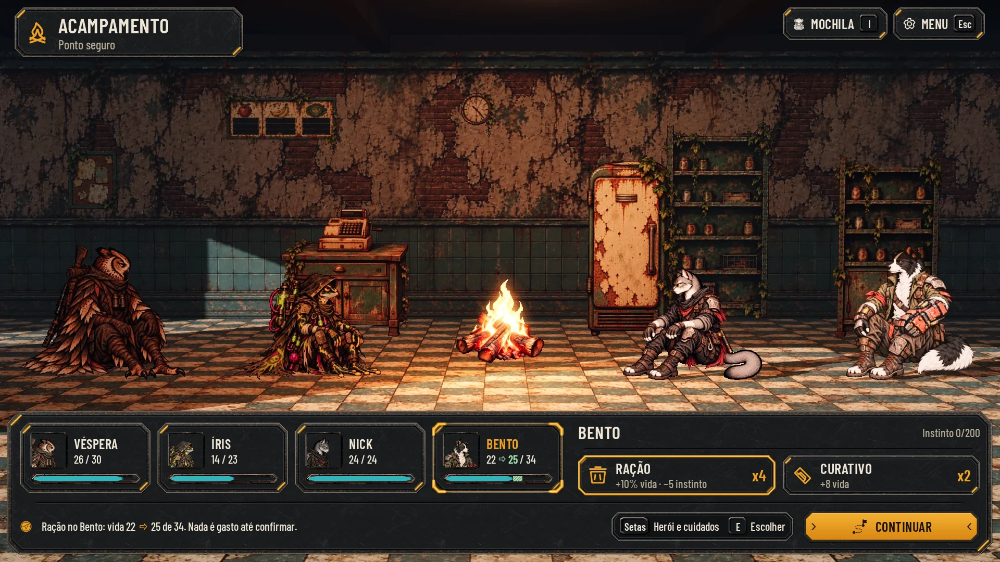
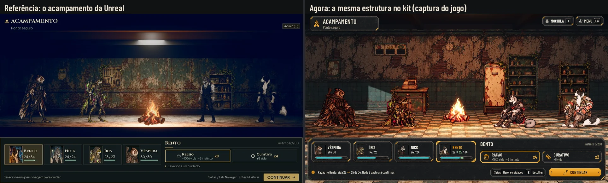

# Ajustes da #109, lote 5 (26/10/2026)

Os três ajustes do Lucas depois de jogar, no kit da Awesomic (`art/ui/kit/station`, a seção "Padrão de componentes" de
[hud-direction.md](hud-direction.md)):
1. o acampamento na estrutura da Unreal;
2. o Menu da expedição no lugar da "Pausa";
3. o popup curto de fim de luta, sem botão obrigatório.

As telas estão sobre **capturas novas do jogo** (Godot 4.7.2, gl_compatibility, 1920x1080), tiradas pelo
[capture.gd](hud-ajustes/capture.gd) com a interface escondida. Os textos e números são os dessas capturas
([before/](hud-ajustes/before)) e os do código de hoje. As maquetes servem para comparar e aprovar e não entram no jogo.
A integração é do Claude (#109 e #60).

**Só o que mudou foi gerado.** As 14 outras telas de [hud-exploracao.md](hud-exploracao.md) não foram refeitas. O
`render.mjs` de lá passou a exportar a moldura, e as 56 telas dele saem iguais, pixel a pixel, às do PR #110. Saíram de
lá só o acampamento e a Pausa (as WebP antigas foram apagadas), e aquela página agora aponta para cá.

## As telas

| Tela | Normal | Maior | Daltonismo | Maior com daltonismo | Comparar |
|---|---|---|---|---|---|
| Acampamento: o herói escolhido | [camp](hud-ajustes/camp.webp) | [large](hud-ajustes/camp_large.webp) | [colorblind](hud-ajustes/camp_colorblind.webp) | [large_colorblind](hud-ajustes/camp_large_colorblind.webp) | [hoje](hud-ajustes/before_after_camp.webp) |
| Acampamento: foco na Ração, com a vida prevista | [camp_preview](hud-ajustes/camp_preview.webp) | [large](hud-ajustes/camp_preview_large.webp) | [colorblind](hud-ajustes/camp_preview_colorblind.webp) | [large_colorblind](hud-ajustes/camp_preview_large_colorblind.webp) | [Unreal](hud-ajustes/camp_unreal.webp) |
| Acampamento: vida cheia (Nick) | [camp_full](hud-ajustes/camp_full.webp) | [large](hud-ajustes/camp_full_large.webp) | [colorblind](hud-ajustes/camp_full_colorblind.webp) | [large_colorblind](hud-ajustes/camp_full_large_colorblind.webp) | |
| Menu da expedição | [menu](hud-ajustes/menu.webp) | [large](hud-ajustes/menu_large.webp) | [colorblind](hud-ajustes/menu_colorblind.webp) | [large_colorblind](hud-ajustes/menu_large_colorblind.webp) | [hoje](hud-ajustes/before_after_menu.webp) |
| Sem o menu: OPÇÕES e VOLTAR À ESTAÇÃO | [menu_direct](hud-ajustes/menu_direct.webp) | [large](hud-ajustes/menu_direct_large.webp) | [colorblind](hud-ajustes/menu_direct_colorblind.webp) | [large_colorblind](hud-ajustes/menu_direct_large_colorblind.webp) | |
| Fim de luta: sem recursos (patrulha) | [fight_none](hud-ajustes/fight_none.webp) | [large](hud-ajustes/fight_none_large.webp) | [colorblind](hud-ajustes/fight_none_colorblind.webp) | [large_colorblind](hud-ajustes/fight_none_large_colorblind.webp) | [hoje](hud-ajustes/before_after_fight_none.webp) |
| Fim de luta: Treino pronto | [fight_level](hud-ajustes/fight_level.webp) | [large](hud-ajustes/fight_level_large.webp) | [colorblind](hud-ajustes/fight_level_colorblind.webp) | [large_colorblind](hud-ajustes/fight_level_large_colorblind.webp) | |
| Fim de luta: com recursos (guardião) | [fight_loot](hud-ajustes/fight_loot.webp) | [large](hud-ajustes/fight_loot_large.webp) | [colorblind](hud-ajustes/fight_loot_colorblind.webp) | [large_colorblind](hud-ajustes/fight_loot_large_colorblind.webp) | |
| Fim de luta: fuga | [fight_fled](hud-ajustes/fight_fled.webp) | [large](hud-ajustes/fight_fled_large.webp) | [colorblind](hud-ajustes/fight_fled_colorblind.webp) | [large_colorblind](hud-ajustes/fight_fled_large_colorblind.webp) | |
| Fim de luta: derrota | [fight_defeat](hud-ajustes/fight_defeat.webp) | [large](hud-ajustes/fight_defeat_large.webp) | [colorblind](hud-ajustes/fight_defeat_colorblind.webp) | [large_colorblind](hud-ajustes/fight_defeat_large_colorblind.webp) | |

Cada tela também tem a redução a 40% (`*_40.webp`) e o cinza (`*_gray.webp`). A comparação com a Unreal existe nos
quatro perfis (`camp_unreal*.webp`). Os "hoje" são capturas da `main` de hoje: o acampamento de `tools/capture_camp.gd`,
a Pausa e a tela de vitória de `capture.gd --only=today`.

[checks.json](hud-ajustes/checks.json) passa nas 40 telas (10 telas, 4 perfis), com as conferências do
[lib.mjs](hud-kit/lib.mjs):
- texto dentro da área de conteúdo de cada peça, sem corte e dentro da tela;
- peça cortada;
- alvo fora da tela, sobreposto ou menor que 56 px;
- texto embaixo de um painel do meio ou de um medalhão;
- **painel ou botão sobre a equipe:** o corpo de cada herói na cena entra como uma caixa (`data-hit="hero-body"`). No
  acampamento e no fim de luta, ela é medida na captura pela mesma conta do clique do acampamento
  (`AHCampHud.body_rect`, nos JSON de `before/`); na rua do Menu, ela é medida na imagem. Qualquer painel ou botão
  por cima de um corpo reprova a tela;
- caractere que a fonte não tem;
- o menor texto tem 20 px.




## 1. O acampamento na estrutura da Unreal

**A cena** ([before/camp_clean.webp](hud-ajustes/before/camp_clean.webp)):
- de lado, como a luta, com a fogueira da mercearia no meio do quadro;
- Véspera e Íris à esquerda, Nick e Bento à direita, sentados no chão com as poses da #82, virados para o fogo e
  alinhados na mesma linha do chão. Nada de roda nem de herói de costas;
- quem chega com até um quarto da vida continua deitado (`LIE_DOWN_AT`), como hoje.

**O painel, um só, na faixa de baixo de ponta a ponta** (`panel_large`, x 14–1906, o pé em y 1066):
- **à esquerda, as quatro cartas** na ordem da cena, com as peças das cartas da Preparação: `hero_card` (252 de
  largura), o retrato de 72 em `square_portrait`, o nome, a vida e a barra. A escolhida tem o nome em âmbar e as
  cantoneiras âmbar (`selected_corners`, as de quem age na luta). O foco do teclado é a moldura inteira (`focus_frame`).
  As duas formas se distinguem também no cinza. Clicar ou usar as setas troca;
- **à direita, o herói escolhido:** o nome, o instinto ("Instinto 0/200") e os dois cuidados grandes
  (`secondary_button`, 76 de altura no Normal):
  - **RAÇÃO:** "+10% vida · −5 instinto" e o estoque de comida ("x4");
  - **CURATIVO:** "+8 vida" e o estoque ("x2");
- **com o foco num cuidado,** a carta mostra a vida prevista, sem gastar nada:
  - na barra, a peça nova `bar_preview`, verde clara com riscas, do fim da vida de agora até a prevista;
  - no número, "22 → 25 / 34";
  - as riscas separam a prévia também no cinza e no daltonismo, onde ela fica azul clara;
- **sem efeito,** o cuidado ganha um véu escuro com riscas sobre a chapa (como a habilidade sem uso da luta), e o ícone,
  o texto e o estoque ficam no tom apagado, sem transparência. A linha de estado diz por quê. As regras são as de hoje:
  - a **Ração** fica sem efeito só com a vida cheia **e** o instinto em 0 (`camp_use_food`). Com o instinto acima de 0,
    ela continua ativa e a linha diz "%s está com a vida cheia: a Ração só baixa o instinto (−5).";
  - o **Curativo** fica sem efeito com a vida cheia (`camp_use_bandage`): "%s está com a vida cheia.";
  - os dois juntos ([camp_full](hud-ajustes/camp_full.webp), o Nick com 24/24 e o instinto em 0): "%s está com a vida
    cheia e o instinto em 0: nenhum cuidado faz efeito.";
- **no pé:**
  - a linha de estado ("Ração no Bento: vida 22 → 25 de 34. Nada é gasto até confirmar.");
  - a dica das teclas: Setas (herói e cuidados), E Escolher;
  - CONTINUAR (levantar acampamento), o botão âmbar.

**No alto:**
- à esquerda, a plaqueta "ACAMPAMENTO / Ponto seguro";
- à direita, MOCHILA (I) e MENU (Esc), como hoje (#98). A Mochila e a ampola da Íris continuam, e o Menu da expedição
  abre no acampamento com o Voltar à Estação liberado (`safe_retreat` aceita a tela `rest`).
- O corredor, os suprimentos e a equipe da rua saem durante o acampamento, como já saem hoje.

**A resposta** (o número verde, o efeito e o som) continua sobre o herói escolhido, como na #77.

**O foco do teclado e do controle**, como hoje:
- ←/→ (A/D, o direcional e o analógico) trocam o herói, em qualquer lugar do painel; a carta escolhida acompanha;
- ↑/↓ andam entre a carta, RAÇÃO, CURATIVO e CONTINUAR, nessa ordem;
- E (ou o A do controle) confirma; I abre a Mochila no herói escolhido; Esc abre o Menu da expedição;
- ao abrir, o foco vai para o primeiro cuidado com efeito, e, sem nenhum, para CONTINUAR.

**Medidas:**
- o painel começa em y 790 no Normal e em y 738 no Maior. Os pés da cena ficam em y 731, e a conferência dos corpos
  confirma que ele não cobre ninguém;
- cartas de 252 com 12 entre elas; os dois cuidados dividem o resto da linha.

**Na cena (`camp_scene.gd`, para a integração):**
- os quatro lugares passam a ser uma fileira, a partir da fogueira: x −3,3, −1,55, +1,55 e +3,3 m, todos em z 0,55;
- a ordem é Véspera, Íris | fogo | Nick, Bento;
- a câmera fica na fogueira (`focus_x = camp_x`), sem puxar para o escolhido, para ninguém sair do quadro. O escolhido
  se marca pela luz da escolha, que já existe, e pela carta.
- Com menos gente, os lugares de dentro primeiro.
- **Quem chega com até um quarto da vida deita** (a pose `*_sleep`, mais larga). Esta entrega não mostra esse caso: na
  integração, a pose deitada precisa caber no lugar de fora (até a borda da tela) sem encostar no vizinho de dentro.
- `capture.gd` faz exatamente isso com as cartas do jogo; nada em `scripts/` mudou.

## 2. O Menu da expedição

No lugar da "Pausa" (`exploration_hud.gd`, `show_menu`), com as mesmas ações:
- **as medidas:** `panel_large` com 660 de largura, centrado no espaço à direita do cartão do objetivo (x 862). O pé fica
  em y 720, acima das cabeças da equipe (a do Bento começa em y 732): o topo cai em y 246 no Normal (a Pausa ficava em
  230) e sobe no Maior (y 144). O X é um `icon_button` de 56; os botões têm 64 de altura (`secondary_button` e, no
  FECHAR, `primary_button`);
- **o título:** "MENU DA EXPEDIÇÃO" pequeno em âmbar, o lugar ("RUA DAS VITRINES") e o trecho ("Trecho 3 de 10 ·
  Patrulha");
- **o X** no canto, como nos painéis da Estação;
- **VOLTAR À ESTAÇÃO**, com o custo numa sublinha menor ("Retirada: metade do achado"; com o guardião vencido, "Fase
  concluída: todo o achado"), para o botão não quebrar em duas linhas no Maior. A confirmação é a mesma, "Abandonar a expedição?"
  ([risk](hud-exploracao/risk.webp), que não mudou). No meio de uma luta ou evento, fica apagado com "Termine a luta ou
  o evento antes de voltar.", como hoje. Esses dois estados não têm tela própria nesta entrega: só mudam a sublinha e o
  apagado (o mesmo dos cuidados do acampamento);
- **OPÇÕES** e **NOVA CAMPANHA**, em alerta e com a confirmação de hoje;
- **FECHAR** no lugar de CONTINUAR, com Esc / B. O Esc, o B, o X e FECHAR fecham.

**Nenhum texto fala em "Pausa".** O guardião vencido diz "(botão ou Esc)", o que continua certo: Esc abre o Menu da
expedição, e lá está "Voltar à Estação (fase concluída: todo o achado)". As dicas (`data/`) não citam a Pausa.

**A variante sem menu** ([menu_direct](hud-ajustes/menu_direct.webp)), se o Lucas preferir tirar o menu de vez:
- os botões do canto ficam MOCHILA (I), VOLTAR À ESTAÇÃO (sem tecla, com a mesma confirmação de retirada) e OPÇÕES (Esc);
- o Esc e OPÇÕES abrem as Opções de hoje, que já têm Nova campanha na seção Campanha.

## 3. O popup de fim de luta

No lugar do painel de vitória (`combat_hud.gd`, `show_result`):
- **um painel pequeno no alto** (`panel_large`, 640 de largura, o topo em y 40, no lugar da ordem da rodada), longe da
  equipe. **Na integração, o popup esconde a ordem da rodada** (`_order_panel`, em y 12): hoje o `show_result` só esconde
  o painel de baixo, e os dois se sobreporiam. As barras de vida continuam sob os heróis. A conferência dos corpos confirma que
  ninguém fica coberto, também no Maior com o "Treino pronto" (o pé do painel em y 405, a cabeça mais alta em y 438);
- **"BATALHA FINALIZADA"** e, numa linha menor, **Vitória** em âmbar com as estrelas pequenas (os ícones novos `star` e
  `star_empty`, 28 px; a vazia é o contorno, para ler também no cinza). **Fuga** fica no tom do texto, e **Derrota**, em
  alerta;
- **os recursos da luta** em chips (`cost_chip`), ou **"Nenhum recurso nesta luta"**:
  - a patrulha não dá recurso (`AHJourneyRules.end_combat`), então é o caso comum;
  - o guardião dá +16 sementes, +3 sucata e +1 fragmento (+6 e +1 da luta, mais +10, +2 e +1 da fase concluída);
- **o XP numa linha**, o de cada herói na ordem da cena (`xp_gained`): "XP: Véspera +8 · Íris +11 · Nick +11 · Bento
  +8", na patrulha. A soma enganava, porque o nível pede 60 de cada um;
- **"Bento: Treino pronto"**, se alguém fechou o XP do nível (o mesmo critério da tela de hoje). O nível sobe no Treino
  do Alojamento, então esta é a linha de "nível novo";
- **depois do guardião,** "A carga do guardião abre em seguida". A carga abre logo depois do popup, sem o painel de
  vitória antes;
- **fuga e derrota** mostram o que se perdeu em chips na cor de alerta: "A equipe recuou pelas sombras e largou o que
  carregava." e "Todos caíram nas ruínas. O achado ficou para trás.";
- **fecha sozinho** em cerca de 2,5 s. A linha âmbar embaixo (`slider_track` com `bar_fill`) é o tempo que falta, e
  "Fecha sozinho · qualquer tecla fecha antes". A velocidade 2x encurta pela metade. Com "Reduzir efeitos", o popup
  aparece sem animação e a linha fica parada, mas ele **continua fechando sozinho** no mesmo tempo;
- **a derrota espera um toque,** como o pedido sugere: sem a linha do tempo, com "Qualquer tecla ou toque para
  continuar". **A fuga fecha sozinha:** ela também encerra a expedição, mas logo depois vem a tela do fim da expedição
  (`show_result`, "Fuga"), que já pede o botão. Se o Lucas preferir, a fuga passa a esperar o toque também, e a tela
  muda só no pé;
- **sem botão:** nenhum alvo de toque no popup, e qualquer tecla, clique ou toque fecha;
- **o detalhe** (os critérios e o XP por herói) fica onde já existe: no relatório da volta e no Alojamento.

## Peças novas (`art/ui/kit/station/`)

| Peça | Tamanho | 9-slice | Uso |
|---|---|---|---|
| `bar_preview` | 64×16 | 0/4/0/4, **TILE na largura** | A vida prevista por cima do `bar_fill`: riscas diagonais a cada 8 px, tingida de `#a6e3ae` (`#a9d8f5` no daltonismo). Sem chanfro nos lados (continua o `bar_fill`) e repetida na largura (`axis_stretch_horizontal`), na altura da barra: as riscas mantêm o passo de 20 a 400 px |
| `icons/star` | 64×64 | — | A estrela cheia das notas, glifo branco tingido (âmbar) |
| `icons/star_empty` | 64×64 | — | A estrela vazia, só o contorno (no tom apagado) |

O manifesto (`assets.json`) passou de 57 para 58 peças e de 44 para 46 ícones. As peças saem de
[build_kit.py](hud-station/build_kit.py) (`adjust_pieces`), no mesmo padrão. A Godot 4.7.2 importou as três.

**Reaproveitadas:**
- `panel_large`, `hero_card`, `selected_frame`, `focus_frame`, `secondary_button`, `primary_button`, `keys_bar`,
  `room_plaque`, `icon_button`, `cost_chip`, `slider_track`, `bar_fill`, `divider`;
- `main_bar` e `ally_mark` (as barras sob os heróis, como na luta);
- `square_portrait`.

## Textos novos (português e inglês)

| Português | Inglês |
|---|---|
| Menu da expedição | Expedition menu |
| Trecho %d de %d · %s | Stretch %d of %d · %s (já existe no corredor) |
| Fechar | Close (já existe) |
| Ração | Ration |
| +10% vida · −5 instinto | +10% life · −5 instinct |
| +8 vida | +8 life |
| Ponto seguro | Safe spot |
| Continuar | Continue (já existe) |
| %s: escolha um cuidado. A barra mostra a vida prevista antes de gastar. | %s: choose a treatment. The bar shows the predicted life before anything is spent. |
| %s está com a vida cheia: a Ração só baixa o instinto (−5). | %s is at full life: the Ration only lowers instinct (−5). |
| %s está com a vida cheia. | %s is at full life. |
| Herói e cuidados | Hero and treatments |
| Retirada: metade do achado | Retreat: half of the finds |
| Fase concluída: todo o achado | Stage complete: all the finds |
| Ração no %s: vida %d → %d de %d. Nada é gasto até confirmar. | Ration for %s: life %d → %d of %d. Nothing is spent until you confirm. |
| %s está com a vida cheia e o instinto em 0: nenhum cuidado faz efeito. | %s is at full life with 0 instinct: no treatment has an effect. |
| Batalha finalizada | Battle over |
| Nenhum recurso nesta luta | No resources from this fight |
| XP: %s | XP: %s |
| %s +%d | %s +%d |
| %s: Treino pronto | %s: Training ready |
| A carga do guardião abre em seguida | The guardian's cargo opens next |
| A equipe recuou pelas sombras e largou o que carregava. | The team fell back through the shadows and dropped what it carried. |
| Todos caíram nas ruínas. O achado ficou para trás. | Everyone fell in the ruins. The finds were left behind. |
| Fecha sozinho · qualquer tecla fecha antes | Closes on its own · any key closes it sooner |
| Qualquer tecla ou toque para continuar | Any key or tap to continue |

"Ração" é o nome do cuidado, como na Unreal; ele gasta 1 Comida da expedição, e o estoque mostrado é o da Comida. O
ícone é o da Comida do jogo (`lobby-food`).

## Reprodução

Da raiz do repositório:
```
# 1. As capturas (precisa de uma tela; no Linux sem tela, xvfb-run -a -s "-screen 0 1920x1080x24")
"$GODOT" --path . --rendering-driver opengl3 --resolution 1920x1080 -s res://docs/design/hud-ajustes/capture.gd -- --out=<pasta>
"$GODOT" --path . --rendering-driver opengl3 --resolution 1920x1080 -s res://docs/design/hud-ajustes/capture.gd -- --out=<pasta> --only=today
"$GODOT" --path . --resolution 1920x1080 -s res://tools/capture_camp.gd -- --out=<outra>   # 01-camp.png vira <pasta>/today_camp.png
python3 docs/design/hud-ajustes/compare.py import <pasta>
# 2. As telas (com python3 -m http.server 8765 --bind 127.0.0.1)
python3 docs/design/hud-station/build_kit.py
node docs/design/hud-ajustes/render.mjs http://127.0.0.1:8765
B=docs/design/hud-ajustes/before
python3 docs/design/hud-kit/compose.py docs/design/hud-ajustes camp=$B/today_camp.jpg camp_preview camp_full \
  menu=$B/today_pause.jpg menu_direct fight_none=$B/today_result.jpg fight_level fight_loot fight_fled fight_defeat
python3 docs/design/hud-ajustes/compare.py
```

## QA de design

As rodadas seguem [qa.md](qa.md) e ficam registradas abaixo e no PR.

### Rodada 1: REPROVADO

**Alta, corrigido:**
- O popup cobria a cabeça do Bento no Maior, com o "Treino pronto". Ele subiu para y 40 (no lugar da ordem da rodada,
  que sai no fim da luta), com menos espaço entre as linhas. A conferência ganhou o corpo de cada herói
  (`data-hit="hero-body"`, medido na captura por `AHCampHud.body_rect`): painel ou botão por cima de um corpo reprova a
  tela.

**Média, corrigidos:**
- O Menu cobria o Bento no Maior. O custo da volta foi para uma sublinha, e o pé do painel ficou em y 720, acima das
  cabeças; as medidas estão na página.
- A regra da vida cheia estava errada: a Ração só fica sem efeito com a vida cheia e o instinto em 0. A página tem as
  três frases (só o instinto, só o Curativo, os dois).
- O MENU (Esc) voltou ao acampamento, ao lado da Mochila, e a página tem o mapa do foco.
- O `bar_preview` passou a ser TILE na largura, sem o chanfro dos lados; a maquete repete a peça como a Godot.

**Baixa, corrigidos:**
- o XP por herói, e não a soma;
- a escolhida com as cantoneiras e o foco com a moldura inteira;
- o véu com riscas nos cuidados sem efeito;
- a tecla E "Escolher", como na exploração;
- os textos que faltavam na tabela;
- a fuga e a derrota explicadas, e o "Reduzir efeitos";
- o cabeçalho do `capture.gd`.

**Baixa, ficam como observação:**
- o Menu com o Voltar apagado e com o guardião vencido, e o acampamento com alguém deitado, não têm tela própria (a
  página diz o que muda);
- `before_after_camp` compara o acampamento de hoje (com a Véspera deitada, 6/30) com a cena nova (26/30);
- as folgas no Maior são curtas: 11 px entre o pé do Menu e a cabeça do Bento, e 7 px entre o painel do acampamento e
  os corpos. Na integração, a mesma conferência dos corpos (`AHCampHud.body_rect` contra o painel) vale também no jogo;
- as capturas das lutas foram tiradas de novo para medir os corpos, e os números mudaram um pouco (a luta no automático
  varia a cada vez): as telas usam os da captura nova.

### Rodada 2: APROVADO

Os cinco problemas da rodada 1 estão corrigidos, sem nada novo de gravidade alta ou média. As 40 telas passam, os
números batem com os JSON recapturados, e as 56 telas da exploração continuam iguais às da `main`.

Observações baixas, para a integração (na página):
- esconder a ordem da rodada ao abrir o popup;
- as folgas curtas no Maior (11 px no Menu, 7 px no acampamento), com a conferência dos corpos também no jogo;
- o acampamento com alguém deitado e os dois estados do Voltar à Estação seguem sem tela própria;
- o ícone da Ração é o da Comida do jogo.
