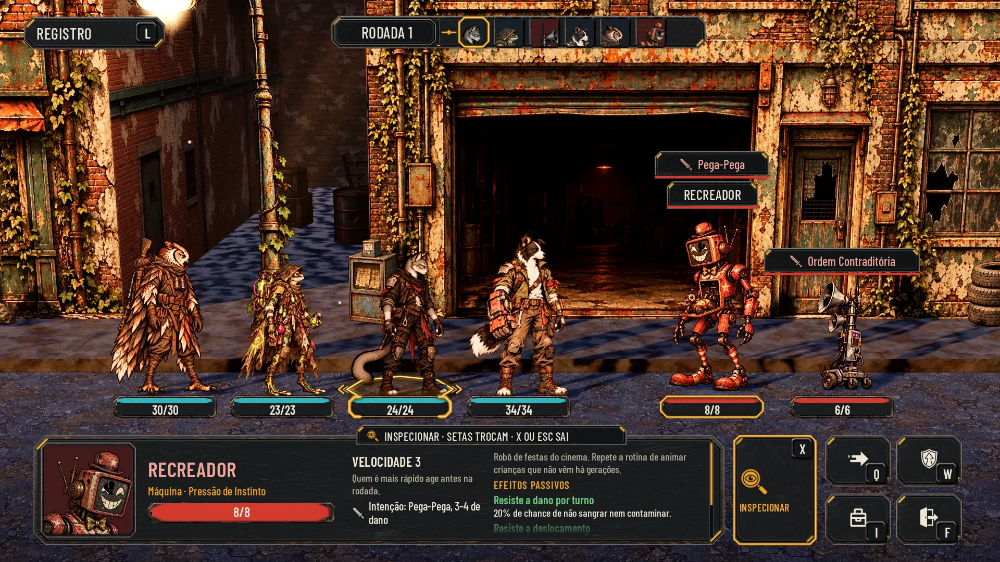
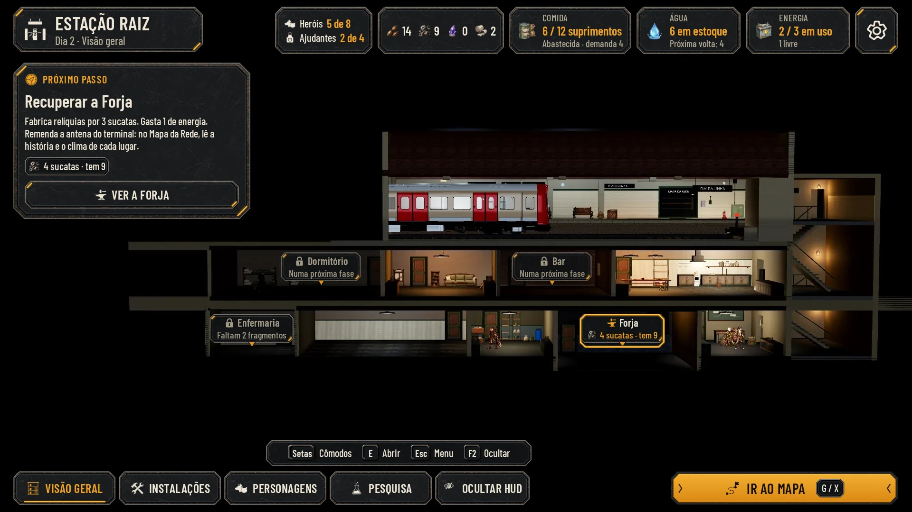
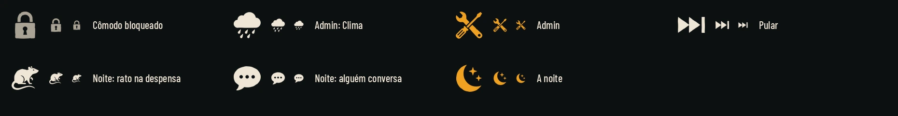

# Os ajustes depois de jogar: inspeção, Admin, cômodos, noite e formação (26/10/2026)

O lote 8, a issue #134, com as propostas de tela para as issues do Claude que saíram da última vez que o Lucas jogou:
- **a inspeção da luta (#128):** o botão INSPECIONAR, os detalhes na HUD de baixo (herói e máquina), a intenção da
  máquina sem o alvo e o popup de fim de luta com o X e a barra do tempo;
- **a barra de Admin (#130):** as sete abas, no kit;
- **os marcadores dos cômodos na Estação (#131),** como no XCOM 2;
- **a noite e o amanhecer (#132):** o cartão "Noite N" e o painel "Amanhecer · Dia N", com e sem evento;
- **a troca de formação na exploração (#129):** as plaquinhas em modo de troca;
- **ícones novos** no mesmo método: o cadeado, o clima, o Admin, pular, a noite, o rato e a conversa.

Tudo no kit da Awesomic (`art/ui/kit/station`), sobre as capturas do jogo, nos quatro perfis (Normal, Maior, daltonismo
e Maior com daltonismo). Nada em `scripts/`, `data/` nem `tests/`. Este PR vem depois do da Estação nova
([hud-casa.md](hud-casa.md), #139) e usa o que ele trouxe (os ícones INSPECIONAR, troca de formação e amanhecer, a
Enfermaria, a barra com os limites e a história do Dia 4 e do Dia 5). As telas servem para comparar e aprovar; a
integração é do Claude, nas issues de cada item.

## As telas

| Tela | Normal | Maior | Daltonismo | Maior e daltonismo | Antes e depois |
|---|---|---|---|---|---|
| Luta: a intenção sem o alvo, o mouse no Recreador | [fight_intent](hud-ajustes2/fight_intent.webp) | [large](hud-ajustes2/fight_intent_large.webp) | [colorblind](hud-ajustes2/fight_intent_colorblind.webp) | [large_colorblind](hud-ajustes2/fight_intent_large_colorblind.webp) | [comparar](hud-ajustes2/before_after_fight_intent.webp) |
| Luta: inspecionar um herói | [fight_inspect_hero](hud-ajustes2/fight_inspect_hero.webp) | [large](hud-ajustes2/fight_inspect_hero_large.webp) | [colorblind](hud-ajustes2/fight_inspect_hero_colorblind.webp) | [large_colorblind](hud-ajustes2/fight_inspect_hero_large_colorblind.webp) | [comparar](hud-ajustes2/before_after_fight_inspect_hero.webp) |
| Luta: inspecionar uma máquina | [fight_inspect_machine](hud-ajustes2/fight_inspect_machine.webp) | [large](hud-ajustes2/fight_inspect_machine_large.webp) | [colorblind](hud-ajustes2/fight_inspect_machine_colorblind.webp) | [large_colorblind](hud-ajustes2/fight_inspect_machine_large_colorblind.webp) | (como a anterior) |
| Fim de luta: o X e a barra do tempo | [fight_popup](hud-ajustes2/fight_popup.webp) | [large](hud-ajustes2/fight_popup_large.webp) | [colorblind](hud-ajustes2/fight_popup_colorblind.webp) | [large_colorblind](hud-ajustes2/fight_popup_large_colorblind.webp) | [comparar](hud-ajustes2/before_after_fight_popup.webp) |
| Fim de luta: parado com o mouse em cima | [fight_popup_hold](hud-ajustes2/fight_popup_hold.webp) | [large](hud-ajustes2/fight_popup_hold_large.webp) | [colorblind](hud-ajustes2/fight_popup_hold_colorblind.webp) | [large_colorblind](hud-ajustes2/fight_popup_hold_large_colorblind.webp) | (como a anterior) |
| Admin: Mapas | [admin_maps](hud-ajustes2/admin_maps.webp) | [large](hud-ajustes2/admin_maps_large.webp) | [colorblind](hud-ajustes2/admin_maps_colorblind.webp) | [large_colorblind](hud-ajustes2/admin_maps_large_colorblind.webp) | (tela nova) |
| Admin: Clima | [admin_weather](hud-ajustes2/admin_weather.webp) | [large](hud-ajustes2/admin_weather_large.webp) | [colorblind](hud-ajustes2/admin_weather_colorblind.webp) | [large_colorblind](hud-ajustes2/admin_weather_large_colorblind.webp) | (tela nova) |
| Admin: Ajustes | [admin_settings](hud-ajustes2/admin_settings.webp) | [large](hud-ajustes2/admin_settings_large.webp) | [colorblind](hud-ajustes2/admin_settings_colorblind.webp) | [large_colorblind](hud-ajustes2/admin_settings_large_colorblind.webp) | (tela nova) |
| Admin: Recursos | [admin_resources](hud-ajustes2/admin_resources.webp) | [large](hud-ajustes2/admin_resources_large.webp) | [colorblind](hud-ajustes2/admin_resources_colorblind.webp) | [large_colorblind](hud-ajustes2/admin_resources_large_colorblind.webp) | (tela nova) |
| Admin: Heróis | [admin_heroes](hud-ajustes2/admin_heroes.webp) | [large](hud-ajustes2/admin_heroes_large.webp) | [colorblind](hud-ajustes2/admin_heroes_colorblind.webp) | [large_colorblind](hud-ajustes2/admin_heroes_large_colorblind.webp) | (tela nova) |
| Admin: Testes de combate | [admin_combat](hud-ajustes2/admin_combat.webp) | [large](hud-ajustes2/admin_combat_large.webp) | [colorblind](hud-ajustes2/admin_combat_colorblind.webp) | [large_colorblind](hud-ajustes2/admin_combat_large_colorblind.webp) | (tela nova) |
| Admin: Cenas e Jornada, com a confirmação | [admin_journey](hud-ajustes2/admin_journey.webp) | [large](hud-ajustes2/admin_journey_large.webp) | [colorblind](hud-ajustes2/admin_journey_colorblind.webp) | [large_colorblind](hud-ajustes2/admin_journey_large_colorblind.webp) | (tela nova) |
| Estação: os marcadores dos cômodos | [station_markers](hud-ajustes2/station_markers.webp) | [large](hud-ajustes2/station_markers_large.webp) | [colorblind](hud-ajustes2/station_markers_colorblind.webp) | [large_colorblind](hud-ajustes2/station_markers_large_colorblind.webp) | [comparar](hud-ajustes2/before_after_station_markers.webp) |
| Estação: o foco num cômodo bloqueado | [station_markers_focus](hud-ajustes2/station_markers_focus.webp) | [large](hud-ajustes2/station_markers_focus_large.webp) | [colorblind](hud-ajustes2/station_markers_focus_colorblind.webp) | [large_colorblind](hud-ajustes2/station_markers_focus_large_colorblind.webp) | (como a anterior) |
| A noite: o cartão "Noite 4" | [night_card](hud-ajustes2/night_card.webp) | [large](hud-ajustes2/night_card_large.webp) | [colorblind](hud-ajustes2/night_card_colorblind.webp) | [large_colorblind](hud-ajustes2/night_card_large_colorblind.webp) | [comparar](hud-ajustes2/before_after_night_card.webp) |
| O amanhecer, com um evento | [dawn_event](hud-ajustes2/dawn_event.webp) | [large](hud-ajustes2/dawn_event_large.webp) | [colorblind](hud-ajustes2/dawn_event_colorblind.webp) | [large_colorblind](hud-ajustes2/dawn_event_large_colorblind.webp) | [comparar](hud-ajustes2/before_after_dawn_event.webp) |
| O amanhecer, sem evento | [dawn_quiet](hud-ajustes2/dawn_quiet.webp) | [large](hud-ajustes2/dawn_quiet_large.webp) | [colorblind](hud-ajustes2/dawn_quiet_colorblind.webp) | [large_colorblind](hud-ajustes2/dawn_quiet_large_colorblind.webp) | (como a anterior) |
| Exploração: a formação aberta | [explore_formation](hud-ajustes2/explore_formation.webp) | [large](hud-ajustes2/explore_formation_large.webp) | [colorblind](hud-ajustes2/explore_formation_colorblind.webp) | [large_colorblind](hud-ajustes2/explore_formation_large_colorblind.webp) | [comparar](hud-ajustes2/before_after_explore_formation.webp) |
| Exploração: um escolhido para trocar | [explore_formation_pick](hud-ajustes2/explore_formation_pick.webp) | [large](hud-ajustes2/explore_formation_pick_large.webp) | [colorblind](hud-ajustes2/explore_formation_pick_colorblind.webp) | [large_colorblind](hud-ajustes2/explore_formation_pick_large_colorblind.webp) | (como a anterior) |

Cada tela também tem a redução a 40% (`*_40.webp`), o cinza (`*_gray.webp`) e, quando o painel rola, o painel rolado
até o fim (`*_scrolled.webp`). O "antes" é a tela aprovada que o jogo segue hoje (hud-luta, hud-ajustes, hud-estacao e
hud-exploracao).

[checks.json](hud-ajustes2/checks.json) mede cada texto e cada alvo de toque com as conferências do `lib.mjs`. As 76
telas (19 telas, 4 perfis) passam: nenhum texto cortado, fora da sua peça ou fora da tela; nenhum alvo sobreposto ou
menor que 56 px; nenhuma peça cortada pelo painel; nenhum texto por cima de medalhão ou de painel; o menor texto tem
20 px.

## 1. A inspeção da luta (#128)

- **INSPECIONAR** é um botão alto à esquerda da grade das ações (Mover, Defender, Mochila, Fugir), da altura das duas
  linhas, com o glifo da lupa, o rótulo e a tecla. A tecla é a do Examinar de hoje (`combat_examine`, X e L3 no
  controle): é a mesma ideia, agora como botão. Ligado, ganha a moldura âmbar.
- **O mouse em cima** de um personagem só marca quem ele é: a moldura de foco na barra da vida e, nas máquinas, o nome
  na aba vermelha. A ficha não abre.
- **Com a inspeção ligada,** quem foi apontado ou escolhido aparece na HUD de baixo, no lugar do painel do herói da vez
  **e** das habilidades (a vez continua de quem age; ao desligar, o painel volta):
  - o retrato (nas máquinas, o recorte do sprite), o nome, o nível, a espécie e o papel (nas máquinas, "Máquina" e o
    papel de `enemies.json`), a vida e o instinto;
  - a velocidade e o que ela faz; a posição (heróis) ou a intenção, sem o alvo (máquinas);
  - à direita, os passivos e os estados, cada um com o que faz (os textos de `character_sheet.gd` e do glossário de
    `ui_style.gd`). Nas máquinas, a descrição vem primeiro. O que não cabe rola.
  - A aba de cima diz como trocar e sair: "Inspecionar · Setas trocam · X ou Esc sai".
  - Os estados mostrados são exemplo (a captura é a rodada 1, sem estados): o Recreador "Marcado".
- **A intenção da máquina,** sobre a cabeça, mostra o tipo (o ícone de hoje: ataque, área, bloqueio, cura, movimento,
  atordoado) e o nome da ação: "Pega-Pega", "Ordem Contraditória". Sai o "→ um de 4".
- **O popup de fim de luta** (o do lote 5, [hud-ajustes.md](hud-ajustes.md)) ganha o X no canto, e a barra do tempo
  conta 5 s ("Fecha em 4 s · qualquer tecla fecha antes"). Com o mouse em cima ou o foco nele, a barra para, fica
  cinza e diz por quê ("Parado: o mouse está em cima · qualquer tecla fecha"). Na derrota, continua esperando o toque.

## 2. A barra de Admin (#130)

Ferramenta de teste: simples e densa, mas no idioma do kit.
- **O F1 abre por cima de qualquer tela** (título, Estação, rua, luta): a tela de baixo escurece e fica parada. No alto,
  a faixa com ADMIN ("Testes · F1 fecha"), as sete abas (a ativa em âmbar e sublinhada) e o X.
- **O conteúdo** é uma lista de linhas: o rótulo à esquerda (com a origem, quando substitui uma tecla antiga da rua) e
  os controles à direita, em chips do kit. No Maior, os chips quebram a linha.
- **O que muda o save** diz antes ("Isso altera o save: cada ação pede para confirmar antes"), e a confirmação é a
  janela do kit (em "Cenas e Jornada": "Liberar todas as fases?"). Os testes de combate dizem que não alteram o save.
- **Cada ação diz o que fez** num aviso curto embaixo ("+10 sementes: agora 40").
- **As abas:**
  - **Mapas:** o título, a Estação e o Mapa da Rede; cada fase com os mapas dela (a travessia e o trecho), o trecho 1 e
    o guardião; ir com a equipe de agora ou a inicial.
  - **Clima:** a hora (fim de tarde, noite) e a chuva, que eram o T e o R da rua; só agora ou a jornada inteira.
  - **Ajustes:** a câmera da exploração, da Estação e da luta; a velocidade da luta; o pós-processamento e as colisões
    (o P e o C da rua); a qualidade.
  - **Recursos:** um por linha, com o que se tem e −1, +1, +5, +10.
  - **Heróis:** cada herói com o estado, curar, cair ou tirar da recuperação (#118), +50 XP e +1 nível (#90);
    recrutar na hora e quem chega no próximo trem (#122).
  - **Testes de combate:** a próxima patrulha (o K da rua), a luta contra um inimigo escolhido, forçar Superação e
    Colapso, +50 de Instinto, curar a equipe, vencer, perder e fugir.
  - **Cenas e Jornada:** finalizar e resetar a fase, liberar todas, pular a noite e o amanhecer, abrir cada evento e o
    briefing, recuperar todos os cômodos.

## 3. Os marcadores dos cômodos (#131)

Como no XCOM 2: sobre cada cômodo não recuperado, uma placa (a `room_tag` do kit, com a ponta para baixo) com o que
falta. É a informação do Plano, no lugar.
- **O que já dá para recuperar** fica aceso: o ícone do cômodo em âmbar, a moldura âmbar e o custo com o que se tem
  ("Forja · 4 sucatas · tem 9").
- **O que ainda não dá** fica apagado, com o cadeado e o motivo: "Enfermaria · Faltam 2 fragmentos", "Bar · Numa
  próxima fase" (o `upgrade_block` de hoje).
- **Os recuperados** ficam sem placa.
- **Com o foco numa placa** (setas ou mouse), a moldura de foco e o cartão do cômodo embaixo, à esquerda: o que ele
  destrava, o custo em chips (o que falta em alerta) e RECUPERAR travado com o motivo.
- É um dia antes da volta do lote 7 (o Dia 2): a Forja e a Enfermaria ainda vazias, o Próximo passo "Recuperar a
  Forja". O custo de recuperar a Enfermaria (4 sucatas e 2 fragmentos) é proposta; o resto é o de `station_rules.gd`.

## 4. A noite e o amanhecer (#132)

- **O cartão "Noite 4":** ao INICIAR DESCANSO, a Estação escurece (as luzes dos cômodos se apagam; a do Dormitório e a
  da Enfermaria ficam baixas) e o cartão mostra a noite, quem dorme, quem vigia e quem está na Enfermaria, a barra do
  tempo passando e PULAR (Esc / B). Sem a HUD. Com "Reduzir efeitos", só o cartão.
- **O painel "Amanhecer · Dia 5",** no lugar do painel do cômodo:
  - **o que a noite fez:** a Comida (8 → 4, pela conta do jogo), quem descansou e quanto (o Nick +8 de vida, −15 de
    instinto), quem vigiou e a Enfermaria (a Íris volta amanhã);
  - **durante a noite:** o evento, com o ícone, o título e o que mudou;
  - **o Próximo passo;**
  - COMEÇAR O DIA no pé. IR AO MAPA fica bloqueado com o motivo até lá.
- **Com evento:** "A Véspera viu luzes na Ponte": da vigia, ela viu as lanternas da patrulha, e o Mapa da Rede leu os
  inimigos da Ponte das Raízes (é a leitura que a plataforma do lote 7 mostra no "O radar leu").
- **Sem evento:** "Noite calma", com a nota de que alguém de vigia diminui as chances ruins.
- **Os eventos da noite** (a tabela da #132, um sorteio por noite pela semente), com os ícones:

| Evento | Ícone | O que muda |
|---|---|---|
| Nada | `night` | Noite calma |
| Barulho na plataforma | `train_arrival` | Alguém chegou no trem (#122) |
| Goteira | `resource_water` (pintado) | A água cai |
| Rato na despensa | `night_rat` | A comida cai; o Depósito melhorado protege |
| O vigia vê algo | `watch` | Uma leitura do Mapa da Rede (#87) |
| Um morador conversa | `night_talk` | Uma fala curta da Dora, do Otto ou da Cora |
| Herói com trauma não dorme | `alert` | O instinto dele não baixa |

Os textos dos eventos passam pela regra de consistência de `docs/narrative/` na integração.

## 5. A troca de formação na exploração (#129)

- **FORMAÇÃO** entra ao lado de MOCHILA e MENU, com uma tecla nova trocável (proposta: R, que a #129 tira da chuva).
  Ligada, ganha a moldura âmbar. Só fora da luta e dos eventos.
- **As plaquinhas em modo de troca:** o medalhão da posição em cada uma (1 é a frente), a faixa "Formação · da frente
  para trás · escolha dois para trocar", o foco do teclado; o mesmo número sobre a cabeça de cada herói na rua.
- **Um escolhido:** a moldura âmbar e a marca da troca no canto; a faixa diz o que acontece ("E troca o Nick com a
  Íris"). Clicar no segundo troca os dois; vale para a próxima luta e para a fila na rua.
- A barra das teclas: Setas escolhem, E troca, Esc fecha.

## Ícones novos

Em `art/ui/kit/station/icons/`, glifos brancos de 64 px para tingir (`glyph_white_tintable` nos dois manifestos,
[assets.json](../../art/ui/kit/station/assets.json) e [hud-station/assets.json](hud-station/assets.json)). Gerados no
Nano Banana Pro numa folha 4x2 sobre magenta e recortados por [cut_glyphs.py](hud-ajustes2/cut_glyphs.py), o mesmo
recorte do lote 7.

| Ícone | Uso |
|---|---|
| `lock` | O cômodo bloqueado (os marcadores, RECUPERAR travado) |
| `weather` | A aba Clima do Admin |
| `admin` | A barra de Admin |
| `skip` | PULAR a noite |
| `night` | A noite (o cartão, "O que a noite fez", a noite calma) |
| `night_rat` | O evento do rato na despensa |
| `night_talk` | O evento da conversa de um morador |

A folha tinha uma oitava célula, a goteira, que ficou de fora: o cano fino sumia a 32 px. O evento da goteira usa o
recurso pintado da água. A prancha mostra cada glifo a 64, 32 e 22 px; a [prancha em cinza](hud-ajustes2/glyphs_gray.webp)
confere a leitura sem cor.

## As montagens de before/

A cena 3D da Estação não abre no xvfb sem placa de vídeo. [build_bg.py](hud-ajustes2/build_bg.py) monta, só com as
capturas do jogo:
- `station_markers_clean.webp`: a Visão geral com a Enfermaria vazia (as paredes do Centro de Pesquisa, sem móveis, na
  penumbra, como o cômodo vazio fica no jogo) e o Bar na penumbra;
- `station_night_clean.webp`: a Visão geral do Dia 5 do lote 7 à noite (a captura a 0,3, puxada para o azul), com só o
  Dormitório e a Enfermaria acesos, baixos.

As telas da luta usam as capturas limpas de `loop-screens/before/` e `hud-ajustes/before/`; a exploração, a de
`hud-v2/before/`; o amanhecer, a Visão geral do Dia 5 do lote 7 (`hud-casa/before/station_day5_clean.webp`).

## O que mudou fora desta pasta

- `hud-luta/render.mjs`: `combat()` aceita `bottom`, que troca o painel do herói da vez e as habilidades (a inspeção).
  Sem ele, a luta sai como antes.
- `hud-casa/render.mjs`: exporta a barra do alto com os limites e as outras peças que este lote usa, aceita o estoque
  na barra e não gera nada quando é importado. As telas do lote 7 saem iguais.

## Para integrar (é do Claude)

- **#128:** a ação de inspecionar reaproveita `combat_examine`; os detalhes vêm de `AHCharacterSheet.from_unit`; a
  plaqueta da intenção perde o "→ alvo" e fica com o ícone e o nome; o popup ganha o X e a pausa com o mouse em cima, e
  `POPUP_HOLD` passa a 5 s.
- **#130:** a ação `admin_toggle` em `tools/define_input.gd`; a barra é uma CanvasLayer por cima de tudo, só na build
  de desenvolvimento ou com `--admin`.
- **#131:** as placas leem `AHStationRules.next_level_cost` e `upgrade_block`; o foco nelas segue as setas, como os
  cômodos.
- **#132:** a tabela dos eventos vai para `data/night-events.json`; o painel do amanhecer lê o resultado de
  `resolve_night`.
- **#129:** a ação nova de formação em `tools/define_input.gd` (trocável nas Opções); a troca usa
  `AHStationRules.set_formation` na expedição.

## Como refazer

A imagem bruta fica fora do Git, em `images/hud-ajustes2/ajustes-glyphs-sheet.png` do projeto na Awesomic.

Da raiz do repositório, depois das montagens do lote 7 ([hud-casa.md](hud-casa.md)):
1. `python3 -B docs/design/hud-ajustes2/cut_glyphs.py <ajustes-glyphs-sheet.png>` e
   `python3 -B docs/design/hud-ajustes2/glyph_sheet.py`: os glifos e a prancha.
2. `python3 -B docs/design/hud-ajustes2/build_bg.py`: as montagens de `before/`.
3. `python3 -m http.server 8765 --bind 127.0.0.1` e, noutro terminal,
   `node docs/design/hud-ajustes2/render.mjs http://127.0.0.1:8765`.
4. `python3 -B docs/design/hud-ajustes2/compose.py`: as reduções, o cinza, o antes e depois e o `checks.json`.

A pasta `.render/` é temporária e fica fora do Git.

## QA de design

As rodadas seguem [qa.md](qa.md) e ficam registradas abaixo e no PR.
