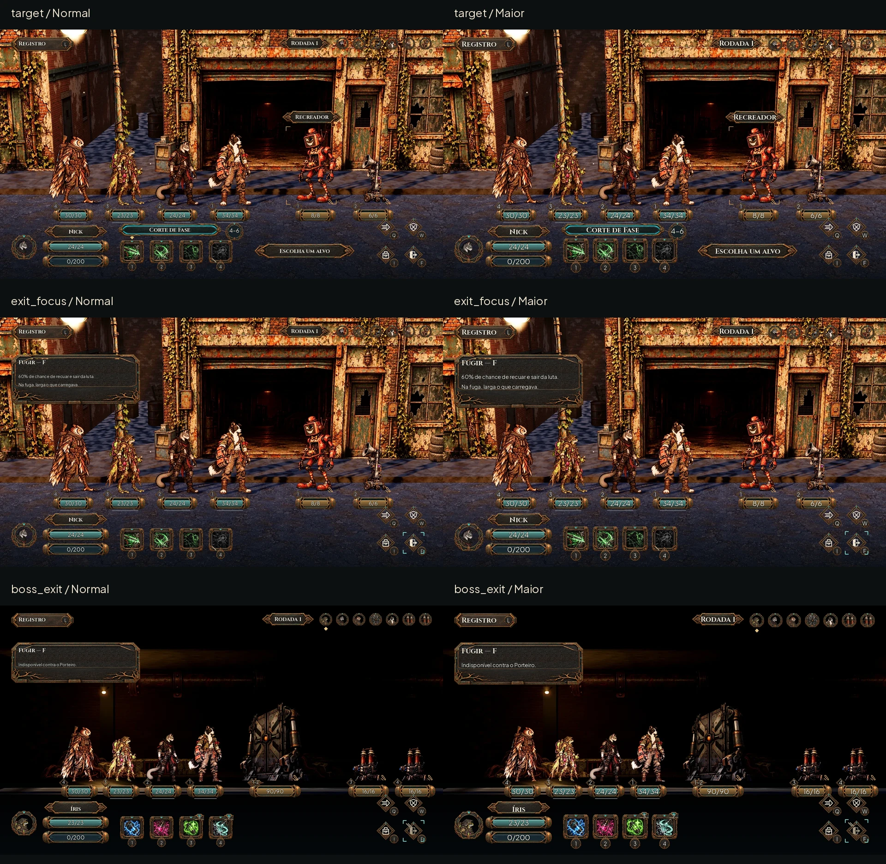

# HUD C consolidada — Latão noturno

> **Histórico, anterior ao alvo aprovado:** a [entrega atual](hud-target.md) segue a revisão de aço chanfrado e letra condensada do Lucas. Não usar estas peças ornamentadas na nova integração.

Lucas escolheu a terceira HUD em25/10/2026 e pediu foco somente na HUD. Esta entrega consolida o desenho de combate, as peças, os estados e as medidas para integração do Claude. **Os ícones do Nick permanecem os usados pelo jogo; os estudos alternativos ficam guardados.** Nenhuma tela nova do laço foi refeita nesta rodada. O Registro da luta foi preservado em um botão compacto, sem painel permanente.

**[Abrir a HUD principal](hud-c/target.webp)** · **[Texto Maior](hud-c/target_large.webp)** · **[Maior com daltonismo](hud-c/target_large_colorblind.webp)** · [Contrato completo](hud-c/contract.json).

**[Comparação: C escolhida → C consolidada](hud-c/before_after.webp)**

## O que foi consolidado

- Distribuição compacta da C, ornamentação contida, latão oxidado, madeira/tecido escuros e vidro. Sem faixas de ponta a ponta ou uma janela permanente cobrindo a luta.
- Molduras com cantos/capas preservados por9-slice, e vidro separado do preenchimento. Zero de Instinto fica vazio; brilho da moldura não é progresso. Preenchimento tem sombra e reflexo, sem uma linha opaca atravessando o número.
- Ator e habilidade escolhidos usam losango dourado; foco de teclado/controle usa cantos segmentados; alvo usa cantos no corpo e o nome. São estados diferentes, podendo coexistir.
- Bandeira substituída por **porta com seta de saída**, com o nome **Fugir** e a regra no foco. Fuga normal mantém60% e larga o que carregava; contra o Porteiro fica bloqueada com motivo explícito. Não foi alterada a regra.
- Habilidade indisponível fica atenuada, com marca de bloqueio e motivo. **Caçada Precisa** está bloqueada no snapshot sem alvo Marcado/Vulnerável. A imagem original da habilidade permanece intacta.
- Contadores de usos finitos: Ampola de Reparo Vivo3, Antídoto de Campo2 no encontro do Porteiro, lidos da sessão e apresentados em gemas. Valor-1 não vira um contador0. Reaproveitada a faceta da moldura do retrato; não foi inventada uma habilidade/ícone novo.
- Iniciativa dinâmica para até8 retratos, comprovada com6 unidades e com o Porteiro+2 relés, total7. O chefe ocupa posições1–2, sem ser representado como uma unidade de uma posição.

## Estados entregues

Cada estado tem quatro imagens1920×1080: Normal, Maior, daltonismo e Maior+daltonismo. Usar os sufixos `_large`, `_colorblind` e `_large_colorblind` antes de `.webp`. São **36 propostas**, mais provas de leitura.

| Estado | Imagem Normal |
|---|---|
| Histórico acessível por Registro/L |[log](hud-c/log.webp)|
| Aguardando ação |[ready](hud-c/ready.webp)|
| Habilidade em foco, descrição completa |[skill_focus](hud-c/skill_focus.webp)|
| Habilidade escolhida, alvo apontado e dano |[target](hud-c/target.webp)|
| Inspeção da habilidade bloqueada |[locked_skill](hud-c/locked_skill.webp)|
| Fugir em foco, com regra |[exit_focus](hud-c/exit_focus.webp)|
| Porteiro e usos finitos |[boss](hud-c/boss.webp)|
| Fugir bloqueado contra o Porteiro |[boss_exit](hud-c/boss_exit.webp)|
| Ator em foco |[actor_focus](hud-c/actor_focus.webp)|

[Catálogo de estados](hud-c/states.webp) · [Catálogo Maior+daltonismo](hud-c/states_large_colorblind.webp) · [Porta em22/32/64 nos dois fundos](hud-c/exit_readability.webp). Cada cena também tem `_40.webp` (768×432) e `_gray.webp` (cinza do Maior+daltonismo). O catálogo inclui hover, foco, pressionado, bloqueado, escolhido e alerta; seus percentuais de Vida/Instinto são **amostras**, não resultados de uma luta.

## Fontes reais e fidelidade

As propostas reutilizam os frames reais e metadados já capturados na Godot4.7.2 em [loop-screens/before](loop-screens/captures.json). Um mesmo frame/DTO por encontro é usado nos quatro perfis, para não trocar o ator quando só o texto deveria mudar. Não são capturas de uma HUD já integrada: a camada nova é composição de design.

Nick age na luta comum; Íris age no encontro do Porteiro. Vida e posições vêm dos DTOs. A posição horizontal de cada placa é derivada do centro do controle de nome projetado na captura; a integração deve usar a projeção real dos pés/cartões, não esses números fixos de uma câmera. O medalhão de dano mostra a faixa da habilidade, não dano garantido depois da defesa ou de um crítico. Os hashes, as âncoras de exemplo e a ordem aparecem em [checks.json](hud-c/checks.json).

[session_quotes.json](hud-c/session_quotes.json) foi exportado pelo próprio `AHCombatSession`: reconstrução dos heróis da campanha inicial6 e dos inimigos dos DTOs, semente4242, com conferência de hp/max_hp e ids. Não foi jogada uma campanha inteira para obter esses estados. Os quotes confirmam habilidades utilizáveis, motivos, alvos, usos, movimento e fuga. A integração usa essas mesmas APIs e `effective_range()` para pesquisa/treino; não copia a lógica aproximada de um mockup. O4–6 de Corte de Fase corresponde ao snapshot sem pesquisa ativa.

Não houve mudança de balanceamento, ids, saves, dados ou código do jogo. Descrições de habilidades vêm dos dados existentes. A nova porta é somente o sinal de um comando já existente.

## Peças e medidas

**13 WebP RGBA**, sem texto rasterizado, em `art/ui/kit/v2/`, cerca de217KiB de arquivos WebP. [Manifesto de dimensões/hashes](hud-c/assets.json). PNGs mestres fora do repositório. As peças derivam da direção C, sem copiar as referências privadas.

| Arquivo | Canvas | 9-slice esquerda/cima/direita/baixo | Conteúdo/uso |
|---|---|---|---|
| `plate.webp`, `primary.webp`, `secondary.webp` |256×64|32/16/32/16|Nome/ação; área central192×32; texto é do jogo|
| `slot.webp` |112×112|não esticar|Ícone existente dentro do encaixe; escala uniforme104 Normal/112 Maior|
| `portrait.webp` |128×128|não esticar|Rosto canônico em janela circular; âncora64,64|
| `action.webp` |88×88|não esticar|Losango80/88; alvo de interação112×112|
| `key.webp` |48×48|não esticar|Moeda40/48; Esc56/64; teclas são rótulos da ação atual|
| `divider.webp` |320×56|não esticar|Nó de raízes central; ornamento, sem clique|
| `bar_frame.webp` |256×48|32/16/32/14|Janela transparente192×18 em(32,16); nas alturas maiores, crescer somente o centro|
| `bar_glass.webp` |192×18|camada do canal|Reflexo branco com alfa sobre o líquido; não sobre os números|
| `panel.webp` |256×160|32/32/32/48|Dica com raízes nos cantos; crescer pelo conteúdo|
| `panel_material.webp` |64×64|repetir no miolo|Tecido/chapa gasta sob o texto, separado dos cantos|
| `exit.webp` |64×64|não esticar|Porta+seta, branco com alfa para tingimento; âncora32,32|

Normal usa título32, corpo24 e detalhe18; Maior42/31/23. Cinzel em títulos/nomes, Plus Jakarta Sans no corpo. Não reduzir a fonte para caber: medir/quebrar e aumentar a dica. Contraste deve ser preservado sobre o material. Patina/musgo são decoração; não indicam estado.

Cores de origem: equipe ciano `#77ddd4`, máquina âmbar `#e7aa55`; no daltonismo azul `#56b4e9` e laranja `#e69f00`. Instinto violeta `#b7a6f4`; alerta troca perigo `#e2675b` por `#e69f00`. Palavra, retrato, posição e forma continuam distinguindo estados. Não recolorir as artes de habilidade/personagem.

## Geometria e interação

Origem superior esquerda na base1920×1080. Horizontais48; texto dentro de margem32; peças decorativas do rodapé podem chegar a24. Escala de viewport uniforme e área segura somada a esses offsets; sem achatamento independente de X/Y.

| Região | Medida/âncora |
|---|---|
| Nome do ator |(192,848)272×56; somente o nome para caber também Véspera no Maior|
| Vida / Instinto do ator |(184,912) e(184,976),288×56; canal começa32,16 e termina largura−32,altura−14|
| Retrato do ator |(48,888),112 Normal/128 Maior; alvo128 para inspecionar|
| Habilidades |x520+i×128; y912 Normal/904 Maior; visual104/112; hit mínimo112 de largura, estendido até1056 para incluir a moeda da tecla|
| Nome escolhido / dano |(512,840)448×56; medalhão80 em(976,836); o número representa a faixa de dano atual|
| Ações |centros(1672,856),(1792,856),(1672,976),(1792,976); quatro alvos112×112; tecla40 inteira dentro do alvo|
| Registro |Botão(48,32)272×64, alvo272×112, comando `combat_log`; histórico e mensagem temporária quando houver evento|
| Iniciativa |direita48, topo32; retrato56/64 e passo72/80; plaqueta224×56 com24 de intervalo; até8|
| Vida no mundo |y776, altura56; largura176,160 para heróis no enquadramento denso do chefe,224 para o Porteiro; centro projetado por unidade|
| Posição |Medalhão40 em y748;1–2 usa plaqueta72; é posição, não nível|
| Dica |(48,160), largura560; altura por linhas medidas, com reserva inferior48 para raízes; desaparece ao sair/cancelar|

O contrato completo guarda fórmulas, estados, paleta e comandos. A ordem é informativa; não criar pequenos botões de toque sobre retratos próximos. Inspeção do ator/unidades usa alvos próprios. Alvos interativos de112px equivalem a44,8px a40%; moedas de teclas pertencem ao mesmo controle, sem um segundo botão minúsculo. A integração ainda deve verificar toque e safe area em aparelho real.

Foco não confirma; pressionado dura somente a ação; escolhido persiste até trocar/cancelar. Controle bloqueado pode ser **inspecionado por um wrapper de foco** para explicar o motivo, mas não pode ativar o comando. Dica aparece no teclado imediatamente e após250ms no mouse. Touch precisa oferecer a mesma informação por foco/inspeção, sem depender de hover. Reduzir efeitos remove pulso/zoom e mantém forma estática.

Usar os comandos existentes `combat_move`, `combat_defend`, `inventory`, `combat_flee` , `combat_log` e `combat_ability_1..4`. Q/W/I/F/1–4 são os bindings de referência; o jogo mostra a configuração atual. Não renomear ids nem transformar cancelar em fuga. Recarga, usos, capacidade de mover e alvos vêm da sessão, incluindo quem ocupa várias posições.

## QA de design

Checklist de [qa.md](qa.md), com a persona QA depois da montagem. Aprovação do desenho não é certificação de interação já implementada.

### Rodada1 — VEREDITO: REPROVADO

| Arquivo | Problema | Gravidade | Correção |
|---|---|---|---|
| `hud-c/render.py`, perfis | Capturas de Normal/Maior tinham atores diferentes; descrição/alvo fixos podiam pertencer à outra classe. | Alta | Um frame/DTO por encontro nos quatro perfis e textos lidos da habilidade correta. |
| Habilidades | Bloqueio aproximado não refletia Caçada Precisa sem alvo válido. | Alta | Quotes reais do `AHCombatSession`; arte atenuada, marca e motivo no foco. |
| `boss_exit` | Dica de uma linha ficava em painel grande e vazio. | Média | Altura medida por conteúdo e reserva das raízes. |
| Iniciativa e placas | Título Maior disputava o metal; placas de heróis no chefe precisavam seguir o enquadramento mais denso. | Média | Plaqueta224 e âncoras dos controles da captura; barras160 no chefe. |
| Ações | Moedas de tecla podiam ficar fora do alvo de toque. | Média | Moeda40 totalmente contida no alvo112; habilidades incluem suas moedas no hitbox. |

### Rodada2 — VEREDITO: APROVADO

Conferidas36 cenas e4 folhas de estados nos quatro perfis, com redução real a40% e cinza. Nick e a ordem do encontro comum permanecem iguais entre Normal/Maior; Íris e os7 participantes permanecem iguais entre os perfis do Porteiro. Fontes mínimas18/23, nomes e números dentro do canvas, fontes originais,13 WebP RGBA nas medidas declaradas. O símbolo de saída é distinguível em22/32 nos dois fundos.

A [auditoria](hud-c/verification.json) confirma **zero alvos interativos sobrepostos**, largura/altura mínimas112, binds existentes, estados de disponibilidade/uso iguais aos quotes e os **quatro hashes dos ícones de habilidade do Nick inalterados**. As placas seguem o enquadramento de cada captura. Foco/bloqueio/seleção se distinguem por forma e texto; o fundo do jogo não foi redesenhado. Não há problema alto ou médio pendente na entrega de design.

A aprovação não afirma que a HUD já esteja rodando no jogo. Safe area, clique/toque, navegação, cancelamento, reduzidos efeitos e dados que variam ao longo da luta precisam ser exercitados na implementação do Claude. Não substituir essa QA de integração pelas pranchas.

**Validação após importar as13 peças:** Godot4.7.2,43/43 testes em234,546s; paridade48/48 (3351 passos), saída0. Avisos de recursos/ObjectDB/RID no encerramento permanecem. Nenhum arquivo em `scripts/`, `data/` ou `tests/` foi alterado.

## Reprodução

`python docs/design/hud-c/build_assets.py` refaz os recortes a partir da pele C; se o mestre externo de saída não estiver disponível, conserva o WebP normalizado já versionado. `python docs/design/hud-c/render.py` refaz as36 composições; `python docs/design/hud-c/states.py` refaz as quatro folhas de estados e a prova da porta. Dependências: Pillow, numpy, scipy e CairoSVG.

A reconstrução dos quotes pode ser repetida com Godot4.7.2 `--headless --path . --script docs/design/hud-c/export_quotes.gd`; usar XDG/save isolados para ferramentas. Não escreve no save do jogador. `docs/.gdignore` mantém essas provas fora da importação normal do jogo.

Integração do Claude após o merge/revisão do Lucas; não trocar os ícones do Nick, não remontar as demais telas do laço nesta tarefa. As variações A/B e os glifos reservados continuam preservados.
