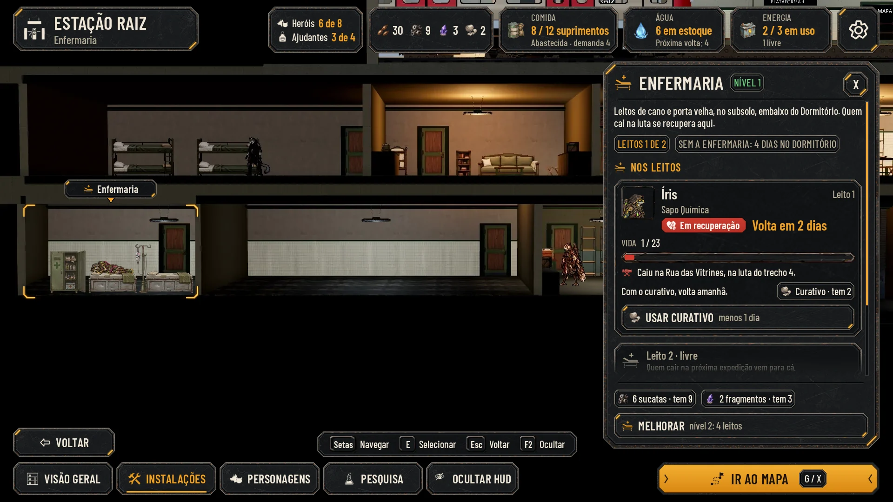
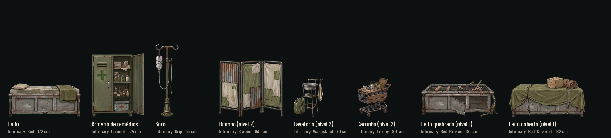
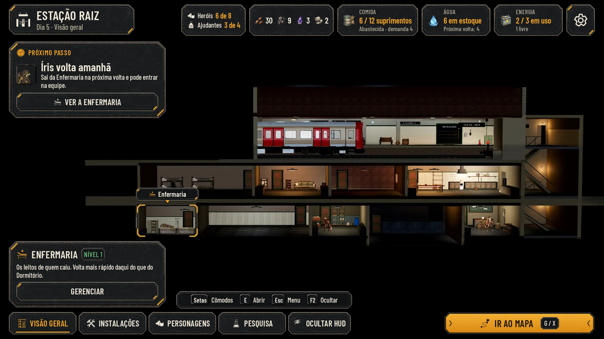
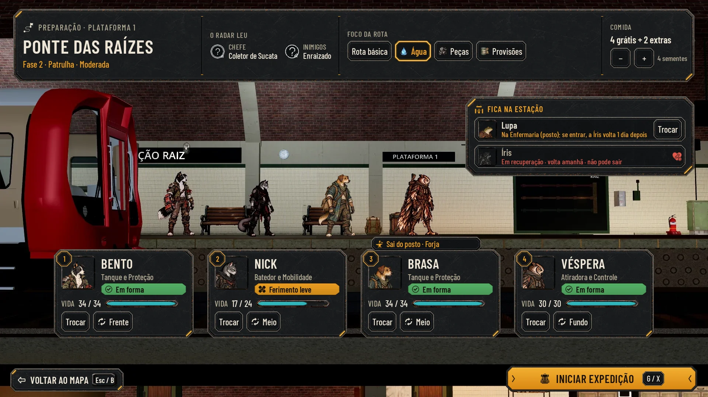
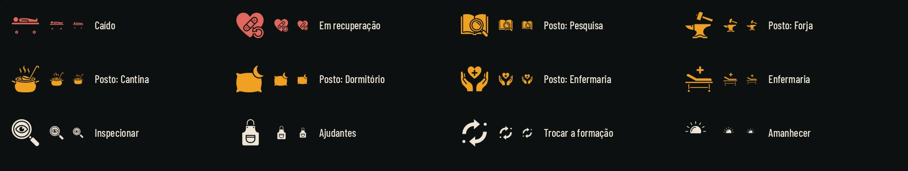

# A Estação nova: Enfermaria, Caído, postos, trem e plataforma (26/10/2026)

O lote 7, as issues #120 e #124 juntas, porque as telas se cruzam:
- **Ninguém morre (#118):** o estado Caído / Em recuperação nas cartas do relatório, na Sala dos Personagens e na
  Preparação, e "Íris caiu" no popup de fim de luta;
- **limites e postos (#119):** "Heróis 6 de 8" e "Ajudantes 3 de 4", o campo Posto na Sala, "Quem trabalha aqui" no
  painel do cômodo e o rendimento no relatório da volta;
- **a Enfermaria (#121):** o cômodo novo na Estação em corte (a arte nova principal), o painel e "Íris volta amanhã" no
  Próximo passo;
- **o recrutamento pelo trem (#122):** quem chegou, ACEITAR e RECUSAR, a casa cheia e a volta sem ninguém;
- **a preparação na plataforma (#123):** IR AO MAPA, PREPARAR NESTE LUGAR, a equipe de pé com as cartas e a confirmação
  INICIAR EXPEDIÇÃO;
- **ícones novos** no mesmo método dos traços.

Tudo no kit da Awesomic (`art/ui/kit/station`), sobre as capturas do jogo, nos quatro perfis (Normal, Maior, daltonismo
e Maior com daltonismo). Nada em `scripts/`, `data/` nem `tests/`. As telas servem para comparar e aprovar; a
integração é do Claude. Os números são exemplos coerentes entre as telas (o que cada posto rende, os dias, os limites):
os valores de verdade entram em `data/` na integração.

## A Enfermaria na Estação

**Onde fica (proposta):** no **subsolo 2, de x −1240 a −640** (600 cm, a largura do Depósito), embaixo da metade esquerda
do Dormitório e encostada no Centro de Pesquisa, à esquerda dele. Hoje esse trecho é rocha
(`station_build.gd`, a caixa de x −1800 a −640 no subsolo 2): a rocha passa a ir só até −1240. Os motivos:
- quem cai desce do trem, atravessa o corredor e chega ao leito sem passar pelos cômodos de trabalho;
- fica embaixo de quem dorme e ao lado de quem pesquisa, que é a vizinhança do cuidado (o Dormitório também ajuda a
  recuperar; veja os postos);
- usa o mesmo piso e teto do subsolo 2 (`B2_FLOOR −940`, `B2_CEILING −620`) e não mexe em nenhum cômodo de hoje.

**A linguagem:** as paredes, o lambri de azulejo branco, o piso pintado e a luz fria (`COOL`) são os do Centro de
Pesquisa (`painted_plaster_wall`, `long_white_tiles`, `concrete_floor_painted`): a Enfermaria é a parte limpa do
subsolo. A porta fica no fundo, à direita, atrás do segundo leito. Os móveis são cards pintados novos, de frente, como os
dos outros cômodos (`art/station/cards/`), feitos de sucata: estrado de cano, colchão remendado, porta de armário velha.

| Card | Largura proposta | Uso |
|---|---|---|
| `Infirmary_Bed` (477×220) | 172 cm | O leito. O colchão fica a 30 px de 220 do alto do card (cerca de 81 cm do piso): é onde a pose de dormir deita |
| `Infirmary_Cabinet` (328×398) | 92 cm | O armário de remédios, no canto esquerdo |
| `Infirmary_Drip` (129×402) | 40 cm | O suporte do soro, entre os leitos |
| `Infirmary_Screen` (422×377) | 140 cm | O biombo de lata e lona (nível 2) |
| `Infirmary_Washstand` (265×339) | 70 cm | O lavatório com o galão (nível 2) |
| `Infirmary_Trolley` (327×378) | 80 cm | O carrinho de supermercado com o material (nível 2) |

- **Nível 1:** o armário, dois leitos e o soro entre eles (a montagem das telas, [infirmary_layer](hud-casa/before/infirmary_layer.webp)).
- **Nível 2:** quatro leitos, com o biombo, o lavatório e o carrinho no lugar do armário e entre os pares de leitos.
- **Quem se recupera deita no leito** com a pose de dormir que já existe (`art/station/poses/*_sleep.webp`), como no
  Dormitório.

Na Visão geral, o cômodo novo fica de x 440 a 620 da tela; na câmera do cômodo (a mesma do Centro de Pesquisa), de x 54
a 420. A cena 3D da Estação não abre no xvfb sem placa de vídeo, então as telas usam uma montagem
([build_room.py](hud-casa/build_room.py)) feita com recortes da própria captura do Centro de Pesquisa e os cards novos.

## As telas

| Tela | Normal | Maior | Daltonismo | Maior e daltonismo | Antes e depois |
|---|---|---|---|---|---|
| Visão geral com a Enfermaria e "Íris volta amanhã" | [infirmary_overview](hud-casa/infirmary_overview.webp) | [large](hud-casa/infirmary_overview_large.webp) | [colorblind](hud-casa/infirmary_overview_colorblind.webp) | [large_colorblind](hud-casa/infirmary_overview_large_colorblind.webp) | [comparar](hud-casa/before_after_infirmary_overview.webp) |
| O painel da Enfermaria | [infirmary](hud-casa/infirmary.webp) | [large](hud-casa/infirmary_large.webp) | [colorblind](hud-casa/infirmary_colorblind.webp) | [large_colorblind](hud-casa/infirmary_large_colorblind.webp) | (tela nova) |
| Relatório: a Íris caiu | [report_fallen](hud-casa/report_fallen.webp) | [large](hud-casa/report_fallen_large.webp) | [colorblind](hud-casa/report_fallen_colorblind.webp) | [large_colorblind](hud-casa/report_fallen_large_colorblind.webp) | [comparar](hud-casa/before_after_report_fallen.webp) |
| Relatório: os detalhes e o que os postos renderam | [report_posts](hud-casa/report_posts.webp) | [large](hud-casa/report_posts_large.webp) | [colorblind](hud-casa/report_posts_colorblind.webp) | [large_colorblind](hud-casa/report_posts_large_colorblind.webp) | [comparar](hud-casa/before_after_report_posts.webp) |
| Sala: a Íris em recuperação | [characters_fallen](hud-casa/characters_fallen.webp) | [large](hud-casa/characters_fallen_large.webp) | [colorblind](hud-casa/characters_fallen_colorblind.webp) | [large_colorblind](hud-casa/characters_fallen_large_colorblind.webp) | [comparar](hud-casa/before_after_characters_fallen.webp) |
| Sala: o campo Posto | [characters_post](hud-casa/characters_post.webp) | [large](hud-casa/characters_post_large.webp) | [colorblind](hud-casa/characters_post_colorblind.webp) | [large_colorblind](hud-casa/characters_post_large_colorblind.webp) | (como a anterior) |
| Forja: quem trabalha aqui | [room_workers](hud-casa/room_workers.webp) | [large](hud-casa/room_workers_large.webp) | [colorblind](hud-casa/room_workers_colorblind.webp) | [large_colorblind](hud-casa/room_workers_large_colorblind.webp) | [comparar](hud-casa/before_after_room_workers.webp) |
| Fim de luta: "Íris caiu" | [fight_fallen](hud-casa/fight_fallen.webp) | [large](hud-casa/fight_fallen_large.webp) | [colorblind](hud-casa/fight_fallen_colorblind.webp) | [large_colorblind](hud-casa/fight_fallen_large_colorblind.webp) | [comparar](hud-casa/before_after_fight_fallen.webp) |
| O trem: chegou alguém | [train_recruit](hud-casa/train_recruit.webp) | [large](hud-casa/train_recruit_large.webp) | [colorblind](hud-casa/train_recruit_colorblind.webp) | [large_colorblind](hud-casa/train_recruit_large_colorblind.webp) | [comparar](hud-casa/before_after_train_recruit.webp) |
| O trem: a casa cheia | [train_full](hud-casa/train_full.webp) | [large](hud-casa/train_full_large.webp) | [colorblind](hud-casa/train_full_colorblind.webp) | [large_colorblind](hud-casa/train_full_large_colorblind.webp) | (como a anterior) |
| O trem: voltou vazio | [train_nobody](hud-casa/train_nobody.webp) | [large](hud-casa/train_nobody_large.webp) | [colorblind](hud-casa/train_nobody_colorblind.webp) | [large_colorblind](hud-casa/train_nobody_large_colorblind.webp) | (tela nova) |
| A Estação: IR AO MAPA | [go_map](hud-casa/go_map.webp) | [large](hud-casa/go_map_large.webp) | [colorblind](hud-casa/go_map_colorblind.webp) | [large_colorblind](hud-casa/go_map_large_colorblind.webp) | (como a Visão geral) |
| O Mapa: PREPARAR NESTE LUGAR | [map_prepare](hud-casa/map_prepare.webp) | [large](hud-casa/map_prepare_large.webp) | [colorblind](hud-casa/map_prepare_colorblind.webp) | [large_colorblind](hud-casa/map_prepare_large_colorblind.webp) | [comparar](hud-casa/before_after_map_prepare.webp) |
| A plataforma: a equipe de pé | [platform](hud-casa/platform.webp) | [large](hud-casa/platform_large.webp) | [colorblind](hud-casa/platform_colorblind.webp) | [large_colorblind](hud-casa/platform_large_colorblind.webp) | [comparar](hud-casa/before_after_platform.webp) |
| A plataforma: INICIAR EXPEDIÇÃO? | [platform_confirm](hud-casa/platform_confirm.webp) | [large](hud-casa/platform_confirm_large.webp) | [colorblind](hud-casa/platform_confirm_colorblind.webp) | [large_colorblind](hud-casa/platform_confirm_large_colorblind.webp) | (como a anterior) |

Cada tela também tem a redução a 40% (`*_40.webp`), o cinza (`*_gray.webp`) e, quando o painel rola, o painel rolado
até o fim (`*_scrolled.webp`). O "antes" é a tela aprovada do lote anterior que o jogo segue hoje (hud-estacao,
hud-station, hud-fluxo e hud-ajustes).

[checks.json](hud-casa/checks.json) mede cada texto e cada alvo de toque com as conferências do `lib.mjs`. As 60 telas
(15 telas, 4 perfis) passam: nenhum texto cortado, fora da sua peça ou fora da tela; nenhum alvo sobreposto ou menor que
56 px; nenhuma peça cortada pelo painel; nenhum texto por cima de medalhão; o menor texto tem 20 px.

## O que cada tela mostra

**A Enfermaria (#121)**
- **Visão geral:** a Enfermaria no subsolo 2, escolhida (os cantos âmbar e a etiqueta), e o cartão do cômodo embaixo
  ("Os leitos de quem caiu", Nível 1, GERENCIAR). O Próximo passo é **"Íris volta amanhã"**, com o retrato dela e VER A
  ENFERMARIA. É o dia seguinte ao do painel ("Volta em 2 dias"), por isso agora falta um.
- **O painel:**
  - o que o cômodo é, "Leitos 1 de 2" e o que acontece sem ele ("Sem a Enfermaria: 3 dias no Dormitório");
  - um bloco por leito ocupado: o retrato, o nome, a classe, a pílula **Em recuperação**, a vida, o que ele tem ("Caiu
    na Rua das Vitrines, na luta do trecho 4."), **"Volta em 2 dias"**, o curativo com o que se tem e USAR CURATIVO
    ("menos 1 dia");
  - o leito livre ("Quem cair na próxima expedição vem para cá.");
  - no pé, fixos: o custo e MELHORAR ("nível 2: 4 leitos").
  - Quem cuida (o posto Enfermaria) aparece na Sala e no relatório: a Lupa tira 1 dia de quem está nos leitos.

**Caído e em recuperação (#118)**
- **O estado:** uma pílula nova do kit, na cor do perigo, com o glifo da recuperação. O texto é **"Em recuperação"**,
  neutro de gênero, como "Em forma" e "Ferimento leve" (os heróis não têm gênero nos dados). "Caído" é o nome do
  estado e o ícone do evento (o leito de lado), usado em "Íris caiu".
- **Fim de luta:** o popup do lote 5 ([hud-ajustes.md](hud-ajustes.md)) sobre a luta de verdade em que a Íris caiu
  ([capture.gd](hud-casa/capture.gd)), com a linha "Íris caiu" e "Volta à Estação com a equipe e vai para a
  Enfermaria. Ninguém morre." logo abaixo das estrelas.
- **Relatório:** na faixa, o destaque "Íris caiu · foi para a Enfermaria". A carta dela fica apagada (o véu das
  habilidades sem uso), com a pílula e, no lugar da relíquia, "Enfermaria · volta em 2 dias". Na plataforma, o lugar
  dela na fila fica vazio: ela desceu direto para a Enfermaria. Nos detalhes, "Quem caiu" com o trecho e os dias.
- **Sala:** a aba da Íris com o glifo da recuperação no canto do retrato; no painel PERSONAGEM, a pílula, "Volta em 2
  dias", o motivo e "Sem posto enquanto se recupera". O corpo dela aparece apagado e curvado na sombra.
- **Preparação:** na coluna "Fica na Estação", apagada, com "Em recuperação · volta em 2 dias · não pode sair" e sem
  Trocar.

**Limites e postos (#119)**
- **Os limites** ficam na barra do alto da Estação, antes dos materiais: "Heróis 6 de 8" e "Ajudantes 3 de 4", cada um
  com o ícone. Na Sala, repetem no alto da coluna dos heróis, com a explicação: o Alojamento abre lugar para heróis e
  o Dormitório para ajudantes, e quem está em recuperação conta. Na casa cheia, o número fica na cor de alerta.
- **Sala, os postos da Estação:** uma linha por posto (Enfermaria, Forja, Pesquisa, Cantina, Dormitório), com o ícone,
  quem está nele (heróis e ajudantes) e o rendimento.
- **Sala, o campo Posto:** no painel PERSONAGEM, os postos como chips com o ícone (Nenhum, Pesquisa, Forja, Cantina,
  Dormitório, Enfermaria), o escolhido em âmbar; embaixo, o que ele rende ali ("Sapo cuida melhor: mais 1 dia a menos
  a cada duas voltas") e "Se entrar na equipe, sai do posto: a Preparação avisa."
- **Quem trabalha aqui (a Forja):** um bloco por pessoa, herói ou ajudante, com o retrato, o rendimento e TIRAR, mais
  PÔR ALGUÉM ("1 lugar livre"). Embaixo, "Na próxima volta", o custo com o desconto (6 → 4 sucatas na próxima obra).
- **Relatório, os detalhes:** a coluna "Os postos renderam", uma linha por posto, com quem ficou e o que rendeu (em
  verde). Na faixa, "Os postos renderam: veja os detalhes."
- **A Preparação avisa:** a carta de quem sai de um posto ganha uma aba no alto ("Sai do posto · Forja"), e a
  confirmação diz o que muda ("com só o Otto, a próxima obra passa de 4 para 5 sucatas").

**O trem (#122)**
- **Chegou alguém:** o recruta de pé na plataforma e, no painel, a carta: classe, de onde veio, o ponto forte e o ponto
  fraco (os traços de `perks.json`, que não podem ser incompatíveis), o que pede (um chip por opção, com o que se tem),
  "Heróis 6 de 8: cabe." e o aviso de que, sem decisão, ele vai embora no trem. ACEITAR (âmbar) e RECUSAR (de aço, sem
  tecla). IR AO MAPA fica bloqueado com o motivo.
- **A casa cheia:** o limite em alerta na barra e no painel ("Heróis 8 de 8: a casa está cheia. Para aceitar, abra
  lugar: melhore o Alojamento (10 lugares) ou dispense alguém."), e ACEITAR travado com o motivo. RECUSAR segue livre.
- **Voltou vazio:** a plataforma sem ninguém, "O trem voltou vazio", a chance que sobe a cada volta vazia e os limites.

**A preparação (#123)**
- **Estação:** o botão principal vira **IR AO MAPA** (G / X), no lugar de PREPARAR EXPEDIÇÃO; com o foco do teclado nele,
  o Próximo passo explica a ordem nova: o lugar primeiro, a equipe depois, na plataforma.
- **Mapa:** o painel do lugar ganha **PREPARAR NESTE LUGAR** no pé. A plaqueta conta "Equipe: 5 prontos · 1 em
  recuperação" (dizia "4 vivos").
- **Plataforma:** a equipe de pé na plataforma, ao lado do trem, como na chegada da missão, com uma carta embaixo de
  cada um: o medalhão da posição, o retrato, o estado, a vida, TROCAR e a posição na formação (Frente, Meio, Fundo, com
  o ícone da troca). No alto, a faixa do lugar: o nome, a fase, o que o radar leu, o **Foco da rota** (a opção escolhida
  em âmbar) e a **Comida** (− e +). À direita, quem **fica na Estação**: quem está em posto (entra com Trocar e sai do
  posto) e quem não pode sair, apagado. Embaixo, VOLTAR AO MAPA e **INICIAR EXPEDIÇÃO**.
- **Confirmação:** "Iniciar expedição?" com o lugar, a equipe na ordem, o foco, a comida e o que muda nos postos; VOLTAR
  e INICIAR EXPEDIÇÃO. A tela de baixo fica sob o véu.

## Ícones novos

Em `art/ui/kit/station/icons/`, glifos brancos de 64 px para tingir (`glyph_white_tintable` no manifesto
[assets.json](../../art/ui/kit/station/assets.json) e na cópia de [hud-station/assets.json](hud-station/assets.json)).
Gerados no Nano Banana Pro numa folha sobre magenta e recortados por [cut_art.py](hud-casa/cut_art.py), o mesmo recorte
dos traços: alfa direto, RGB branco onde há alfa.

| Ícone | Uso |
|---|---|
| `state_fallen` | Caído: o leito de lado ("Íris caiu", "Quem caiu") |
| `state_recovering` | Em recuperação: o coração com o curativo (a pílula, a aba da Sala, "Volta em N dias") |
| `job_research`, `job_forge`, `job_canteen`, `job_dormitory`, `job_infirmary` | Um por posto: o livro com a lupa, a bigorna, a panela, o travesseiro com a lua e as mãos com o coração |
| `room_infirmary` | O cômodo Enfermaria (a etiqueta no corte, o painel, o Próximo passo) |
| `helpers` | Ajudantes (o avental), no limite da barra do alto |
| `inspect` | INSPECIONAR, para a #134 (o próximo PR) |
| `formation_swap` | A troca de posição na formação (a Preparação e, na #134, a exploração) |
| `dawn` | O amanhecer, para a #134 |

A prancha em cinza ([glyphs_gray](hud-casa/glyphs_gray.webp)) confere a leitura sem cor, a 64, 32 e 24 px.

## Para integrar (é do Claude)

- **A Enfermaria:** um cômodo novo em `AHStationRules.ROOMS` e em `station_build.gd`, no subsolo 2 de x −1240 a −640,
  com a rocha de −1800 a −1240; paredes, lambri, piso e luz do Centro de Pesquisa; os cards com as larguras da tabela
  (`b.card`), o leito com a pose de dormir de quem está nele.
- **O estado:** `status_pill` ganha o estado `recovering` (tinta de perigo, o glifo `state_recovering`, o texto em
  "Em recuperação"), nas duas tintas (normal e daltonismo).
- **Os dias:** "Volta em N dias" conta voltas (cada expedição é um dia, como o "Dia 5" da barra). O curativo tira um
  dia, o posto Enfermaria tira outro, e sem Enfermaria a recuperação é no Dormitório, mais lenta.
- **Os limites:** a ficha "Heróis N de M · Ajudantes N de M" vai na barra do alto de todas as telas da Estação; o
  Alojamento hoje tem `max_level 1`, e o segundo nível (10 lugares) é proposta da #119.
- **Os postos:** o rendimento por espécie e traço fica em `data/` (a Sala mostra o texto que vem de lá).
- **O botão principal:** IR AO MAPA substitui PREPARAR EXPEDIÇÃO; a Preparação sai da Estação e vai para a plataforma,
  aberta pelo PREPARAR NESTE LUGAR do Mapa. INICIAR EXPEDIÇÃO pede confirmação.

## Como refazer

As imagens brutas ficam fora do Git, em `images/hud-casa/` do projeto na Awesomic: `infirmary-props-sheet-2.png` (os seis
móveis), `casa-glyphs-sheet.png` (os doze glifos) e `ref-cards.png` (a referência dos cards de hoje que foi junto no
pedido ao Nano Banana Pro).

Da raiz do repositório:
1. `python3 -B docs/design/hud-casa/cut_art.py <infirmary-props-sheet-2.png> <casa-glyphs-sheet.png>`: os cards e os
   glifos.
2. `python3 -B docs/design/hud-casa/build_room.py` e `python3 -B docs/design/hud-casa/build_platform.py`: as montagens de
   `before/` (a Enfermaria no corte e a plataforma com a equipe, vazia e com o recruta).
3. A luta com a Íris caída (precisa de uma tela; no Linux sem tela, `xvfb-run`):
   `xvfb-run -a -s "-screen 0 1920x1080x24" "$GODOT" --path . --rendering-driver opengl3 --resolution 1920x1080 -s res://docs/design/hud-casa/capture.gd -- --out=<pasta>`.
   Ela grava `fight_fallen.png` (sem a HUD) e `fight_fallen.json` em `<pasta>`; o PNG vai para `before/` convertido em
   WebP, com o nome `fight_fallen_clean.webp`, e o JSON é copiado.
4. `python3 -m http.server 8765 --bind 127.0.0.1` e, noutro terminal, `node docs/design/hud-casa/render.mjs http://127.0.0.1:8765`.
5. `python3 -B docs/design/hud-casa/compose.py` (as reduções, o cinza, o antes e depois e o `checks.json`) e
   `python3 -B docs/design/hud-casa/art_sheet.py` (as pranchas dos cards e dos glifos).

A pasta `.render/` é temporária e fica fora do Git.

## QA de design

As rodadas seguem [qa.md](qa.md) e ficam registradas abaixo e no PR.
