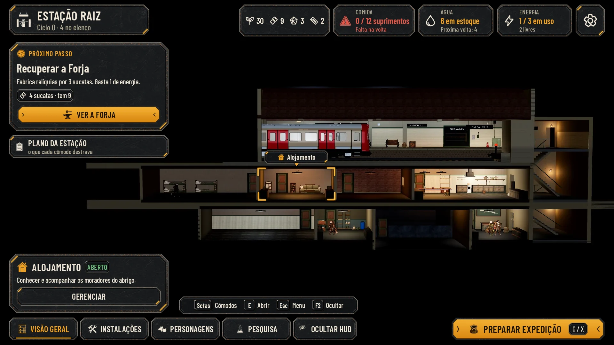
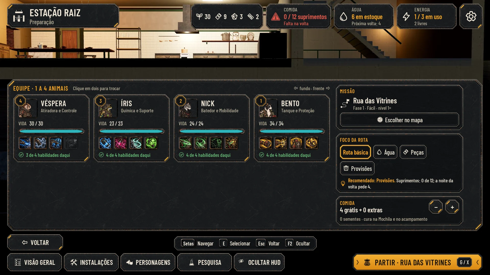

# HUD da Estação, lote 1: as outras telas (25/10/2026)

As doze telas da Estação que faltavam, no mesmo idioma do relatório da volta e da Sala dos Personagens
([hud-station.md](hud-station.md)): aço grafite chanfrado, âmbar em dois cantos, Barlow Condensed e as mesmas cores.

Não há alvo do Lucas para estas telas. A régua é a direção aprovada ([hud-direction.md](hud-direction.md)) e as duas
telas já aprovadas. As maquetes estão sobre as capturas limpas do jogo (`hud-v2/before/*_clean.webp`), com os textos e
números dessas capturas; servem para comparar e aprovar e não entram no jogo. A integração é da #60.

## O padrão das telas da Estação

Todas as telas seguem a moldura da Sala dos Personagens:
- **No alto:**
  - a plaqueta com "ESTAÇÃO RAIZ" e o nome da tela;
  - à direita, os materiais (sementes, sucata, fragmentos, curativos), Comida, Água, Energia e a engrenagem.
  - Quando falta Comida, o chip troca o ícone pelo alerta (triângulo) e fica na cor de alerta: a forma também avisa no
    daltonismo.
- **Embaixo:**
  - VOLTAR (nos cômodos) e a barra das teclas;
  - as abas VISÃO GERAL, INSTALAÇÕES, PERSONAGENS, PESQUISA e OCULTAR HUD (a ativa sublinhada em âmbar);
  - o botão principal, que é PREPARAR EXPEDIÇÃO (G / X), PARTIR na Preparação, e bloqueado com o motivo dentro quando
    a regra impede (`AHStationRules.preparation_block`).
- **Cada cômodo abre o painel à direita,** no lugar e na chapa do painel PERSONAGEM:
  - o ícone e o nome do cômodo;
  - o estado num chip (Vazio, Nível 1, Nível 1 de 2);
  - o X;
  - o conteúdo, que rola no texto Maior.

## As telas

| Tela | Normal | Maior | Daltonismo | Antes e depois |
|---|---|---|---|---|
| Visão geral | [overview](hud-estacao/overview.webp) | [large](hud-estacao/overview_large.webp) | [colorblind](hud-estacao/overview_colorblind.webp) | [comparar](hud-estacao/before_after_overview.webp) |
| Preparação | [preparation](hud-estacao/preparation.webp) | [large](hud-estacao/preparation_large.webp) | [colorblind](hud-estacao/preparation_colorblind.webp) | [comparar](hud-estacao/before_after_preparation.webp) |
| Forja | [forge](hud-estacao/forge.webp) | [large](hud-estacao/forge_large.webp) | [colorblind](hud-estacao/forge_colorblind.webp) | [comparar](hud-estacao/before_after_forge.webp) |
| Centro de Pesquisa | [research](hud-estacao/research.webp) | [large](hud-estacao/research_large.webp) | [colorblind](hud-estacao/research_colorblind.webp) | [comparar](hud-estacao/before_after_research.webp) |
| Dormitório, a noite | [night](hud-estacao/night.webp) | [large](hud-estacao/night_large.webp) | [colorblind](hud-estacao/night_colorblind.webp) | [comparar](hud-estacao/before_after_night.webp) |
| Dormitório vazio | [dormitory](hud-estacao/dormitory.webp) | [large](hud-estacao/dormitory_large.webp) | [colorblind](hud-estacao/dormitory_colorblind.webp) | [comparar](hud-estacao/before_after_dormitory.webp) |
| O trem chegou | [train](hud-estacao/train.webp) | [large](hud-estacao/train_large.webp) | [colorblind](hud-estacao/train_colorblind.webp) | [comparar](hud-estacao/before_after_train.webp) |
| Plano da Estação | [plan](hud-estacao/plan.webp) | [large](hud-estacao/plan_large.webp) | [colorblind](hud-estacao/plan_colorblind.webp) | [comparar](hud-estacao/before_after_plan.webp) |
| Cantina | [canteen](hud-estacao/canteen.webp) | [large](hud-estacao/canteen_large.webp) | [colorblind](hud-estacao/canteen_colorblind.webp) | [comparar](hud-estacao/before_after_canteen.webp) |
| Depósito | [depot](hud-estacao/depot.webp) | [large](hud-estacao/depot_large.webp) | [colorblind](hud-estacao/depot_colorblind.webp) | [comparar](hud-estacao/before_after_depot.webp) |
| Bar | [bar](hud-estacao/bar.webp) | [large](hud-estacao/bar_large.webp) | [colorblind](hud-estacao/bar_colorblind.webp) | [comparar](hud-estacao/before_after_bar.webp) |
| Opções | [options](hud-estacao/options.webp) | [large](hud-estacao/options_large.webp) | [colorblind](hud-estacao/options_colorblind.webp) | [comparar](hud-estacao/before_after_options.webp) |

Cada tela também tem:
- o perfil Maior com daltonismo (`*_large_colorblind.webp`);
- a redução a 40% (`*_40.webp`);
- o cinza (`*_gray.webp`);
- o painel rolado até o fim, quando rola (`*_scrolled.webp`).

[checks.json](hud-estacao/checks.json) mede cada texto e cada alvo de toque. As 48 telas (12 telas, 4 perfis) passam:
- nenhum texto cortado ou fora da sua peça;
- nenhum conteúdo maior que a área de conteúdo da peça;
- nenhuma peça cortada pelo painel (nos lados; embaixo, só a parte que rola);
- nenhum alvo de toque sobreposto, fora da tela ou menor que 56 px (os que só informam, como a barra das teclas, ficam de fora);
- nenhum texto por cima de um medalhão;
- nenhum caractere que a Barlow Condensed não tem (setas, estrelas e triângulos viram glifo);
- o menor texto tem 20 px.




## O que cada tela mostra

- **Visão geral:**
  - o cartão PRÓXIMO PASSO (`AHStationRules.next_step`), com o título, a descrição, o custo com o que se tem e o botão;
  - o Plano da Estação, com "o que cada cômodo destrava";
  - no corte, o cômodo escolhido com os cantos âmbar e a etiqueta com a ponta para baixo;
  - embaixo, à esquerda, o cartão do cômodo (estado e GERENCIAR, de aço).
  - Um só botão âmbar além de PREPARAR, e a tecla de abrir é a da barra (E).
  - Quando há pendências (a noite, o trem), elas aparecem num cartão PENDÊNCIAS na coluna da esquerda, como hoje
    (`refuge_hud.gd`).
- **Preparação:**
  - as quatro cartas da equipe na ordem da formação, com:
    - o medalhão da posição, no canto do retrato;
    - o retrato, a vida e os quatro ícones de habilidade (as que não alcançam daqui ficam apagadas);
    - "N de 4 habilidades daqui";
  - à direita:
    - a Missão (ESCOLHER NO MAPA);
    - o Foco da rota: a opção escolhida em âmbar e a recomendada (a ★ de hoje) numa linha com o pino, separadas;
    - a Comida (− e +);
  - o painel termina acima de VOLTAR, e nenhuma aba fica ativa: a Preparação não é uma aba;
  - o botão principal vira PARTIR.
- **Forja e Centro de Pesquisa vazios:**
  - o que o cômodo faz;
  - o custo em chips, com o que se tem;
  - RECUPERAR;
  - o que o cômodo libera, apagado: as relíquias de `relics.json` e as melhorias de classe de `research.json`, a
    3 fragmentos cada.
- **Dormitório na noite:**
  - a descrição do quarto, a contagem e o custo em chips;
  - uma linha por herói, com DORMIR e VIGIAR (o escolhido em âmbar) e o que a noite faz;
  - no pé do painel, fixos fora da parte que rola: os suprimentos e INICIAR DESCANSO;
  - à esquerda, as PENDÊNCIAS (a noite e o trem);
  - PREPARAR EXPEDIÇÃO fica bloqueado com o motivo.
- **O trem chegou:**
  - o retrato do civil (`art/civilians/civil_dora.webp`), o nome e o papel;
  - o ponto forte e o ponto fraco com os quadradinhos de + e −;
  - o pedido;
  - "Na próxima volta", uma linha por recurso com o rótulo do jogo e o chip de antes e depois (a água que cai, na cor de
    alerta);
  - no pé do painel, ACOLHER (âmbar) e RECUSAR (de aço, sem tecla: Esc fecha o painel e não pode recusar sem querer);
  - PREPARAR EXPEDIÇÃO bloqueado com o motivo do jogo ("Há alguém esperando na plataforma: decida antes de partir.").
- **Plano da Estação:** um bloco por cômodo, na ordem do jogo, com o ícone, o nome, o nível ou Vazio, o que faz, o custo
  para recuperar (um chip por recurso) e VER.
- **Cantina:** a conta da próxima volta por recurso (o que entra em verde, o que sai no tom normal) e o resultado num
  chip, em alerta só quando falta.
- **Depósito:**
  - a barra de suprimentos (0 de 12);
  - o custo e MELHORAR;
  - o estoque em quadrados de recurso;
  - as relíquias e as ferramentas.
- **Bar:** o estado vazio com o ícone do cômodo e só o texto do jogo. O efeito do Bar segue em aberto (#11).
- **Opções:** tudo o que `options_panel.gd` tem hoje, com os mesmos textos:
  - Som, Gráficos, Jogo (com "Mostrar as dicas de novo"), Controles (os três modos de toque, as dicas, a lista de ações
    com TROCAR e "Restaurar as teclas padrão") e Campanha ("Voltar ao título" e "Nova campanha…" na cor de alerta);
  - controles deslizantes com o valor em âmbar;
  - liga e desliga com o rótulo "Ligado" ou "Desligado" ao lado, porque a cor sozinha não basta;
  - opções em grupo, com a marcada em âmbar.
  - A lista de teclas na maquete é uma amostra (7 das 19 ações de `options_panel.gd`). A integração lista todas, no
    mesmo formato.

## Peças e ícones novos

**Peças em `art/ui/kit/station/`** (manifesto: [assets.json](../../art/ui/kit/station/assets.json); as peças do lote
anterior não mudaram):

| Peça | Tamanho | 9-slice | Uso |
|---|---|---|---|
| `selected_frame` | 120×60 | 16/16/16/16 | Escolha persistente sobre qualquer chapa: opção marcada, DORMIR, foco da rota |
| `chip_button` | 160×48 | 14/14/14/14 | Botão pequeno de opção (Rota básica, Baixo, 1x, VER, Dormir) |
| `cost_chip` | 120×40 | 12/12/12/12 | Custo ou quantidade: ícone 24 e número 22; também o chip de estado do cômodo |
| `slider_track` / `slider_knob` | 240×20 / 28×36 | 10/6/10/6 / — | Controle deslizante: o preenchimento é `bar_fill` em âmbar; pegador centrado no valor |
| `toggle_off` / `toggle_on` | 64×32 | — | Liga e desliga: desligado, o pegador de aço claro à esquerda; ligado, o pegador âmbar à direita. A linha inteira é o alvo de toque (56 px) |
| `room_tag` | 200×52 | 16/12/16/20 | Etiqueta do cômodo no corte, com a ponta para baixo (âncora 100,52) |

**Reaproveitadas:**
- do kit da Estação: a moldura das telas (`room_plaque`, `resource_chip`, `icon_button`, `nav_tab`, `keys_bar`,
  `primary_button`), `panel_large`, `panel_inset`, `hero_card`, `level_medal`, `train_button`, `resource_tile`;
- do kit da luta: `selected_slot`, os cantos do cômodo escolhido.

**Ícones novos em `art/ui/kit/station/icons/`** (glifos brancos para tingir, gerados no Nano Banana Pro numa folha sobre
magenta e recortados por `cut_icons.py`):
- cômodos: `room_quarters`, `room_canteen`, `room_bar`, `room_forge`, `room_depot`, `room_research`;
- `train_arrival`, `sleep`, `watch`, `plan`, `next_step`, `route` (o caminho pontilhado com a bandeira, recortado pela
  silhueta, porque o pontilhado veio preto na folha);
- Opções: `opt_sound`, `opt_graphics`, `opt_controls`, `opt_language`;
- `alert` e `recruit`.

## O que muda do jogo de hoje

- **Mesmo lugar para tudo:** o painel do cômodo ocupa o lugar do painel PERSONAGEM, e a barra do alto e as abas são as
  mesmas da Sala. Hoje, cada tela tem um painel de um tamanho e a barra de baixo tem três botões soltos.
- **Números em chips:** os custos e os resultados viram chips com ícone ("4 sucatas · tem 9"), e não texto corrido.
- **O que falta aparece na cor de alerta.** Na Comida, o alerta também muda o ícone, para valer no daltonismo.
- **A seta (→)** é um glifo, porque a Barlow Condensed não tem esse caractere.
- **As Opções** seguem as seções de hoje, numa lista que rola, sem abas: o jogo não tem abas.

## Como integrar (#60)

- O painel do cômodo é um único componente: título, chip de estado, X e conteúdo rolável. Cada cômodo só preenche o
  conteúdo.
- Os chips de custo leem o estoque (`AHStationRules`) e ficam na cor de alerta quando falta.
- O cartão PRÓXIMO PASSO e o botão principal vêm de `next_step` e `preparation_block`.
- As teclas são as do relatório e da Sala; G / X e V / LB continuam como ações novas sugeridas (veja
  [hud-station.md](hud-station.md)).

## Reprodução

Da raiz do repositório:
1. `python3 docs/design/hud-station/cut_icons.py <folha dos traços> <folha dos glifos> <segunda folha de glifos>`.
2. `python3 docs/design/hud-station/build_kit.py`.
3. `python3 -m http.server 8765 --bind 127.0.0.1` e, noutro terminal,
   `node docs/design/hud-estacao/render.mjs http://127.0.0.1:8765`. A base comum fica em `docs/design/hud-kit/lib.mjs`.
4. Com `B=docs/design/hud-v2/before`:
   ```
   python3 docs/design/hud-kit/compose.py docs/design/hud-estacao overview=$B/station.jpg \
     preparation=$B/station-preparation.jpg forge=$B/station-forge.jpg research=$B/station-research.jpg \
     night=$B/station-night.jpg dormitory=$B/station-dormitory.jpg train=$B/station-train.jpg plan=$B/station-plan.jpg \
     canteen=$B/station-canteen.jpg depot=$B/station-depot.jpg bar=$B/station-bar.jpg options=$B/station-options.jpg
   ```
5. A pasta `.render/` é temporária, recriada a cada montagem e fora do Git (`.gitignore`).

## QA de design

As rodadas seguem [qa.md](qa.md) e ficam registradas abaixo e no PR.

### Rodada 1: REPROVADO

As checagens deixavam passar falhas visíveis. Foram acrescentadas cinco ao `lib.mjs`:
- caracteres que a fonte não tem;
- alvos fora da tela;
- alvos menores que 56 px;
- peças cortadas pelo painel;
- texto por cima de medalhão.

A pasta `.render/` passou a ser apagada a cada montagem e saiu do Git.

**Alta, corrigidos:**
- As setas da Cantina viravam caixinhas: agora são glifo.
- RECUSAR era cortado pelo painel: as ações do trem estão no pé do painel, uma por linha.
- O X da Pesquisa saía da tela no Maior: o título quebra a linha antes de empurrar o X.

**Média, corrigidos:**
- PREPARAR bloqueado com o trem esperando.
- A noite com os números e as pendências da captura.
- A quarta melhoria de classe na Pesquisa.
- Dois chips de custo no Plano.
- A recomendação da rota separada da escolha.
- As Opções completas e com os textos do jogo.
- O liga e desliga desligado mais claro e com rótulo.
- O texto das relíquias apagadas com contraste cheio.
- O nome que passava por cima do medalhão na Preparação.
- O painel da Preparação acima de VOLTAR.
- Todos os alvos com 56 px ou mais.
- Uma tecla por ação: GERENCIAR e RECUSAR sem tecla, e um só botão âmbar.
- As ações da noite e do trem fixas no pé do painel.
- As provas desatualizadas foram removidas.
- O ícone `route` recortado de novo; `route` e `opt_language` agora aparecem.
- O texto inventado do Bar saiu.
- Os rótulos de "Na próxima volta".

**Baixa, corrigidos:**
- os painéis com a altura do conteúdo;
- as saídas da Cantina no tom normal;
- o custo da Forja só no chip;
- "(mínimo zero)" na Coleira;
- nenhuma aba ativa na Preparação;
- a descrição na noite;
- o separador sozinho na quebra;
- a ordem do Plano;
- o comando completo na Reprodução.

**Para a integração:** o alerta da Comida troca o ícone também na Sala dos Personagens (`characters.webp`, do lote
anterior, ainda mostra o ícone antigo). O chip "Vazio" num Dormitório em uso vem do jogo e fica para a #11.

### Rodada 2: REPROVADO

- **Média, corrigido:** o motivo de PREPARAR EXPEDIÇÃO bloqueado saía da área de conteúdo do botão.
  - O motivo agora usa a largura livre do botão: uma linha no Normal, duas no Maior.
  - O botão cresce na altura com o conteúdo e respeita as margens de conteúdo do manifesto.
  - A barra das teclas se afasta para o botão caber.
  - A checagem passou a comparar cada texto com a área de conteúdo da sua peça, e não com a borda. O número do
    medalhão fica de fora de propósito, porque mora na quina da carta.
- **Baixa, corrigidos:**
  - na noite, o chip do cômodo volta a ser "Vazio" (o estado do jogo) e "Noite 1" vai para a linha da contagem;
  - na Cantina, a seta fica sempre junto do chip do resultado;
  - a lista de teclas das Opções está anotada como amostra.
- **Baixa, fica como está:** o espaço embaixo das cartas da Preparação, porque a coluna da direita (Missão, Foco da rota
  e Comida) dá a altura do painel.
- **Baixa:** `docs/design/hud-exploracao/` é do lote 2 e fica fora deste PR.

### Rodada 3: APROVADO

- O texto de PREPARAR EXPEDIÇÃO bloqueado fica dentro da área de conteúdo nas quatro telas.
- As 48 telas estão ok, com o menor texto em 20 px e nenhum alvo de toque abaixo de 56 px.
- Os `_scrolled` correspondem às telas que rolam.
- O escopo foi conferido.

Observações baixas:
- No Maior, sobram 5 px entre a barra das teclas e PREPARAR: na integração, manter uma folga mínima.
- A Sala dos Personagens ainda mostra o ícone antigo no alerta da Comida (para a integração).
