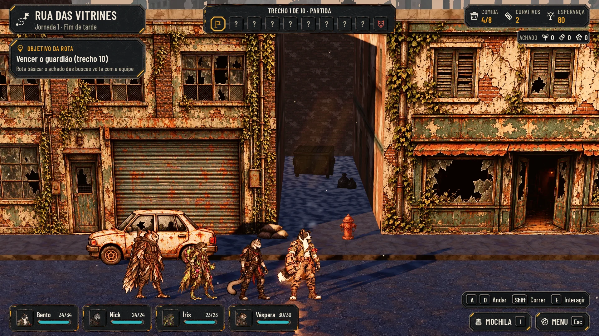
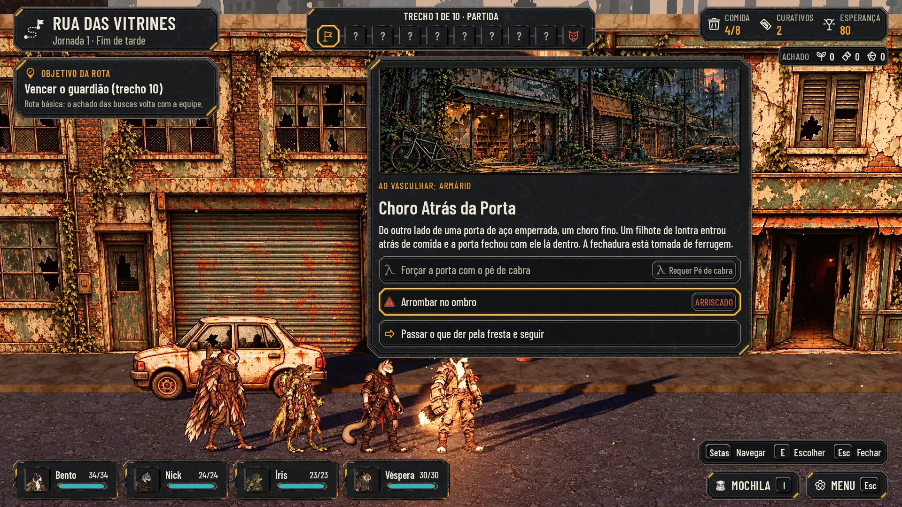

# HUD da exploração, lote 2 (25/10/2026)

A HUD da rua, dos interiores e dos cenários no idioma do kit da Estação ([hud-station.md](hud-station.md) e
[hud-estacao.md](hud-estacao.md)): a mesma chapa, o mesmo âmbar, a mesma letra e as mesmas cores. A luta fica de fora:
ela é do Codex (#59).

Não há alvo do Lucas para estas telas. A régua é a direção aprovada e os dois lotes da Estação. As maquetes estão sobre
as capturas limpas do jogo (`hud-v2/before/*_clean.webp`), com os textos e números dessas capturas. Servem para comparar
e aprovar e não entram no jogo. A integração é da #60.

## A moldura da exploração

- **No alto, à esquerda:**
  - a plaqueta do lugar (o nome e "Jornada 1 · Fim de tarde") com o ícone da rota;
  - embaixo, o cartão OBJETIVO DA ROTA.
- **No alto, no meio:** o corredor numa faixa só, como a rodada da luta, com os estados de `exploration_hud.gd`:
  - o nome do trecho em cima;
  - dez casas quadradas ligadas por elos;
  - **resolvido:** o ícone do tipo em verde, com o check no canto (forma, além da cor) e o elo verde até o seguinte;
  - **de agora:** a moldura âmbar (dentro de uma loja, a casa mostra o interior);
  - **conhecido:** o ícone do tipo (patrulha, suprimentos, descanso, passagem);
  - **ainda não alcançado:** "?";
  - **o guardião:** sempre conhecido, em vermelho, na última casa.
- **No alto, à direita:**
  - um chip com Comida, Curativos e Esperança (o número em âmbar);
  - embaixo, o Achado (sementes, sucata, fragmentos).
- **Embaixo, à esquerda:** a equipe em quatro plaquinhas da luta, com o retrato, o nome, a vida e a barra.
- **Embaixo, à direita:**
  - a barra das teclas: na rua, A e D (duas teclas) Andar, Shift Correr, E Interagir; com um painel aberto, Setas
    Navegar, E Escolher, Esc Fechar;
  - MOCHILA (I) e MENU (Esc).
  - Com o toque, a barra e as teclas dos botões saem, e entram o analógico e o Usar.

## As telas

| Tela | Normal | Maior | Daltonismo | Antes e depois |
|---|---|---|---|---|
| A rua | [explore](hud-exploracao/explore.webp) | [large](hud-exploracao/explore_large.webp) | [colorblind](hud-exploracao/explore_colorblind.webp) | [comparar](hud-exploracao/before_after_explore.webp) |
| Patrulha à frente (trecho 3) | [patrol](hud-exploracao/patrol.webp) | [large](hud-exploracao/patrol_large.webp) | [colorblind](hud-exploracao/patrol_colorblind.webp) | [comparar](hud-exploracao/before_after_patrol.webp) |
| Interação no interior | [interior](hud-exploracao/interior.webp) | [large](hud-exploracao/interior_large.webp) | [colorblind](hud-exploracao/interior_colorblind.webp) | [comparar](hud-exploracao/before_after_interior.webp) |
| Busca | [search](hud-exploracao/search.webp) | [large](hud-exploracao/search_large.webp) | [colorblind](hud-exploracao/search_colorblind.webp) | [comparar](hud-exploracao/before_after_search.webp) |
| Achado na rua | [loot](hud-exploracao/loot.webp) | [large](hud-exploracao/loot_large.webp) | [colorblind](hud-exploracao/loot_colorblind.webp) | [comparar](hud-exploracao/before_after_loot.webp) |
| Evento de busca | [event](hud-exploracao/event.webp) | [large](hud-exploracao/event_large.webp) | [colorblind](hud-exploracao/event_colorblind.webp) | [comparar](hud-exploracao/before_after_event.webp) |
| Resultado do evento | [event_result](hud-exploracao/event_result.webp) | [large](hud-exploracao/event_result_large.webp) | [colorblind](hud-exploracao/event_result_colorblind.webp) | [comparar](hud-exploracao/before_after_event_result.webp) |
| Evento de cenário | [scenario_event](hud-exploracao/scenario_event.webp) | [large](hud-exploracao/scenario_event_large.webp) | [colorblind](hud-exploracao/scenario_event_colorblind.webp) | [comparar](hud-exploracao/before_after_scenario_event.webp) |
| Mochila | [inventory](hud-exploracao/inventory.webp) | [large](hud-exploracao/inventory_large.webp) | [colorblind](hud-exploracao/inventory_colorblind.webp) | [comparar](hud-exploracao/before_after_inventory.webp) |
| Acampamento | [camp](hud-exploracao/camp.webp) | [large](hud-exploracao/camp_large.webp) | [colorblind](hud-exploracao/camp_colorblind.webp) | [comparar](hud-exploracao/before_after_camp.webp) |
| Abandonar a expedição | [risk](hud-exploracao/risk.webp) | [large](hud-exploracao/risk_large.webp) | [colorblind](hud-exploracao/risk_colorblind.webp) | [comparar](hud-exploracao/before_after_risk.webp) |
| Diante do guardião | [boss_choice](hud-exploracao/boss_choice.webp) | [large](hud-exploracao/boss_choice_large.webp) | [colorblind](hud-exploracao/boss_choice_colorblind.webp) | [comparar](hud-exploracao/before_after_boss_choice.webp) |
| Pausa (Esc) | [pause](hud-exploracao/pause.webp) | [large](hud-exploracao/pause_large.webp) | [colorblind](hud-exploracao/pause_colorblind.webp) | [comparar](hud-exploracao/before_after_pause.webp) |
| Guardião vencido | [boss_done](hud-exploracao/boss_done.webp) | [large](hud-exploracao/boss_done_large.webp) | [colorblind](hud-exploracao/boss_done_colorblind.webp) | [comparar](hud-exploracao/before_after_boss_done.webp) |
| Toque, nada por perto | [touch](hud-exploracao/touch.webp) | [large](hud-exploracao/touch_large.webp) | [colorblind](hud-exploracao/touch_colorblind.webp) | [comparar](hud-exploracao/before_after_touch.webp) |
| Toque, perto do caixa | [touch_active](hud-exploracao/touch_active.webp) | [large](hud-exploracao/touch_active_large.webp) | [colorblind](hud-exploracao/touch_active_colorblind.webp) | [comparar](hud-exploracao/before_after_touch_active.webp) |

O resultado do evento, a escolha diante do guardião, o guardião vencido e o toque perto do caixa não têm captura própria.
O "antes" dessas telas é a captura mais próxima (o evento, abandonar, a rua e o toque).

Cada tela também tem:
- o Maior com daltonismo;
- a redução a 40%;
- o cinza.

[checks.json](hud-exploracao/checks.json) passa nas 64 telas (16 telas, 4 perfis), com as mesmas checagens do lote 1
e o painel do meio contado como área (para não cobrir a barra das teclas):
- texto dentro da área de conteúdo de cada peça;
- peça cortada;
- alvo fora da tela, sobreposto ou menor que 56 px;
- texto sobre medalhão;
- caractere que a fonte não tem;
- o menor texto tem 20 px.




## O que cada tela mostra

- **Interação:** o aviso sobre o objeto é a etiqueta do cômodo (a ponta para baixo) com a tecla "E / A", em 60 px de
  altura, que também aceita toque. Depois de vasculhar, a tecla vira o check e o texto fica apagado ("O Caixa (já
  vasculhado)").
- **Patrulha à frente:** com a patrulha fora da tela, o aviso no lado de onde ela vem, com a seta, a barra da suspeita e
  o estado ("desconfiada", "avistou a equipe!"), como em `exploration_hud.gd`.
- **Busca:** o texto do achado numa chapa no alto e o que entrou em chips (+1 Comida, +1 Semente).
- **Achado na rua:** um chip âmbar com brilho sobre a equipe ("+1 Sucata").
- **Eventos:**
  - a ilustração da fase (`art/ui/events/`) na moldura dos retratos;
  - onde foi ("Ao vasculhar: armário"), o título e o texto;
  - as escolhas numa lista. A que pede ferramenta fica apagada, com a ferramenta e "Requer Pé de cabra" num chip. A
    arriscada leva o triângulo e o chip ARRISCADO, em alerta e com forma própria;
  - o foco do teclado (`focus_frame`) começa na primeira escolha que dá para fazer.
- **Resultado do evento:** o texto da resolução (`events.json`, a falha de "Arrombar no ombro"), o que mudou em chips na
  cor de alerta e CONTINUAR.
- **Mochila:**
  - os suprimentos, as ferramentas e os recursos em quadrados de recurso. A escolhida fica em âmbar. As ferramentas que
    não se usam ali ficam no tom apagado, sem transparência. O rótulo quebra dentro da largura do quadrado e mantém o
    nome do jogo ("Máscara com filtro");
  - o painel começa depois do cartão do objetivo (x 500) e termina antes do chip do Achado;
  - à direita, o detalhe: o nome, a descrição e o aliado com as setas;
  - as ações apagadas, no tom apagado sem transparência, e o motivo ("O aliado já está com a vida cheia.");
  - FECHAR (Esc / B).
- **Acampamento:**
  - o que comer e o curativo fazem, em chips ("· 4 comidas", "· 2 curativos");
  - uma linha por herói, com a vida e COMER e CURATIVO (apagados com a vida cheia, e o motivo embaixo);
  - LEVANTAR ACAMPAMENTO.
  - O acampamento encenado do PR #98 usa o HUD da luta para escolher o herói. Esta tela é o painel das ações.
- **Abandonar a expedição:** o triângulo, a pergunta e a consequência. CONTINUAR é o botão âmbar e fica na tecla de
  voltar (Esc / B); VOLTAR À ESTAÇÃO é de aço, sem tecla, para não sair sem querer.
- **Diante do guardião** (`street_corridor.gd`, `_ask_risk`):
  - o título e o texto do jogo;
  - a equipe como está;
  - os suprimentos e o achado em chips;
  - SEGUIR EM FRENTE (âmbar) e VOLTAR À ESTAÇÃO (METADE DO ACHADO), de aço.
- **Pausa** (Esc, `show_menu`):
  - CONTINUAR (âmbar, na tecla de voltar);
  - VOLTAR À ESTAÇÃO com o texto da retirada (no meio de uma luta ou evento, ela fica apagada com "Termine a luta ou o
    evento antes de voltar.");
  - OPÇÕES;
  - NOVA CAMPANHA em alerta.
- **Guardião vencido:** o cartão vira OBJETIVO CUMPRIDO com o check verde, todos os trechos resolvidos, e entra o botão
  CONCLUIR JORNADA · VOLTAR À ESTAÇÃO, sem tecla: o Esc é do MENU, e a volta também sai pela Pausa.
- **Toque:**
  - o analógico: a área e o pegador com a cruz âmbar, octógonos de aço meio transparentes, e "Andar" embaixo;
  - o Usar, apagado sem nada por perto (como na captura) e com o âmbar por cima perto do caixa;
  - MOCHILA e MENU sem a tecla.

## Peças novas (`art/ui/kit/station/`)

| Peça | Tamanho | 9-slice | Uso |
|---|---|---|---|
| `touch_ring` | 240×240 | — | Área do analógico: octógono de aço, meio transparente (âncora 120,120) |
| `touch_knob` | 84×84 | — | O pegador do analógico, octógono de aço com a cruz âmbar (âncora 42,42) |
| `touch_button` | 170×170 | — | O botão Usar apagado: octógono de aço escuro (âncora 85,85) |
| `touch_button_active` | 170×170 | — | Por cima de `touch_button` quando há o que usar: o âmbar inteiro |

**Reaproveitadas:**
- do kit da Estação: `room_plaque`, `panel_large`, `resource_chip`, `cost_chip`, `room_tag`, `list_row`,
  `resource_tile`, `selected_frame`, `chip_button`, `keys_bar`, `secondary_button`, `primary_button`, `panel_inset`,
  `icon_button`;
- do kit da luta: `round_strip` (o corredor), `panel` (as plaquinhas da equipe) e `square_portrait` (as casas, os
  retratos e a moldura da ilustração).

**Ícones:**
- os que o jogo já tem: `node-start`, `node-boss`, `node-rest`, `res-hope`, `res-bandages`, `tool-*`, `item-ampoule`;
- os do kit da Estação: `route`, `objective_done`, `alert`, `expeditions`, `room_depot`, `next_step`.

## Como integrar (#60)

- A moldura é a mesma na rua, nos interiores e nos seis cenários; só mudam o lugar, a jornada e o corredor.
- O corredor lê `AHJourneyRules`: a casa de agora, as conhecidas e as desconhecidas. O guardião é sempre a última.
- O aviso de interação segue o objeto no mundo (âncora na ponta, 100,52 da peça) e aceita toque.
- As escolhas do evento vêm de `events.json`: a ferramenta exigida (apagada sem ela) e o risco (Arriscado).
- O toque segue `AHTouchControls` (Opções > Controles de toque).

## Reprodução

Da raiz do repositório, com o servidor (`python3 -m http.server 8765 --bind 127.0.0.1`) e `B=docs/design/hud-v2/before`:
```
python3 docs/design/hud-station/build_kit.py
node docs/design/hud-exploracao/render.mjs http://127.0.0.1:8765
python3 docs/design/hud-kit/compose.py docs/design/hud-exploracao explore=$B/explore.jpg patrol=$B/explore-patrol.jpg \
  interior=$B/explore-interior.jpg search=$B/explore-search.jpg loot=$B/explore-loot.jpg event=$B/explore-event.jpg \
  event_result=$B/explore-event.jpg scenario_event=$B/scenario-event.jpg inventory=$B/explore-inventory.jpg \
  camp=$B/explore-camp.jpg risk=$B/explore-risk.jpg boss_choice=$B/explore-risk.jpg pause=$B/explore-options.jpg \
  boss_done=$B/explore.jpg touch=$B/explore-touch.jpg touch_active=$B/explore-touch.jpg
```

## QA de design

As rodadas seguem [qa.md](qa.md) e ficam registradas abaixo e no PR.

### Rodada 1: REPROVADO

**Média, corrigidos:**
- O corredor ganhou os estados do jogo (resolvido com check e elo verde, conhecido com o tipo, desconhecido, o de agora
  e o guardião).
- Entraram as telas que faltavam: o resultado do evento, a Pausa, a patrulha à frente, a escolha diante do guardião e o
  guardião vencido.
- A Mochila começa depois do cartão do objetivo; o painel do meio passou a contar como área nas checagens, para não
  cobrir a barra das teclas.
- Os rótulos dos quadrados quebram dentro da largura do quadrado.
- "Máscara com filtro" com o nome inteiro.
- As peças de toque viraram octógonos de aço do kit, com o Usar apagado e o âmbar por cima numa peça à parte; há as
  duas telas.

**Baixa, corrigidos:**
- A e D em duas teclas;
- "E / A" no aviso;
- sem teclas nos botões no toque;
- as teclas do painel com um painel aberto;
- "4 comidas" e "2 curativos";
- o apagado sem transparência (texto em tom cheio);
- o foco do teclado no evento;
- "O Caixa".

### Rodada 2: REPROVADO

**Média, corrigidos:**
- A Mochila cobria o chip do Achado: o painel começa em x 500 e termina antes do chip. A checagem passou a acusar texto
  da moldura embaixo de um painel do meio.
- O resultado do evento mostra Bento com 30/34 na plaquinha.
- CONCLUIR JORNADA ficou sem tecla.

**Baixa, corrigidos:**
- os títulos dos painéis em maiúsculas, como os dos outros lotes;
- a Pausa com VOLTAR À ESTAÇÃO liberado (fora de luta e evento);
- um corredor só para a jornada inteira em todas as telas;
- no resultado do evento, a barra mostra só E Continuar;
- "Andar" numa chapinha.

### Rodada 3: APROVADO

As 64 telas estão ok, sem texto coberto, e o corredor é o mesmo da jornada inteira. O escopo foi conferido.

Observações baixas, para a integração:
- Com o guardião vencido, o texto do jogo diz "(botão ou Esc)". O caminho pelo Esc é Esc, Pausa, "Voltar à Estação
  (fase concluída: todo o achado)"; se quiser, ajuste o texto ao integrar.
- No toque, a chapinha "Andar" fica presa ao anel e passa por cima do cenário.
