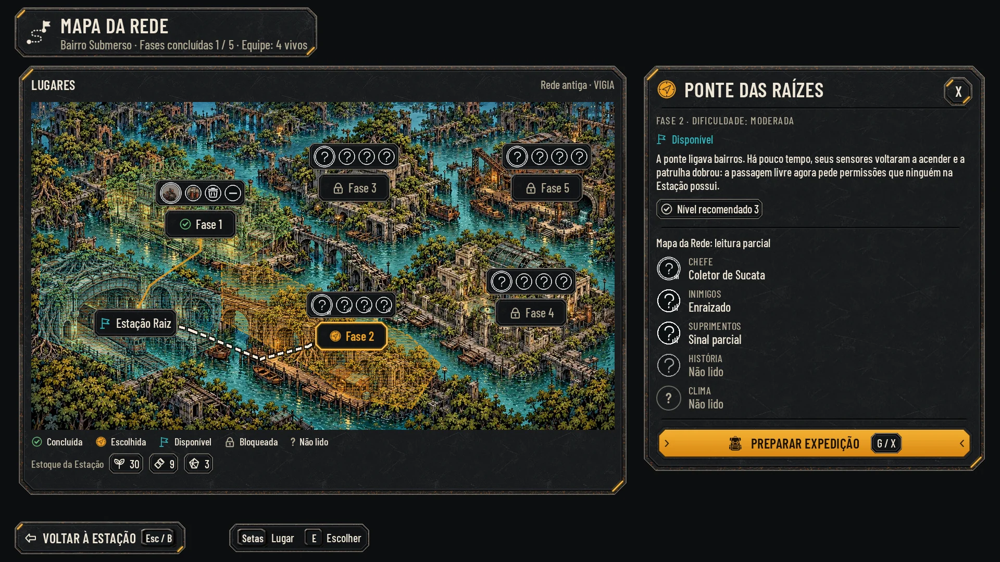
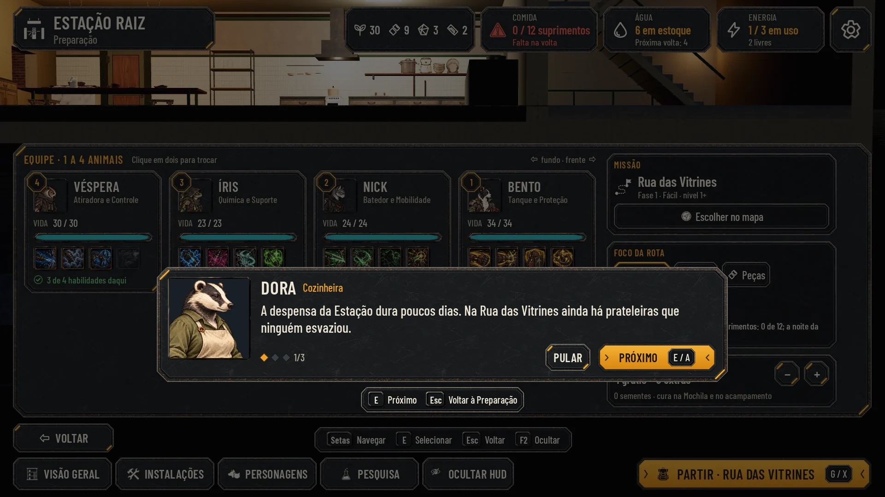

# HUD do título e do fluxo, lote 3 (25/10/2026)

O título, as campanhas, as Opções do título, o briefing e o debriefing, a passagem, a ficha do personagem e o Mapa da
Rede no idioma do kit ([hud-station.md](hud-station.md), [hud-estacao.md](hud-estacao.md),
[hud-exploracao.md](hud-exploracao.md)). A luta fica de fora: ela é do Codex (#59).

Não há alvo do Lucas para estas telas. A régua é a direção aprovada e os lotes anteriores. As maquetes servem para
comparar e aprovar e não entram no jogo. A integração é da #60.

## As telas

| Tela | Normal | Maior | Daltonismo | Antes e depois |
|---|---|---|---|---|
| Título | [title](hud-fluxo/title.webp) | [large](hud-fluxo/title_large.webp) | [colorblind](hud-fluxo/title_colorblind.webp) | [comparar](hud-fluxo/before_after_title.webp) |
| Título com aviso e Campanhas | [title_warning](hud-fluxo/title_warning.webp) | [large](hud-fluxo/title_warning_large.webp) | [colorblind](hud-fluxo/title_warning_colorblind.webp) | [comparar](hud-fluxo/before_after_title_warning.webp) |
| Campanhas | [slots](hud-fluxo/slots.webp) | [large](hud-fluxo/slots_large.webp) | [colorblind](hud-fluxo/slots_colorblind.webp) | [comparar](hud-fluxo/before_after_slots.webp) |
| Em qual espaço começar? | [slots_new](hud-fluxo/slots_new.webp) | [large](hud-fluxo/slots_new_large.webp) | [colorblind](hud-fluxo/slots_new_colorblind.webp) | [comparar](hud-fluxo/before_after_slots_new.webp) |
| Campanha nova | [confirm](hud-fluxo/confirm.webp) | [large](hud-fluxo/confirm_large.webp) | [colorblind](hud-fluxo/confirm_colorblind.webp) | [comparar](hud-fluxo/before_after_confirm.webp) |
| Opções do título | [title_options](hud-fluxo/title_options.webp) | [large](hud-fluxo/title_options_large.webp) | [colorblind](hud-fluxo/title_options_colorblind.webp) | [comparar](hud-fluxo/before_after_title_options.webp) |
| Briefing, fala de um civil | [briefing](hud-fluxo/briefing.webp) | [large](hud-fluxo/briefing_large.webp) | [colorblind](hud-fluxo/briefing_colorblind.webp) | [comparar](hud-fluxo/before_after_briefing.webp) |
| Briefing, última fala (herói) | [briefing_last](hud-fluxo/briefing_last.webp) | [large](hud-fluxo/briefing_last_large.webp) | [colorblind](hud-fluxo/briefing_last_colorblind.webp) | [comparar](hud-fluxo/before_after_briefing_last.webp) |
| Debriefing | [debriefing](hud-fluxo/debriefing.webp) | [large](hud-fluxo/debriefing_large.webp) | [colorblind](hud-fluxo/debriefing_colorblind.webp) | [comparar](hud-fluxo/before_after_debriefing.webp) |
| Passagem para a rua | [passage](hud-fluxo/passage.webp) | [large](hud-fluxo/passage_large.webp) | [colorblind](hud-fluxo/passage_colorblind.webp) | [comparar](hud-fluxo/before_after_passage.webp) |
| Passagem para a Estação (toque) | [passage_station](hud-fluxo/passage_station.webp) | [large](hud-fluxo/passage_station_large.webp) | [colorblind](hud-fluxo/passage_station_colorblind.webp) | [comparar](hud-fluxo/before_after_passage_station.webp) |
| Ficha do personagem | [sheet](hud-fluxo/sheet.webp) | [large](hud-fluxo/sheet_large.webp) | [colorblind](hud-fluxo/sheet_colorblind.webp) | [comparar](hud-fluxo/before_after_sheet.webp) |
| Mapa: fase disponível, leitura parcial | [map](hud-fluxo/map.webp) | [large](hud-fluxo/map_large.webp) | [colorblind](hud-fluxo/map_colorblind.webp) | [comparar](hud-fluxo/before_after_map.webp) |
| Mapa: fase concluída, leitura completa | [map_known](hud-fluxo/map_known.webp) | [large](hud-fluxo/map_known_large.webp) | [colorblind](hud-fluxo/map_known_colorblind.webp) | [comparar](hud-fluxo/before_after_map_known.webp) |
| Mapa: fase bloqueada | [map_locked](hud-fluxo/map_locked.webp) | [large](hud-fluxo/map_locked_large.webp) | [colorblind](hud-fluxo/map_locked_colorblind.webp) | [comparar](hud-fluxo/before_after_map_locked.webp) |

**O "antes" de cada tela:**
- título, campanhas, Opções e Mapa: as capturas de `hud-v2/before/`;
- briefing e debriefing: os recortes de `docs/qa/briefing/before-after.jpg` (o jogo depois da #88);
- ficha: o recorte de `docs/qa/character-sheet/boss-preparation.jpg`;
- passagem: o recorte de `docs/qa/departure/teams.jpg` (o vagão com o cartão, #75).

Cada tela também tem:
- o Maior com daltonismo;
- a redução a 40%;
- o cinza;
- o rolado das Opções.

[checks.json](hud-fluxo/checks.json) passa nas 60 telas, com as mesmas checagens dos lotes anteriores, incluindo o
texto embaixo de um painel do meio. O menor texto tem 20 px.




## O que cada tela mostra

- **Título:**
  - a logo continua a da arte do título (as capturas limpas já a trazem); redesenhar a logo é uma tarefa à parte;
  - o menu fica na coluna da esquerda: CONTINUAR é o botão âmbar, e embaixo vai a linha do espaço numa chapinha (de
    `Campaign.slot_summary`);
  - NOVA CAMPANHA e OPÇÕES são de aço; CAMPANHAS aparece quando há outro espaço que o Continuar não abre;
  - o aviso de `Campaign.warning_text()` (por exemplo, o save de um espaço que não abriu) fica numa chapa com o triângulo,
    abaixo dos botões, como no jogo, sem encostar no enfeite da logo;
  - embaixo, a barra das teclas.
- **Campanhas e "Em qual espaço começar?":** a mesma lista com outro título.
  - Há um bloco por espaço, com o ícone, o nome, o ciclo, as fases, os vivos, a data e o tempo jogado.
  - O escolhido fica com a moldura âmbar, e os vazios ficam apagados.
  - VOLTAR (Esc / B).
- **Campanha nova:**
  - o triângulo e a pergunta, com o texto do jogo;
  - CANCELAR é o âmbar e fica na tecla de voltar;
  - COMEÇAR DO ZERO é de aço, com o triângulo e o texto em alerta, e sem tecla.
- **Opções do título:** o mesmo painel das Opções da Estação (lote 1), à direita, sem a seção Campanha.
- **Briefing e debriefing (#88):** "o briefing é papel com o retrato" (direção).
  - A caixa abre sobre a tela de baixo, escurecida: no briefing, a Preparação aprovada no lote 1; no debriefing, a
    plataforma com a barra do alto.
  - O retrato:
    - nos civis, é o recorte do rosto de `portrait_uv` (`data/presentation/civilians.json`), com o papel ao lado do nome;
    - nos heróis, é o retrato deles, sem papel.
  - A contagem tem os losangos e o "1/3", e os dois crescem no Maior.
  - **Botões:** PULAR, sem tecla, e PRÓXIMO (E / A). Na última fala, o botão é PARTIR (antes da saída) ou VER O RELATÓRIO
    (na volta).
  - **O Esc tem um sentido em cada uma:** no briefing da saída, Esc volta à Preparação sem partir (`cancel_on_back`), e
    PULAR parte. No debriefing, Esc pula. A barra das teclas, logo abaixo da caixa, diz isso.
- **Passagem (#74, #75):** o cartão de `GameFlow.card_for`, na chapa do kit, sobre o vagão em movimento, com a faixa
  escura atrás.
  - Na ida, o nome da fase e "Trecho 1 de 10"; na volta, "Estação Raiz" e "Ciclo 1".
  - Embaixo, à direita, fica um aviso só, como em `passage_card.gd`: "E Pular" (ou "Toque para pular", no toque) quando
    já dá para pular, e "Carregando…" antes disso.
- **Ficha do personagem (#89), na Preparação:**
  - a ficha sai da carta do herói (marcada em âmbar) e fica ancorada à direita dela, sem cobrir a carta;
  - o retrato, o nome, a espécie e o papel, e o medalhão do nível com "Nível" escrito embaixo (para não se confundir
    com o da posição);
  - Vida e Instinto em barras ("em 200, crise"), a Velocidade com o que ela faz;
  - os efeitos passivos com o quadradinho de + (os traços e a relíquia) e os estados.
  - Na luta, a mesma ficha é do Codex.
- **Mapa da Rede (#86):** a pintura, as camadas, as rotas e os marcadores do Codex (`art/ui/map/network/`,
  `phase-map/contract.json`), na chapa do kit.
  - **No alto:** a plaqueta com o texto do jogo ("Bairro Submerso · Fases concluídas 1 / 5 · Equipe: 4 vivos").
  - **No mapa:**
    - sobre cada fase, os marcadores (chefe, inimigos, suprimentos e história) numa chapinha, nas âncoras do Codex; na
      leitura completa, com o rosto do chefe;
    - as etiquetas como botões de opção: concluída com o check, escolhida com a moldura âmbar, disponível com a bandeira,
      bloqueada com o cadeado;
    - as projeções tingidas nas cores do kit;
    - a rota percorrida em âmbar e a que falta até a escolhida em claro, com contorno escuro: uma camada própria
      (`hud-fluxo/layers/route_<lugar>_remaining.webp`, de `build_layers.py`), feita do traço do Codex engrossado;
    - embaixo, a legenda e o estoque da Estação.
  - **À direita, o painel da fase:**
    - a fase e a dificuldade;
    - o estado: Disponível, "Concluída · dá para jogar de novo" ou "Bloqueada · vença a fase anterior";
    - a descrição (bloqueada: "O que há lá, a equipe só descobre quando chegar.");
    - o nível recomendado;
    - a leitura do Mapa da Rede, com os marcadores: Chefe, Inimigos, Suprimentos, História e Clima. O chefe e o inimigo
      mais comum vêm do `radar_snapshot.json` do Codex (o primeiro guardião e a maior contagem de patrulha, como no
      `render.py` dele). Na leitura completa, os dois aparecem com o rosto dentro do aro: Robô e Relé de Defesa, na Fase 1;
    - PREPARAR EXPEDIÇÃO, bloqueado com o motivo na fase bloqueada.
  - **Botões:** o X do painel tira a escolha (volta a "Lugares"); VOLTAR À ESTAÇÃO fecha o mapa.
  - **O que muda da proposta do Codex:** o cobre e o dourado viram o âmbar e o aço do kit, os textos passam para a Barlow
    Condensed, e os marcadores ganham uma chapinha.
  - **A origem:** a pintura fica em 60,196 (no `contract.json`, 68,248); a integração soma essa origem às camadas e aos
    polígonos de clique.

## Peças e ícones

Nenhuma peça nova: o lote usa o kit da Estação, o kit da luta e as camadas do Mapa da Rede (#86).

## Como integrar (#60)

- O título usa a arte e a logo de hoje e troca só o menu.
- As caixas de diálogo (Campanhas, Campanha nova, Abandonar a expedição, Pausa) são um único componente: a chapa grande,
  o título com ícone em maiúsculas, o texto e o botão seguro em âmbar na tecla de voltar.
- A fala do briefing lê `briefings.json`, e o rosto de cada civil vem de `portrait_uv`. O Esc segue `cancel_on_back`.
- O cartão da passagem lê `GameFlow.card_for`.
- O Mapa da Rede segue o `contract.json` do #86 para as camadas e os cliques, e o kit para as cores e as chapas.

## Reprodução

Da raiz do repositório, com o servidor (`python3 -m http.server 8765 --bind 127.0.0.1`):
```
node docs/design/hud-fluxo/render.mjs http://127.0.0.1:8765
```
Os "antes" do briefing, do debriefing, da ficha e da passagem são recortes de 960×540:
- do quadrante de cima à direita e do de baixo à direita de `docs/qa/briefing/before-after.jpg`;
- do quadrante de cima à direita de `docs/qa/character-sheet/boss-preparation.jpg`;
- do quadrante de cima à direita de `docs/qa/departure/teams.jpg`.

Depois, com `B=docs/design/hud-v2/before`, passe ao `docs/design/hud-kit/compose.py` cada tela com a sua captura (a lista
inteira está no PR).

## QA de design

As rodadas seguem [qa.md](qa.md) e ficam registradas abaixo e no PR.

### Rodada 1: REPROVADO

**Média, corrigidos:**
- No briefing, PULAR mostrava "Esc / B", mas no jogo o Esc volta à Preparação sem partir. PULAR ficou sem tecla, a
  barra das teclas diz o que o Esc faz e a página explica a diferença para o debriefing.
- O Mapa voltou a ter:
  - os marcadores sobre cada fase;
  - a rota que falta, que agora se lê;
  - os estados de fase bloqueada e de leitura completa;
  - a dificuldade, a descrição, o estoque e a "Equipe: 4 vivos".
- A passagem usa os textos de `card_for` (a fase e "Trecho N de M"; "Estação Raiz" e "Ciclo N"), sobre o vagão, com
  "Carregando…" e o pular do teclado e do toque.
- O briefing, o debriefing e a ficha abrem sobre as telas aprovadas: a Preparação do lote 1 e a plataforma com a barra
  do alto. A ficha fica ancorada à carta do Bento, sem cobri-la.

**Baixa, corrigidos:**
- "1/3" junto dos losangos, e os dois crescem no Maior;
- o rosto da Dora vem de `portrait_uv`;
- a fala de um herói e a última fala com PARTIR;
- CAMPANHAS, o aviso de save e "Em qual espaço começar?";
- a linha do espaço numa chapinha;
- no Mapa, a origem, o que o X faz e VOLTAR À ESTAÇÃO;
- "Nível" junto do medalhão da ficha.

### Rodada 2: REPROVADO

**Média, corrigidos:**
- A rota até a fase escolhida não aparecia na imagem: o traço fino com o contorno do CSS se perdia na máscara. Agora é
  uma camada própria, engrossada, clara e com contorno escuro (`build_layers.py`), e aparece no WebP.
- A leitura completa da Fase 1 mostrava o inimigo errado: agora é o do `radar_snapshot.json` (Relé de Defesa), com o
  rosto dentro do aro, no mapa e no painel. O chefe (Robô) também tem o rosto.

**Baixa, corrigidos:**
- a linha do Clima voltou (Noite · chuva, na leitura completa; Não lido, nas outras);
- a passagem mostra um aviso só;
- o aviso do título fica abaixo dos botões.

### Rodada 3: APROVADO

- A rota até a fase escolhida aparece no WebP.
- A leitura completa da Fase 1 usa o chefe e o inimigo do radar, com os rostos.
- O Clima, o aviso único da passagem e o aviso do título estão corrigidos.
- As 60 telas estão ok.
- Observação baixa, corrigida: o Clima aparecia duas vezes na fase bloqueada; as telas `map_locked` foram refeitas.
