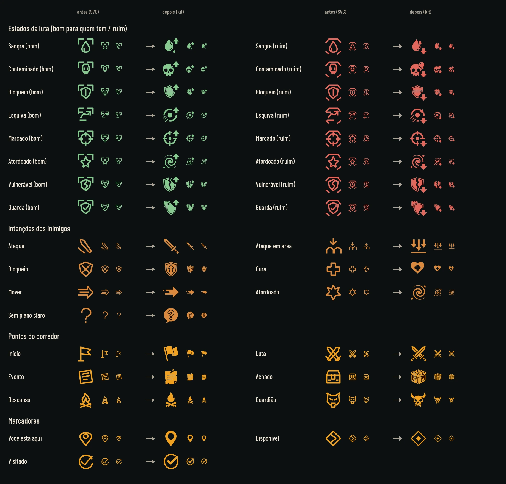
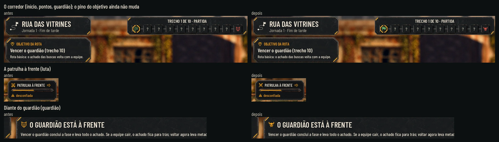

# Os ícones antigos no padrão do kit (26/10/2026)

(O lote B do pedido de 26/10.)

Os estados da luta (`status-*`), as intenções dos inimigos (`intent-*`), os pontos do corredor (`node-*`) e os
marcadores (`marker-*`) de `art/ui/icons/` (os SVG das entregas #17 e #18) refeitos como os glifos do kit
(`art/ui/kit/station/icons`, os de `hud-station.md`): brancos de um tom, para o jogo tingir, no mesmo traço e na mesma
espessura (forma branca cheia com os cortes internos, cantos arredondados). Cada um mantém o significado de antes.

Mesmo método: Nano Banana Pro, folhas 4 x 3 sobre magenta (#FF00FF) com a folha de glifos do kit como referência,
recorte por código ([cut_icons.py](hud-icones/cut_icons.py)), sem texto. Nada em `scripts/`, `data/` nem `tests/`, e os
SVG antigos ficam onde estão.



## A prancha antiga ao lado da nova

[old_new.webp](hud-icones/old_new.webp) ([cinza](hud-icones/old_new_gray.webp)): cada ícone antes (o SVG) e depois (o
glifo), a 64, 32 e 24 px, na cor em que o jogo mostra: os estados no bom e no ruim, as intenções na cor do inimigo e o
corredor e os marcadores no âmbar.

| Grupo | Ícone | Antes | Depois |
|---|---|---|---|
| Estados | Sangra (`bleeding`) | gota | gota grande com duas gotas caindo |
| | Contaminado (`poison`) | caveira | caveira com a bolha tóxica |
| | Bloqueio (`block`) | escudo com faixa | escudo com a faixa rebitada |
| | Esquiva (`dodge`) | seta desviando | seta curva contornando o ponto, com os riscos de velocidade |
| | Marcado (`marked`) | mira | mira com os quatro traços e o ponto |
| | Atordoado (`stunned`) | estrela | espiral com duas estrelas |
| | Vulnerável (`vulnerable`) | escudo partido | escudo de borda grossa, aberto de cima a baixo por um vão largo |
| | Guarda (`protection`) | escudo com o visto | dois escudos, o de trás à esquerda (longe da seta do bom) |
| Intenções | Ataque (`attack`) | lâmina | espada |
| | Ataque em área (`attack_area`) | seta sobre três alvos | três setas descendo sobre o chão |
| | Bloqueio (`block`) | escudo com X | escudo com a seta para cima |
| | Cura (`heal`) | cruz | coração com a cruz |
| | Mover (`move`) | setas | seta cheia com os traços de movimento |
| | Atordoado (`stunned`) | estrela | a espiral do estado |
| | Sem plano claro (`unknown`) | interrogação | interrogação no balão |
| Corredor | Início (`start`) | bandeira | bandeira fincada |
| | Luta (`combat`) | espadas cruzadas | espadas cruzadas com guarda e pomo |
| | Evento (`event`) | folha com linhas | bilhete pregado |
| | Achado (`loot`) | baú | caixote fechado com a cinta |
| | Descanso (`rest`) | fogueira | chama cheia sobre duas toras grossas |
| | Guardião (`boss`) | cabeça de fera | crânio de fera com chifres |
| Marcadores | Você está aqui (`here`) | pino | pino com o furo |
| | Disponível (`available`) | losango | losango com o losango cheio dentro |
| | Visitado (`visited`) | visto | anel com o visto grosso |

A guarda deixou de ser o escudo com o visto porque o kit já tem esse desenho no `guardian_defeated` (o guardião
vencido do relatório); os dois escudos dizem "protege alguém" e separam do Bloqueio (um escudo só, com a faixa
rebitada). O ataque e o mover são espada e seta, e não garra e pegada: os inimigos são quase todos máquinas e raízes.

## Bom e ruim pela forma (daltonismo)

[states.webp](hud-icones/states.webp): os oito estados, bom e ruim, a 32 e 24 px no Normal, no daltonismo (azul
`#56b4e9` e vermelhão `#d55e00`) e em cinza.

- **`_good`**: o símbolo com uma **seta cheia para cima, no canto de cima à direita**;
- **`_bad`**: o mesmo símbolo com uma **seta cheia para baixo, no canto de baixo à direita**.

São duas diferenças de forma (o sentido e o canto), que continuam em cinza e a 24 px. A seta abre um vão de 3 px no
símbolo para não grudar nele; o símbolo fica com 56 px, 4 px abaixo do topo, e a seta numa caixa de 24 x 24 no canto.
Antes a diferença era a moldura (cantoneiras em cima no bom, topo chanfrado e dois pés no ruim), fina demais a 24 px.

## Medidas e nomes

- 64 x 64 px, WebP sem perda, branco de um tom com alfa reto: RGB 255 em todo pixel com alfa, também na borda
  semitransparente (o jogo tinge com `modulate` e importa sem pré-multiplicar), e 0 onde o alfa é 0. O
  desenho ocupa a caixa com 6% de margem, centrado; nos estados, o símbolo a 56 px e a seta no canto, como acima.
- **Os nomes são os mesmos dos SVG** (`status-bleeding_good.webp`, `intent-attack.webp`, `node-boss.webp`,
  `marker-here.webp`…), em `art/ui/kit/station/icons/`. Fogem do `snake_case` dos outros glifos do kit de propósito: o
  `exploration_hud.gd` e o `inventory_panel.gd` já procuram o nome antigo no kit antes do SVG
  (`AHKit.icon(name) if ResourceLoader.exists(AHKit.ICONS % name) else load(ICONS % name)`), e a `qa.md` pede que o
  arquivo que substitui outro mantenha o nome.
- 32 arquivos: 16 estados (8 x bom e ruim), 7 intenções, 6 pontos do corredor, 3 marcadores, cada um com o `.import`.
- No manifesto do kit (`art/ui/kit/station/assets.json` e a cópia em `docs/design/hud-station/assets.json`), os 32
  entram no começo do bloco `icons` com o tamanho, o sha256 e `kind: glyph_white_tintable`, como os outros glifos.

## O que muda no jogo com este PR

Os glifos entram sozinhos onde o código já procura o nome antigo no kit antes do SVG. Capturas do jogo
(`tools/capture_106.gd`, sem e com os arquivos): [before_after_explore.webp](hud-icones/before_after_explore.webp) e a
tela inteira depois, [explore.webp](hud-icones/explore.webp).



| Muda já | Onde no código |
|---|---|
| A faixa do corredor na exploração (início, pontos, guardião) | `exploration_hud.gd`, `STEP_ICONS` pelo `_icon()` |
| A patrulha à frente (luta) | `exploration_hud.gd:210` |
| O título do aviso do guardião | `exploration_hud.gd:1220` |
| O marcador de lugar disponível na exploração | `exploration_hud.gd:672` |
| As fichas do que mudou num evento: vida (`intent-heal`) e instinto (`intent-unknown`) | `exploration_hud.gd`, `CHANGE_ICONS` |
| O conselho da Estação (você está aqui) | `refuge_hud.gd:1865` |

| Não muda ainda (carrega o SVG direto) | Onde no código |
|---|---|
| Os estados e as intenções da luta | `ui_style.gd`, `combat_icon()`; `combat_hud.gd:421-424` |
| O Mapa da Rede | `phase_map.gd`, `ICONS` |
| O pino do objetivo da rota na exploração: nasce com o glifo novo, mas a atualização troca pelo SVG (por isso a captura mostra o antigo) | `exploration_hud.gd:445` |
| O ponto de lista do briefing e da passagem | `briefing_dialog.gd`, `passage_card.gd` (`preload`) |
| O botão do mapa na Estação | `refuge_hud.gd:1832` |

Na faixa do corredor os pontos são pequenos (cerca de 20 px): o crânio do guardião, a bandeira do início e as espadas
da luta (com a guarda e o pomo, para não ler como o X de fechar) se leem.

## Para integrar (Claude)

A luta e o Mapa da Rede ainda carregam os SVG direto; a troca é só de caminho, com o mesmo nome:
- `ui_style.gd`, `combat_icon()`: `AHKit.icon(name)` quando existir no kit, senão o SVG (os estados e as intenções da
  luta e as fichas da placa do inimigo);
- `combat_hud.gd`, as intenções e o ícone da ação (`load("res://art/ui/icons/intent-block.svg")`…), e `phase_map.gd`
  (`ICONS`), com o mesmo teste;
- `passage_card.gd` e `briefing_dialog.gd` pré-carregam `marker-available.svg` como ponto de lista: trocar pelo do kit;
- `exploration_hud.gd:445` (a atualização do pino do objetivo) e `refuge_hud.gd:1832` (o botão do mapa): o mesmo teste.
Os SVG antigos podem sair do jogo quando nenhum código os chamar mais.

## Como refazer

As folhas brutas ficam fora do Git, na pasta `images/hud-icones/` do projeto na Awesomic, e o `cut_icons.py` as recebe
nesta ordem:
1. `combat-glyphs-sheet.png` (4 x 3, com legendas pretas que somem no recorte);
2. `combat-glyphs-sheet-2.png` (4 x 3, a mesma lista sem legendas);
3. `map-glyphs-sheet.png` (4 x 3);
4. `combat-glyphs-fix.png` (2 x 2: a Esquiva, o Sangra e o Ataque em área, que sumiam a 24 px);
5. `map-glyphs-fix.png` (2 x 2: o Início, o Guardião e o Achado mais simples, para a faixa do corredor);
6. `glyphs-fix-round2.png` (4 x 2, as correções da QA: Luta, Guarda, Vulnerável, Marcado, Mover, Descanso e
   Visitado; cada um sai de uma caixa medida na folha, porque o pomo das espadas passa da linha da grade; a Guarda sai
   espelhada e o Marcado com o traço 1 px mais grosso);
7. `glyphs-fix-round2-2.png` (a variante da mesma folha: só a espada sozinha, para o Ataque).

`map-glyphs-sheet-2.png` é a variante que não foi usada. Pedido ao Nano Banana Pro: glifos brancos com contorno preto grosso sobre magenta, no
traço da folha de glifos do kit (referência anexada), sem texto, silhuetas simples para 16 a 24 px. Cada glifo sai da
folha em que ficou mais limpo (a tabela está no `cut_icons.py`).

```sh
# 1. O recorte: grava os 32 em art/ui/kit/station/icons/ (ou na pasta do 8º argumento, para conferir sem mexer no repo)
python3 -B docs/design/hud-icones/cut_icons.py <1> <2> <3> <4> <5> <6> <7> [<pasta>]
# 2. As pranchas (os SVG em PNG antes, pelo Chromium do Playwright)
for s in 24 32 64; do node docs/design/hud-kit/render_svg.mjs <pasta> $s art/ui/icons/*.svg; done
OLD_PNG=<pasta> python3 -B docs/design/hud-icones/sheet.py
# 3. A exploração antes e depois (tools/capture_106.gd sem e com os glifos; precisa de tela, xvfb-run no Linux)
python3 -B docs/design/hud-icones/compose.py <antes> <depois>
```

## QA de design

**Rodada 1, REPROVADO.**
- Alta: o branco não era de um tom: na borda semitransparente o RGB vinha pré-multiplicado (escuro), o que dá franja e
  glifo apagado na Godot. Corrigido: RGB 255 em todo pixel com alfa; as pranchas agora tingem como o `modulate`.
- Médias: a Luta lia como X de fechar; a Guarda (a pata virava mancha) e o Bloqueio ficavam dois escudos iguais; o
  Vulnerável e o Marcado (lia como engrenagem) não se liam a 22 px; garra e pegada no Ataque e no Mover não combinam
  com inimigos que são máquinas e raízes; o Descanso e o Visitado sumiam a 16-20 px. Os oito saíram de novo
  (`glyphs-fix-round2.png`).
- Baixas corrigidas: grãos soltos (o recorte apaga o que fica longe de um traço), a seta dos estados a 2 px da borda,
  "Como refazer" (a ordem e os nomes das folhas) e o título da prancha da exploração (o pino do objetivo não muda).

**Rodada 2, REPROVADO.** A Alta e as Médias da rodada 1 conferidas como corrigidas (o branco a 99-100% do brilho na
redução tipo Godot, a espessura igual à do kit). Duas Médias novas, nos refeitos:
- a seta do bom apagava o segundo escudo da Guarda (o jogo só usa o `_good` dela), e ela ficava igual ao Bloqueio.
  Corrigido: a Guarda espelhada, com o escudo de trás à esquerda;
- o arco do Ataque lia como a lua do `sleep`. Corrigido: só a espada.
- Baixas: os grãos de alfa abaixo de 24 agora somem; o Marcado ganhou 1 px de traço.

**Rodada 3, APROVADO.** Conferidos: os 32 em branco de alfa reto, sem grão, 64 x 64, os `.import`, o manifesto, a
reprodução byte a byte com as 7 folhas, a Guarda com os dois escudos a 16-22 px e separada do Bloqueio, o Ataque como
espada ao lado do `sleep`, o Marcado mais grosso. Observações baixas: a borda serrilhada onde a seta abre o vão (só a
64 px) e o Ataque, o glifo mais leve, fino a 16 px.

