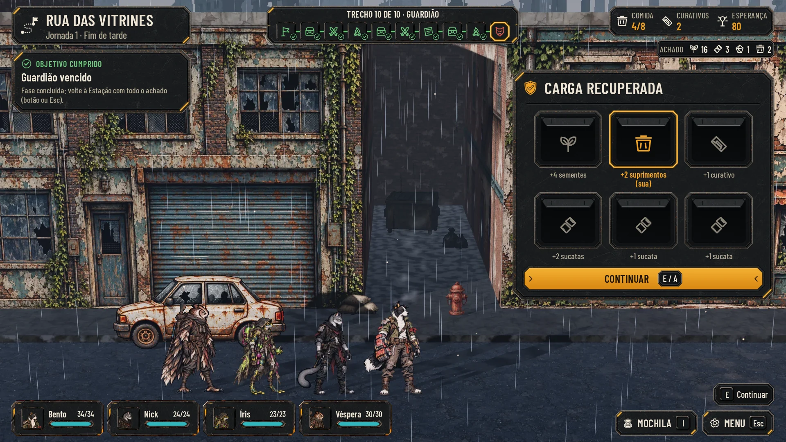
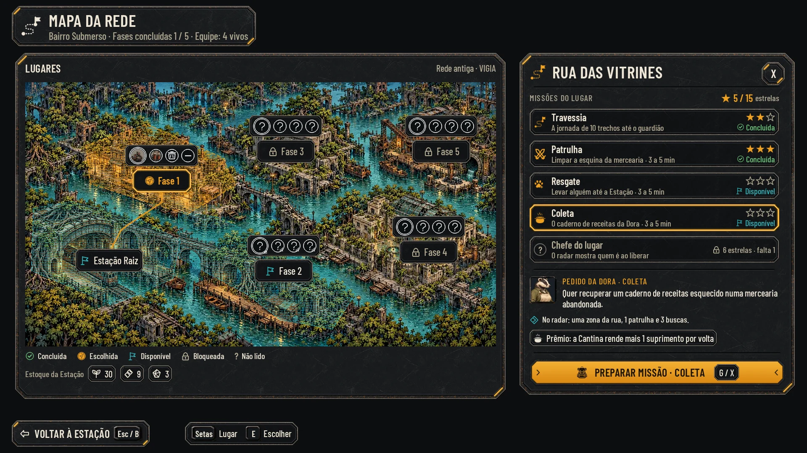

# As telas do laço, lote 6 (26/10/2026)

(O lote 2 do pedido de 26/10; o 6º da série da HUD no kit da Awesomic. Esta página substitui as telas do laço de
[loop-screens.md](loop-screens.md), a versão 1 do Codex, como a proposta atual.)

O resto das telas do laço da [#96](https://github.com/lucasyemz/after-humans-godot/issues/96), no kit da Awesomic
(`art/ui/kit/station`, a seção "Padrão de componentes" de [hud-direction.md](hud-direction.md)). Cada uma segue os
textos e as regras da issue dela:
- a carga recuperada do guardião (#91, já no jogo, [docs/qa/fight-rewards.md](../qa/fight-rewards.md));
- o painel do lugar no Mapa da Rede (#92);
- a árvore da Pesquisa (#94);
- os laços à vista (#93);
- os desafios dos chefes (#95).

O briefing, a ficha, o fim de luta e o Treino da #96 já estão nos lotes anteriores ([hud-fluxo.md](hud-fluxo.md),
[hud-station.md](hud-station.md) e [hud-ajustes.md](hud-ajustes.md)).

**Sobre capturas reais e montadas com as telas aprovadas.** Cada tela é montada pelas funções das telas já aprovadas
(a moldura da exploração, a Visão geral, a Preparação, o Mapa da Rede e a luta do lote 4), que passaram a ser
exportadas. As telas delas não foram geradas de novo: o HTML que elas montam continua igual, byte a byte. Os fundos são:
- **a carga:** uma captura nova do jogo ([before/cargo_clean.webp](hud-laco/before/cargo_clean.webp), do
  [capture.gd](hud-laco/capture.gd)), com as seis caixas sorteadas pelo jogo e o corpo de cada herói em
  [cargo.json](hud-laco/before/cargo.json);
- **a Estação e a Preparação:** as capturas limpas de `hud-v2/before/`;
- **a luta:** as capturas do Codex com o laço disparado pelo motor (`loop-screens/before/combat-bond-*`, a amizade no
  Último Fôlego do Bento e a rivalidade num crítico inimigo);
- **o Mapa da Rede:** o mapa do [hud-fluxo.md](hud-fluxo.md), sem fundo de jogo, como lá.

As maquetes servem para comparar e aprovar e não entram no jogo. A integração é do Claude, em cada issue.

## As telas

| Tela | Normal | Maior | Daltonismo | Maior com daltonismo | Comparar |
|---|---|---|---|---|---|
| Carga: escolher 1 de 6 | [cargo_choose](hud-laco/cargo_choose.webp) | [large](hud-laco/cargo_choose_large.webp) | [colorblind](hud-laco/cargo_choose_colorblind.webp) | [large_colorblind](hud-laco/cargo_choose_large_colorblind.webp) | [hoje](hud-laco/before_after_cargo_choose.webp) |
| Carga: a escolhida e a revelação | [cargo_reveal](hud-laco/cargo_reveal.webp) | [large](hud-laco/cargo_reveal_large.webp) | [colorblind](hud-laco/cargo_reveal_colorblind.webp) | [large_colorblind](hud-laco/cargo_reveal_large_colorblind.webp) | |
| Carga: a relíquia escolhida | [cargo_relic](hud-laco/cargo_relic.webp) | [large](hud-laco/cargo_relic_large.webp) | [colorblind](hud-laco/cargo_relic_colorblind.webp) | [large_colorblind](hud-laco/cargo_relic_large_colorblind.webp) | |
| Lugar: Rua das Vitrines, a Coleta da Dora | [map_place](hud-laco/map_place.webp) | [large](hud-laco/map_place_large.webp) | [colorblind](hud-laco/map_place_colorblind.webp) | [large_colorblind](hud-laco/map_place_large_colorblind.webp) | [hoje](hud-laco/before_after_map_place.webp) |
| Lugar: Ponte das Raízes, as missões bloqueadas | [map_place_locked](hud-laco/map_place_locked.webp) | [large](hud-laco/map_place_locked_large.webp) | [colorblind](hud-laco/map_place_locked_colorblind.webp) | [large_colorblind](hud-laco/map_place_locked_large_colorblind.webp) | |
| Pesquisa: a árvore | [research](hud-laco/research.webp) | [large](hud-laco/research_large.webp) | [colorblind](hud-laco/research_colorblind.webp) | [large_colorblind](hud-laco/research_large_colorblind.webp) | [hoje](hud-laco/before_after_research.webp) |
| Pesquisa concluída, na volta | [research_done](hud-laco/research_done.webp) | [large](hud-laco/research_done_large.webp) | [colorblind](hud-laco/research_done_colorblind.webp) | [large_colorblind](hud-laco/research_done_large_colorblind.webp) | [hoje](hud-laco/before_after_research_done.webp) |
| Laços na Preparação | [bond_preparation](hud-laco/bond_preparation.webp) | [large](hud-laco/bond_preparation_large.webp) | [colorblind](hud-laco/bond_preparation_colorblind.webp) | [large_colorblind](hud-laco/bond_preparation_large_colorblind.webp) | [hoje](hud-laco/before_after_bond_preparation.webp) |
| Laço na luta: amizade | [bond_combat_friend](hud-laco/bond_combat_friend.webp) | [large](hud-laco/bond_combat_friend_large.webp) | [colorblind](hud-laco/bond_combat_friend_colorblind.webp) | [large_colorblind](hud-laco/bond_combat_friend_large_colorblind.webp) | [hoje](hud-laco/before_after_bond_combat_friend.webp) |
| Laço na luta: rivalidade | [bond_combat_rival](hud-laco/bond_combat_rival.webp) | [large](hud-laco/bond_combat_rival_large.webp) | [colorblind](hud-laco/bond_combat_rival_colorblind.webp) | [large_colorblind](hud-laco/bond_combat_rival_large_colorblind.webp) | |
| Desafios dos chefes | [challenges](hud-laco/challenges.webp) | [large](hud-laco/challenges_large.webp) | [colorblind](hud-laco/challenges_colorblind.webp) | [large_colorblind](hud-laco/challenges_large_colorblind.webp) | |

Cada tela também tem a redução a 40% (`*_40.webp`) e o cinza (`*_gray.webp`). Os painéis que rolam no Maior têm também
o rolado (`*_scrolled.webp`). Os "hoje" são capturas do jogo: a carga de [fight-rewards](../qa/fight-rewards.md), e as
outras, de `hud-v2/before/` e `loop-screens/before/`.

[checks.json](hud-laco/checks.json) passa nas 44 telas (11 telas, 4 perfis), com as conferências do
[lib.mjs](hud-kit/lib.mjs), incluindo a dos corpos do lote 5: na carga, o corpo de cada herói (medido na captura)
não pode ficar embaixo do painel. O menor texto tem 20 px.




## 1. A carga recuperada (#91)

O que o jogo já faz (`cargo_picker.gd`, `fight_rewards.gd`), no kit:
- **o painel à direita** (`panel_large`, 640 de largura, x 1252, topo em y 170, embaixo do chip do Achado), longe da
  equipe; a conferência dos corpos confirma. A grade usa a peça a 168x141 (escala 0,84 da peça de 200x168), com 16 px
  entre as colunas e 10 entre as linhas;
- **o título e o texto do jogo:** "Carga recuperada" e "O guardião guardava compartimentos lacrados. Só dá tempo de
  abrir um antes de a carcaça ceder; o resto, a equipe vê pelas frestas.";
- **antes de escolher:** seis compartimentos lacrados (a peça nova `cargo_hatch`, a 168x141) numa grade 3x2, com
  "Compartimento 1" a "6" embaixo. O foco do teclado é o `focus_frame`; a linha embaixo diz que não há segunda escolha;
- **depois:** os seis abrem (`cargo_hatch_open`), com o ícone do que havia no vão (o de `AHFightRewards.icon_of`) e o
  texto embaixo (`box_text`). O texto da história sai, e o painel fica só com o que se abriu:
  - a escolhida tem o `selected_frame`, o ícone e o texto em âmbar e "(sua)" na linha de baixo;
  - o rótulo quebra dentro dos 168 px da coluna (20 px), também o mais longo, o da relíquia
    ([cargo_relic](hud-laco/cargo_relic.webp): "Relíquia: Botão de Cobre", do sorteio da semente 9697 da mesma fase);
  - os suprimentos escolhidos entram no chip do Achado (o ícone da comida com o 2), como o jogo faz quando há algum;
  - as outras cinco ficam apagadas, no tom cheio, sem transparência;
  - CONTINUAR (E / A). O que entra vai para o achado da rota, os curativos vão para a Mochila e a relíquia, para o
    Depósito, como hoje;
- **o cartão do objetivo** diz, como o jogo, "Abra um compartimento da carga do guardião antes de voltar." e, depois,
  "Fase concluída".
- **No fluxo do lote 5,** a carga abre logo depois do popup de fim de luta.

## 2. O painel do lugar no Mapa da Rede (#92)

Sobre o Mapa da Rede do [hud-fluxo.md](hud-fluxo.md), o painel da direita (o mesmo `panel_large`, x 1236, 656 de
largura) passa a ser o do lugar:
- **"Missões do lugar"** e as estrelas somadas do lugar ("5 / 15", com a estrela âmbar);
- **cinco linhas** (`list_row`, a escolhida com `list_row_selected`), cada uma com o ícone, o nome, uma linha e, à
  direita, as estrelas (1 a 3) e o estado:
  - **Travessia:** a jornada de 10 trechos até o guardião (a missão de história de hoje). As estrelas são a melhor nota
    do guardião da fase (`mission_stars`, #91, a chave da fase);
  - **Patrulha:** limpar uma rua (3 a 5 min);
  - **Resgate:** levar alguém até a Estação;
  - **Coleta:** achar uma peça para a Estação. Na Rua das Vitrines, o pedido da Dora, que já existe: "Quer recuperar
    um caderno de receitas esquecido numa mercearia abandonada.", com o prêmio do pedido ("a Cantina rende mais 1
    suprimento por volta"). Na Ponte das Raízes, sem morador (os três pedidos de hoje são das lojas da Rua);
  - **Chefe do lugar:** o "chefe de missão" da #91, que **não é o guardião da Travessia**. Até liberar, ele aparece
    como o "?" do Mapa ("O radar mostra quem é ao liberar"); a nota dele fica numa chave própria, ao lado da do
    guardião;
  - **os estados:** concluída (verde, com as estrelas), disponível (o ciano das fases disponíveis do Mapa) e bloqueada
    (o cadeado do Mapa e o que falta: "6 estrelas · falta 1");
- **o detalhe da escolhida,** embaixo: quem pede (o rosto, como no briefing), o pedido, o que o radar mostra e o prêmio.
- **PREPARAR MISSÃO · COLETA** (G / X), o botão âmbar, como o PREPARAR EXPEDIÇÃO do Mapa.

**As regras da tela** (da #92; os números ficam em `data/`, para ajustar):
- 3 estrelas somadas no lugar liberam o Resgate e a Coleta, e 6 liberam o Chefe. A Patrulha e a Travessia estão sempre
  abertas;
- o total do lugar soma as cinco (até 15): "5 / 15" na Rua das Vitrines (2 da Travessia e 3 da Patrulha);
- os estados também têm forma: concluída com o check, disponível com a bandeira da legenda do Mapa, bloqueada com o
  cadeado;
- missão curta conta como uma expedição (a noite, o consumo e o relatório), sem energia por tempo;
- repetir dá prêmio menor ("4 sucatas · na repetição, 2").

**Decisões do Lucas, antes de integrar:**
- **quem é o Chefe de cada lugar** (um inimigo da fase, como chefe de missão). A tela não escolhe ninguém;
- **o Resgate** ("levar alguém até a Estação") não tem pessoa nem pedido ainda; a tela não inventa ninguém (§14);
- **a Coleta e o foco da rota:** os pedidos da Dora, do Otto e da Cora hoje são focos da Travessia (`FOCI`,
  `request_civil_*`, nas lojas da Rua). A proposta é o pedido sair do foco e virar só a Coleta, com entrega única. Se
  ficar nos dois, a regra precisa impedir a segunda entrega.

## 3. A árvore da Pesquisa (#94)

No Centro de Pesquisa da Estação, com a barra do alto e as abas de baixo das telas da Estação:
- **a árvore** (`panel_large`, x 28–1346): três ramos em colunas, com "N concluídos de M" em cada um:
  - **Classe**, mais larga, numa linha por herói (o retrato, o treino de hoje e o próximo, ligados por um traço
    horizontal: o pré-requisito real é só o treino anterior da mesma classe);
  - **Estação** e **Radar**, cadeias curtas em coluna, cada nó pedindo o de cima (o traço vertical);
- **cada nó** (`panel_inset`): o nome, o custo em chips (fragmentos, sucata e a duração em expedições) e o estado:
  - **concluída:** o check verde, e o elo verde até o seguinte;
  - **em andamento:** a faixa âmbar na esquerda do nó, a barra âmbar e "Em andamento · 1 de 2 expedições", sem moldura;
  - **disponível:** o custo;
  - **bloqueada:** o cadeado e "Requer …" (o pré-requisito);
  - **escolhida:** o `selected_frame`;
- **o detalhe, à direita** (`panel_large`, 520): o ramo, o nome, o efeito, o pré-requisito, o custo com o que a Estação
  tem ("4 fragmentos · tem 3", na cor de alerta quando falta), a duração e INICIAR PESQUISA. Ele fica apagado com o
  motivo ("Uma pesquisa por vez"), e a linha de alerta diz o que falta e quando a de agora termina;
- **uma pesquisa por vez,** medida em expedições (1 a 3).

**Os nós:**
- **Classe:** os quatro treinos de hoje (`res_cao_punho_sucata`, `res_gato_corte_fase`, `res_sapo_carga_voltaica` e
  `res_coruja_recurso_emergencia`, ids preservados, 3 fragmentos e 1 expedição) e o próximo de cada classe (Impacto
  Hidráulico, Salto Entre Ruínas, Coquetel Corrosivo e Disparo Perfurante), no mesmo texto ("+1 nos limites de dano ou
  cura de …"). Os treinos já pesquisados migram como concluídos;
- **Estação:** Canteiro irrigado (+1 suprimento por volta), Filtro de água (+2 de água por volta) e Gerador remendado
  (+1 de capacidade de energia). O Depósito maior continua nas Instalações (o nível 2, que já existe), fora da árvore;
- **Radar:** Leitura parcial, Leitura completa e Leitura das missões, as leituras do Mapa da Rede da #87.
- **Os custos, as durações e os efeitos novos são exemplos,** para a decisão do Lucas, em `data/research.json`.

**O aviso "Pesquisa concluída"** ([research_done](hud-laco/research_done.webp)), na volta:
- o Próximo passo da Visão geral vira "Pesquisa concluída", com o efeito, "2 de 2 expedições" e VER A PESQUISA (a
  Estação no Ciclo 2, depois das duas expedições);
- um aviso curto no alto, ao chegar (`panel_large`, o ícone da Pesquisa, "Pesquisa concluída · Leitura completa do
  radar");
- no relatório da volta, a mesma linha entra como um `result_chip` (a peça do relatório, [hud-station.md](hud-station.md)),
  com o ícone da Pesquisa e "Pesquisa concluída · Leitura completa". Esta entrega não tem a maquete do relatório.

## 4. Os laços (#93)

As regras são as de hoje (`combat_engine.gd`, `character_sheet.gd`):
- o laço vai de −3 a +3, por par;
- a superação aproxima o herói de todos (+1), e o colapso afasta (−1);
- **amizade +3:** quando um cai no Último Fôlego, o outro ergue a guarda (+1 bloqueio);
- **rivalidade −3:** um crítico inimigo num deles abala o outro (+5 de instinto).

**Na Preparação** ([bond_preparation](hud-laco/bond_preparation.webp)):
- cada carta ganha uma linha com o ícone do laço e o par ("Amizade com Nick", "Rivalidade com Íris"). Os ícones novos
  `bond_friend` (dois elos) e `bond_rival` (duas pontas com a fenda) separam também pela forma;
- embaixo das cartas, "Laços da equipe": cada par numa linha (`panel_inset`), com os dois retratos, o ícone, o nível
  ("Amizade +3"), a escala de −3 a +3 (os quadradinhos cheios do lado do laço, o zero mais alto) e o efeito. A linha de
  cima diz o que muda o laço.
- **quais pares entram:** todo par com o laço diferente de 0, com o nível e a escala; o efeito só vale em +3 e em −3, e
  a linha diz isso. Os efeitos dizem o mesmo que a ficha de hoje (`character_sheet.gd`, "Amizade %+d · em +3, quando um
  cai, o outro ergue a guarda (+1 bloqueio)"), mais curtos, para caber na carta e na linha do par;
- **Decisão pendente do Lucas:** hoje o laço zera a cada expedição (`start_expedition`, `relationships = {}`). Para ele
  aparecer na Preparação, antes de sair, precisa ficar na campanha. Sem isso, a Preparação mostra os laços só da
  expedição em curso, que é nenhum; a tela usa o estado de uma expedição como exemplo.

**Na luta** ([bond_combat_friend](hud-laco/bond_combat_friend.webp) e [bond_combat_rival](hud-laco/bond_combat_rival.webp)):
- um destaque curto no alto, embaixo da ordem da rodada (`panel_large`): o ícone, "Amizade · Bento e Nick" e o que
  aconteceu ("Nick ergueu a guarda para proteger Bento", o texto do registro), com o efeito num chip ("+1 bloqueio",
  "+5 de instinto"). Some sozinho em 2,5 s (no ritmo da luta: metade no 2x), sem parar o turno;
- sobre a cabeça de quem recebeu o efeito, o chip com o ícone, como os números da luta;
- **os pares da luta** (Bento e Nick, na amizade e na rivalidade) são estados preparados pelo motor nas capturas do
  Codex, como dizia `loop-screens.md`; os pares da Preparação são outro exemplo;
- o resto da tela é a luta do lote 4, montada sobre a captura do laço. O anel no chão fica de fora nestas duas, porque
  a máscara dele é a do sprite do Nick.

## 5. Os desafios dos chefes (#95)

Sobre o Mapa da Rede, o painel da direita vira "Desafios dos chefes":
- uma linha por chefe, com o rosto do Mapa (`portrait_*`), o nome e a fase;
- **o vencido** (o Robô): os modificadores em chips (Sem curativos, Sem fugir), a melhor nota em estrelas e a moldura
  âmbar no rosto;
- **os outros:** "Guardião desconhecido · Fase N · vença para ler", com o "?" do Mapa no lugar do rosto e o cadeado. O
  nome e o rosto só aparecem depois de vencer, como na leitura do radar (#87);
- embaixo, as estrelas do escolhido (os critérios da luta, `data/fight-stars.json`, com o par de 5 rodadas do guardião
  da Fase 1) e os prêmios de prestígio (uma relíquia rara com 3 estrelas e a moldura de retrato), que não mexem na
  campanha;
- PREPARAR DESAFIO · ROBÔ (G / X).
- **o desafio é do guardião** (o da Travessia), e não do Chefe do lugar: ele abre quando o guardião cai, sem conflito
  com o Chefe do lugar, que é outro inimigo;
- **Os modificadores de cada chefe** são exemplos, da lista da #95 (sem curativos, inimigos mais fortes, equipe de dois,
  sem fugir). Ficam em `data/`, e a paridade não muda.

## Peças novas (`art/ui/kit/station/`)

| Peça | Tamanho | 9-slice | Uso |
|---|---|---|---|
| `cargo_hatch` | 200×168 | — | O compartimento lacrado: a escotilha de aço com rebites, duas cintas e o lacre âmbar. Escolha: `selected_frame`; foco: `focus_frame` |
| `cargo_hatch_open` | 200×168 | — | O compartimento aberto: o vão escuro e a tampa erguida (o trapézio claro no alto, 26 px). O jogo desenha o ícone (48) no vão (área de conteúdo 22,48 a 177,147) |
| `icons/bond_friend` | 64×64 | — | Amizade: dois elos encaixados, glifo branco tingido (verde; azul no daltonismo) |
| `icons/bond_rival` | 64×64 | — | Rivalidade: duas pontas, uma contra a outra, com a fenda no meio (vermelho; vermelhão no daltonismo) |

Este lote também leva as peças do lote 5 (`bar_preview`, `star`, `star_empty`), no mesmo commit do PR dele: quando o
PR do lote 5 entrar, esse commit some daqui. O manifesto passa a ter 60 peças e 48 ícones, e a Godot 4.7.2 importou
as peças novas.

**Reaproveitadas:** `panel_large`, `panel_inset`, `list_row`, `list_row_selected`, `selected_frame`, `focus_frame`,
`cost_chip`, `primary_button` (e o apagado), `secondary_button`, `icon_button`, `hero_card`, `square_portrait`,
`main_bar`, `bar_fill`, `keys_bar`; o cadeado e os rostos do Mapa da Rede.

## Textos novos (português e inglês)

| Português | Inglês |
|---|---|
| Missões do lugar | Missions here |
| Travessia | Crossing |
| A jornada de 10 trechos até o guardião | The 10-stretch journey to the guardian |
| Patrulha · Resgate · Coleta | Patrol · Rescue · Collection |
| Levar alguém até a Estação | Bring someone to the Station |
| Chefe do lugar | Local boss |
| O radar mostra quem é ao liberar | The radar shows who it is once unlocked |
| Achar uma peça para a Estação | Find a part for the Station |
| Guardião desconhecido · %s · vença para ler | Unknown guardian · %s · defeat it to read |
| %d estrelas · falta %d | %d stars · %d to go |
| Pedido da %s · Coleta | %s's request · Collection |
| Preparar missão · %s | Prepare mission · %s |
| Prêmio: %s · na repetição, %s | Reward: %s · on replay, %s |
| Pesquisa | Research |
| Medida em expedições · uma por vez · custo em fragmentos e sucata | Measured in expeditions · one at a time · costs fragments and scrap |
| Em andamento · %d de %d expedições | In progress · %d of %d expeditions |
| Requer %s | Requires %s |
| Iniciar pesquisa | Start research |
| Uma pesquisa por vez | One research at a time |
| Pesquisa concluída | Research complete |
| Laços da equipe | Team bonds |
| Filtro de água · +2 de água por volta | Water filter · +2 water per return |
| Amizade com %s · Rivalidade com %s | Friendship with %s · Rivalry with %s |
| Superação aproxima (+1), colapso afasta (−1), de −3 a +3. O efeito vale em +3 e em −3. | Overcoming brings them closer (+1), collapse pushes them apart (−1), from −3 to +3. The effect applies at +3 and −3. |
| Nick ergueu a guarda para proteger Bento | Nick raised his guard to protect Bento |
| Nick estremeceu ao ver a falha do rival | Nick flinched at his rival's failure |
| Desafios dos chefes | Boss challenges |
| Depois de vencer um chefe, a mesma luta com modificadores. | After a boss falls, the same fight with modifiers. |
| Sem curativos · Sem fugir · Inimigos mais fortes · Equipe de dois | No bandages · No fleeing · Stronger enemies · Team of two |
| Vença o guardião | Defeat the guardian |
| Preparar desafio · %s | Prepare challenge · %s |
| Prêmios de prestígio: a campanha não muda. | Prestige rewards: the campaign does not change. |

## Reprodução

Da raiz do repositório:
```
# 1. A captura da carga (precisa de uma tela; no Linux sem tela, xvfb-run -a -s "-screen 0 1920x1080x24")
"$GODOT" --path . --rendering-driver opengl3 --resolution 1920x1080 -s res://docs/design/hud-laco/capture.gd -- --out=<pasta>
#    <pasta>/cargo.png em WebP (qualidade 84) vira before/cargo_clean.webp, e <pasta>/cargo.json, before/cargo.json
# 2. As telas (com python3 -m http.server 8765 --bind 127.0.0.1)
python3 docs/design/hud-station/build_kit.py
node docs/design/hud-laco/render.mjs http://127.0.0.1:8765
B=docs/design
python3 docs/design/hud-kit/compose.py docs/design/hud-laco cargo_choose=$B/hud-laco/before/today_cargo.jpg cargo_reveal \
  map_place=$B/hud-v2/before/station-map.jpg map_place_locked research=$B/hud-v2/before/station-research.jpg \
  research_done=$B/hud-v2/before/station.jpg bond_preparation=$B/hud-v2/before/station-preparation.jpg \
  bond_combat_friend=$B/loop-screens/before/combat-bond-friend.jpg bond_combat_rival challenges
```

## QA de design

As rodadas seguem [qa.md](qa.md) e ficam registradas abaixo e no PR.

### Rodada 1: REPROVADO

**Média, corrigidos:**
- A árvore da Classe tem os quatro treinos de hoje, numa linha por herói, com o próximo de cada classe ligado só ao
  pré-requisito real ("1 de 8"). O Depósito saiu da árvore (continua nas Instalações); entrou o Filtro de água.
- "Em andamento" ficou com a faixa âmbar na esquerda, sem moldura; a escolhida tem o `selected_frame`.
- O Chefe do lugar é o chefe de missão da #91, não o guardião: aparece com o "?" até liberar, e o desafio é do
  guardião. O total do lugar soma as cinco (até 15).
- Os guardiões não vencidos ficam "Guardião desconhecido", com o "?", na lista de desafios.
- Os rótulos da carga quebram dentro da coluna (20 px), com "(sua)" embaixo, e entrou a tela da relíquia, nos quatro
  perfis.
- O Achado mostra os suprimentos escolhidos.
- A Coleta contra o foco da rota ficou registrada como decisão do Lucas, com a proposta; a Coleta da Ponte não usa
  mais o pedido do Otto (os três pedidos de hoje são da Rua).

**Baixa, corrigidos:**
- os laços: o estado preparado das capturas, quais pares entram e os textos da ficha reaproveitados;
- "4 sucatas", "+5 de instinto" e "mais 1 suprimento";
- a Estação no Ciclo 2 no aviso; o `result_chip` do relatório descrito;
- o check e a bandeira nos estados das missões;
- a tampa da escotilha aberta mais visível;
- a escala da peça da carga, a duração do destaque e os espaços da grade na página;
- `loop-screens.md` aponta para esta página; os commits separados (o kit do lote 5 e o deste lote).

**Baixa, fica como observação:** o ponto de alfa no encaixe dos elos de `bond_friend`, invisível a 22 e 32 px.

### Rodada 2: REPROVADO

**Média, corrigidos:**
- O manifesto (`assets.json`, os dois) foi gerado de novo: a área de conteúdo de `cargo_hatch_open` é 22, 48, 155, 99.
- No Maior, a barra de rolagem da árvore passava por cima do Radar: a área que rola reserva a calha (18 px à direita).

**Baixa, corrigidos:** "5 / 15" e "4 sucatas" na página; a frase sobre os textos dos laços; "Requer Punho de Sucata
(concluída)"; "Ramo Classe · Cão".

### Rodada 3: APROVADO

Os dois médios e as baixas da rodada 2 estão corrigidos, sem nada alto ou médio. As 44 telas passam, o kit sai igual
do `build_kit.py`, e as bases (exploração, fluxo, Estação e luta) continuam gerando o mesmo HTML.

Observação baixa: o ponto de alfa no encaixe dos elos de `bond_friend`, que não aparece a 22 nem a 32 px.

