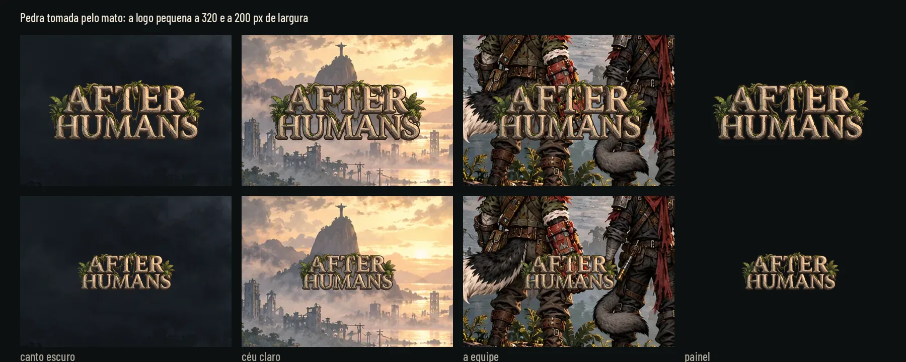

# A logo do título: Pedra tomada pelo mato (26/10/2026)

(O lote C do pedido de 26/10, na segunda rodada.)

Uma proposta de logo de "After Humans" sobre a tela do título como o jogo mostra hoje, em tamanho grande e pequeno.
**É só proposta: a logo do jogo (`art/ui/title/after_humans_logo.png`) não muda.** Nada em `art/`, `scripts/`,
`data/` nem `tests/`.

Mesmo método dos ícones do kit: Nano Banana Pro, a logo sobre magenta (#FF00FF) e recortada por código
([cut_logos.py](hud-logo/cut_logos.py), o mesmo recorte dos traços de `hud-station/cut_icons.py`). A logo é a única
imagem com letras, como a de hoje ([title.md](title.md): a assinatura é a exceção à regra de arte sem texto); a grafia
foi conferida letra a letra.


## Como chegamos aqui

- **Rodada 1** (no histórico deste branch): três ideias, Raízes, Sucata e VIGIA e Placa da cidade alagada. O Lucas
  gostou do estilo das Raízes, mas ainda não era o que queria.
- **Rodada 2** ([explorations.webp](hud-logo/explorations.webp)): cinco variações dentro das Raízes, sobre a tela do
  título: contida numa linha, a raiz atravessando, pedra tomada pelo mato, com o emblema da estação e raízes na água.
  O Lucas escolheu **a pedra tomada pelo mato**. A prancha é um registro da escolha, montada com os rascunhos (fora do
  Git, em `images/hud-logo/round2/`), e não é refeita por script.
- **O refino da escolhida:** menos cipó sobre as faces das letras (a maior parte corre pelo alto e desce nos vãos;
  alguns ainda enrolam a perna do A, o M e o T, sem cortar a leitura), a pedra ganhou a luz quente do pôr do sol da
  arte do título e o contorno virou marrom-escuro, mais pintado e menos "adesivo".

## A proposta

Um monumento da cidade dos humanos, em pedra clara rachada e lascada, com musgo nos sulcos, cipós e raízes pelo alto e
folhas tropicais nas pontas: a cidade tomada pela mata, que é o fundo do título. Duas linhas, AFTER em cima de HUMANS.

| Tela grande | A 40% (celular) | Pequena (320 e 200 px) | Retrato |
|---|---|---|---|
| [title_stone](hud-logo/title_stone.webp) | [40%](hud-logo/title_stone_40.webp) · [cinza](hud-logo/title_stone_40_gray.webp) | [small_stone](hud-logo/small_stone.webp) · [cinza](hud-logo/small_stone_gray.webp) | [portrait_stone](hud-logo/portrait_stone.webp) |




## Leitura

- **Na tela grande** a logo fica na caixa da logo de hoje (x 65, y 160, 880 x 241 de `title_screen.gd`), alinhada à
  esquerda na borda dos botões (x 100) e centrada na altura da caixa, com no máximo 210 px de altura: em duas linhas,
  com os 241 px da caixa, ela chegava a 28 px dos botões. O que se vê (sem a margem transparente): x 103, y 178,
  525 x 204. Termina em y 382, a 43 px dos botões (y 425); a de hoje deixa cerca de 87.
- **Pequena**, a 320 e a 200 px, sobre o canto escuro, o céu claro, a equipe (o trecho mais cheio da arte) e o painel do
  kit: lê nos quatro, também a 200 px. No escuro é a pedra clara que separa (cerca de 8,9:1); no céu claro a face da
  pedra quase some no fundo (1,3:1) e quem segura a leitura é o contorno escuro (6,3:1).
- **A 40% e em cinza** ([title_stone_40_gray](hud-logo/title_stone_40_gray.webp)) a logo é o ponto mais claro do
  canto esquerdo e lê inteira.
- **Retrato** ([portrait_stone](hud-logo/portrait_stone.webp), a 50%): o fundo em pé de `title_background_portrait.png`
  e a logo em (80, 190) na caixa de 920 x 252 do `PORTRAIT` de `title_screen.gd`. Só fundo e logo: a Godot não abre em
  pé no xvfb, então sem os botões.

## Medidas e arquivos

| Arquivo em `docs/design/hud-logo/` | Tamanho | Proporção (altura / largura) |
|---|---|---|
| `logo_stone.webp` | 1355 x 536 | 0,396 |
| `logo_stone_small.webp` | 640 x 258 | 0,403 |

WebP sem perda, com alfa: 8 px de margem transparente em volta (o centro é o meio da imagem), o RGB zerado onde o alfa
é 0, nenhum pixel com alfa abaixo de 8 e nenhum pixel puxando para o magenta (o recorte tira o azul do que sobrou de
mistura com o fundo, no contorno e nos furinhos entre cipós e letras, e o leva ao marrom-escuro do traço). Os fundos das telas são a captura do jogo
([before/title.webp](hud-logo/before/title.webp), e sem a logo, [before/title_clean.webp](hud-logo/before/title_clean.webp)),
do [capture.gd](hud-logo/capture.gd), com a caixa da logo e a posição dos botões em
[before/title.json](hud-logo/before/title.json).

**Para integrar, se o Lucas aprovar** (é do Claude):
- a peça grande vai para `art/ui/title/after_humans_logo.png` (ou um `.webp` novo) e a pequena para
  `after_humans_logo_small.png`;
- `title_screen.gd` calcula a altura da caixa com a proporção de hoje (`560.0 / 2048.0`); a nova tem 0,396, e a caixa
  passa a usar a da textura, com no máximo 210 px de altura (centrada na caixa de hoje, como na prévia);
- o `TextureRect` usa `STRETCH_KEEP_ASPECT`, que desenha no canto esquerdo da caixa (x 65): para a logo começar na
  borda dos botões, como na prévia, `LANDSCAPE.logo.x` passa a 100;
- a peça grande tem 1355 px de largura (a de hoje, 2048): em 4K (caixa de 1760 px) seria ampliada. Se o jogo for a 4K,
  pedir a logo maior;
- o `splash.png` e o ícone do app usam a logo de hoje e mudam junto, se for o caso.

## Como refazer

A imagem bruta fica fora do Git, na pasta `images/hud-logo/` do projeto na Awesomic: `logo-stone.png` (a rodada 2 e o
refino estão em `images/hud-logo/round2/`). Saiu do Nano Banana Pro com a variação 3 da rodada 2 e a arte do título
como referência, pedindo a grafia exata "AFTER HUMANS" em duas linhas sobre magenta chapado, as faces das letras
limpas, os cipós só no alto e nos vãos, a luz do pôr do sol e o contorno marrom-escuro.

```sh
# 1. A captura do título (precisa de uma tela; no Linux sem tela, xvfb-run). Ela grava title_landscape.png,
#    title_landscape_clean.png e title_landscape.json; o compose.py lê before/title.webp, before/title_clean.webp e
#    before/title.json (os dois PNG convertidos em WebP com qualidade 80, e o JSON copiado)
xvfb-run -a -s "-screen 0 1920x1080x24" "$GODOT" --path . --rendering-driver opengl3 --resolution 1920x1080 \
  -s res://docs/design/hud-logo/capture.gd -- --out=<pasta>
# 2. O recorte
python3 -B docs/design/hud-logo/cut_logos.py stone=<logo-stone.png>
# 3. As telas e as pranchas
python3 -B docs/design/hud-logo/compose.py
```

## QA de design

A rodada 1 de propostas (as três ideias) foi aprovada na 2ª rodada de QA; o registro está no histórico do branch.

**Pedra tomada pelo mato, rodada 1, REPROVADO.**
- Alta: franja magenta escura no contorno da peça grande (o recorte tratava como opaca a mistura com até cerca de 24%
  de magenta). Corrigido: o recorte tira o azul e devolve o marrom ao que puxa para o magenta, na peça inteira.
- Baixas corrigidas: a descrição do refino (alguns cipós ainda no A, no M e no T), os 28 px até os botões (agora 43,
  com a altura máxima de 210 px), o `LANDSCAPE.logo.x` na integração, a conversão da captura em "Como refazer".

**Rodada 2, APROVADO.** Conferidos: as duas peças e as sete telas reproduzidas byte a byte, nenhum pixel magenta, o alfa,
as medidas, a grafia e a leitura em todos os tamanhos. Observações baixas já aplicadas: o contorno com o verde de volta
(marrom, não vinho) e "cerca de 87 px" para a logo de hoje.
