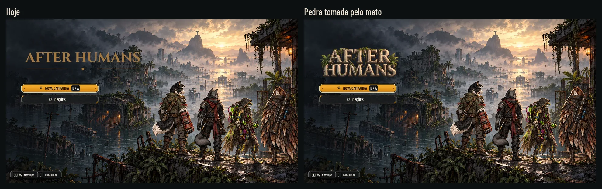
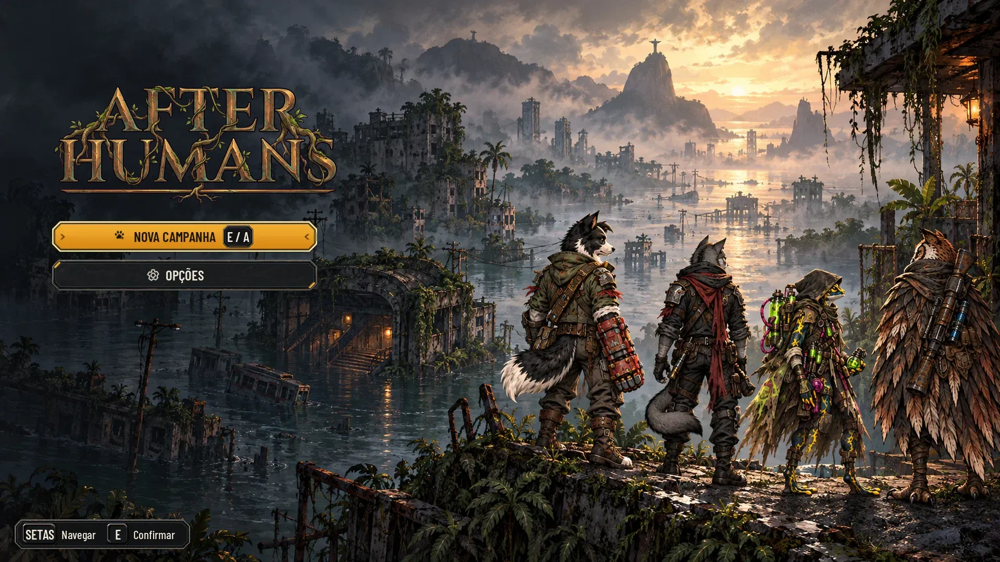
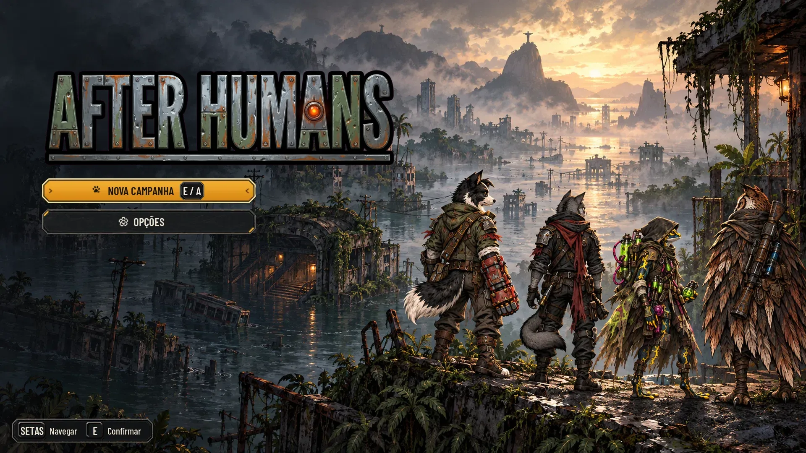
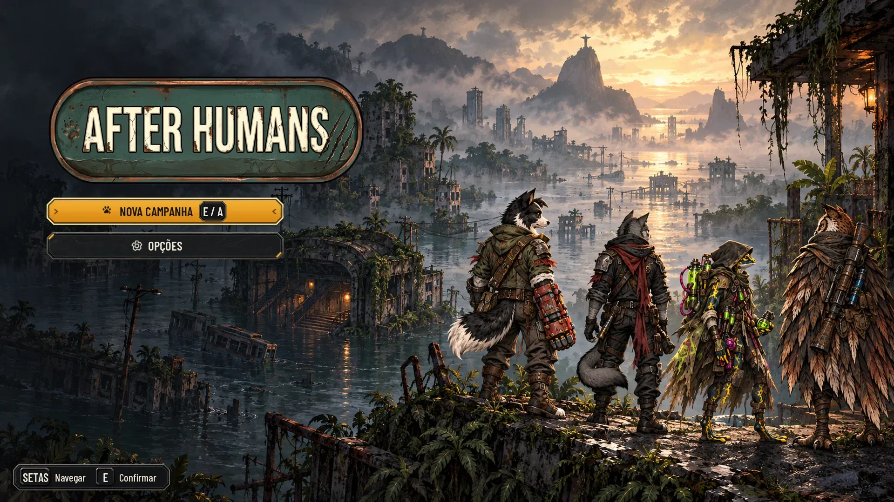

# Três propostas de logo do título (26/10/2026)

(O lote C do pedido de 26/10.)

Três logos de "After Humans" feitas dentro do mundo do jogo, cada uma sobre a tela do título como o jogo mostra hoje,
em tamanho grande e pequeno, para o Lucas escolher. **É só proposta: a logo do jogo
(`art/ui/title/after_humans_logo.png`) não muda.** Nada em `art/`, `scripts/`, `data/` nem `tests/`.

Mesmo método dos ícones do kit: Nano Banana Pro, cada logo sobre magenta (#FF00FF) e recortada por código
([cut_logos.py](hud-logo/cut_logos.py), o mesmo recorte dos traços de `hud-station/cut_icons.py`). A logo é a única
imagem com letras, como a de hoje ([title.md](title.md): a assinatura é a exceção à regra de arte sem texto); a grafia
foi conferida letra a letra nas três.



## As propostas

| | Ideia | Tela grande | A 40% (celular) | Pequena (320 e 200 px) |
|---|---|---|---|---|
| **A · Raízes** | Letras de bronze com verdete, no desenho clássico da de hoje, com raízes e cipós da cidade tomada pelo mato passando por elas; um filete embaixo com uma raiz brotando. Duas linhas. | [title_roots](hud-logo/title_roots.webp) · [retrato](hud-logo/portrait_roots.webp) | [40%](hud-logo/title_roots_40.webp) · [cinza](hud-logo/title_roots_40_gray.webp) | [small_roots](hud-logo/small_roots.webp) · [cinza](hud-logo/small_roots_gray.webp) |
| **B · Sucata e VIGIA** | Letras condensadas de chapa rebitada (aço e verde descascado, ferrugem), e o olho da VIGIA no lugar da barra do A de HUMANS: a única luz da logo, âmbar. Uma linha. | [title_scrap](hud-logo/title_scrap.webp) · [retrato](hud-logo/portrait_scrap.webp) | [40%](hud-logo/title_scrap_40.webp) · [cinza](hud-logo/title_scrap_40_gray.webp) | [small_scrap](hud-logo/small_scrap.webp) · [cinza](hud-logo/small_scrap_gray.webp) |
| **C · Placa da cidade alagada** | Uma placa esmaltada de estação, que ficou debaixo d'água (a faixa escura embaixo), com a pegada de um sobrevivente num canto e três arranhões de garra no fim da placa, depois do S. Uma linha. | [title_sign](hud-logo/title_sign.webp) · [retrato](hud-logo/portrait_sign.webp) | [40%](hud-logo/title_sign_40.webp) · [cinza](hud-logo/title_sign_40_gray.webp) | [small_sign](hud-logo/small_sign.webp) · [cinza](hud-logo/small_sign_gray.webp) |





## Leitura

- **Na tela grande** as três ficam na caixa da logo de hoje (x 65, y 160, 880 x 241 de `title_screen.gd`), alinhadas
  à esquerda na borda dos botões (x 100), com a altura da caixa; a B, mais comprida, bate antes na largura (845 px).
  O que se vê de cada uma (sem a margem transparente), medido na tela:

  | | x, y | largura x altura |
  |---|---|---|
  | A · Raízes | 104, 163 | 544 x 235 |
  | B · Sucata e VIGIA | 106, 167 | 833 x 227 |
  | C · Placa | 104, 164 | 678 x 233 |

  Nenhuma encosta nos botões (y 425), mas a B termina em y 394 e deixa 31 px até eles (a de hoje deixa 88): se a B
  for a escolhida, a altura dela pode ir a 210 px. A de hoje mostra 755 px de largura.
- **Pequena** ([small_*](hud-logo/small_roots.webp)), sobre o canto escuro, o céu claro, a equipe (o trecho mais cheio
  da arte) e o painel do kit:
  - **C** é a mais legível em tudo: a placa leva o próprio fundo, então lê igual no céu e sobre a equipe, a 200 px
    inclusive;
  - **B** lê bem a 320 e a 200 px. No céu claro quem separa a logo do fundo é o contorno preto grosso; no escuro e no
    painel, onde ela fica de fato, quem separa é a face clara do aço (o contorno some no escuro);
  - **A** é a mais fraca: lê no escuro e no painel, mas a 200 px sobre o céu e sobre a equipe os cipós e o bronze se
    misturam com a arte, e a 40% em cinza as letras perdem para o fundo. Se for a escolhida, a versão pequena precisa
    de um fundo (a chapa do kit ou uma sombra), ou só ir sobre o escuro.
- **Contraste** das faces das letras sobre o fundo da caixa: A e B ficam em torno de 2,7:1 e a de hoje em 3,5:1 (medida
  da QA); a C tem a placa como fundo próprio.
- **A 40%** (a tela inteira de celular) as três se leem; no cinza ([*_40_gray](hud-logo/title_roots_40_gray.webp)) a
  B e a C separam mais do fundo que a A.
- O olho da VIGIA (B) é a única cor quente forte; não depende dele para ler o nome.
- **Retrato** ([portrait_*](hud-logo/portrait_roots.webp), a 50%): o fundo em pé de `title_background_portrait.png` e a
  logo em (80, 190) na caixa de 920 x 252 do `PORTRAIT` de `title_screen.gd` (a borda da caixa; os botões em pé ficam
  em x 120, e na paisagem a logo foi alinhada aos botões: a integração escolhe uma regra só). Só fundo e logo: a Godot não abre em pé
  no xvfb, então sem os botões.

## Medidas e arquivos

| Arquivo em `docs/design/hud-logo/` | Tamanho | Proporção (altura / largura) |
|---|---|---|
| `logo_roots.webp` / `_small` | 1322 x 577 / 640 x 284 | 0,436 |
| `logo_scrap.webp` / `_small` | 1306 x 370 / 640 x 187 | 0,283 |
| `logo_sign.webp` / `_small` | 1489 x 522 / 640 x 230 | 0,351 |

WebP sem perda, com alfa: 8 a 9 px de margem transparente em volta (o centro é o meio da imagem), o RGB zerado onde o alfa é 0 e nenhum pixel com alfa abaixo de 8. Os fundos das telas são a captura do jogo
([before/title.webp](hud-logo/before/title.webp), e sem a logo, [before/title_clean.webp](hud-logo/before/title_clean.webp)),
do [capture.gd](hud-logo/capture.gd), com a caixa da logo e a posição dos botões em
[before/title.json](hud-logo/before/title.json).

**Para integrar a escolhida** (quando o Lucas escolher; é do Claude):
- a peça grande vai para `art/ui/title/after_humans_logo.png` (ou um `.webp` novo) e a pequena para
  `after_humans_logo_small.png`;
- `title_screen.gd` calcula a altura da caixa com a proporção de hoje (`560.0 / 2048.0`); a nova tem outra (a da
  tabela), e a caixa passa a usar a da textura, com a mesma altura máxima de 241 px para não descer nos botões;
- a peça grande tem de 1306 a 1489 px de largura (a de hoje, 2048): em 4K (caixa de 1760 px) seria ampliada. Se o
  jogo for a 4K, pedir a escolhida maior;
- o `splash.png` e o ícone do app usam a logo de hoje e mudam junto, se for o caso.

## Como refazer

As imagens brutas ficam fora do Git, na pasta `images/hud-logo/` do projeto na Awesomic: `logo-roots-2.png` (A),
`logo-scrap-vigia.png` (B) e `logo-flooded-sign-3.png` (C: a `logo-flooded-sign-2.png` com as garras tiradas de cima do
S). Saíram do Nano Banana Pro com a arte do título como referência, cada uma pedindo a grafia exata "AFTER HUMANS"
sobre magenta chapado, contorno escuro, sem sombra nem brilho fora da peça, e a ideia da linha da tabela.

```sh
# 1. A captura do título (precisa de uma tela; no Linux sem tela, xvfb-run)
xvfb-run -a -s "-screen 0 1920x1080x24" "$GODOT" --path . --rendering-driver opengl3 --resolution 1920x1080 \
  -s res://docs/design/hud-logo/capture.gd -- --out=<pasta>
# 2. O recorte das três
python3 -B docs/design/hud-logo/cut_logos.py <raizes.png> <sucata_vigia.png> <placa_alagada.png>
# 3. As telas e as pranchas
python3 -B docs/design/hud-logo/compose.py
```

## Para o Lucas decidir

- Qual das três (ou a de hoje).
- Na C, o verde-azulado esmaltado da placa não está na paleta do jogo (é a cor das placas de metrô antigas); pode ir
  para o aço escuro do kit com o filete de cobre, se a C for a escolhida.
- B e C têm o contorno preto grosso, mais limpo que a pintura do fundo; a A é a mais pintada, e a mais fraca pequena.

## QA de design

**Rodada 1, REPROVADO.**
- Alta: um pixel não magenta no canto das imagens brutas esticava o recorte das três (sobravam até 156 px vazios),
  e as medidas da página não valiam. Corrigido: o recorte zera 6 px da borda da imagem bruta e corta pela logo (o alfa
  erodido), com 8 px de margem de verdade; as telas, as medidas e as proporções foram refeitas.
- Média: WebP com perda, RGB sob o alfa 0 e franja nas pequenas. Corrigido: WebP sem perda com o RGB exato, e a limpeza
  do alfa depois de reduzir (0 pixels com RGB sob alfa 0, 0 com alfa abaixo de 8, nas seis peças).
- Baixas corrigidas: as garras da C cobriam o S (a C saiu de novo com elas no fim da placa); a página não dizia quais
  imagens brutas nem o pedido; o `__pycache__` do recorte (agora `python3 -B`); a leitura da B (o contorno ajuda no
  claro, não no escuro); o retrato (montado sobre o fundo em pé); a nota do 4K.
- Fica como observação: o verde da placa C e o contorno grosso de B e C (para o Lucas decidir).

**Rodada 2, APROVADO.** Conferidos por script: uma peça só de alfa em cada logo, RGB zerado sob o alfa 0, nenhuma
franja, as medidas da página (diferença de no máximo 1 px), a caixa do retrato e o escopo (`art/ui/title/` igual à
main). Observações baixas, já anotadas acima: a margem de 8 a 9 px, um pixel de alfa 8 na `logo_scrap_small` (invisível),
os 31 px entre a B e os botões e a regra de alinhamento do retrato.

