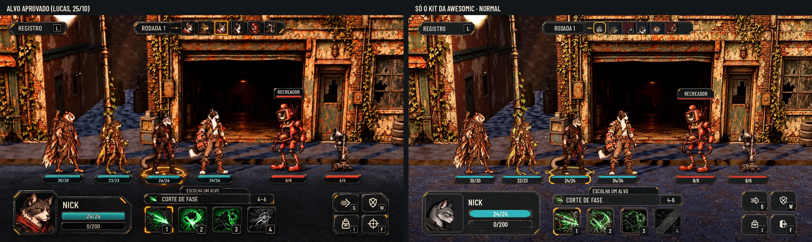
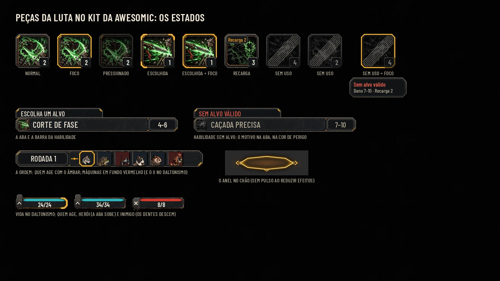

# HUD da luta no kit da Awesomic, lote 4 (25/10/2026)

Decisão do Lucas ([hud-direction.md](hud-direction.md), "Padrão de componentes"): o kit da Awesomic
(`art/ui/kit/station`) é o padrão de toda a HUD, inclusive a luta. Este lote redesenha, no mesmo padrão e com os
mesmos estados, as peças só de luta que ainda eram do Codex. Ele também monta a tela da luta só com o kit, lado a lado
com o [alvo aprovado](reference/hud-target-2026-10-25.webp).

As medidas e a estrutura são as do alvo e de [hud-target.md](hud-target.md). Muda só o desenho: o chanfro, o bisel, o
aço, o canto âmbar, o 9-slice e as conferências de [hud-kit/lib.mjs](hud-kit/lib.mjs).

A maquete está sobre a captura limpa do jogo (`loop-screens/before/combat_clean.webp`), com os números e a ordem
dessa captura e as cotações da sessão (`hud-c/session_quotes.json`). Ela serve só para comparar e aprovar. A integração
é da #60.

## Tela da luta: alvo × kit da Awesomic

| Perfil | Lado a lado com o alvo | Só a tela |
|---|---|---|
| Normal | [comparison](hud-luta/comparison.webp) | [combat](hud-luta/combat.webp) |
| Maior | [comparison_large](hud-luta/comparison_large.webp) | [combat_large](hud-luta/combat_large.webp) |
| Daltonismo | [comparison_colorblind](hud-luta/comparison_colorblind.webp) | [combat_colorblind](hud-luta/combat_colorblind.webp) |
| Maior com daltonismo | [comparison_large_colorblind](hud-luta/comparison_large_colorblind.webp) | [combat_large_colorblind](hud-luta/combat_large_colorblind.webp) |

Peça por peça (alvo, kit do Codex que sai, kit da Awesomic que entra):
- [Normal](hud-luta/piece_comparison.webp);
- [Maior](hud-luta/piece_comparison_large.webp);
- [daltonismo](hud-luta/piece_comparison_colorblind.webp);
- [Maior com daltonismo, em cinza](hud-luta/piece_comparison_gray.webp).

Os estados de cada peça nova estão numa prancha: [states](hud-luta/states.webp), [Maior](hud-luta/states_large.webp)
e [daltonismo](hud-luta/states_colorblind.webp).

Cada tela também tem a redução a 40% (`_40`) e o cinza (`_gray`).

## A tela montada só com o kit

| Parte do alvo | Peças do kit da Awesomic | Onde fica (1920 x 1080) |
|---|---|---|
| Registro (L) | `room_plaque` + `key_tab` | 46, 32, 272 x 64 |
| Ordem da rodada | `round_strip` + `square_portrait` 60 + `selected_frame` em quem age | 636, 30, 720 x 64 |
| Vida sob as unidades | `main_bar` + `bar_fill` tingido; quem age: `selected_corners` | centro − 100, 760, 200 x 44 |
| Anel no chão | `actor_ring` | centro nos pés de quem age, y 748, 256 x 80 |
| Nome do alvo | `target_tab` assentada numa linha da cor do inimigo | 1280, 348, 176 x 48 |
| Herói da vez | `panel_large`, retrato 184 na moldura `hero_tab`, `main_bar` + `bar_fill` | 64, 836, 564 x 212 |
| Aba ESCOLHA UM ALVO | `target_tab` | 856, 816, 336 x 40 |
| Barra da habilidade | `ability_header` | 684, 852, 624 x 56 |
| Quatro habilidades | `ability_slot` (e os estados) + `selected_corners` + `key_tab` | 688 + i x 160, 916, 132 x 132 |
| Ações (2 x 2) | `icon_button` + `key_tab`; F é a porta de saída | 1584 + col x 136, 836 + lin x 112, 128 x 100 |

Nenhuma peça de `art/ui/kit/combat` desenha a tela, a não ser as que o kit já reaproveitava (`square_portrait`,
`key_tab`, `main_bar`, `steel_material`) e o símbolo `exit` de F.

## As peças novas no manifesto

São 12 peças, todas em `art/ui/kit/station/` e no [assets.json](../../art/ui/kit/station/assets.json), com o tamanho, as
margens de 9-slice (esquerda, cima, direita, baixo), a área de conteúdo, a âncora e o sha256. Saem do mesmo
[build_kit.py](hud-station/build_kit.py) das outras 45 peças, que passam a ser 57. O manifesto ganhou
`replaces_combat_kit`, que diz o que substitui cada peça do Codex.

| Peça | Tela | 9-slice | Estados e uso |
|---|---|---|---|
| `round_strip` | 720 x 64 | 244/20/24/20 | O bolso escuro do nome (desenho de x 6 a 202, texto de 18 a 196) e o elo âmbar com o ponto (x 212–240) ficam na margem esquerda. Só o miolo dos retratos estica. |
| `corridor_strip` | 720 x 72 | 24/16/24/16 | A faixa lisa do corredor da exploração, que usava o `round_strip` do Codex. Sem o bolso do nome, para o corredor não herdar a peça da ordem da rodada. |
| `enemy_badge` | 22 x 22 | não fatiar | O X no canto do retrato das máquinas, só no daltonismo. No cinza, o fundo vermelho deixa de separar. |
| `ability_header` | 624 x 56 | 60/16/124/16 | Bolso do ícone 40 à esquerda e casa do dano (4–6) à direita, com o sulco. O nome cabe em 42 no Maior. |
| `target_tab` | 336 x 40 | 16/12/16/4 | Aba com chanfro só em cima: encosta reta na barra da habilidade ou na linha do inimigo. Sem alvo: o motivo na cor de perigo, na mesma aba. |
| `ability_slot` | 132 x 132 | 20/20/20/20 | Moldura vazada: o ícone de 116 fica por baixo. |
| `ability_slot_pressed` | 132 x 132 | 20/20/20/20 | Pressionado: aro escuro e sombra por dentro. O ícone desce 2 px e o alvo de toque não muda. |
| `ability_slot_disabled` | 132 x 132 | 20/20/20/20 | Sem uso: aro apagado e sem âmbar, véu escuro por dentro e uma faixa diagonal de riscas. Lê-se sozinha, mesmo sobre um ícone que já é cinza. O ícone fica cinza, a tecla apaga e o motivo aparece no foco. |
| `selected_corners` | 132 x 132 | 24/22/24/22 | A escolha persistente em cantoneiras (habilidade escolhida e a barra de 44 de quem age). Substitui `active_health`. O foco (`focus_frame`) vai por cima e soma. |
| `actor_ring` | 256 x 80 | não fatiar | Anel fino em perspectiva, com as pontas nos lados (o chanfro do kit), o núcleo claro, o halo, as divisas ‹ › e a marca na frente. Âncora 128, 40. |
| `ally_mark` | 28 x 56 | não fatiar | No daltonismo, a tampa do herói na ponta da barra: a aba sobe 12 px e mostra a divisa para cima. Fica por cima das cantoneiras. Na barra de 46 do Maior, escala por igual (46/44). |
| `enemy_mark` | 28 x 56 | não fatiar | No daltonismo, a tampa do inimigo: o X e dois dentes que descem 12 px. Escala como a do herói. |

Os estados seguem o resto do kit: foco com `focus_frame`, escolha com cantoneiras, pressionado e desabilitado em peças
próprias, como o `primary_button`. Usos e recarga usam o `cost_chip` no canto de cima do quadrado. Não há contador
para usos ilimitados.

## Texto e Maior

A letra é a Barlow Condensed. No Maior, todos os textos crescem 30%, e as peças ficam nas mesmas posições:

| Uso | Normal | Maior |
|---|---|---|
| Registro e rodada | 30 | 39 |
| Nome do herói | 40 | 52 |
| Nome da habilidade e números do herói | 32 | 42 |
| Vida no mundo | 24 | 31 |
| Aba do alvo, nome do inimigo e teclas | 26 | 34 |
| Casa do dano | 28 | 36 |

Para caber, só três alturas mudam no Maior:
- a vida no mundo vai de 44 para 46 (760 a 806);
- a aba do alvo vai de 40 para 44, crescendo para baixo (816 a 860), por cima da borda da barra da habilidade;
- as barras do herói vão de 40 para 52.

Entre as barras do mundo e a aba ficam 10 px no Maior (12 no Normal). As teclas ficam em 42 x 42, com o número em 34.

## Cores e daltonismo

- **Normal:** ciano `#2fb6bd` nos heróis e vermelho `#d23a2e` nos inimigos, como no alvo.
- **Daltonismo:**
  - azul `#56b4e9` nos heróis;
  - vermelhão `#d55e00` nos inimigos, o mesmo do resto do kit;
  - a forma também muda: a aba do herói (`ally_mark`) e os dentes do inimigo (`enemy_mark`) na barra, e o X
    (`enemy_badge`) no retrato das máquinas na ordem.

  A [matriz em cinza](hud-luta/piece_comparison_gray.webp) mostra os lados separados sem cor nenhuma.

O anel, a escolha e o foco continuam âmbar em todos os perfis. Quem age não depende da cor da vida.

## Conferências

[checks.json](hud-luta/checks.json) passa nas 8 telas (2 telas, 4 perfis). Usa as mesmas checagens dos lotes 1 a 3:
- texto dentro da área de conteúdo de cada peça;
- nenhum texto cortado;
- nenhuma peça cortada;
- nenhum alvo fora da tela, sobreposto ou menor que 56 px;
- nenhum caractere que a fonte não tem;
- o menor texto tem 20 px.

A Godot 4.7.2 importou as 12 peças novas sem erro, e os testes passam (49 de 49, com a paridade de 48 lutas).

## Diferenças deliberadas em relação ao alvo

- **Seleção:** a habilidade escolhida e a barra de quem age usam cantoneiras grossas, como no alvo. Na ordem da rodada,
  o retrato de quem age leva a moldura âmbar inteira (`selected_frame`), também como no alvo.
- **O anel** tem pontas nos lados, e não é uma elipse lisa: é o chanfro do kit visto no chão.
- **Vermelhão no daltonismo,** e não o laranja `#e69f00` de hud-target.md: o laranja ficava perto do âmbar da escolha e
  do anel. **Decisão sua.**
- **A forma do lado só no daltonismo:** no Normal a barra fica limpa, como no alvo.
- Vale o que hud-target.md já registra:
  - a ordem e os retratos são os da sessão real;
  - a quarta habilidade (Caçada Precisa) aparece sem uso, porque a sessão diz "Sem alvo válido"; no alvo ela está acesa;
  - os ícones das habilidades são os do jogo, sem alteração;
  - F é a porta de saída, e não a mira do desenho.

## Para a integração (#60)

- **Componentes:** a luta usa os mesmos componentes da Estação (Painel, Plaqueta, Botão, Barra, Aba, Tecla). Faltam só
  as peças desta página.
- **`art/ui/kit/combat`:** depois do merge, fica só como histórico, como o `v2`.
- **O anel:**
  - é um decalque sob a unidade, com depth test, que acompanha o ator real;
  - com reduzir efeitos, fica parado, sem pulso;
  - a máscara do sprite nesta maquete é só para a prova.
- **Bindings:** não mudam (`combat_log`, `combat_move`, `combat_defend`, `inventory`, `combat_flee`,
  `combat_ability_1..4`). As teclas mostradas são os padrões de hoje.
- **A exploração:** o corredor usava o `round_strip` do Codex. Agora usa o `corridor_strip`, porque o nome
  `round_strip` passou a ser a ordem da rodada, com o bolso do nome. As 16 telas da exploração foram montadas de novo
  e passam nas 64 conferências. A única mudança é a chapa da faixa do corredor; as medidas e o conteúdo são os mesmos.

## Reprodução

Da raiz do repositório:
1. `python3 docs/design/hud-station/build_kit.py` (as 57 peças e o manifesto).
2. `python3 -m http.server 8765 --bind 127.0.0.1` e, noutro terminal,
   `node docs/design/hud-luta/render.mjs http://127.0.0.1:8765`.
3. `python3 docs/design/hud-kit/compose.py docs/design/hud-luta combat states`.
4. `python3 docs/design/hud-luta/compare.py` (as comparações com o alvo e as matrizes).
5. A exploração, que agora usa o `corridor_strip`: `node docs/design/hud-exploracao/render.mjs http://127.0.0.1:8765` e
   o `compose.py` com as capturas de antes, como em [hud-exploracao.md](hud-exploracao.md#reprodução).

Nada muda em `scripts/`, `data/` nem `tests/`.

## QA de design

### Rodada 1: VEREDITO: REPROVADO

Nenhum problema Alto. Três Médios:
- **O corredor da exploração herdava a ordem da rodada.** O nome `round_strip` passou a ser a peça nova, e o corredor
  aprovado ganhava o bolso do nome por cima das casas. Corrigido com a peça `corridor_strip`. As 16 telas da exploração
  foram montadas de novo.
- **O estado sem uso não se distinguia** sobre um ícone que já é cinza. Corrigido: a peça ganhou o véu escuro e a
  faixa de riscas, e a tecla apaga. A prancha agora mostra o estado também sobre um ícone colorido, e o motivo no foco.
- **No Maior, a aba ESCOLHA UM ALVO encostava nas barras de vida** (2 px). Corrigido: a vida no mundo tem 46 de altura
  e a aba cresce para baixo, sobre a borda da barra da habilidade. O vão agora é de 10 px.

Também acertei os pontos Baixos:
- o anel ficou mais fino, sem o preenchimento, e com as pontas nos lados;
- a prancha mostra o anel em 256 x 80;
- as tampas do daltonismo escalam por igual e ficam por cima das cantoneiras;
- o retrato do herói tem moldura (`hero_tab`);
- o recorte do nome do alvo nas matrizes inclui a linha;
- a nota do bolso da ordem no manifesto foi acertada;
- hud-direction.md fala em 57 peças.

### Rodada 2: VEREDITO: APROVADO

Os três Médios estão resolvidos, e não há problema Alto nem Médio. A QA conferiu:
- as 57 peças, com tamanho e sha256 certos, e o build reproduzido byte a byte;
- as 8 telas da luta e as 64 da exploração, que passam nas conferências;
- nas telas da exploração, a única diferença para as aprovadas é a faixa do corredor.

Observações Baixas:
- **Acertadas depois da rodada:** as notas do manifesto do quadrado sem uso e da tampa do herói, a reprodução da
  exploração nesta página e a quarta habilidade nas diferenças deliberadas.
- **Ficam como estão:**
  - no daltonismo, a tampa do herói cobre as cantoneiras da esquerda da barra de quem age. Quem age continua claro
    pelas cantoneiras da direita, pelo anel e pela ordem;
  - o X do retrato das máquinas não se lê na redução a 40%. As tampas das barras ainda separam os lados;
  - o vermelhão no daltonismo espera a decisão do Lucas. Depois dela, o qa.md precisa ser atualizado.
