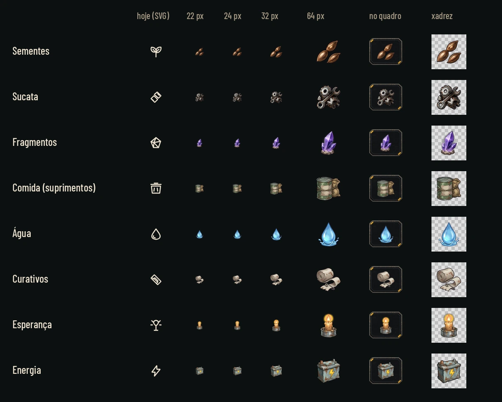
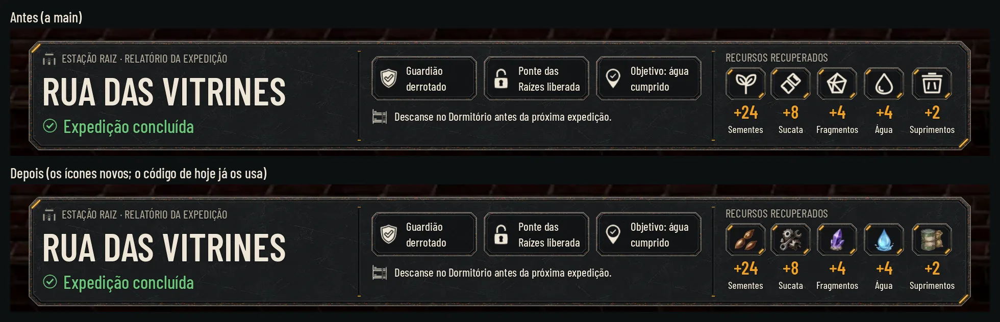
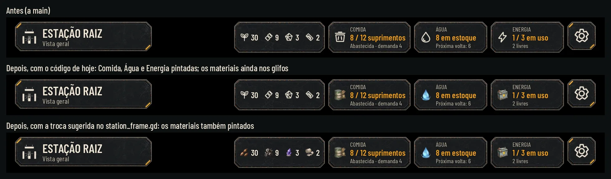
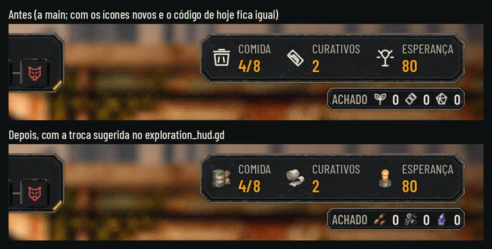

# Os ícones de recurso pintados (26/10/2026)

(O lote A do pedido de 26/10: a pendência da revisão do #104.)

Sementes, sucata, fragmentos, comida (suprimentos), água, curativos e esperança, pintados como os traços do kit
(`trait_*`, e os três recursos do alvo [hud-target-report-2026-10-25.webp](reference/hud-target-report-2026-10-25.webp)),
mais a **energia**, que a barra do alto da Estação mostra ao lado de Comida e Água e ficaria a única em glifo.

Mesmo método do kit: Nano Banana Pro, uma folha 4 x 2 sobre magenta (#FF00FF), recorte por código
([cut_icons.py](hud-recursos/cut_icons.py), o mesmo de `hud-station/cut_icons.py`), sem texto nas imagens. Nada em
`scripts/`, `data/` nem `tests/`.



## Os nomes que o código procura

O jogo já usa `art/ui/kit/station/icons/resource_<tipo>.webp` quando o arquivo existe (#111): `AHKit.icon()` devolve
`null` sem ele e o código cai no SVG antigo. Conferido no código, são estes os `<tipo>`:

| Onde | Código | `<tipo>` procurados |
|---|---|---|
| Relatório da volta, "Recursos recuperados" | `station_report.gd`, `RESOURCES` | `seeds`, `scrap`, `fragments`, `water`, `supplies` |
| Barra do alto da Estação, Comida, Água e Energia | `station_frame.gd`, `vital_chip` (ids de `AHStationRules.vitals`) | `food`, `water`, `power` |

Comida e suprimentos são o mesmo recurso com dois nomes no código: a mesma arte sai como `resource_food.webp` e
`resource_supplies.webp`. Os 9 arquivos:

| Arquivo | O que é | Hoje (SVG) |
|---|---|---|
| `resource_seeds.webp` | três sementes, marrom e cobre (como no alvo) | `lobby-seed` |
| `resource_scrap.webp` | chave inglesa sobre engrenagem e parafuso, aço com ferrugem (como no alvo) | `lobby-scrap` |
| `resource_fragments.webp` | três lascas de cristal violeta numa pedra (como no alvo) | `lobby-fragment` |
| `resource_food.webp` = `resource_supplies.webp` | lata de ração amassada amarrada a um saco de grãos | `lobby-food` |
| `resource_water.webp` | gota de água clara com o respingo | `lobby-water` |
| `resource_bandages.webp` | rolo de gaze meio desenrolado com o alfinete | `res-bandages` |
| `resource_hope.webp` | toco de vela acesa num pires de lata (a chama do SVG de hoje) | `res-hope` |
| `resource_power.webp` | bateria velha com o raio amarelo grande | `lobby-energy` |

**Curativos e esperança ainda não aparecem**: nenhum código procura `resource_bandages` nem `resource_hope` (eles estão
na exploração e na ficha de materiais da Estação, que carregam o SVG). Os arquivos já ficam prontos para a integração
abaixo.

## Leitura

[readability.webp](hud-recursos/readability.webp) e [o cinza](hud-recursos/readability_gray.webp): cada ícone ao lado
do SVG de hoje, a 22, 24, 32 e 64 px, no quadro do relatório (`resource_tile` a 80 de largura, como o
`station_report.gd` desenha com cinco recursos, e o ícone a 46 px) e sobre xadrez claro para ver o alfa. A redução imita
os mipmaps da Godot (metade em metade e bilinear no fim), não um filtro mais nítido.
- Todos se leem a 32 e 64. **A 22 e 24** sementes, água, cristal e vela continuam claros; a sucata vira um aglomerado
  de engrenagens, os curativos um rolo e a comida um barril com o saco ao lado; a bateria vira uma caixa e o raio
  some. A energia só aparece a 40 px (a ficha da barra), onde o raio se lê; se for para uma ficha pequena, o raio
  precisa engrossar.
- Sementes e sucata têm pouco contraste com o painel no tom médio (cerca de 1,8:1); o contorno e os brilhos seguram.
- A energia saiu duas vezes: a bateria da folha (verde escura) sumia a 24 px no painel; a nova, de aço claro e com o
  raio maior, é a da entrega ([cut_icons.py](hud-recursos/cut_icons.py) troca a da folha por ela).
- Em cinza cada um segue diferente pelo formato (não só pela cor): sementes, engrenagens, cristal, lata com saco, gota,
  rolo, vela, bateria. Comida e energia são as silhuetas mais parecidas (dois blocos); separam pelo saco ao lado da
  lata e pelo miolo claro da bateria.
- Cores próprias, como os traços: o jogo não tinge (o código já põe `modulate` branco quando o ícone é pintado).

## As telas, antes e depois

As fotos são do jogo (Godot 4.7.2, gl_compatibility, 1920 x 1080). A cena 3D da Estação não abre no xvfb sem placa de
vídeo (o llvmpipe para na montagem), então o relatório e a barra do alto são a interface de verdade
(`AHStationReport` e `AHStationFrame.top`, desenhados pela Godot com o código da main) sobre as capturas limpas da
Estação de `hud-v2/before/` ([capture.gd](hud-recursos/capture.gd)). A exploração é a captura inteira do
`tools/capture_106.gd`.

| Tela | Antes e depois | Depois, nos quatro perfis |
|---|---|---|
| Relatório da volta | [before_after_report](hud-recursos/before_after_report.webp) | [Normal](hud-recursos/report_normal.webp) · [Maior](hud-recursos/report_large.webp) · [Daltonismo](hud-recursos/report_colorblind.webp) · [Maior com daltonismo](hud-recursos/report_large_colorblind.webp) |
| Barra do alto da Estação | [before_after_bar](hud-recursos/before_after_bar.webp) | [Normal](hud-recursos/bar_normal.webp) · [Maior](hud-recursos/bar_large.webp) · [Daltonismo](hud-recursos/bar_colorblind.webp) · [Maior com daltonismo](hud-recursos/bar_large_colorblind.webp) |
| Exploração | [before_after_explore](hud-recursos/before_after_explore.webp) | [com a integração](hud-recursos/explore_integration.webp) · [Maior](hud-recursos/explore_integration_large.webp) |





- **Relatório:** muda sozinho, só com os arquivos. Os cinco recursos passam a ser os pintados, como no alvo.
- **Barra do alto:** com o código de hoje, Comida, Água e Energia viram pintadas e a ficha dos materiais (sementes,
  sucata, fragmentos, curativos) continua nos glifos. A mistura fica na mesma barra; por isso a terceira faixa mostra a
  troca sugerida abaixo, com os quatro materiais pintados também.
- **Exploração:** com o código de hoje **não muda** (o `exploration_hud.gd` carrega os SVG): conferido por diferença de
  pixels entre as capturas sem e com os arquivos (a HUD igual; só a rua animada muda). A segunda faixa é a troca
  sugerida, feita só para a foto: Comida, Curativos, Esperança e o Achado pintados.
- Nos quatro perfis os textos e as peças são os mesmos de antes; os ícones pintados não mudam com o daltonismo (nenhum
  deles diz bom ou ruim pela cor). No Maior, as colunas do relatório alargam com o texto e os quadros (80 de largura
  com cinco recursos) e os ícones (46 px) não mudam; na barra do alto as fichas alargam e os ícones ficam no mesmo
  tamanho.

## Para integrar (Claude)

Duas trocas pequenas, no mesmo padrão do `vital_chip`. As fotos "com a integração" foram tiradas com elas aplicadas
por um momento na árvore local e revertidas logo depois (`git checkout scripts/`); nada disso entra neste PR:

```gdscript
# station_frame.gd, materials(): os materiais pintados (MATERIALS já tem o id em spec[1]: seeds, scrap, fragments, bandages)
var painted := AHKit.icon("resource_%s" % spec[1])
icon.texture = painted if painted != null else load("res://art/ui/icons/%s.svg" % spec[0])
icon.modulate = Color.WHITE if painted != null else AHKit.TEXT

# exploration_hud.gd, _icon(): o nome antigo do recurso aponta para o pintado, sem tinta
const PAINTED := {"lobby-seed": "resource_seeds", "lobby-scrap": "resource_scrap", "lobby-fragment": "resource_fragments",
	"lobby-food": "resource_food", "lobby-water": "resource_water", "res-bandages": "resource_bandages", "res-hope": "resource_hope"}
var painted: Texture2D = AHKit.icon(PAINTED[name]) if PAINTED.has(name) else null
if painted != null:
	tint = Color.WHITE
# (no lugar da linha rect.texture que já existe em _icon())
rect.texture = painted if painted != null else (AHKit.icon(name) if ResourceLoader.exists(AHKit.ICONS % name) else load(ICONS % name))
```

Os outros lugares que mostram recurso em glifo (o acampamento, a Mochila, as fichas de custo da Forja e da Pesquisa, o
fim de luta, a carga do guardião) podem seguir o mesmo mapa; quando o glifo vem tingido de alerta (faltando), o alerta
continua no ícone `alert`, como hoje.

## Medidas

- 128 x 128 px, WebP sem perda com alfa, o RGB zerado onde o alfa é 0; o desenho ocupa a caixa com 4% de margem
  (como os `trait_*`), centrado. Âncora no centro, sem 9-slice.
- Tamanhos de uso: 46 px no quadro do relatório, 40 px em Comida, Água e Energia na barra do alto (`vital_chip`),
  30 px nos materiais da barra, 32 px na ficha da exploração e 22 px no Achado.
- No manifesto do kit (`art/ui/kit/station/assets.json` e a cópia em `docs/design/hud-station/assets.json`), os 9 entram
  no bloco `icons` com o tamanho, o sha256 e `kind: painted`, como os `trait_*` (48 → 57 ícones).
- Importação como os outros ícones do kit (o `.import` de cada um vem junto, igual ao dos `trait_*`).

## Como refazer

A folha bruta e a energia ficam fora do Git, na pasta `images/hud-recursos/` do projeto na Awesomic
(`resource-icons-sheet-2.png` e `resource-power.png`). Pedido ao Nano Banana Pro: oito ícones de recurso pintados, grade
4 x 2 sobre magenta chapado, no estilo da folha dos traços e dos três recursos do alvo (referência anexada), contorno
escuro, sem texto.

```sh
# 1. O recorte (grava os 9 em art/ui/kit/station/icons/)
python3 -B docs/design/hud-recursos/cut_icons.py <folha.png> <energia.png>
# 2. A prancha de leitura (os SVG de hoje em PNG antes, pelo Chromium do Playwright)
node docs/design/hud-kit/render_svg.mjs <pasta> 32 art/ui/icons/*.svg
OLD_PNG=<pasta> python3 -B docs/design/hud-recursos/sheet.py
# 3. As fotos (precisa de uma tela; no Linux sem tela, xvfb-run), sem e com os ícones, e as telas
xvfb-run -a -s "-screen 0 1920x1080x24" "$GODOT" --path . --rendering-driver opengl3 --resolution 1920x1080 \
  -s res://docs/design/hud-recursos/capture.gd -- --out=<pasta> [--text-size=2] [--colorblind]
python3 -B docs/design/hud-recursos/compose.py <pasta das capturas>
```

## QA de design

**Rodada 1, REPROVADO.**
- Média: os 9 ícones não estavam no manifesto do kit (`assets.json`), como os `trait_*`. Corrigido nos dois
  manifestos.
- Média: o trecho do `exploration_hud.gd` em "Para integrar" não trocava a textura (faltava a linha do
  `rect.texture`). Corrigido; é o mesmo trecho com que as fotos foram tiradas.
- Baixas corrigidas: os tamanhos de uso (40 px na barra), a frase do Maior (os quadros não mudam), a prancha (o quadro a
  80, a coluna de 22 px e a redução como os mipmaps), a leitura em cinza (comida e energia, as mais parecidas) e como as
  fotos da integração foram tiradas (aplicada e revertida na árvore, não numa cópia).
- Fica como observação: a água é a mais lisa e brilhante do conjunto, com menos desgaste que os outros.

**Rodada 2, APROVADO.** Conferidos: os manifestos só com acréscimos (48 → 57 ícones, sha256 e tamanho certos), o
trecho da integração igual ao das fotos, os tamanhos de uso no código, a frase do Maior e a prancha contra uma redução
própria. Observações baixas já resolvidas na página (a legenda de 22 px e a linha que o trecho substitui); a água segue
como observação.

