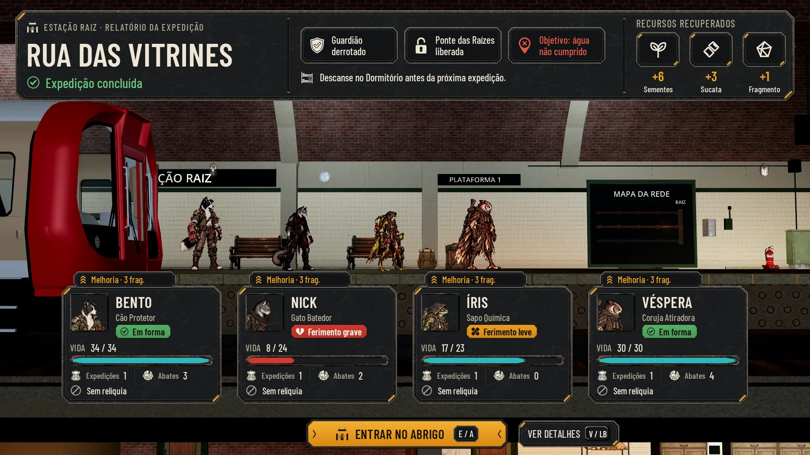
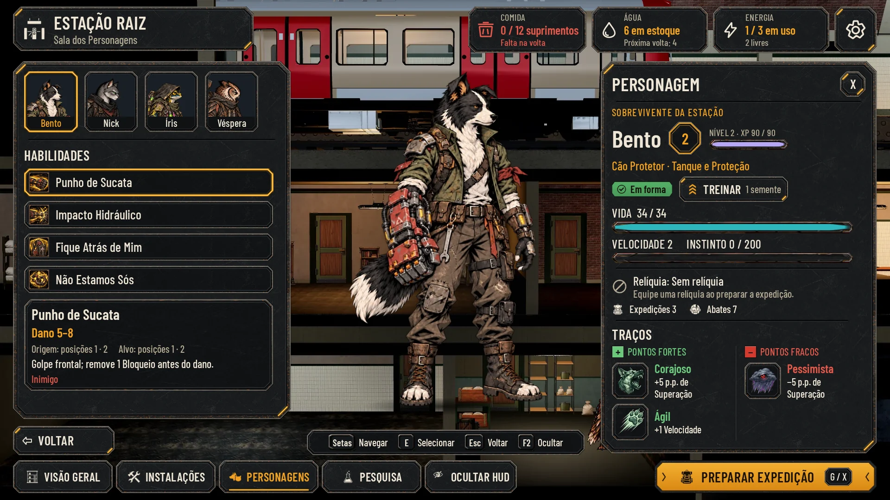

# HUD da Estação: relatório da volta e Sala dos Personagens (25/10/2026)

As duas telas da Estação no idioma do kit da luta, o mais perto possível dos dois alvos do Lucas:
- [relatório](reference/hud-target-report-2026-10-25.webp);
- [Sala dos Personagens](reference/hud-target-characters-2026-10-25.webp).

As peças reaproveitam `art/ui/kit/combat/`, e as novas estão em `art/ui/kit/station/`. As telas foram montadas sobre
capturas reais do jogo, só para comparação e aprovação; nenhuma maquete entra no jogo. A integração é da #60 (Claude).

## As telas

| Tela | Normal | Maior (130%) | Daltonismo | Maior + daltonismo |
|---|---|---|---|---|
| Relatório | [report](hud-station/report.webp) | [large](hud-station/report_large.webp) | [colorblind](hud-station/report_colorblind.webp) | [large_colorblind](hud-station/report_large_colorblind.webp) |
| Relatório, detalhes | [report_details](hud-station/report_details.webp) | [large](hud-station/report_details_large.webp) | [colorblind](hud-station/report_details_colorblind.webp) | [large_colorblind](hud-station/report_details_large_colorblind.webp) |
| Sala dos Personagens | [characters](hud-station/characters.webp) | [large](hud-station/characters_large.webp) · [rolado](hud-station/characters_large_scrolled.webp) | [colorblind](hud-station/characters_colorblind.webp) | [large_colorblind](hud-station/characters_large_colorblind.webp) |
| Treino (1 de 2) | [characters_training](hud-station/characters_training.webp) | [large](hud-station/characters_training_large.webp) | [colorblind](hud-station/characters_training_colorblind.webp) | [large_colorblind](hud-station/characters_training_large_colorblind.webp) |
| Bloqueados | [characters_locked](hud-station/characters_locked.webp) | [large](hud-station/characters_locked_large.webp) | [colorblind](hud-station/characters_locked_colorblind.webp) | [large_colorblind](hud-station/characters_locked_large_colorblind.webp) |

As provas:
- **Alvo e entrega lado a lado:**
  - relatório: [Normal](hud-station/comparison_report.webp), [Maior](hud-station/comparison_report_large.webp) e
    [daltonismo](hud-station/comparison_report_colorblind.webp);
  - Sala dos Personagens: [Normal](hud-station/comparison_characters.webp),
    [Maior](hud-station/comparison_characters_large.webp) e
    [daltonismo](hud-station/comparison_characters_colorblind.webp).
- **Peça por peça:** [relatório](hud-station/pieces_report.webp) e [Sala dos Personagens](hud-station/pieces_characters.webp).
- **Redução a 40% (768x432):** os `*_40.webp` de cada tela e perfil. **Cinza:** os `*_gray.webp`.
- **Medidas de cada texto e alvo de toque:** [checks.json](hud-station/checks.json). As 20 telas (5 telas, 4 perfis)
  passam:
  - nenhum texto cortado ou fora da peça;
  - nenhum conteúdo maior que a área de conteúdo da sua peça;
  - nenhum alvo de toque sobreposto;
  - nenhuma carta sobre os heróis da fila;
  - o menor texto tem 20 px no Normal e 26 px no Maior.

## O que mudou do alvo e por quê

- **Os fundos são do jogo de hoje.** Vêm de `hud-v2/before/station-report_clean.webp` e `station-characters_clean.webp`.
  A câmera do jogo é mais aberta que a dos alvos.
  - **No relatório,** os heróis da fila são menores e mais juntos que as cartas: os quatro cabem em 660 px, e quatro
    cartas de 380 px, não. As cartas ficam na ordem da fila, logo abaixo dos pés, sem cobrir ninguém.
    - **Na integração:** a fila do relatório (`station.gd`, o lugar da fila) põe cada herói sobre o centro da sua carta
      (x 336, 752, 1168 e 1584), ou a câmera da volta aproxima.
  - **Na Sala,** o herói de corpo inteiro é uma camada da interface: a pose idle do jogo, com uma sombra no chão e um
    escurecido atrás. A câmera do cômodo não chega a esse tamanho.
    - **Na integração:** esconder os moradores que ficam atrás dos painéis. Na captura, sobra uma lasca da Véspera na
      borda do painel PERSONAGEM.
- **Os detalhes do relatório não somem.** "O que a equipe viu", "O que chegou", "A Estação no ciclo" e "Agora dá para"
  ficam numa segunda faixa, que troca de lugar com as cartas.
  - VER DETALHES mostra a faixa; VER A EQUIPE volta às cartas.
  - Assim nada cobre a fila nem o botão, nem no Maior.
- **Estados com rótulo neutro:**
  - verde: Em forma (ícone de check);
  - âmbar: Ferimento leve (curativos em X);
  - vermelho: Ferimento grave (coração rachado).
  - **Por quê:** os heróis não têm gênero nos dados, e o alvo dizia "Levemente ferida" para a Íris e a Véspera.
  - **Limites propostos** (a regra de hoje é ferido abaixo de 50%): Em forma a partir de 75% da vida, Ferimento leve
    de 50% a 75%, Ferimento grave abaixo de 50%.
  - Decisão do Lucas: os nomes e os limites.
- **"Sobrevivente da Estação"** fica como no alvo, para todos os heróis: o termo "fundador" é interno, e a narrativa não
  diz que o Bento fundou a Estação.
- **Nível, XP e Treino (#90)** entram no painel PERSONAGEM:
  - o medalhão do nível;
  - a barra de XP;
  - TREINAR com o custo.
  - Treinar abre a escolha de uma das duas melhorias da espécie, com os dados reais (`hero-upgrades.json`; nível 3 custa
    90 de XP e 1 semente).
  - Bloqueado, TREINAR diz o que falta ("faltam 26 XP").
- **PREPARAR EXPEDIÇÃO bloqueado** mostra o motivo dentro do próprio botão, sem depender de apontar.
  - O motivo vem de `AHStationRules.preparation_block`; na tela, "Conclua a noite no Dormitório antes de partir."
  - Título e motivo em creme sobre a chapa apagada, acima de 4,5:1.
- **O objetivo é um pino com check ou X,** não a gota do alvo: o pino serve para qualquer foco (água, peças, provisões,
  pedido de um civil).
- **Abates usa a cabeça de robô rachada,** não a caveira do alvo: na luta, só se abatem máquinas da VIGIA.
- **Os ícones de recurso** (sementes, sucata, fragmento, comida, água, energia) são os SVG que já existem no jogo, como
  pede a direção. Os pintados do alvo podem vir numa rodada própria, se o Lucas quiser.
- **A barra de XP é violeta** (`#b7a6f4`, o `AHUiStyle.VIOLET`, a cor que o XP já tem no Alojamento).
- **A barra de Instinto passa a ferrugem** (`#c07a3c`); no jogo de hoje, ela também é violeta.
  - Com as duas no mesmo painel, a mesma cor confundiria.
  - A direção pede que o instinto ganhe cor quente perto da crise.
  - Decisão do Lucas: manter ou voltar ao violeta.
- **O vermelho:**
  - nas barras e pílulas, é o aprovado `#d23a2e`;
  - no texto sobre o aço escuro, é `#e2584a`, porque o `#d23a2e` fica abaixo de 4,5:1 de contraste em 20–24 px.
- **Pontos fortes e fracos** têm o quadradinho de + e − do alvo. O sinal também separa as colunas no daltonismo.

## As peças novas (`art/ui/kit/station/`)

Todas em WebP com alfa, na resolução de uso e sem texto. As medidas, as margens de 9-slice (esquerda/cima/direita/baixo),
a área de conteúdo, as âncoras e os sha256 estão em [assets.json](../../art/ui/kit/station/assets.json), espelhado em
[hud-station/assets.json](hud-station/assets.json).

**Como usar na Godot:**
- `nine_slice_ltrb` vai nas `texture_margin_*` do StyleBoxTexture.
- O recuo de `content_xywh` vai nas `content_margin_*`.
- Nas peças grandes (`report_band`, `panel_large`), use `axis_stretch_* = TILE_FIT`, para o aço não esticar.

**Relatório:**

| Peça | Tamanho | 9-slice | Uso |
|---|---|---|---|
| `report_band` | 480×216 | 40/40/40/40 | Faixa do alto, x 36, y 24, 1848×216; e a faixa dos detalhes, x 96, y 668, 1728×256 |
| `band_divider` | 12×176 | — | Divisão vertical da faixa |
| `result_chip` | 232×88 | 18/18/18/18 | Chip de resultado: ícone 44 e duas linhas de 24 |
| `resource_tile` | 112×96 | 16/16/16/16 | Recurso recuperado, usado a 104×84: ícone 46, número âmbar 32 e nome 20 embaixo |
| `hero_card` | 380×256 | 32/32/32/32 | Carta do herói, 380 de largura, topo em y 678 (674 no Maior), cresce para baixo e termina pelo menos 11 px acima do botão |
| `card_tab` | 244×40 | 16/12/16/12 | A aba "Melhoria · 3 frag." (a Pesquisa da classe custa 3 fragmentos), sobre o topo da carta |
| `status_pill` | 176×34 | 12/10/12/10 | Pílula clara, tingida pelo modulate (cores abaixo) |
| `bar_fill` | 64×16 | 6/4/6/4 | Preenchimento de barra, tingido; a calha é `main_bar` do kit da luta |
| `primary_button` (+ `_focus`, `_pressed`, `_disabled`) | 480×72 | 40/22/40/22 | Botão âmbar com as divisas › ‹. ENTRAR NO ABRIGO e VER DETALHES ficam numa linha centrada no pé da tela (y 994), com 24 entre os dois; no Maior, o botão cresce com o conteúdo |
| `button_key` | 128×44 | 12/12/12/12 | A tecla dentro do botão principal |
| `secondary_button` | 240×64 | 24/20/24/20 | VER DETALHES, VOLTAR, CANCELAR |
| `focus_frame` | 240×64 | 24/20/24/20 | Foco do teclado ou do controle sobre qualquer chapa |

**Sala dos Personagens:**

| Peça | Tamanho | 9-slice | Uso |
|---|---|---|---|
| `room_plaque` | 520×96 | 40/28/40/28 | Plaqueta, x 28, y 14 |
| `resource_chip` | 248×96 | 28/24/28/24 | Comida, Água e Energia, alinhados à direita (até x 1790) |
| `icon_button` | 92×92 | 24/24/24/24 | Engrenagem, x 1800, y 14; o X do painel em 56×56 |
| `panel_large` | 320×320 | 44/44/44/44 | Coluna da esquerda, x 28, y 132, 600 de largura; painel PERSONAGEM, x 1296, y 132, 596 de largura; diálogo do Treino, x 620, y 250, 680 de largura |
| `panel_inset` | 240×160 | 24/24/24/24 | Detalhe da habilidade |
| `hero_tab` / `hero_tab_selected` | 116×132 | 16/16/16/16 | Aba do herói: retrato 104×92 por baixo, nome 22 numa faixa de 28 |
| `list_row` / `list_row_selected` | 560×60 | 20/16/20/16 | Linha de HABILIDADES, 538 de largura: ícone 44 e nome 28 |
| `divider` | 240×8 | 8/0/8/0 | Divisor horizontal |
| `trait_tile` | 88×88 | 16/16/16/16 | Quadrado do traço, usado a 80: ícone pintado 66 |
| `level_medal` | 72×72 | — | Medalhão do nível: número 34 âmbar; âncora 36,36 |
| `train_button` | 240×56 | 20/16/20/16 | TREINAR e o custo (bloqueado: apagado e o que falta) |
| `upgrade_card` / `upgrade_card_selected` | 300×200 | 28/28/28/28 | A melhoria do Treino: nome 30, efeito 24 e "Já tem" |
| `nav_tab` / `nav_tab_active` | 216×72 | 24/20/24/20 | Abas de baixo, y 994; a ativa sublinhada em âmbar |
| `keys_bar` | 320×56 | 24/16/24/16 | Barra das teclas, centrada em x 962, acima das abas |

**Reaproveitadas do kit da luta:**
- `square_portrait` (os retratos);
- `key_tab` (as teclas);
- `main_bar` (a calha das barras);
- `steel_material` (o aço de todas as peças).

**Ícones** (`art/ui/kit/station/icons/`):
- **Os oito traços, pintados (128):**
  - `trait_agile`, `trait_brave`, `trait_hopeful`, `trait_loyal`;
  - `trait_sluggish`, `trait_anxious`, `trait_gloomy`, `trait_machine_fear`.
  - O id `machine-fear` de `perks.json` aponta para `trait_machine_fear` em `trait_ids`, no manifesto.
- **Glifos brancos de um tom (64), para o jogo tingir:**
  - resultados: `guardian_defeated`, `place_unlocked`, `objective_done`, `objective_failed`;
  - dica do Dormitório e Estação: `bed`, `station`;
  - estados: `state_active`, `state_light_wound`, `state_wounded`;
  - contadores e relíquia: `expeditions`, `kills`, `relic_empty`;
  - Treino: `train`;
  - abas: `nav_overview`, `nav_facilities`, `nav_characters`, `nav_research`, `nav_hide`.
- A leitura foi conferida a 22, 32 e 64 px, sobre escuro e sobre claro.

**Cores de tinta:**

| Uso | Normal | Daltonismo |
|---|---|---|
| Em forma | `#56b468` | `#56b4e9` |
| Ferimento leve | `#f0a020` | `#f0e442` |
| Ferimento grave (pílula e barra baixa) | `#d23a2e` | `#d55e00` |
| Vida dos heróis | `#2fb6bd` | `#56b4e9` |
| Texto de alerta | `#e2584a` | `#e8743a` |
| Bom (concluída, pontos fortes) | `#6cc77c` | `#56b4e9` |

No daltonismo, o estado também muda de ícone, e os traços também mudam de sinal (+ e −).

## Fonte e texto Maior

Barlow Condensed: Medium nos rótulos e textos, SemiBold nos nomes, títulos e números (OFL, `art/ui/fonts/`).

| Uso | Normal | Maior |
|---|---|---|
| Nome da fase (relatório) | 76 | 99 |
| Nome do herói no painel | 52 | 68 |
| Títulos dos painéis e plaqueta | 40 | 52 |
| Nome na carta | 36 | 47 |
| Botões principais | 30 | 39 |
| Linhas de lista, nomes de traço e abas | 26–28 | 34–36 |
| Textos e rótulos | 22–24 | 29–31 |
| Mínimo (rótulos pequenos) | 20 | 26 |

No Maior, as caixas crescem e nada é cortado:
- as cartas do relatório põem a VIDA na linha da barra;
- os chips de resultado passam para duas linhas;
- o painel PERSONAGEM e a lista de HABILIDADES rolam, com a barra de rolagem do kit (calha escura e polegar âmbar),
  como no alvo. A captura `_scrolled` mostra o fim.

## Teclado, controle e toque

| Ação | Tecla e botão | Nota |
|---|---|---|
| ENTRAR NO ABRIGO, TREINAR (confirmar) | `interact`: E/Enter, A | Já existe. Mostrado sempre como "E / A", pelo `AHUiStyle.key_name("interact")` |
| Voltar, Cancelar | `cancel`: Backspace, B (Esc também volta) | Já existe |
| Ocultar a HUD | `hide_hud`: F2, Back | Já existe |
| VER DETALHES ou VER A EQUIPE | V, LB | **Ação nova** (sugestão: `report_details`). LB só é usado na luta |
| PREPARAR EXPEDIÇÃO | G, X | **Ação nova** (sugestão: `station_prepare`). X só é usado na luta |

**Por que não as teclas óbvias:**
- P é `debug_post`.
- Espaço é `ui_accept` e `ui_select`, padrão da Godot: acionaria o botão com foco e a partida juntos.
- Tab é `ui_focus_next`, e Y é a Mochila (`inventory`) e `ui_select`.
- V, G, LB e X não colidem com nenhuma ação da Estação.

As teclas desenhadas seguem as trocas das Opções (`AHUiStyle.key_name`).

**Foco:**
- o foco do teclado ou do controle é o `focus_frame` âmbar por cima da peça;
- a escolha persistente (herói, habilidade, aba, melhoria) é a moldura âmbar `*_selected`.

**Toque:** todos os alvos têm 56 px ou mais, sem sobreposição (`checks.json`, campo `targets`).

## Como integrar (#60)

1. Carregue as peças pelo `assets.json`: StyleBoxTexture com as margens. As cores vêm da tabela acima, nunca da imagem.
2. **O relatório:**
   - a faixa do alto ocupa a largura toda, com três colunas e duas `band_divider`; os chips quebram linha no Maior;
   - as cartas são um HBox no pé da tela, com o topo em y 678 e o botão em y 994;
   - VER DETALHES troca as cartas pela segunda faixa.
3. **A Sala dos Personagens:**
   - no alto, a plaqueta à esquerda e os chips com a engrenagem à direita;
   - a coluna e o painel ancorados embaixo, acima das abas;
   - o herói de corpo inteiro é um TextureRect com a pose idle, sobre a sombra.
4. **Dados de verdade:**
   - vida, nível, XP, custo e bloqueio do Treino: `AHHeroLevels`;
   - traços: `perks.json`;
   - relíquia e contadores: `completed_expeditions`, `kills_count`;
   - o motivo do bloqueio da partida: `AHStationRules`.
   - Os números das telas são de exemplo.

## Reprodução

Da raiz do repositório:
1. `python3 docs/design/hud-station/cut_icons.py <folha_dos_traços> <folha_dos_glifos>`: recorta as folhas geradas
   sobre o magenta. As folhas brutas ficam fora do Git.
2. `python3 docs/design/hud-station/build_kit.py`: desenha as peças e grava o manifesto (só Pillow).
3. `python3 -m http.server 8765 --bind 127.0.0.1` e, em outro terminal,
   `node docs/design/hud-station/render.mjs http://127.0.0.1:8765`: monta as telas no Chromium (Playwright) e mede
   cada texto.
4. `python3 docs/design/hud-station/compose.py`: grava as telas, as comparações, as pranchas, os 40% e o `checks.json`.
5. Apague `docs/design/hud-station/.render/`, a pasta temporária.

Os ícones foram gerados no Nano Banana Pro, em folhas por família sobre magenta chapado. As molduras são todas por código.

## QA de design

O ciclo segue [qa.md](qa.md), comparando com o alvo peça por peça. As rodadas ficam abaixo e no PR.

### Rodada 1: REPROVADO

- **Alta:** faltava esta página com as medidas. Feita.
- **Média:** no Maior, as cartas cobriam os heróis. Corrigido:
  - as cartas crescem para baixo;
  - no Maior, a VIDA vai para a linha da barra;
  - o `checks.json` confere que nenhuma carta cobre a fila.
- **Média:** "Fundador da Estação" trocava o texto do alvo. Voltou a "Sobrevivente da Estação".
- **Média:** "Levemente ferido" para a Íris. Os rótulos ficaram neutros (veja acima).
- **Baixa, corrigidos:**
  - o alerta do daltonismo se confundia com o âmbar: passou a vermelhão `#d55e00`/`#e8743a`;
  - o vermelho aprovado nas barras e pílulas;
  - as teclas novas (refeitas na rodada 2);
  - `trait_machine_fear` em snake_case;
  - a rebarba rosada na borda de dois traços;
  - `checks.json` com cada texto;
  - os rótulos das pranchas fora do recorte;
  - as divisas do botão para dentro;
  - os quadradinhos de + e −;
  - as telas dos estados bloqueados.
- **Baixa, registrados acima:** a lasca da Véspera na captura, o violeta do XP, o pino do objetivo e o robô dos Abates.

### Rodada 2: REPROVADO

- **Média:** as teclas novas colidiam com as ações padrão da Godot (Espaço, Tab e Y). Corrigido: V/LB e G/X, com a
  explicação na tabela.
- **Média:** no Maior, o conteúdo de ENTRAR NO ABRIGO passava da peça, e as cartas ficavam a 1 px do botão. Corrigido:
  - o botão e VER DETALHES estão numa linha centrada;
  - o botão cresce com o conteúdo;
  - as cartas ganharam 11 px de folga;
  - o `checks.json` confere que o conteúdo de cada peça cabe no seu `content_xywh`.
- **Baixa:** PREPARAR EXPEDIÇÃO desabilitado agora tem texto creme e o motivo do jogo.
- **Baixa:** o violeta do XP agora é o `#b7a6f4`, e a troca do Instinto para ferrugem está registrada.
- **Baixa:** a mesma tecla aparece com um rótulo só ("E / A").
- **Baixa:** o recorte do botão na prancha foi corrigido.
- **Baixa, não feito:** o alerta da Comida no daltonismo segue apoiado no texto "Falta na volta".

### Rodada 3: APROVADO

Conferidos:
- as teclas contra `tools/define_input.gd` e os `ui_*` da Godot;
- a linha de baixo do relatório no Maior (11 px entre as cartas e o botão, e a aba fora da fila);
- os botões que crescem sem bater nas abas;
- o contraste do botão bloqueado;
- o XP e o Instinto;
- a prancha;
- as 20 telas `ok` no `checks.json`;
- o escopo.

Observações baixas:
- o `checks.json` passou a gravar o campo `pieces`;
- o alerta da Comida no daltonismo e a lasca da Véspera seguem como registrados acima.
