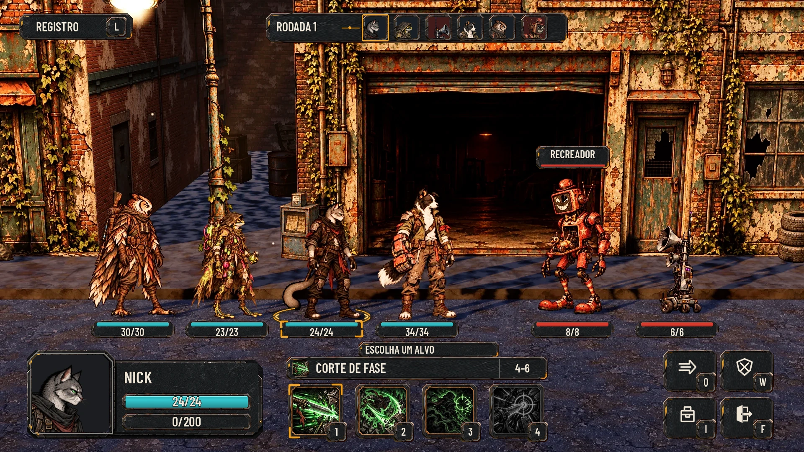

# HUD da luta — alvo aprovado de25/10/2026

**Referência atual do kit de combate:** o [alvo do Lucas](reference/hud-target-2026-10-25.webp), conforme o topo de [hud-direction.md](hud-direction.md). Ele substitui a aparência ornamentada da C. Esta entrega mantém sua estrutura sobre uma captura real, com aço grafite chanfrado, detalhe âmbar e Barlow Condensed SemiBold em caixa alta.

**[Alvo e entrega lado a lado — Normal](hud-target/comparison.webp)** · **[Maior](hud-target/comparison_large.webp)** · **[Daltonismo](hud-target/comparison_colorblind.webp)** · **[Maior+daltonismo](hud-target/comparison_large_colorblind.webp)**

**[QA visual: dez peças lado a lado nos perfis](hud-target/piece_comparison.webp)** · [Tela Maior+daltonismo](hud-target/hud_large_colorblind.webp) · [Margens/âncoras do kit](hud-target/assets.json) · [Verificação](hud-target/verification.json).

## Estrutura reproduzida

| Peça do alvo | Entrega |
|---|---|
| Aço escuro arranhado, chanfros e detalhe âmbar | Biséis derivados do próprio alvo, conteúdo removido e miolos de aço preparados separadamente. Sem latão, voltas ornamentais ou medalhões. |
| Letra condensada, sem serifa e em caixa alta | Barlow Condensed SemiBold, fonte OFL no repositório; toda a tipografia nova usa essa fonte. |
| Registro com L em aba | Peça chanfrada272×64 no alto à esquerda, com tecla em aba48. |
| Rodada numa faixa única | Faixa720×72, nome da rodada, linha/ponto e seis retratos quadrados64, coloridos; fundo avermelhado nas máquinas e borda âmbar no ator atual. |
| Vida sob as unidades | Barras200×44, ciano nos heróis e vermelho nos inimigos, valor dentro. Sem número da posição. Aba superior nos heróis, recorte na borda dos inimigos. |
| Ator no chão | Anel âmbar com setas, centrado nos pés de Nick; cantos âmbar na barra dele. |
| Nome do alvo | Plaqueta pequena, escura, com linha vermelha embaixo. |
| Painel único do herói | Uma silhueta conectada564×212 com retrato quadrado grande, nome, Vida e Instinto encaixados. Não são peças soltas. |
| Habilidade e quatro ícones | Aba "ESCOLHA UM ALVO", barra com ícone/nome e célula4–6 à direita; quatro slots132×132, artes vivas e tecla na aba inferior direita; selecionada com cantos âmbar. |
| Ações | Grade2×2 de peças chanfradas, ícone branco e tecla em aba. **F usa porta com seta de saída**, não a mira do desenho de referência. |

A quarta habilidade permanece atenuada porque o quote real indica **Sem alvo válido** para Caçada Precisa. Os arquivos dos quatro ícones do Nick não foram alterados ou redesenhados. O campo4–6 conserva a faixa do alvo; na regra atual é a faixa de dano da habilidade, não as posições de alcance.

## Kit WebP e9-slice

Peças em `art/ui/kit/combat/`. **18 WebP**:17 RGBA e um material RGB repetível. O [assets.json do pacote](../../art/ui/kit/combat/assets.json) é espelhado automaticamente em [hud-target/assets.json](hud-target/assets.json). São a mesma fonte de dimensões, conteúdo, âncora, hashes e `nine_slice_ltrb` na ordem **esquerda/cima/direita/baixo**. No Godot, usar essas margens nas `texture_margin_*` do StyleBoxTexture.

| Peça | Canvas | Margens9-slice |
|---|---|---|
| `panel.webp` |256×80|24/24/24/24|
| `register.webp` |272×64|24/20/24/20|
| `round_strip.webp` |720×72|24/16/24/16|
| `square_portrait.webp` |72×72|12/12/12/12|
| `hero_panel.webp` |564×212|224/24/24/24; manter altura212 e preservar coluna do retrato|
| `ability_header.webp` |624×56|20/12/20/12|
| `target_tab.webp` |336×40|16/12/16/12|
| `action_button.webp` |128×100|16/16/16/16|
| `key_tab.webp` |48×48|8/8/8/8|
| `ability_slot.webp` |132×132|16/16/16/16|
| `health_ally.webp`, `health_enemy.webp` |200×44|20/12/20/12|
| `main_bar.webp` |320×44|12/10/12/10|
| `selected_slot.webp` |132×132|28/28/28/28|
| `active_health.webp` |200×44|28/12/28/12|
| `actor_ring.webp` |256×80|Não fatiar: elipse de perspectiva, âncora128,40|
| `exit.webp` |64×64|Não fatiar: símbolo, âncora32,32|
| `steel_material.webp` |512×512|Repetir material; não é uma moldura|

Não há nomes, números, retratos ou ícones de habilidade embutidos nessas molduras. Textos, fotografias, preenchimento de Vida e separação da célula4–6 são conteúdo do componente. Os overlays de escolha/ator são camadas separadas, não uma alteração dos dados. Os PNG mestres de material ficam fora do Git; as referências já aprovadas permanecem intactas.

## Fonte e texto Maior

Fonte: [barlow_condensed_semibold.ttf](../../art/ui/fonts/barlow_condensed_semibold.ttf), cerca de106KiB. [Licença SIL OFL1.1](../../art/ui/fonts/OFL-BarlowCondensed.txt), copyright The Barlow Project Authors; origem oficial [Google Fonts](https://github.com/google/fonts/tree/main/ofl/barlowcondensed). O binário da fonte não foi modificado; o texto integral da licença foi preservado, normalizando apenas espaços finais. Família, caminho e SHA estão no manifesto.

| Uso | Normal | Maior |
|---|---|---|
| Registro e rodada |30|39|
| Nome do herói |40|52|
| Nome da habilidade e números do painel principal |32|42|
| Barras no mundo, aba do alvo, nome do inimigo e teclas |26|34|
| Campo4–6 |28|36|

Maior usa130%, sem encolher texto ou cortar letras. As caixas de valores do herói têm32 de altura para comportar a fonte42. As posições e a estrutura permanecem iguais nos quatro perfis. [checks.json](hud-target/checks.json) guarda cada caixa de texto e seu resultado medido. O texto do alvo é condensado, não Cinzel nem a Jakarta da versão anterior.

## Cores e daltonismo

Normal: aço `#1b1d20`–`#25282c`, bisel grafite, detalhe/foco `#f0a020`, Vida dos heróis `#2fb6bd`, Vida das máquinas `#d23a2e`, texto `#efe6d6`. O material preserva os riscos e o desgaste dos biséis, sem ouro limpo ou cobre ornamental.

Daltonismo: heróis `#56b4e9`, inimigos `#e69f00`; a linha do nome do alvo acompanha a cor inimiga. A forma também muda: **aba no herói e recorte no inimigo**, preservados em cinza, além do lado, do corpo e do valor. O anel e as marcas de turno continuam âmbar; não dependem da cor da Vida para identificar quem age. As artes originais não são recoloridas.

Há [prova de saída em22/32/48 sobre claro/escuro](hud-target/readability.webp), [cinza](hud-target/hud_gray.webp) e versões `_40.webp` dos quatro perfis (768×432). São provas do desenho; navegação, safe area e toque precisam da QA na implementação.

## Geometria e alvos de interação

Base1920×1080. O arquivo aprovado1672×941 é normalizado a essa base **somente para comparar**; a captura real já tem1920×1080. Não se reconstituiu o cenário nem se redesenhou o corpo dos personagens.

| Região | Retângulo da entrega (x,y,w,h) |
|---|---|
| Registro |46,32,272,64|
| Rodada |636,30,720,72|
| Herói |64,836,564,212; imagem quadrada184 dentro da coluna208|
| Aba "Escolha um alvo" |856,816,336,40|
| Barra da habilidade |684,852,624,56; ícone40; divisão direita em x1192|
| Quatro ícones |688+i×160,916,132,132; conteúdo116, teclas48 na aba inferior direita|
| Grade2×2 |1584+coluna×136,836+linha×112,128,100|
| Vida sob a unidade |centro projetado−100,764,200,44|
| Nome do alvo |1280,348,176,56; linha vermelha inferior|
| Anel |248×64, centro nos pés de Nick; na imagem, máscara oculta a parte atrás das botas|

[Diferenças geométricas para as medidas aproximadas da especificação](hud-target/target_comparison.json): painéis ficam próximos do alvo, sem mudar sua organização. A grade termina em1848,1048; seu topo fica11px acima da medida aproximada. O passo vertical112 permite alvos de toque112 de altura sem sobreposição. A faixa da rodada tem8px adicionais de altura para acomodar os retratos64.

Na integração: ancorar o rodapé à área segura e escalar uniformemente, sem achatar chanfros. Registro tem alvo272×112; ações128×112; habilidades140×140 incluindo as abas. O retrato abre a inspeção do ator. Os pequenos retratos da ordem são informativos; não criar alvos de toque sobrepostos sobre eles. Não trocar bindings: `combat_log`, `combat_move`, `combat_defend`, `inventory`, `combat_flee`, `combat_ability_1..4`. As teclas mostradas são os defaults atuais, não teclas fixas no código.

Teclado e controle mantêm os bindings existentes e navegação por foco; apontar ou focar não confirma uma ação. A seleção persistente usa cantos âmbar grossos; foco de navegação acrescenta um contorno interno claro, independente da seleção. Pressionado desloca somente o desenho2px, sem mover o hitbox. Bloqueados continuam explicáveis por wrapper de foco, sem disparar o comando; os motivos vêm da sessão. Reduzir efeitos mantém anel e marcas estáticos, sem pulso. Em toque, a aba com a tecla faz parte do controle maior, e a descrição não pode depender só de hover. Usos/recarga aparecem em pequenas abas do mesmo idioma quando existirem; não mostrar contador0 para usos ilimitados. Reutilizar as inspeções e o Registro já existentes, sem perder seu conteúdo.

O anel deve ser um decal/plano **sob** a unidade, com oclusão/depth test e acompanhamento do ator real. A máscara de botas serve só à composição congelada. Não pintar o anel sobre os pés. A mesma informação aparece na barra e no retrato da rodada.

## Conteúdo dinâmico e diferenças deliberadas

O objetivo é reproduzir a **HUD**, sem transformar a arte da referência em regra de jogo. A captura real vem de [loop-screens/before/combat_clean.webp](loop-screens/before/combat_clean.webp), com os [DTOs](loop-screens/before/combat.json) e os quotes de sessão já documentados. Fonte/hashes dos dois lados estão no manifesto e em `checks.json`.

- **Nick age na sessão real e é o primeiro da ordem capturada.** O desenho do alvo põe o destaque em outro índice; não se duplicaram retratos ou mudou a iniciativa para imitar o desenho.
- Corpos, roupas, retratos canônicos e ícones são os do jogo. A referência tem diferenças de ilustração; elas não são um pedido para redesenhar os fundadores ou substituir os ícones reservados do Nick.
- Retratos inimigos vêm de recortes dos sprites originais, convertendo coordenadas do canvas original para a resolução física da textura. Não usar pixels do canvas1178 como se a textura reduzida também tivesse1178.
- **F é saída**, diferença exigida explicitamente pela especificação; a mira da imagem não foi copiada.
- Vida30/30,23/23,24/24,34/34 e8/8,6/6 permanecem iguais nos quatro perfis. Sem posição sobre a barra. `usable`, motivo, usos, alvos e dano efetivo devem vir de `AHCombatSession`, incluindo pesquisa e recarga, sem copiar a aproximação de um mockup.

## QA de design — alvo peça por peça

Usado o [checklist](qa.md) com prioridade ao alvo atual, que substitui a paleta/serifa ornamentadas anteriores.

### Rodada1 — VEREDITO: REPROVADO

- **Alta — números do herói no Maior:** caixas de28 não comportavam os glifos da fonte42. Aumentadas para32; fonte mantida.
- **Média — acabamento das molduras:** a primeira reconstrução tinha contornos excessivamente simples e marcas âmbar grandes. Preparados biséis a partir do próprio alvo e miolos de material limpos, preservando suas bordas gastas.

### Rodada2 — VEREDITO: REPROVADO

- **Alta — retratos inimigos:** recortes em coordenadas originais aplicados à textura reduzida deixavam as células vazias. Convertidos por `texture_size/canvas_size` e adicionada a conferência de alfa não vazio.
- **Média — anel:** pouco visível junto às botas e à barra. Ampliado para248×64, reforçado o halo e mantida a oclusão dos pés.

### Rodada3 — VEREDITO: APROVADO

Conferida a matriz **alvo × Normal × Maior × Maior+daltonismo**, nas dez peças: material/Registro, faixa da rodada, Vida dos heróis, Vida dos inimigos, nome do alvo, painel único, habilidades, ações, anel e F. A estrutura e o idioma do alvo estão mantidos. As exceções são as exigidas/documentadas: F de saída, retratos canônicos e ordem real do combate.

Aço/chanfros e detalhe âmbar conferidos; sem ornamentação de latão ou serifa. Retratos quadrados não vazios, cor das máquinas, faixa única, retrato grande encaixado, ícones vivos, selecionado âmbar, teclas em abas e anel junto aos pés. Sem posição nas barras. Normal usa ciano/vermelho; daltonismo usa azul/laranja com as formas de origem preservadas.

Auditoria:18 WebP nas dimensões declaradas, margens9-slice válidas, fonte OFL com checksum, quatro perfis sem texto fora de suas caixas e **zero alvos interativos sobrepostos**. Verificados os hashes dos quatro ícones originais do Nick. Redução real a40%, cinza e saída22/32 conferidos. Nenhum problema alto ou médio pendente na entrega de design. Navegação, touch/safe area e oclusão dinâmica precisam ser testadas pelo Claude na integração.

**Godot4.7.2 na base atualizada da main:** importação concluída,46/46 testes em256,681s, paridade48/48 (3351 passos), saída0. Persistem avisos de recursos/RID/ObjectDB no encerramento. Não são falhas do verificador de design.

## Reprodução e escopo

`python docs/design/hud-target/build_assets.py` prepara as peças e os dois manifestos idênticos; o material WebP versionado dispensa o mestre PNG externo. `render.py` monta os quatro perfis e as quatro comparações completas. `compare.py` gera a matriz peça por peça; `verify.py` confere9-slice, fonte/OFL, limites, alvos, quatro ícones originais e hashes. Dependências: Pillow, numpy e CairoSVG.

Entrega de design/arte para integração do Claude na #60; sem alterações próprias em `scripts/`, `data/` ou `tests/`. O merge da `main` foi feito antes do trabalho e trouxe o trabalho do Claude; essas mudanças não são alterações do designer. Não foram refeitas as outras telas da #96 nesta rodada. O novo idioma fica disponível para elas, conforme a direção aprovada.
