# Galeria da HUD v2 — #58

54 telas/estados, cada um em Normal, Maior, daltonismo e Maior com daltonismo. PNG1920×1080; cinza e redução real a40% como evidência de QA. [Sistema, medidas e decisão de interação](system.md) · [Resumo antes/depois](summary.png) · [QA](qa.md).

As variantes de foco novas usam a captura anterior indicada na tabela. Ela é referência da vista anterior, não uma alegação de que aquele novo estado já existia no jogo. Valores são do frame correspondente; capturas independentes podem começar com heróis diferentes. As contagens excluem textos encobertos pelo fundo opaco do mapa e glifos totalmente cortados, com o caminho e o motivo em `counts.json`.

| Tela/estado | Normal | Maior | Daltonismo | Maior + daltonismo |
|---|---|---|---|---|
| combat | [PNG](combat.png) | [PNG](combat_large.png) | [PNG](combat_colorblind.png) | [PNG](combat_large_colorblind.png) |
| combat-action-focus | [PNG](combat-action-focus.png) | [PNG](combat-action-focus_large.png) | [PNG](combat-action-focus_colorblind.png) | [PNG](combat-action-focus_large_colorblind.png) |
| combat-area-target | [PNG](combat-area-target.png) | [PNG](combat-area-target_large.png) | [PNG](combat-area-target_colorblind.png) | [PNG](combat-area-target_large_colorblind.png) |
| combat-crisis | [PNG](combat-crisis.png) | [PNG](combat-crisis_large.png) | [PNG](combat-crisis_colorblind.png) | [PNG](combat-crisis_large_colorblind.png) |
| combat-intent-focus | [PNG](combat-intent-focus.png) | [PNG](combat-intent-focus_large.png) | [PNG](combat-intent-focus_colorblind.png) | [PNG](combat-intent-focus_large_colorblind.png) |
| combat-inventory | [PNG](combat-inventory.png) | [PNG](combat-inventory_large.png) | [PNG](combat-inventory_colorblind.png) | [PNG](combat-inventory_large_colorblind.png) |
| combat-result | [PNG](combat-result.png) | [PNG](combat-result_large.png) | [PNG](combat-result_colorblind.png) | [PNG](combat-result_large_colorblind.png) |
| combat-skill-focus | [PNG](combat-skill-focus.png) | [PNG](combat-skill-focus_large.png) | [PNG](combat-skill-focus_colorblind.png) | [PNG](combat-skill-focus_large_colorblind.png) |
| combat-target | [PNG](combat-target.png) | [PNG](combat-target_large.png) | [PNG](combat-target_colorblind.png) | [PNG](combat-target_large_colorblind.png) |
| combat-unit-focus | [PNG](combat-unit-focus.png) | [PNG](combat-unit-focus_large.png) | [PNG](combat-unit-focus_colorblind.png) | [PNG](combat-unit-focus_large_colorblind.png) |
| explore | [PNG](explore.png) | [PNG](explore_large.png) | [PNG](explore_colorblind.png) | [PNG](explore_large_colorblind.png) |
| explore-camp | [PNG](explore-camp.png) | [PNG](explore-camp_large.png) | [PNG](explore-camp_colorblind.png) | [PNG](explore-camp_large_colorblind.png) |
| explore-event | [PNG](explore-event.png) | [PNG](explore-event_large.png) | [PNG](explore-event_colorblind.png) | [PNG](explore-event_large_colorblind.png) |
| explore-interaction | [PNG](explore-interaction.png) | [PNG](explore-interaction_large.png) | [PNG](explore-interaction_colorblind.png) | [PNG](explore-interaction_large_colorblind.png) |
| explore-interior | [PNG](explore-interior.png) | [PNG](explore-interior_large.png) | [PNG](explore-interior_colorblind.png) | [PNG](explore-interior_large_colorblind.png) |
| explore-inventory | [PNG](explore-inventory.png) | [PNG](explore-inventory_large.png) | [PNG](explore-inventory_colorblind.png) | [PNG](explore-inventory_large_colorblind.png) |
| explore-loot | [PNG](explore-loot.png) | [PNG](explore-loot_large.png) | [PNG](explore-loot_colorblind.png) | [PNG](explore-loot_large_colorblind.png) |
| explore-objective-focus | [PNG](explore-objective-focus.png) | [PNG](explore-objective-focus_large.png) | [PNG](explore-objective-focus_colorblind.png) | [PNG](explore-objective-focus_large_colorblind.png) |
| explore-options | [PNG](explore-options.png) | [PNG](explore-options_large.png) | [PNG](explore-options_colorblind.png) | [PNG](explore-options_large_colorblind.png) |
| explore-patrol | [PNG](explore-patrol.png) | [PNG](explore-patrol_large.png) | [PNG](explore-patrol_colorblind.png) | [PNG](explore-patrol_large_colorblind.png) |
| explore-resources-focus | [PNG](explore-resources-focus.png) | [PNG](explore-resources-focus_large.png) | [PNG](explore-resources-focus_colorblind.png) | [PNG](explore-resources-focus_large_colorblind.png) |
| explore-risk | [PNG](explore-risk.png) | [PNG](explore-risk_large.png) | [PNG](explore-risk_colorblind.png) | [PNG](explore-risk_large_colorblind.png) |
| explore-search | [PNG](explore-search.png) | [PNG](explore-search_large.png) | [PNG](explore-search_colorblind.png) | [PNG](explore-search_large_colorblind.png) |
| explore-team-focus | [PNG](explore-team-focus.png) | [PNG](explore-team-focus_large.png) | [PNG](explore-team-focus_colorblind.png) | [PNG](explore-team-focus_large_colorblind.png) |
| explore-touch | [PNG](explore-touch.png) | [PNG](explore-touch_large.png) | [PNG](explore-touch_colorblind.png) | [PNG](explore-touch_large_colorblind.png) |
| options-game | [PNG](options-game.png) | [PNG](options-game_large.png) | [PNG](options-game_colorblind.png) | [PNG](options-game_large_colorblind.png) |
| options-image | [PNG](options-image.png) | [PNG](options-image_large.png) | [PNG](options-image_colorblind.png) | [PNG](options-image_large_colorblind.png) |
| options-sound | [PNG](options-sound.png) | [PNG](options-sound_large.png) | [PNG](options-sound_colorblind.png) | [PNG](options-sound_large_colorblind.png) |
| scenario-event | [PNG](scenario-event.png) | [PNG](scenario-event_large.png) | [PNG](scenario-event_colorblind.png) | [PNG](scenario-event_large_colorblind.png) |
| station | [PNG](station.png) | [PNG](station_large.png) | [PNG](station_colorblind.png) | [PNG](station_large_colorblind.png) |
| station-bar | [PNG](station-bar.png) | [PNG](station-bar_large.png) | [PNG](station-bar_colorblind.png) | [PNG](station-bar_large_colorblind.png) |
| station-canteen | [PNG](station-canteen.png) | [PNG](station-canteen_large.png) | [PNG](station-canteen_colorblind.png) | [PNG](station-canteen_large_colorblind.png) |
| station-character-focus | [PNG](station-character-focus.png) | [PNG](station-character-focus_large.png) | [PNG](station-character-focus_colorblind.png) | [PNG](station-character-focus_large_colorblind.png) |
| station-characters | [PNG](station-characters.png) | [PNG](station-characters_large.png) | [PNG](station-characters_colorblind.png) | [PNG](station-characters_large_colorblind.png) |
| station-depot | [PNG](station-depot.png) | [PNG](station-depot_large.png) | [PNG](station-depot_colorblind.png) | [PNG](station-depot_large_colorblind.png) |
| station-dormitory | [PNG](station-dormitory.png) | [PNG](station-dormitory_large.png) | [PNG](station-dormitory_colorblind.png) | [PNG](station-dormitory_large_colorblind.png) |
| station-forge | [PNG](station-forge.png) | [PNG](station-forge_large.png) | [PNG](station-forge_colorblind.png) | [PNG](station-forge_large_colorblind.png) |
| station-hidden | [PNG](station-hidden.png) | [PNG](station-hidden_large.png) | [PNG](station-hidden_colorblind.png) | [PNG](station-hidden_large_colorblind.png) |
| station-map | [PNG](station-map.png) | [PNG](station-map_large.png) | [PNG](station-map_colorblind.png) | [PNG](station-map_large_colorblind.png) |
| station-night | [PNG](station-night.png) | [PNG](station-night_large.png) | [PNG](station-night_colorblind.png) | [PNG](station-night_large_colorblind.png) |
| station-options | [PNG](station-options.png) | [PNG](station-options_large.png) | [PNG](station-options_colorblind.png) | [PNG](station-options_large_colorblind.png) |
| station-plan | [PNG](station-plan.png) | [PNG](station-plan_large.png) | [PNG](station-plan_colorblind.png) | [PNG](station-plan_large_colorblind.png) |
| station-preparation | [PNG](station-preparation.png) | [PNG](station-preparation_large.png) | [PNG](station-preparation_colorblind.png) | [PNG](station-preparation_large_colorblind.png) |
| station-report | [PNG](station-report.png) | [PNG](station-report_large.png) | [PNG](station-report_colorblind.png) | [PNG](station-report_large_colorblind.png) |
| station-report-focus | [PNG](station-report-focus.png) | [PNG](station-report-focus_large.png) | [PNG](station-report-focus_colorblind.png) | [PNG](station-report-focus_large_colorblind.png) |
| station-research | [PNG](station-research.png) | [PNG](station-research_large.png) | [PNG](station-research_colorblind.png) | [PNG](station-research_large_colorblind.png) |
| station-room-focus | [PNG](station-room-focus.png) | [PNG](station-room-focus_large.png) | [PNG](station-room-focus_colorblind.png) | [PNG](station-room-focus_large_colorblind.png) |
| station-train | [PNG](station-train.png) | [PNG](station-train_large.png) | [PNG](station-train_colorblind.png) | [PNG](station-train_large_colorblind.png) |
| title | [PNG](title.png) | [PNG](title_large.png) | [PNG](title_colorblind.png) | [PNG](title_large_colorblind.png) |
| title-confirm | [PNG](title-confirm.png) | [PNG](title-confirm_large.png) | [PNG](title-confirm_colorblind.png) | [PNG](title-confirm_large_colorblind.png) |
| title-continue | [PNG](title-continue.png) | [PNG](title-continue_large.png) | [PNG](title-continue_colorblind.png) | [PNG](title-continue_large_colorblind.png) |
| title-options | [PNG](title-options.png) | [PNG](title-options_large.png) | [PNG](title-options_colorblind.png) | [PNG](title-options_large_colorblind.png) |
| title-slots | [PNG](title-slots.png) | [PNG](title-slots_large.png) | [PNG](title-slots_colorblind.png) | [PNG](title-slots_large_colorblind.png) |
| title-slots-empty | [PNG](title-slots-empty.png) | [PNG](title-slots-empty_large.png) | [PNG](title-slots-empty_colorblind.png) | [PNG](title-slots-empty_large_colorblind.png) |

## combat

Saem os nomes e valores duplicados, as quatro descrições de habilidade e o texto fixo de instrução. Ficam posições, vida gráfica, trilha de instinto, ordem, ator e atalhos. Nome/valores/estados e intenção aparecem no foco.

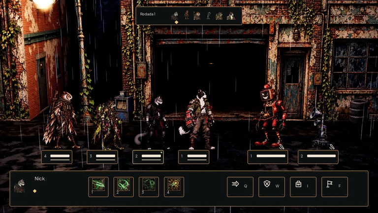

| Perfil | Referência real | Textos antes → depois | Números antes → depois |
|---|---|---|---|
| Normal | [JPG](before/combat.jpg) | 43 → 6 | 33 → 11 |
| Maior | [JPG](before/combat_large.jpg) | 43 → 6 | 33 → 11 |

[Cinza](combat_gray.webp) · [Normal completo](combat.png) · [Maior completo](combat_large.png) · medidas na [folha do sistema](system.md).

## combat-action-focus

O ícone da ação revela o nome e a consequência antes de confirmar. Mesmo efeito no mouse, teclado e controle; o restante da barra não ganha descrições simultâneas.

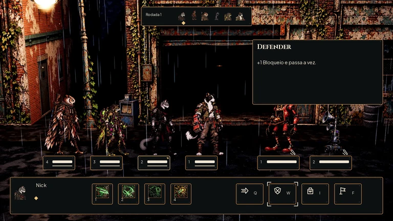

| Perfil | Referência real | Textos antes → depois | Números antes → depois |
|---|---|---|---|
| Normal | [JPG](before/combat.jpg) | 43 → 8 | 33 → 12 |
| Maior | [JPG](before/combat_large.jpg) | 43 → 8 | 33 → 12 |

[Cinza](combat-action-focus_gray.webp) · [Normal completo](combat-action-focus.png) · [Maior completo](combat-action-focus_large.png) · medidas na [folha do sistema](system.md).

## combat-area-target

Mira real do Coquetel Corrosivo. O corpo inteiro recebe o clique. Alvo e vizinho atingido têm luz e formas distintas; a legenda curta não substitui a lista de atingidos no foco. O frame de daltonismo foi renderizado pela Godot com a nova cor da luz, sem repintar o ator.

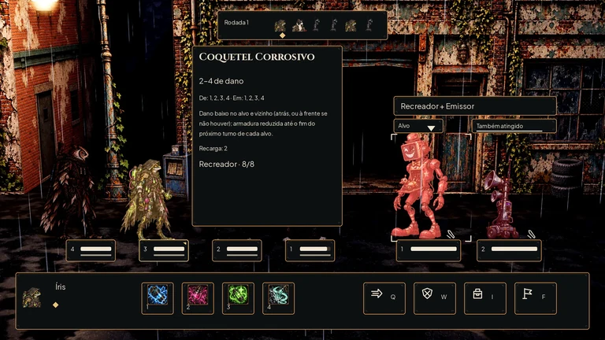

| Perfil | Referência real | Textos antes → depois | Números antes → depois |
|---|---|---|---|
| Normal | [JPG](before/combat-area-target.jpg) | 47 → 15 | 39 → 24 |
| Maior | [JPG](before/combat-area-target_large.jpg) | 50 → 15 | 40 → 24 |

[Cinza](combat-area-target_gray.webp) · [Normal completo](combat-area-target.png) · [Maior completo](combat-area-target_large.png) · medidas na [folha do sistema](system.md).

## combat-crisis

A crise interrompe a leitura com um aviso curto e texto explícito, sem abrir um segundo painel de dados. Estado encenado pela API real da HUD em campanha de captura.

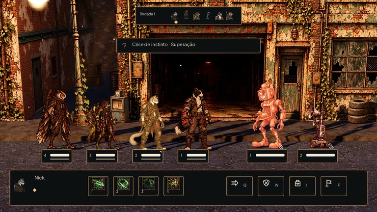

| Perfil | Referência real | Textos antes → depois | Números antes → depois |
|---|---|---|---|
| Normal | [JPG](before/combat-crisis.jpg) | 49 → 7 | 34 → 11 |
| Maior | [JPG](before/combat-crisis_large.jpg) | 52 → 7 | 38 → 11 |

[Cinza](combat-crisis_gray.webp) · [Normal completo](combat-crisis.png) · [Maior completo](combat-crisis_large.png) · medidas na [folha do sistema](system.md).

## combat-intent-focus

O ícone da intenção revela a ação original e os afetados. A intenção não usa só laranja: símbolo, nome e direção continuam disponíveis no foco.

| Perfil | Referência real | Textos antes → depois | Números antes → depois |
|---|---|---|---|
| Normal | [JPG](before/combat.jpg) | 43 → 9 | 33 → 15 |
| Maior | [JPG](before/combat_large.jpg) | 43 → 9 | 33 → 15 |

[Cinza](combat-intent-focus_gray.webp) · [Normal completo](combat-intent-focus.png) · [Maior completo](combat-intent-focus_large.png) · medidas na [folha do sistema](system.md).

## combat-inventory

A mesma Mochila da exploração, com o herói da vez da captura; a ação livre e o limite por vez aparecem no detalhe. Ampola continua habilidade do sapo dentro da luta. Comida custa1/3 para15%/35%, sem importar a regra da fogueira.

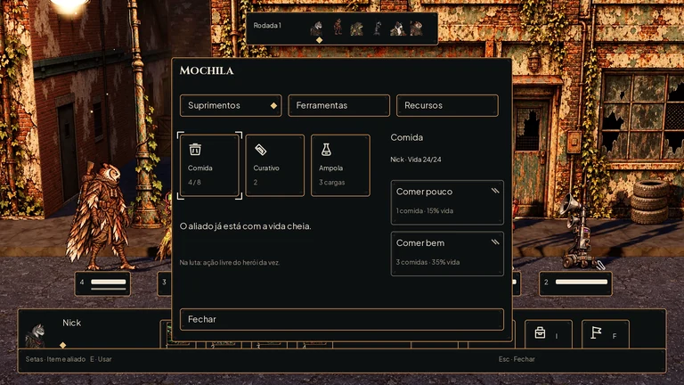

| Perfil | Referência real | Textos antes → depois | Números antes → depois |
|---|---|---|---|
| Normal | [JPG](before/combat-inventory.jpg) | 63 → 25 | 46 → 21 |
| Maior | [JPG](before/combat-inventory_large.jpg) | 66 → 25 | 48 → 21 |

[Cinza](combat-inventory_gray.webp) · [Normal completo](combat-inventory.png) · [Maior completo](combat-inventory_large.png) · medidas na [folha do sistema](system.md).

## combat-result

A barra de comandos sai. Resultado, sobreviventes e vida ficam numa única superfície; uma ação continua. A vitória foi apresentada pela API para capturar a tela, não atesta uma batalha vencida.

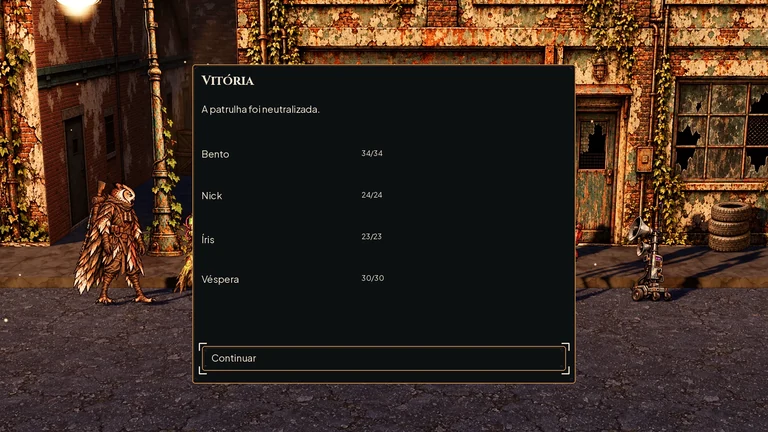

| Perfil | Referência real | Textos antes → depois | Números antes → depois |
|---|---|---|---|
| Normal | [JPG](before/combat-result.jpg) | 22 → 7 | 23 → 8 |
| Maior | [JPG](before/combat-result_large.jpg) | 22 → 7 | 23 → 8 |

[Cinza](combat-result_gray.webp) · [Normal completo](combat-result.png) · [Maior completo](combat-result_large.png) · medidas na [folha do sistema](system.md).

## combat-skill-focus

Arte e atalho ficam na barra; dano, posições, efeito e recarga/usos aparecem só no foco. Dica480 Normal/640 Maior; detalhe18/23. A dica muda de lado para deixar o ator atual e o alvo visíveis.

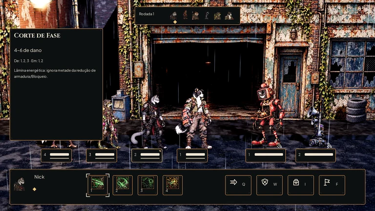

| Perfil | Referência real | Textos antes → depois | Números antes → depois |
|---|---|---|---|
| Normal | [JPG](before/combat-skill-focus.jpg) | 47 → 10 | 35 → 18 |
| Maior | [JPG](before/combat-skill-focus_large.jpg) | 47 → 10 | 35 → 18 |

[Cinza](combat-skill-focus_gray.webp) · [Normal completo](combat-skill-focus.png) · [Maior completo](combat-skill-focus_large.png) · medidas na [folha do sistema](system.md).

## combat-target

Prévia da primeira habilidade válida do herói capturado. O nome do alvo vem de “Atinge” da captura, não de uma escolha inventada. O outro inimigo mantém a luz fraca de alvo válido e não recebe a marca de atingido.

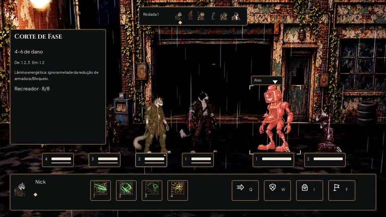

| Perfil | Referência real | Textos antes → depois | Números antes → depois |
|---|---|---|---|
| Normal | [JPG](before/combat-target.jpg) | 49 → 12 | 34 → 20 |
| Maior | [JPG](before/combat-target_large.jpg) | 49 → 12 | 34 → 20 |

[Cinza](combat-target_gray.webp) · [Normal completo](combat-target.png) · [Maior completo](combat-target_large.png) · medidas na [folha do sistema](system.md).

## combat-unit-focus

Vida numérica, instinto, limiar e posição ficam juntos no foco do ator atual. Os outros aliados e inimigos usam a mesma ficha, com seus próprios valores; não repetir a ficha inteira sob cada corpo.

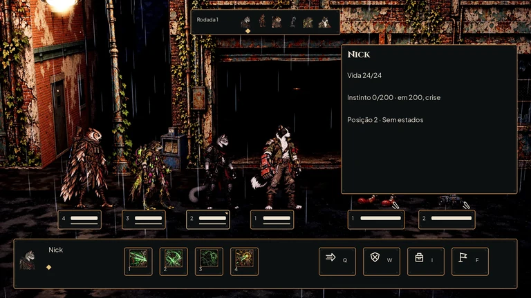

| Perfil | Referência real | Textos antes → depois | Números antes → depois |
|---|---|---|---|
| Normal | [JPG](before/combat.jpg) | 43 → 10 | 33 → 17 |
| Maior | [JPG](before/combat_large.jpg) | 43 → 10 | 33 → 17 |

[Cinza](combat-unit-focus_gray.webp) · [Normal completo](combat-unit-focus.png) · [Maior completo](combat-unit-focus_large.png) · medidas na [folha do sistema](system.md).

## explore

Lugar e sequência ficam; objetivo detalhado, esperança, achado e fichas de aliados saem da vista fixa para o foco. Retratos e ícones substituem rótulos repetidos. Comida e curativo continuam à vista.

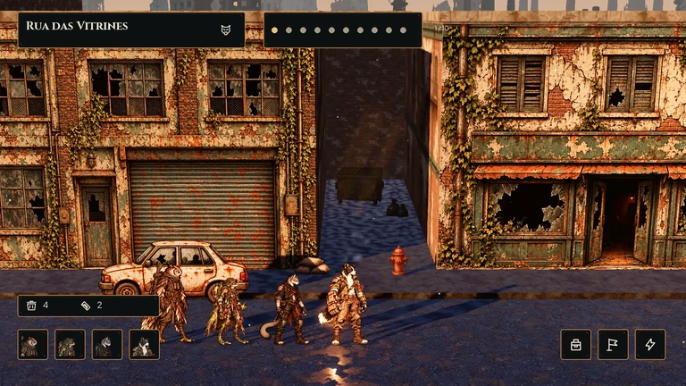

| Perfil | Referência real | Textos antes → depois | Números antes → depois |
|---|---|---|---|
| Normal | [JPG](before/explore.jpg) | 25 → 1 | 19 → 4 |
| Maior | [JPG](before/explore_large.jpg) | 25 → 1 | 19 → 4 |

[Cinza](explore_gray.webp) · [Normal completo](explore.png) · [Maior completo](explore_large.png) · medidas na [folha do sistema](system.md).

## explore-camp

Mesmos painéis, fichas e botões. Antes de usar, mostrar comida, curativos, vida, instinto e efeito. No frame, os quatro estão cheios: ações indisponíveis com barras e motivo no foco. Não substituir as poses nesta proposta de HUD; a integração da arte de descanso é da #77/#82.

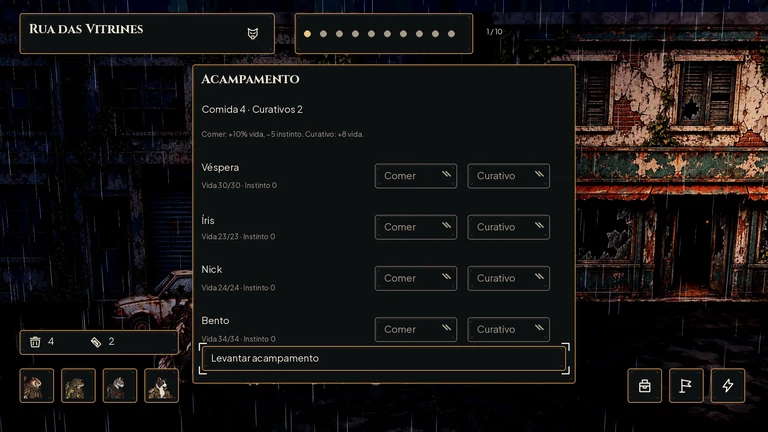

| Perfil | Referência real | Textos antes → depois | Números antes → depois |
|---|---|---|---|
| Normal | [JPG](before/explore-camp.jpg) | 40 → 21 | 36 → 21 |
| Maior | [JPG](before/explore-camp_large.jpg) | 40 → 21 | 36 → 21 |

[Cinza](explore-camp_gray.webp) · [Normal completo](explore-camp.png) · [Maior completo](explore-camp_large.png) · medidas na [folha do sistema](system.md).

## explore-event

A narrativa e as três escolhas permanecem completas. A ilustração redundante sai desta vista para reduzir o painel; requisitos e risco ficam junto da opção, com símbolo de bloqueio e foco separado.

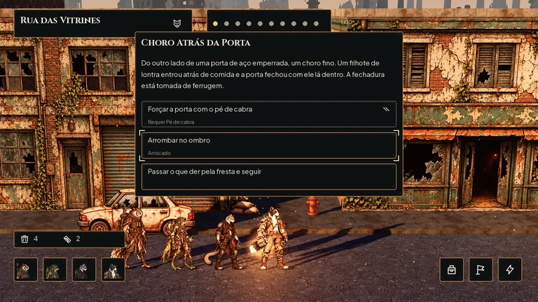

| Perfil | Referência real | Textos antes → depois | Números antes → depois |
|---|---|---|---|
| Normal | [JPG](before/explore-event.jpg) | 31 → 8 | 19 → 4 |
| Maior | [JPG](before/explore-event_large.jpg) | 31 → 8 | 19 → 4 |

[Cinza](explore-event_gray.webp) · [Normal completo](explore-event.png) · [Maior completo](explore-event_large.png) · medidas na [folha do sistema](system.md).

## explore-interaction

Aviso local com ícone e ação somente ao alcance do objeto. Os atalhos gerais não repetem a mesma instrução pela tela.

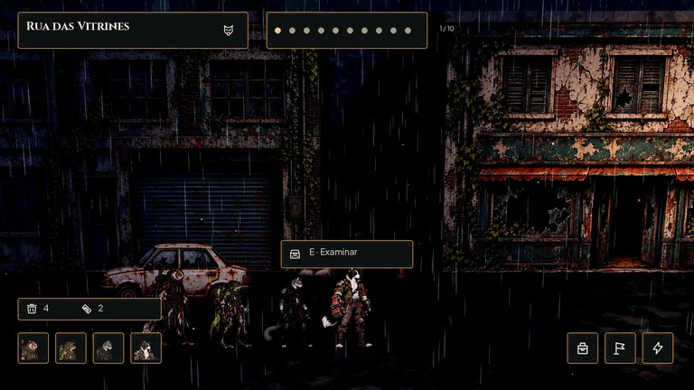

| Perfil | Referência real | Textos antes → depois | Números antes → depois |
|---|---|---|---|
| Normal | [JPG](before/explore-interaction.jpg) | 25 → 2 | 19 → 4 |
| Maior | [JPG](before/explore-interaction_large.jpg) | 25 → 2 | 19 → 4 |

[Cinza](explore-interaction_gray.webp) · [Normal completo](explore-interaction.png) · [Maior completo](explore-interaction_large.png) · medidas na [folha do sistema](system.md).

## explore-interior

Mesmo HUD dentro da mercearia; o texto de progresso vira Interior. A casa foi aberta em campanha isolada com a patrulha marcada como vencida, usando a cena real.

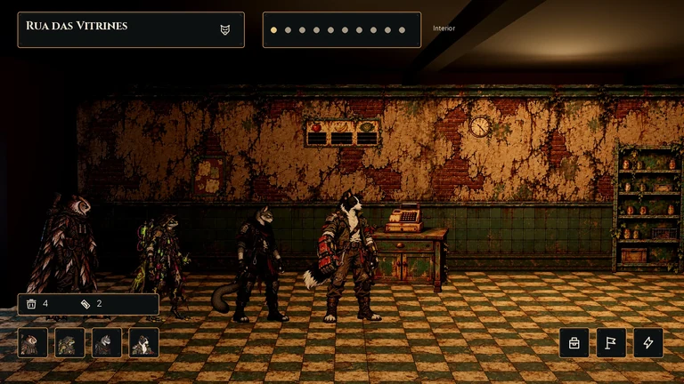

| Perfil | Referência real | Textos antes → depois | Números antes → depois |
|---|---|---|---|
| Normal | [JPG](before/explore-interior.jpg) | 26 → 2 | 17 → 2 |
| Maior | [JPG](before/explore-interior_large.jpg) | 26 → 2 | 17 → 2 |

[Cinza](explore-interior_gray.webp) · [Normal completo](explore-interior.png) · [Maior completo](explore-interior_large.png) · medidas na [folha do sistema](system.md).

## explore-inventory

A grade é dividida por categorias e só um detalhe fica aberto. O aliado, custo, efeito e motivo de bloqueio acompanham o item. Estoque de ferramentas vazio é indicado no foco da categoria, sem ocupar a vista de suprimentos.

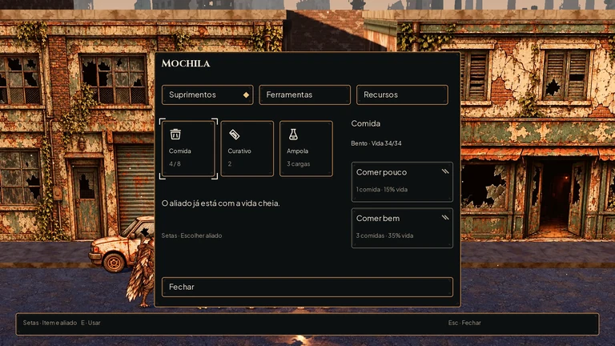

| Perfil | Referência real | Textos antes → depois | Números antes → depois |
|---|---|---|---|
| Normal | [JPG](before/explore-inventory.jpg) | 47 → 19 | 32 → 10 |
| Maior | [JPG](before/explore-inventory_large.jpg) | 47 → 19 | 32 → 10 |

[Cinza](explore-inventory_gray.webp) · [Normal completo](explore-inventory.png) · [Maior completo](explore-inventory_large.png) · medidas na [folha do sistema](system.md).

## explore-loot

Um achado sobe perto do objeto, com ícone e quantidade. Fonte recapturada com o ícone correto lobby-scrap; a captura auxiliar com o ícone ausente não entrou na entrega.

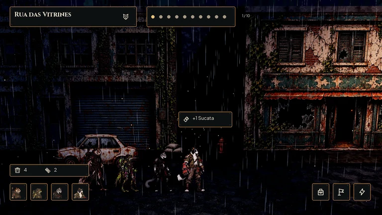

| Perfil | Referência real | Textos antes → depois | Números antes → depois |
|---|---|---|---|
| Normal | [JPG](before/explore-loot.jpg) | 26 → 2 | 20 → 5 |
| Maior | [JPG](before/explore-loot_large.jpg) | 26 → 2 | 20 → 5 |

[Cinza](explore-loot_gray.webp) · [Normal completo](explore-loot.png) · [Maior completo](explore-loot_large.png) · medidas na [folha do sistema](system.md).

## explore-objective-focus

O ícone do objetivo abre o texto real da rota e a condição do guardião; a instrução não ocupa a tela durante toda a caminhada.

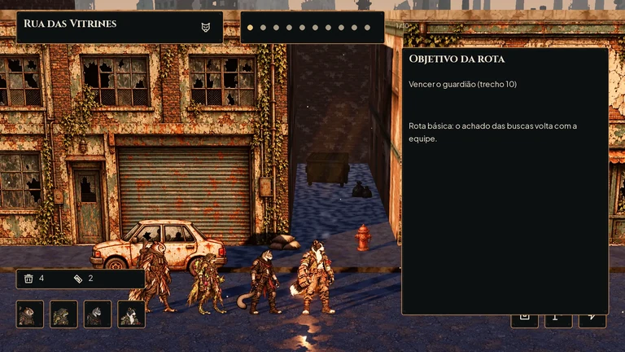

| Perfil | Referência real | Textos antes → depois | Números antes → depois |
|---|---|---|---|
| Normal | [JPG](before/explore.jpg) | 25 → 4 | 19 → 5 |
| Maior | [JPG](before/explore_large.jpg) | 25 → 4 | 19 → 5 |

[Cinza](explore-objective-focus_gray.webp) · [Normal completo](explore-objective-focus.png) · [Maior completo](explore-objective-focus_large.png) · medidas na [folha do sistema](system.md).

## explore-options

Mesmas categorias e controles nas três entradas. Acessibilidade reúne os três tamanhos e daltonismo; Som, Imagem e Jogo têm pranchas próprias. Não repetir todos os ajustes numa lista longa sobre a cena.

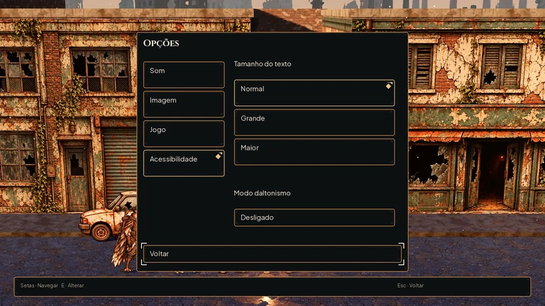

| Perfil | Referência real | Textos antes → depois | Números antes → depois |
|---|---|---|---|
| Normal | [JPG](before/explore-options.jpg) | 53 → 14 | 24 → 0 |
| Maior | [JPG](before/explore-options_large.jpg) | 45 → 14 | 24 → 0 |

[Cinza](explore-options_gray.webp) · [Normal completo](explore-options.png) · [Maior completo](explore-options_large.png) · medidas na [folha do sistema](system.md).

## explore-patrol

Aviso curto com símbolo de alerta e palavras, legível na rua clara e no escuro. A forma continua reconhecível sem vermelho.

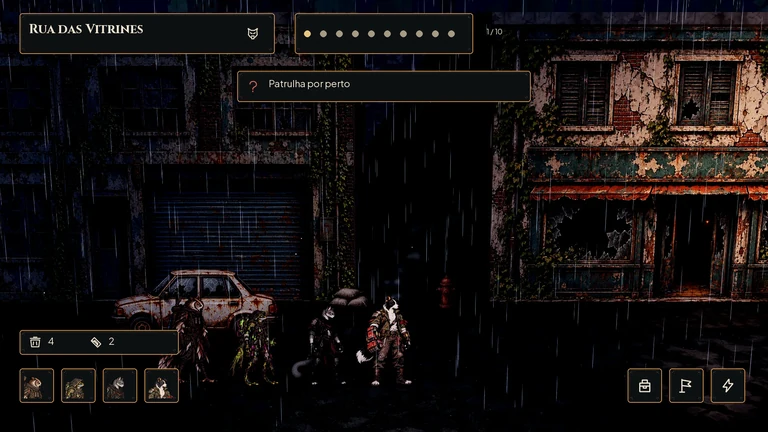

| Perfil | Referência real | Textos antes → depois | Números antes → depois |
|---|---|---|---|
| Normal | [JPG](before/explore-patrol.jpg) | 25 → 2 | 19 → 4 |
| Maior | [JPG](before/explore-patrol_large.jpg) | 25 → 2 | 19 → 4 |

[Cinza](explore-patrol_gray.webp) · [Normal completo](explore-patrol.png) · [Maior completo](explore-patrol_large.png) · medidas na [folha do sistema](system.md).

## explore-resources-focus

Detalhe de comida, curativos, ampola, achado e esperança. Não confundir o achado ainda na expedição com as sementes já no estoque da Estação.

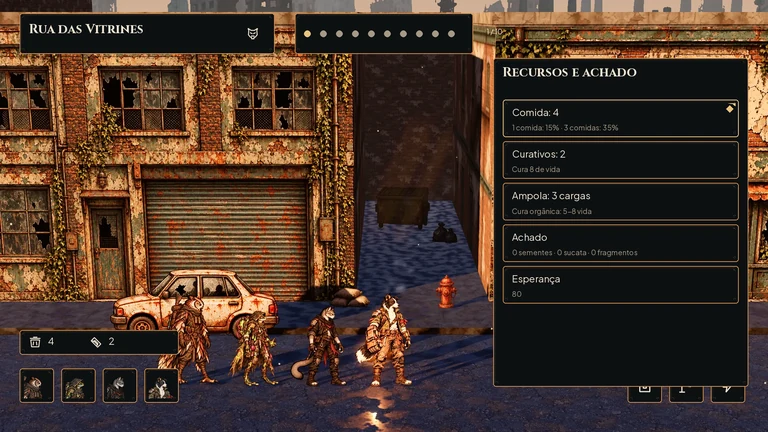

| Perfil | Referência real | Textos antes → depois | Números antes → depois |
|---|---|---|---|
| Normal | [JPG](before/explore.jpg) | 25 → 11 | 19 → 18 |
| Maior | [JPG](before/explore_large.jpg) | 25 → 11 | 19 → 18 |

[Cinza](explore-resources-focus_gray.webp) · [Normal completo](explore-resources-focus.png) · [Maior completo](explore-resources-focus_large.png) · medidas na [folha do sistema](system.md).

## explore-risk

A perda de metade do achado fica no próprio diálogo. Continuar é o foco inicial; voltar exige uma ação explícita e mantém a consequência escrita.

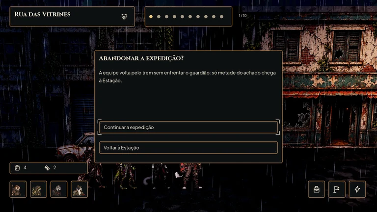

| Perfil | Referência real | Textos antes → depois | Números antes → depois |
|---|---|---|---|
| Normal | [JPG](before/explore-risk.jpg) | 29 → 5 | 19 → 4 |
| Maior | [JPG](before/explore-risk_large.jpg) | 29 → 5 | 19 → 4 |

[Cinza](explore-risk_gray.webp) · [Normal completo](explore-risk.png) · [Maior completo](explore-risk_large.png) · medidas na [folha do sistema](system.md).

## explore-search

A captura mostra a busca concluída: comida sobe de4 para5 e chega1 semente ao achado. O aviso diz o que foi encontrado, sem fingir que a busca ainda está em curso.

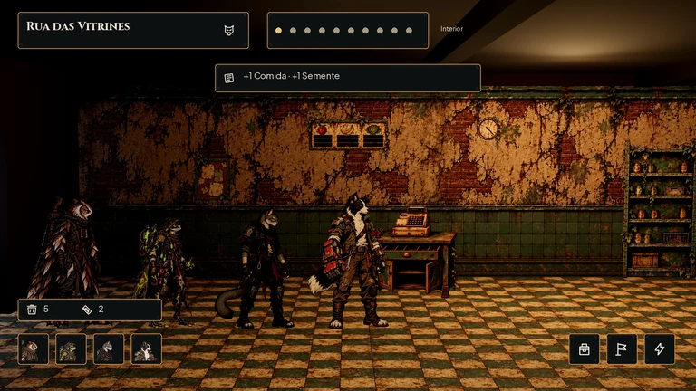

| Perfil | Referência real | Textos antes → depois | Números antes → depois |
|---|---|---|---|
| Normal | [JPG](before/explore-search.jpg) | 27 → 3 | 19 → 4 |
| Maior | [JPG](before/explore-search_large.jpg) | 27 → 3 | 19 → 4 |

[Cinza](explore-search_gray.webp) · [Normal completo](explore-search.png) · [Maior completo](explore-search_large.png) · medidas na [folha do sistema](system.md).

## explore-team-focus

Um aliado em foco revela vida, instinto, posição e estados. A mesma ficha vale para os quatro e para recrutas; não trocar a informação por uma cor sem legenda.

| Perfil | Referência real | Textos antes → depois | Números antes → depois |
|---|---|---|---|
| Normal | [JPG](before/explore.jpg) | 25 → 7 | 19 → 9 |
| Maior | [JPG](before/explore_large.jpg) | 25 → 7 | 19 → 9 |

[Cinza](explore-team-focus_gray.webp) · [Normal completo](explore-team-focus.png) · [Maior completo](explore-team-focus_large.png) · medidas na [folha do sistema](system.md).

## explore-touch

Mesma interface, com áreas de toque112×112 e espaço16. O detalhe abre no primeiro toque e a confirmação fica separada. A redução real a40% deixa44,8px por alvo e testa hierarquia e formas; não comprimir os alvos interativos abaixo do mínimo do dispositivo.

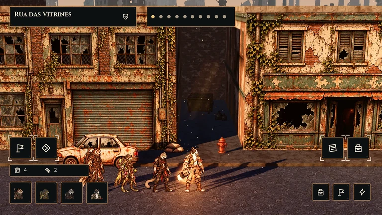

| Perfil | Referência real | Textos antes → depois | Números antes → depois |
|---|---|---|---|
| Normal | [JPG](before/explore-touch.jpg) | 18 → 1 | 19 → 4 |
| Maior | [JPG](before/explore-touch_large.jpg) | 18 → 1 | 19 → 4 |

[Cinza](explore-touch_gray.webp) · [Normal completo](explore-touch.png) · [Maior completo](explore-touch_large.png) · medidas na [folha do sistema](system.md).

## options-game

Jogo: velocidade da batalha, dicas e idioma Português/English em teste. São os controles existentes, sem novo sistema de atalhos configuráveis.

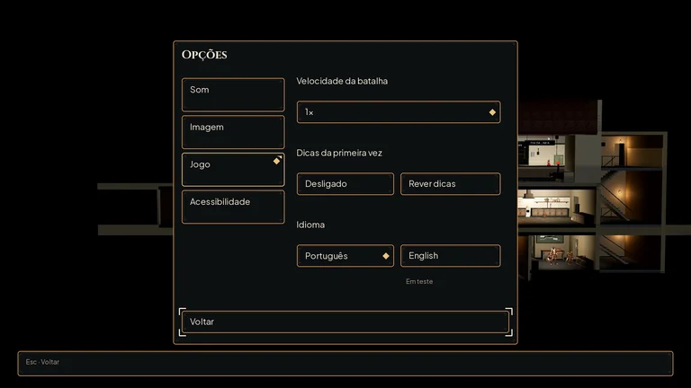

| Perfil | Referência real | Textos antes → depois | Números antes → depois |
|---|---|---|---|
| Normal | [JPG](before/station-options.jpg) | 47 → 16 | 21 → 1 |
| Maior | [JPG](before/station-options_large.jpg) | 43 → 16 | 21 → 1 |

[Cinza](options-game_gray.webp) · [Normal completo](options-game.png) · [Maior completo](options-game_large.png) · medidas na [folha do sistema](system.md).

## options-image

Imagem: qualidade Alto, tela cheia, sincronização vertical e redução de efeitos. O controle em foco mostra o estado por escrito.

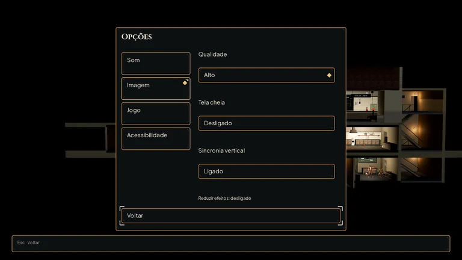

| Perfil | Referência real | Textos antes → depois | Números antes → depois |
|---|---|---|---|
| Normal | [JPG](before/station-options.jpg) | 47 → 14 | 21 → 0 |
| Maior | [JPG](before/station-options_large.jpg) | 43 → 14 | 21 → 0 |

[Cinza](options-image_gray.webp) · [Normal completo](options-image.png) · [Maior completo](options-image_large.png) · medidas na [folha do sistema](system.md).

## options-sound

Som: Música, Ambiente e Efeitos em60%, com valor textual e barra. Mesmos painéis, fonte e foco das demais opções.

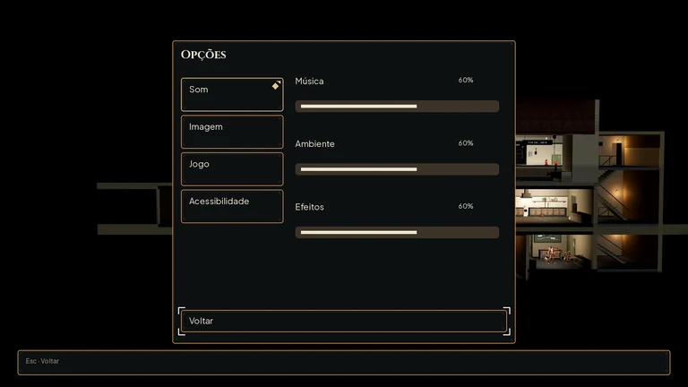

| Perfil | Referência real | Textos antes → depois | Números antes → depois |
|---|---|---|---|
| Normal | [JPG](before/station-options.jpg) | 47 → 10 | 21 → 3 |
| Maior | [JPG](before/station-options_large.jpg) | 43 → 10 | 21 → 3 |

[Cinza](options-sound_gray.webp) · [Normal completo](options-sound.png) · [Maior completo](options-sound_large.png) · medidas na [folha do sistema](system.md).

## scenario-event

Mesmo cartão, molduras e hierarquia no Abrigo Lacrado. Texto e escolhas são os da Sala dos Esporos; nenhuma HUD nova para esta fase.

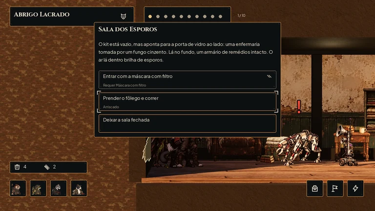

| Perfil | Referência real | Textos antes → depois | Números antes → depois |
|---|---|---|---|
| Normal | [JPG](before/scenario-event.jpg) | 31 → 8 | 19 → 4 |
| Maior | [JPG](before/scenario-event_large.jpg) | 31 → 8 | 19 → 4 |

[Cinza](scenario-event_gray.webp) · [Normal completo](scenario-event.png) · [Maior completo](scenario-event_large.png) · medidas na [folha do sistema](system.md).

## station

Os doze serviços não se acumulam sobre o cenário. Recursos principais, próximo passo e entrada da expedição ficam; cômodos são escolhidos na própria base. Materiais aparecem no custo da decisão.

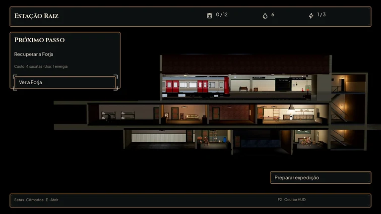

| Perfil | Referência real | Textos antes → depois | Números antes → depois |
|---|---|---|---|
| Normal | [JPG](before/station.jpg) | 31 → 8 | 17 → 8 |
| Maior | [JPG](before/station_large.jpg) | 31 → 8 | 17 → 8 |

[Cinza](station_gray.webp) · [Normal completo](station.png) · [Maior completo](station_large.png) · medidas na [folha do sistema](system.md).

## station-bar

Estado vazio real, sem uso por enquanto; não inventar serviços nem uma ação de recuperar inexistente.

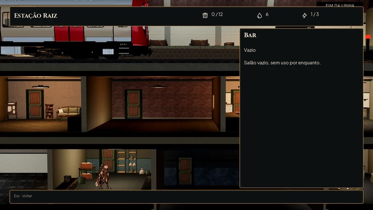

| Perfil | Referência real | Textos antes → depois | Números antes → depois |
|---|---|---|---|
| Normal | [JPG](before/station-bar.jpg) | 17 → 5 | 13 → 5 |
| Maior | [JPG](before/station-bar_large.jpg) | 17 → 5 | 13 → 5 |

[Cinza](station-bar_gray.webp) · [Normal completo](station-bar.png) · [Maior completo](station-bar_large.png) · medidas na [folha do sistema](system.md).

## station-canteen

Produção, demanda da equipe, moradores, água e energia ficam juntos na decisão da Cantina. Os números são os do frame; não resumir previsão a uma luz verde.

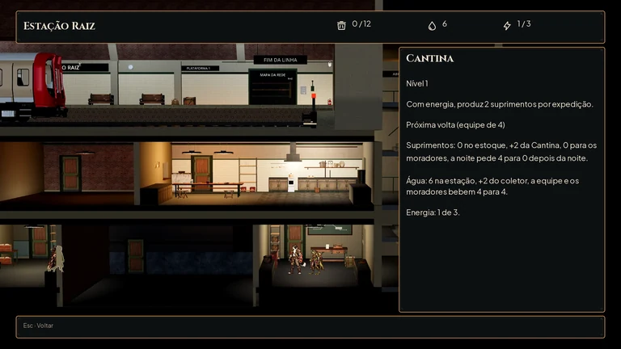

| Perfil | Referência real | Textos antes → depois | Números antes → depois |
|---|---|---|---|
| Normal | [JPG](before/station-canteen.jpg) | 21 → 9 | 27 → 19 |
| Maior | [JPG](before/station-canteen_large.jpg) | 21 → 9 | 27 → 19 |

[Cinza](station-canteen_gray.webp) · [Normal completo](station-canteen.png) · [Maior completo](station-canteen_large.png) · medidas na [folha do sistema](system.md).

## station-character-focus

Ficha selecionada com os valores reais de Bento e acessos a relíquia/trauma. Os demais usam a mesma estrutura, com seus próprios dados.

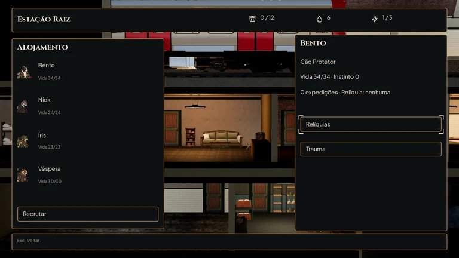

| Perfil | Referência real | Textos antes → depois | Números antes → depois |
|---|---|---|---|
| Normal | [JPG](before/station-characters.jpg) | 31 → 18 | 36 → 17 |
| Maior | [JPG](before/station-characters_large.jpg) | 31 → 18 | 36 → 17 |

[Cinza](station-character-focus_gray.webp) · [Normal completo](station-character-focus.png) · [Maior completo](station-character-focus_large.png) · medidas na [folha do sistema](system.md).

## station-characters

Quatro fichas de elenco e um detalhe selecionado, em vez de descrições e serviços de todos simultaneamente. Vida, instinto, expedições e relíquia são mantidos no detalhe; recrutar permanece uma ação separada.

| Perfil | Referência real | Textos antes → depois | Números antes → depois |
|---|---|---|---|
| Normal | [JPG](before/station-characters.jpg) | 31 → 18 | 36 → 17 |
| Maior | [JPG](before/station-characters_large.jpg) | 31 → 18 | 36 → 17 |

[Cinza](station-characters_gray.webp) · [Normal completo](station-characters.png) · [Maior completo](station-characters_large.png) · medidas na [folha do sistema](system.md).

## station-depot

Fichas de estoque, capacidade e excesso separados do botão Melhorar. Custo5 sucatas e1 fragmento visível antes de confirmar; ferramentas e relíquias vazias por escrito.

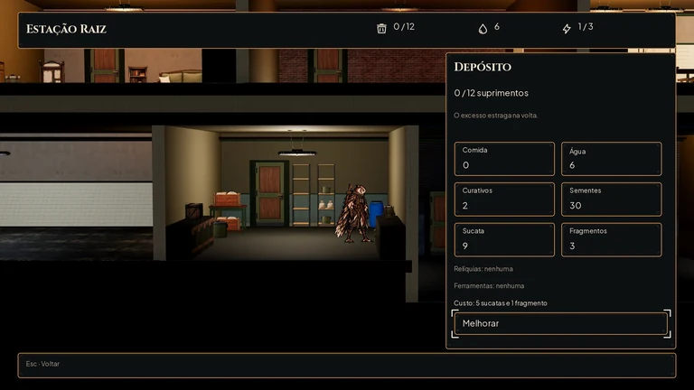

| Perfil | Referência real | Textos antes → depois | Números antes → depois |
|---|---|---|---|
| Normal | [JPG](before/station-depot.jpg) | 24 → 15 | 24 → 15 |
| Maior | [JPG](before/station-depot_large.jpg) | 24 → 15 | 24 → 15 |

[Cinza](station-depot_gray.webp) · [Normal completo](station-depot.png) · [Maior completo](station-depot_large.png) · medidas na [folha do sistema](system.md).

## station-dormitory

Estado sem noite pendente: informa que ninguém precisa descansar agora. Não oferecer uma noite falsa para preencher o painel.

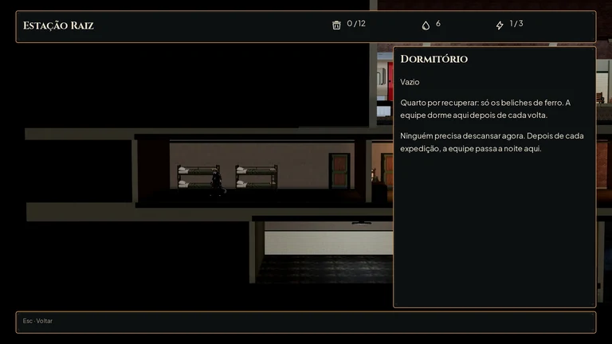

| Perfil | Referência real | Textos antes → depois | Números antes → depois |
|---|---|---|---|
| Normal | [JPG](before/station-dormitory.jpg) | 18 → 6 | 13 → 5 |
| Maior | [JPG](before/station-dormitory_large.jpg) | 18 → 6 | 13 → 5 |

[Cinza](station-dormitory_gray.webp) · [Normal completo](station-dormitory.png) · [Maior completo](station-dormitory_large.png) · medidas na [folha do sistema](system.md).

## station-forge

Estado vazio real: função e custo separados da ação Recuperar. Não oferecer fabricar antes da recuperação.9-slice e botão são os do kit.

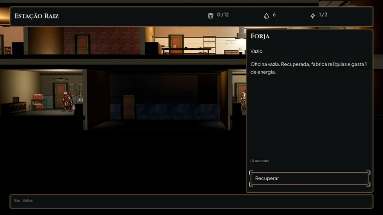

| Perfil | Referência real | Textos antes → depois | Números antes → depois |
|---|---|---|---|
| Normal | [JPG](before/station-forge.jpg) | 18 → 7 | 15 → 7 |
| Maior | [JPG](before/station-forge_large.jpg) | 18 → 7 | 15 → 7 |

[Cinza](station-forge_gray.webp) · [Normal completo](station-forge.png) · [Maior completo](station-forge_large.png) · medidas na [folha do sistema](system.md).

## station-hidden

Ocultar HUD remove também o cabeçalho; fica o frame real da Estação. F2 restaura e devolve o foco anterior.

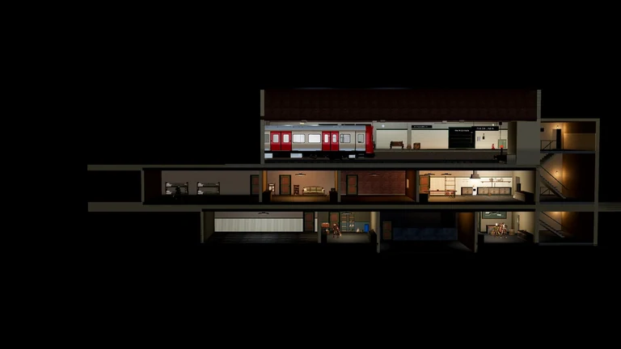

| Perfil | Referência real | Textos antes → depois | Números antes → depois |
|---|---|---|---|
| Normal | [JPG](before/station.jpg) | 31 → 0 | 17 → 0 |
| Maior | [JPG](before/station_large.jpg) | 31 → 0 | 17 → 0 |

[Cinza](station-hidden_gray.webp) · [Normal completo](station-hidden.png) · [Maior completo](station-hidden_large.png) · medidas na [folha do sistema](system.md).

## station-map

Sai o bege e entra a variante #69. Estados são palavra e forma; escolha e foco são independentes. Nós mantêm o papel geográfico, etiquetas podem se deslocar com ligação; o cenário de fundo é o mapa atual.

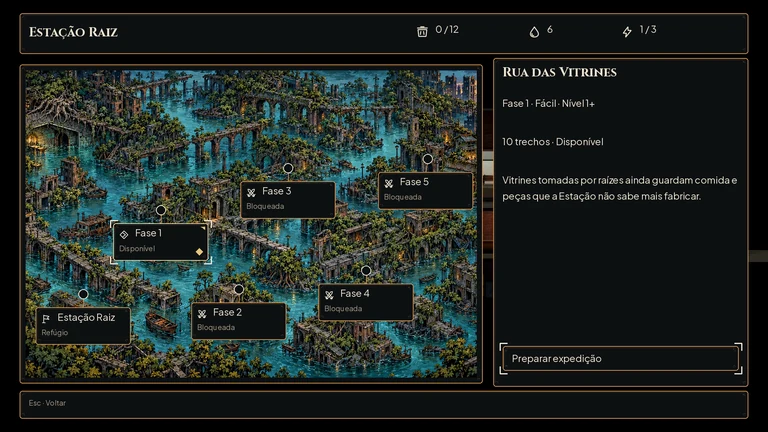

| Perfil | Referência real | Textos antes → depois | Números antes → depois |
|---|---|---|---|
| Normal | [JPG](before/station-map.jpg) | 26 → 19 | 20 → 13 |
| Maior | [JPG](before/station-map_large.jpg) | 24 → 19 | 16 → 13 |

[Cinza](station-map_gray.webp) · [Normal completo](station-map.png) · [Maior completo](station-map_large.png) · medidas na [folha do sistema](system.md).

## station-night

Dormir/Vigiar por aliado, previsão da noite e custo do suprimento antes de Iniciar descanso. Nick8/24 recupera8 de vida. Estas regras não são as da fogueira.

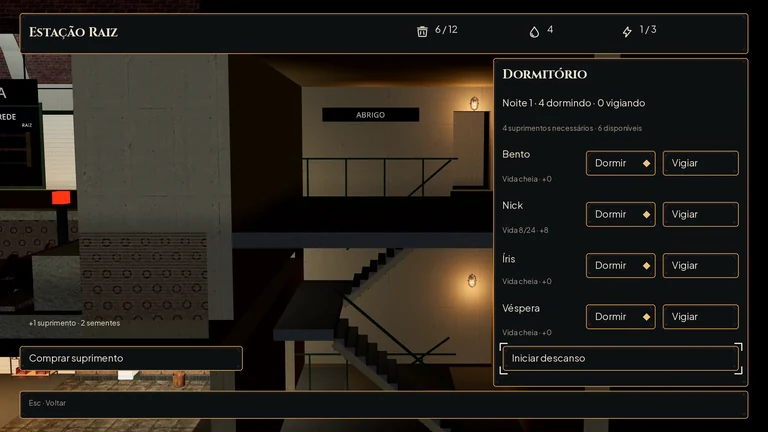

| Perfil | Referência real | Textos antes → depois | Números antes → depois |
|---|---|---|---|
| Normal | [JPG](before/station-night.jpg) | 43 → 24 | 41 → 18 |
| Maior | [JPG](before/station-night_large.jpg) | 43 → 24 | 41 → 18 |

[Cinza](station-night_gray.webp) · [Normal completo](station-night.png) · [Maior completo](station-night_large.png) · medidas na [folha do sistema](system.md).

## station-options

Mesmas categorias e controles nas três entradas. Acessibilidade reúne os três tamanhos e daltonismo; Som, Imagem e Jogo têm pranchas próprias. Não repetir todos os ajustes numa lista longa sobre a cena.

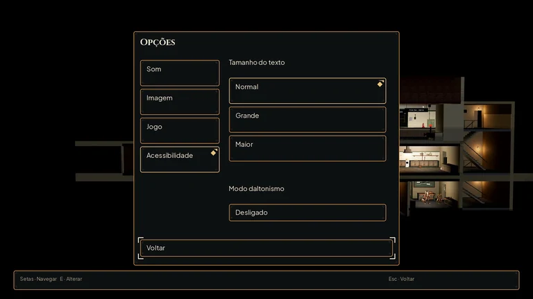

| Perfil | Referência real | Textos antes → depois | Números antes → depois |
|---|---|---|---|
| Normal | [JPG](before/station-options.jpg) | 47 → 14 | 21 → 0 |
| Maior | [JPG](before/station-options_large.jpg) | 43 → 14 | 21 → 0 |

[Cinza](station-options_gray.webp) · [Normal completo](station-options.png) · [Maior completo](station-options_large.png) · medidas na [folha do sistema](system.md).

## station-plan

Lista de cômodos à esquerda; um único detalhe e custo à direita. O mapa em corte continua visível entre os painéis. Cômodo vazio não ganha uma função que ainda não existe.

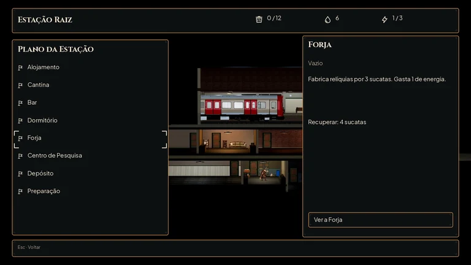

| Perfil | Referência real | Textos antes → depois | Números antes → depois |
|---|---|---|---|
| Normal | [JPG](before/station-plan.jpg) | 39 → 16 | 23 → 8 |
| Maior | [JPG](before/station-plan_large.jpg) | 35 → 16 | 18 → 8 |

[Cinza](station-plan_gray.webp) · [Normal completo](station-plan.png) · [Maior completo](station-plan_large.png) · medidas na [folha do sistema](system.md).

## station-preparation

Posição, vida e quantidade de habilidades válidas nas fichas da equipe. Foco e comida têm controles claros; custo em sementes aparece junto do ajuste. Partir é a única decisão principal.

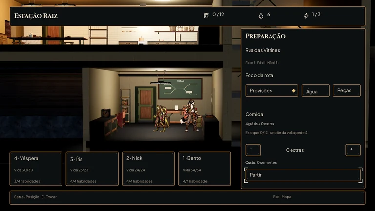

| Perfil | Referência real | Textos antes → depois | Números antes → depois |
|---|---|---|---|
| Normal | [JPG](before/station-preparation.jpg) | 44 → 28 | 43 → 34 |
| Maior | [JPG](before/station-preparation_large.jpg) | 44 → 28 | 43 → 34 |

[Cinza](station-preparation_gray.webp) · [Normal completo](station-preparation.png) · [Maior completo](station-preparation_large.png) · medidas na [folha do sistema](system.md).

## station-report

Resultado, três recursos entregues e os quatro sobreviventes num só painel. O ferimento de Nick8/24 permanece evidente. Narrativa e desbloqueios passam para o detalhe do relatório.

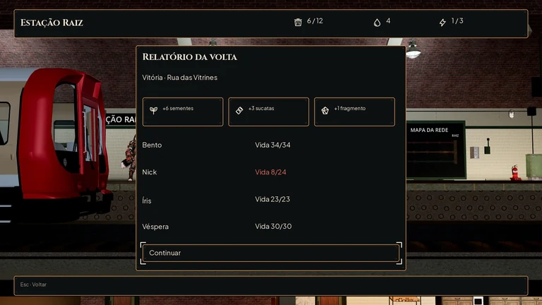

| Perfil | Referência real | Textos antes → depois | Números antes → depois |
|---|---|---|---|
| Normal | [JPG](before/station-report.jpg) | 45 → 16 | 40 → 16 |
| Maior | [JPG](before/station-report_large.jpg) | 40 → 16 | 34 → 16 |

[Cinza](station-report_gray.webp) · [Normal completo](station-report.png) · [Maior completo](station-report_large.png) · medidas na [folha do sistema](system.md).

## station-report-focus

O detalhe conserva a observação narrativa original e os custos das obras liberadas. Não inventar eventos ou promessas de gameplay.

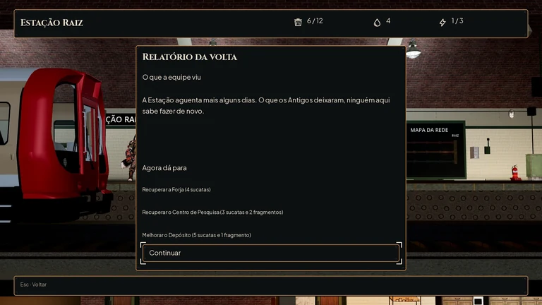

| Perfil | Referência real | Textos antes → depois | Números antes → depois |
|---|---|---|---|
| Normal | [JPG](before/station-report.jpg) | 45 → 10 | 40 → 10 |
| Maior | [JPG](before/station-report_large.jpg) | 40 → 10 | 34 → 10 |

[Cinza](station-report-focus_gray.webp) · [Normal completo](station-report-focus.png) · [Maior completo](station-report-focus_large.png) · medidas na [folha do sistema](system.md).

## station-research

Estado vazio real com custo3 sucatas e2 fragmentos, sem criar melhoria ou receita. Texto e custo crescem para o Maior.

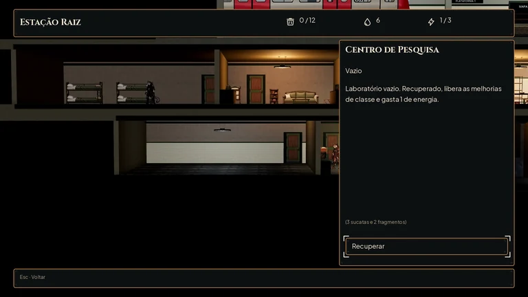

| Perfil | Referência real | Textos antes → depois | Números antes → depois |
|---|---|---|---|
| Normal | [JPG](before/station-research.jpg) | 18 → 7 | 16 → 8 |
| Maior | [JPG](before/station-research_large.jpg) | 18 → 7 | 16 → 8 |

[Cinza](station-research_gray.webp) · [Normal completo](station-research.png) · [Maior completo](station-research_large.png) · medidas na [folha do sistema](system.md).

## station-room-focus

Só o cômodo apontado recebe sua ficha e Gerenciar. Foco não aciona, nem troca os ids das salas; teclado e mouse usam a mesma ficha.

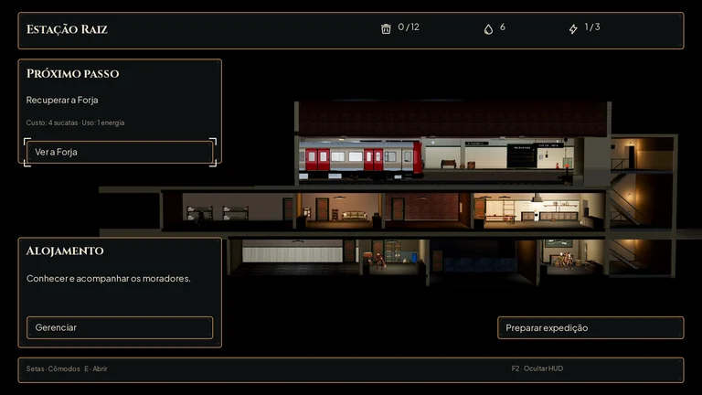

| Perfil | Referência real | Textos antes → depois | Números antes → depois |
|---|---|---|---|
| Normal | [JPG](before/station.jpg) | 31 → 11 | 17 → 8 |
| Maior | [JPG](before/station_large.jpg) | 31 → 11 | 17 → 8 |

[Cinza](station-room-focus_gray.webp) · [Normal completo](station-room-focus.png) · [Maior completo](station-room-focus_large.png) · medidas na [folha do sistema](system.md).

## station-train

Pedido em faixa superior, rosto e corpo de Dora livres, decisão lateral. Benefício, consumo de água e previsão antes/depois ficam à vista; Acolher e Recusar não dependem de cor.

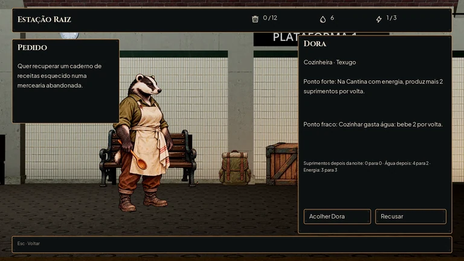

| Perfil | Referência real | Textos antes → depois | Números antes → depois |
|---|---|---|---|
| Normal | [JPG](before/station-train.jpg) | 24 → 11 | 21 → 13 |
| Maior | [JPG](before/station-train_large.jpg) | 24 → 11 | 21 → 13 |

[Cinza](station-train_gray.webp) · [Normal completo](station-train.png) · [Maior completo](station-train_large.png) · medidas na [folha do sistema](system.md).

## title

A imagem e o logo reais continuam. Duas entradas claras sem save; foco inicial na Nova campanha.

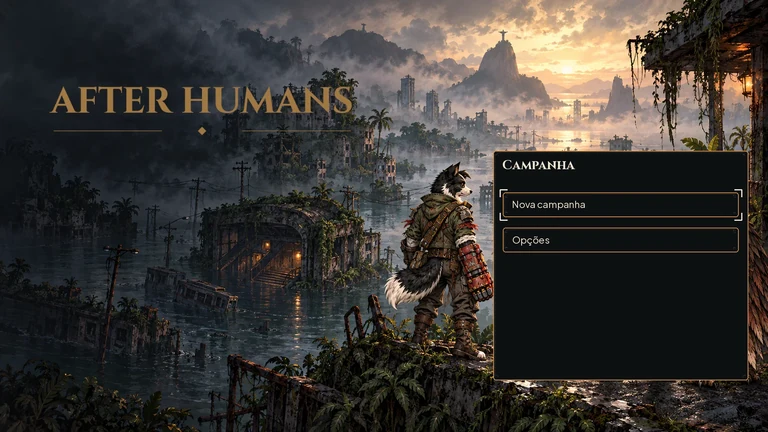

| Perfil | Referência real | Textos antes → depois | Números antes → depois |
|---|---|---|---|
| Normal | [JPG](before/title.jpg) | 2 → 3 | 0 → 0 |
| Maior | [JPG](before/title_large.jpg) | 2 → 3 | 0 → 0 |

[Cinza](title_gray.webp) · [Normal completo](title.png) · [Maior completo](title_large.png) · medidas na [folha do sistema](system.md).

## title-confirm

A perda do progresso do espaço1 e a preservação dos demais são escritas antes da escolha. Cancelar é o foco inicial.

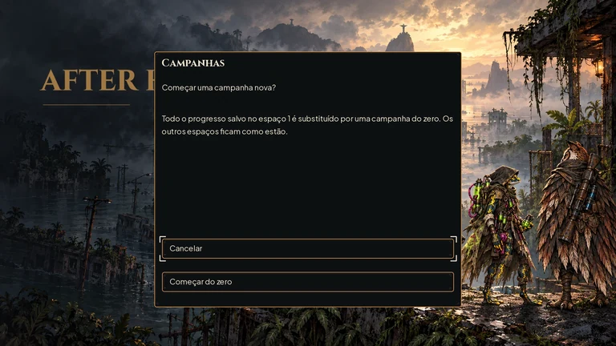

| Perfil | Referência real | Textos antes → depois | Números antes → depois |
|---|---|---|---|
| Normal | [JPG](before/title-confirm.jpg) | 4 → 5 | 1 → 1 |
| Maior | [JPG](before/title-confirm_large.jpg) | 4 → 5 | 1 → 1 |

[Cinza](title-confirm_gray.webp) · [Normal completo](title-confirm.png) · [Maior completo](title-confirm_large.png) · medidas na [folha do sistema](system.md).

## title-continue

Continuar aparece com save; Nova campanha, Campanhas e Opções mantêm a mesma família de botões. O menu não vira uma HUD diferente.

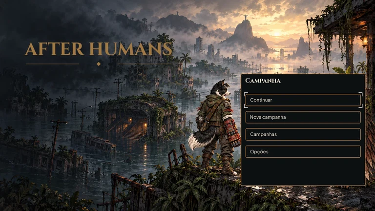

| Perfil | Referência real | Textos antes → depois | Números antes → depois |
|---|---|---|---|
| Normal | [JPG](before/title-continue.jpg) | 3 → 5 | 0 → 0 |
| Maior | [JPG](before/title-continue_large.jpg) | 3 → 5 | 0 → 0 |

[Cinza](title-continue_gray.webp) · [Normal completo](title-continue.png) · [Maior completo](title-continue_large.png) · medidas na [folha do sistema](system.md).

## title-options

Mesmas categorias e controles nas três entradas. Acessibilidade reúne os três tamanhos e daltonismo; Som, Imagem e Jogo têm pranchas próprias. Não repetir todos os ajustes numa lista longa sobre a cena.

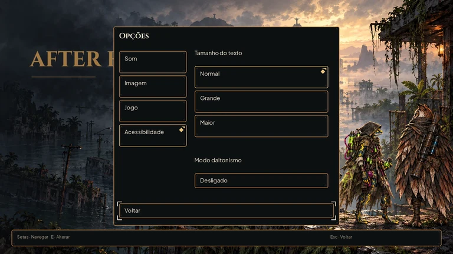

| Perfil | Referência real | Textos antes → depois | Números antes → depois |
|---|---|---|---|
| Normal | [JPG](before/title-options.jpg) | 28 → 14 | 5 → 0 |
| Maior | [JPG](before/title-options_large.jpg) | 20 → 14 | 5 → 0 |

[Cinza](title-options_gray.webp) · [Normal completo](title-options.png) · [Maior completo](title-options_large.png) · medidas na [folha do sistema](system.md).

## title-slots

Os três espaços conservam ciclo, fases, vivos e data do save existente. Espaços vazios são explícitos; foco e seleção são separados.

| Perfil | Referência real | Textos antes → depois | Números antes → depois |
|---|---|---|---|
| Normal | [JPG](before/title-slots.jpg) | 5 → 9 | 13 → 13 |
| Maior | [JPG](before/title-slots_large.jpg) | 5 → 9 | 13 → 13 |

[Cinza](title-slots_gray.webp) · [Normal completo](title-slots.png) · [Maior completo](title-slots_large.png) · medidas na [folha do sistema](system.md).

## title-slots-empty

Três espaços vazios, sem campanha falsa para ornamentar a tela. A mesma geometria cabe no Maior.

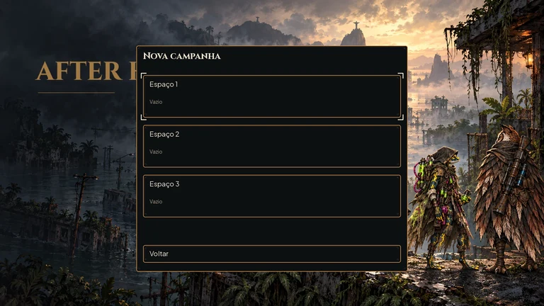

| Perfil | Referência real | Textos antes → depois | Números antes → depois |
|---|---|---|---|
| Normal | [JPG](before/title-slots-empty.jpg) | 5 → 8 | 3 → 3 |
| Maior | [JPG](before/title-slots-empty_large.jpg) | 5 → 8 | 3 → 3 |

[Cinza](title-slots-empty_gray.webp) · [Normal completo](title-slots-empty.png) · [Maior completo](title-slots-empty_large.png) · medidas na [folha do sistema](system.md).
