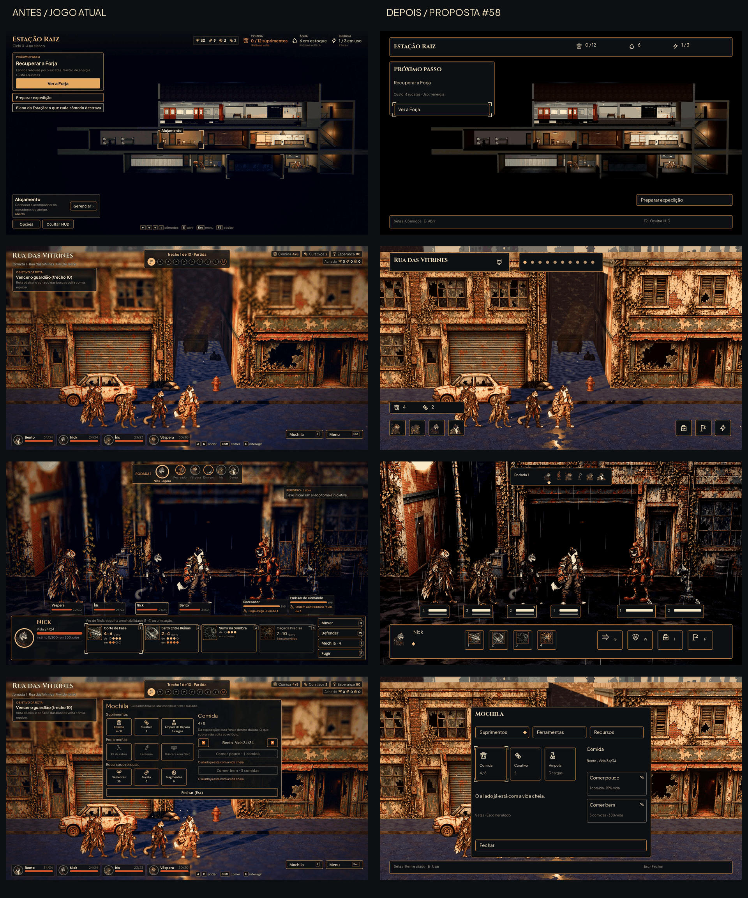
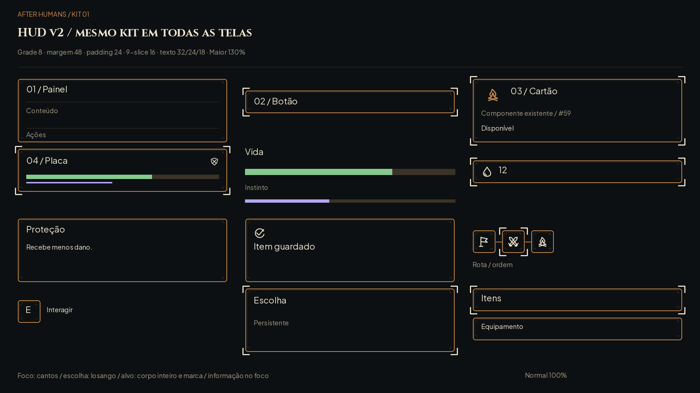

# HUD v2 — proposta integral da #58

Esta é uma proposta para aprovação visual do Lucas. A integração continua com o Claude nas #56 e #57, depois da aprovação. **Nenhum código, id, regra ou dado do jogo foi alterado.** As imagens mostram interfaces propostas sobre frames reais da Godot 4.7.2, base **bc81822**, com capturas adicionais em **e0c15e9**. O kit #59 já aprovado é a única fonte de componentes; a variante de etiqueta #69 entrou no contrato antes desta composição.

[Galeria e contagens por tela](index.md) · [Capturas originais e índice](before/README.md) · [Proveniência e hashes](captures.json) · [Contagens e textos desenhados](counts.json) · [Kit e contrato](../ui-kit.md) · [QA](qa.md).

## Direção e componentes

O cenário e os personagens são os do jogo, sem geração de imagem, repintura ou troca de fundo. A captura original e a captura com HUD oculta são leituras do **mesmo frame pausado**. As pranchas recompõem apenas a interface. O mapa ferroviário é um componente de interface; reutiliza sua imagem atual. As sombras, as texturas dos cômodos, os personagens e a iluminação não são reconstruídos a partir de uma descrição. As cópias JPG/WebP e os PNG indexados têm compressão de documentação, não são novos assets de runtime.

As molduras envelhecidas `art/ui/frames/`, os SVG `art/ui/icons/`, os retratos `art/ui/portraits/` e os ícones pintados `art/combat/icons/` são os atuais. Não há nova família, fonte, moldura ou ícone. Placa, sequência, cartão, botão, painel, aviso, dica, ficha e seleção vêm do [contrato do kit](../ui-kit/contract.json). A ordem de iniciativa usa retratos de aliados e imagens atuais de inimigos; habilidades usam sua arte própria, sem substituição por símbolos genéricos.

## Grade e medidas para integrar

Base **1920×1080**, coordenadas a partir do canto superior esquerdo. Margem externa **48**, malha **8**, espaçamento **24**, padding **24**. Todas as molduras conservam margens de 9-slice **16/16/16/16**. Nunca esticar a borda como imagem inteira. Os valores abaixo são âncoras de layout, não novos ids de produção.

| Componente do kit | Origem/âncora | Medida e comportamento |
|---|---|---|
| Cabeçalho | 48,32; topo/esquerda e direita | 1824×104 |
| Painel lateral | 1232,144; direita | 640×824; conteúdo 592 px |
| Painel modal | 480,160; centro | 960×800; conteúdo 912 px |
| Modal de opções | 480,112; centro | 960×848; categorias à esquerda, controle em foco à direita |
| Rodapé | 48,976; inferior | 1824×72; atalhos contextuais |
| Botão | largura do conteúdo | altura 64 Normal; 80 Grande/Maior; padding24 |
| Ficha de recurso | cabeçalho ou canto inferior | ícone32, número24/31; descrição no foco |
| Placa sob unidade | alinhada ao pé projetado | faixa compacta; vida e trilha de instinto sem números fixos; área inteira do personagem clicável |
| Ordem | 688,32; centro superior | 544×96; retratos48, passo56; quem age marcado por losango |
| Barra de comandos | 48,864; inferior | 1824×184; habilidade104×104; ação136×104 |
| Dica de habilidade | 48,176 | 640 px; altura cresce com conteúdo, sem cobrir o alvo |
| Aviso | 592,176; centro superior | 736×80 Normal; 96 Maior; ícone + frase |
| Etiqueta de fase | sob o nó, centro superior | 240×96 Normal; 272×112 Grande/Maior, conforme #69 |
| Toque | laterais inferiores | alvos112×112, espaço16; 44,8 px a40%; retratos também112 no toque |

As âncoras das placas são projeções dos pés de cada card, **não** os x fixos da prancha em todos os dispositivos. O protótipo ilustra a posição no frame capturado. O Claude deve usar as projeções de `AHSpriteCard`, respeitar a silhueta inteira para clicar e evitar a sobreposição com a barra inferior. Os painéis podem ter rolagem de conteúdo; título, decisão e custo permanecem visíveis.

## Tipografia e cor

No máximo três tamanhos por tela: **Cinzel 32** para títulos; **Plus Jakarta Sans 24** para corpo; **18** para detalhes e atalhos. Grande115%:37/28/21; Maior130%:42/31/23. Grande usa a geometria ampliada do kit, nunca uma caixa Normal com fonte maior. Não diminuir a fonte para caber uma tradução; quebrar linhas ou aumentar a caixa. As etiquetas #69 incluem a prova em inglês.

Fundo `#0d1012`, superfície `#12171a`, cobre `#c98a4b`, texto `#efe5d1`, secundário `#a69a84`. Dourado `#e9c47c` indica a decisão corrente/seleção; não colore todos os títulos e números. Bom `#86c98f` → `#56b4e9` no daltonismo; perigo `#e2675b` → `#e69f00`. Informações neutras permanecem claras. Instinto é uma trilha fina, separada da vida; nunca comunica estado só pela cor.

Foco: quatro cantos claros externos, gap6, braços18, traço3. Escolha: losango18 e moldura do kit. Bloqueado: barras e motivo por escrito. Alvo apontado: luz no corpo + marca superior “Alvo” e cantos; válido sem apontar: luz fraca; outro atingido: luz intermediária + barra/marca e nome no resumo. Herói da vez: losango + retrato atual + luz no corpo. No cinza e no daltonismo, esses sinais continuam distintos.

## O que sai da HUD fixa — e onde encontrar

| Informação | Vista fixa | A um apontar/foco de distância |
|---|---|---|
| Lugar e objetivo | lugar + ícone de objetivo | objetivo e condição do guardião, `explore-objective-focus` |
| Trechos | sequência gráfica e posição corrente | descrição do trecho e rota no foco da sequência |
| Recursos | comida e curativo, só quantidade | esperança, cargas, achado e recuperação em `explore-resources-focus` |
| Equipe na rua | quatro retratos | vida/instinto/posição/estados em `explore-team-focus`, reaplicado a cada aliado |
| Unidade na luta | posição + vida + trilha de instinto | nome, vida numérica, instinto, limiar e estados em `combat-unit-focus` |
| Intenção inimiga | ícone acima da placa | nome da ação e afetados em `combat-intent-focus`; foco pelo controle equivale ao mouse |
| Habilidade | arte própria + atalho | descrição, dano, posições, recarga/usos e motivos em `combat-skill-focus` |
| Mira | personagem inteiro | apontado e demais atingidos por extenso; `combat-target` e `combat-area-target` |
| Ações | ícone + tecla | nome no mouse/foco; Mochila mantém item, aliado, custo, efeito e motivo |
| Estação | comida, água, energia; próximo passo | previsão e custos no cômodo/Plano; material só na decisão que o gasta |
| Cômodos | cenário clicável | um painel selecionado; não uma lista de todos os serviços sobre o cenário |
| Noite | Dormir/Vigiar + previsão | recuperação e alimentação antes de confirmar; nunca trocar por regra do acampamento |
| Evento | narrativa e todas as escolhas | requisitos, risco e bloqueio no próprio cartão da escolha |

O detalhe fica no **mesmo gesto de foco**, não atrás de um submenu necessário para confirmar uma ação. Teclado/controle percorrem cenário → unidades/objetos → habilidades → ações; Esc volta um nível, mantém o foco anterior e não confirma decisões destrutivas. Toque: primeiro toque mostra detalhe e alvo; segundo confirma. A área que recebe o clique da mira é a silhueta projetada inteira; a placa é um segundo acesso, não a única área.

## Medição

“Texto” = um bloco de interface com letras (um Label, RichTextLabel ou texto próprio de Button), sem contar ícones e sinais isolados. “Número” = cada token numérico dentro desses blocos **e** dos blocos só numéricos; `34/34` são dois, `5–8` são dois, `1–4` são dois. A mesma convenção vale no antes e no depois. Um texto que quebrou linha continua um bloco. Não contar placas pintadas no cenário: pertencem ao mesmo fundo nas duas imagens.

A revisão visual também removeu textos encobertos pelo fundo opaco do mapa e blocos sem glifos legíveis nos recortes. As exclusões ficam explícitas por caminho e motivo em `counts.json`. No antes, o script percorreu os Controls visíveis, intersectou viewport e ancestrais com recorte e registrou caminho, texto, retângulo e se houve recorte. Não contou nós invisíveis ou fora da tela. No depois, o compositor registra cada bloco desenhado e suas coordenadas em `counts.json`. Os números são do frame de cada tamanho; não extrapolar uma captura Normal para o Maior. Estados de detalhe novos comparam-se à vista anterior indicada, não simulam um hover que não foi capturado. A meta de metade se aplica às vistas fixas de exploração e combate; estados de decisão mostram deliberadamente mais informação.

## Arquivos e reprodução

As propostas são PNG1920×1080, quatro perfis por tela; as originais de referência são JPG1920×1080 e há WebP do frame limpo para reprodução. Os PNG de captura sem compressão e scripts temporários estão fora do Git em `/workspace/scratch/round69_58/`. Os geradores de documentação ficam em `docs/`, protegidos por `docs/.gdignore`. Nenhum PNG com texto desta pasta é asset do jogo. Não há pasta nova `art/ui/hud-v2/`, porque nenhuma arte adicional foi necessária.

Reprodução a partir dos frames comprimidos incluídos, com Pillow13/CairoSVG: `python docs/design/hud-v2/render.py --documented-frames`; depois `python docs/design/hud-v2/catalog.py`. Os hashes dos originais permanecem no manifesto. Reprodução com as capturas PNG locais: `python docs/design/hud-v2/render.py --sources /workspace/scratch/round69_58`. As chamadas de captura usam `tools/capture_ui.gd` e scripts temporários derivados, com save/config isolados. O índice contém o commit e hashes dos PNG originais. A integração deve validar navegação, rolagem, animação, toque e três escalas no jogo; estas pranchas especificam o resultado visual, não certificam uma implementação ainda inexistente.

## Coordenadas do mapa

Área da ilustração:64,176;1128×768. Projeção da malha lógica1100×660: `x=64+map_x×1128/1100`, `y=176+map_y×768/660`. Refúgio140,480; fases330,300;520,470;640,210;830,430;980,190, conforme a regra atual. Etiquetas começam32px abaixo do ponto; se precisam se deslocar para caber, o ponto não muda e fica uma ligação.

## Ações no foco

Mover troca com aliado vizinho e gasta a vez. Defender dá1 Bloqueio e passa a vez. Mochila é ação livre, um item por vez do herói. Fugir informa60% de chance e a perda do que a equipe carregava. Esses textos são os do jogo, revelados pelo foco do botão; não empilhar quatro explicações fixas.

## Evolução da base durante o trabalho

O PR83, com #82 e #69, foi mesclado durante a rodada. Esta entrega da #58 segue em PR próprio. A base Git foi sincronizada com main4f5e811 e validada com43/43 testes. As capturas conservam seus commits de origem; ver [QA e cobertura](qa.md). As telas novas do laço pedidas na #96 são uma entrega posterior.
