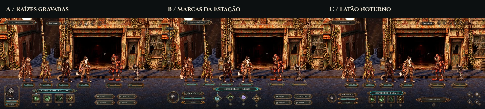
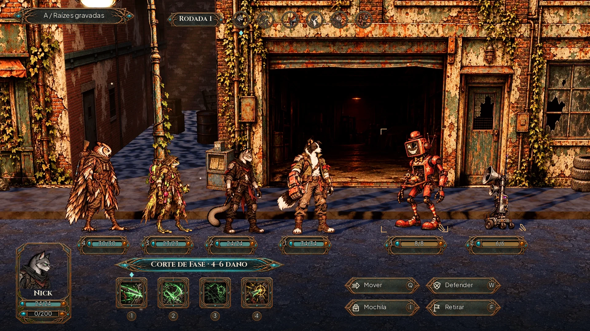
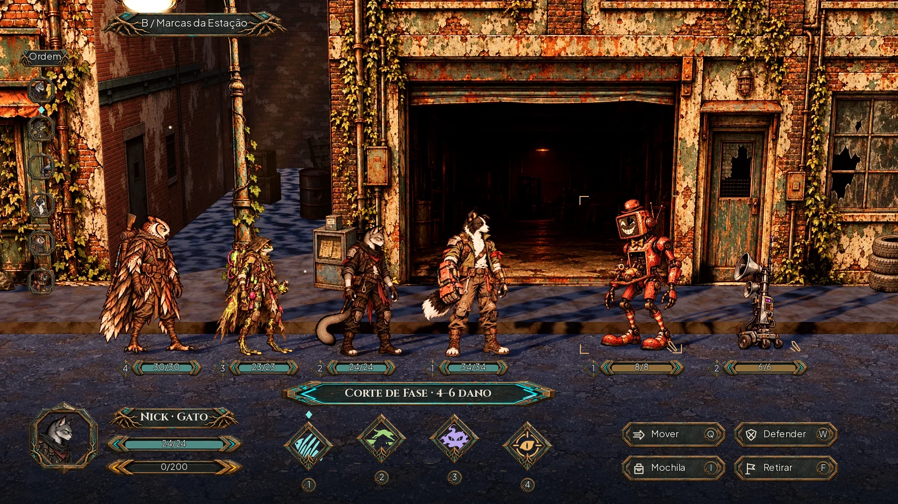
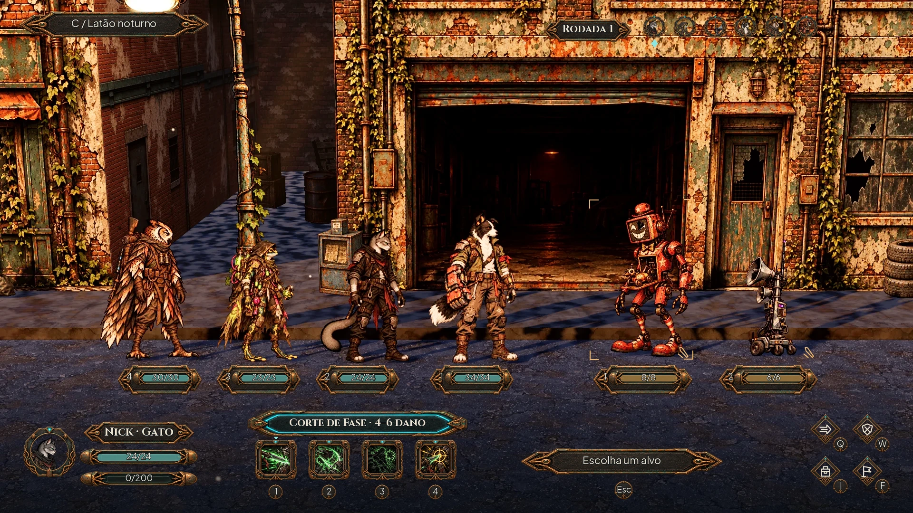

# Três variações de HUD — escolha de direção

Estudos pedidos pelo Lucas depois da prancha do kit v2. **Direção visual escolhida pelo Lucas: C — Latão noturno (25/10/2026).** A aprovação da direção não significa que a interface já esteja integrada. Estas são três composições de combate para comparar a linguagem em uso; o foco atual é consolidar somente a HUD. Os ícones do Nick ficam preservados como possibilidade futura.

**[Comparar A, B e C em tamanho completo](hud-variations/comparison.webp)**

| Opção | Linguagem | Distribuição |
|---|---|---|
| [A — Raízes gravadas](hud-variations/hud_a.webp) | Cobre fino, linhas duplas, raízes gravadas e pequenos pontos de luz. A mais ornamentada. | Carta vertical de Nick; iniciativa central no alto; habilidades quadradas, ações agrupadas à direita. |
| [B — Marcas da Estação](hud-variations/hud_b.webp) | Bordas angulares, losangos e glifos coloridos em silhueta. A mais gráfica. | Iniciativa vertical na esquerda; retrato separado das barras; quatro habilidades em losango, com as centrais mais altas. |
| [C — Latão noturno](hud-variations/hud_c.webp) | Latão contido, superfície escura, encaixes pequenos e pouco ornamento. A mais discreta. | Iniciativa no alto à direita; identidade e habilidades compactas embaixo; ações em quatro pequenos losangos. |

**[Consolidação da C: peças, estados e medidas](hud-c.md)**. As imagens abaixo preservam os estudos de escolha.

## A — Raízes gravadas

O cobre desenha os limites, sem voltar aos tubos pesados da primeira prancha. A carta dá presença ao personagem ativo. As raízes substituem filigranas religiosas; ciano destaca a habilidade em foco. Tem maior presença decorativa e uma carta mais alta na borda.

## B — Marcas da Estação

O foco são os símbolos: corte, salto, sombra e mira têm glifos próprios, mantendo a leitura pela forma. A ordem de turno sai do centro e vai para a lateral. O custo visual é ocupar uma coluna à esquerda; o benefício é abrir o alto da cena e separar bem as quatro habilidades.

## C — Latão noturno

A estrutura fica próxima das bordas e o cenário recebe mais espaço. Os ícones de habilidade continuam ilustrados como os atuais; molduras e botões perdem a maior parte da ornamentação. O detalhe da ação aparece ao escolher/focar. Os controles de ação precisam de dica no foco na futura versão interativa.

## O que é igual para comparar

Mesmo [frame real sem HUD](loop-screens/before/combat_clean.webp), mesma câmera, atores, vida, posições, iniciativa e turno de Nick. Nenhum cenário ou personagem da luta foi redesenhado. Os retratos canônicos foram reutilizados, inclusive no detalhe do ator. A parte inferior recebe apenas uma vinheta gradual para leitura; não existe faixa preta opaca de ponta a ponta.

As três propõem o mesmo estado de foco de **Corte de Fase**, com **4–6 de dano**, e Recreador apontado. Esse foco é composto para estudar a UI; não é a captura de uma interface nova já implementada. A moldura de mira usa cantos, o ator atual e a habilidade escolhida usam losangos. Vida da equipe em ciano e das máquinas em âmbar; zero de Instinto mantém o tubo vazio. Contorno luminoso não é preenchimento de barra.

| Unidade | Vida | Posição |
|---|---|---|
| Bento |34/34|1|
| Nick |24/24|2|
| Íris |23/23|3|
| Véspera |30/30|4|
| Recreador |8/8|1 inimiga|
| Emissor de Comando |6/6|2 inimiga|

Iniciativa: Nick → Íris → Emissor → Bento → Véspera → Recreador, conforme [metadados da captura](loop-screens/before/combat.json). O número junto à vida é a **posição**, não o nível. Dados de combate e ids não mudam. Na B, a cor de função dos quatro glifos é uma exploração visual; os desenhos diferem mesmo sem cor. O nome completo da habilidade permanece no foco.

## Medidas dos estudos

Base1920×1080. Tipografia existente: Plus Jakarta Sans no corpo e Cinzel nos nomes, turno e habilidade em foco; mínimo18, nomes/captions20–24. [Composição com coordenadas, recortes e hashes](hud-variations/composition.json). São medidas das propostas para escolha, não o contrato final do kit.

| Peça | A | B | C |
|---|---|---|---|
| Iniciativa |6 retratos64, passo80, origem(752,32)|6 retratos64, passo82 vertical, origem(56,160)|6 retratos48, passo64, origem(1352,32)|
| Identidade do ator |carta184×264 em(48,792), retrato152×132|medalhão160 em(56,856), nome/barras à direita|medalhão112 em(48,896), nome/barras à direita|
| Habilidades |104×104, passo136, início(376,904)|120×120, passo156, início(600,896), duas centrais sobem16|88×88, passo112, início(536,924)|
| Foco da habilidade |plaqueta560×48 em(368,840)|plaqueta588×56 em(600,816)|plaqueta464×56 em(520,864)|
| Ações |quatro botões248×56,2×2|quatro botões224×56,2×2|quatro losangos64,2×2|
| Vida sob os atores |plaquetas176×64 /208×64 inimigas|losango40 com posição e vidro compacto|plaquetas176×64 /208×64 inimigas|
| Teclas |moeda32 (Esc40), independente|moeda32 (Esc40), independente|moeda32 (Esc40), independente|

Os recortes dos estudos são ajustados à composição. Depois de escolher a direção, ornamentos/capas não serão esticados: o kit final precisa de peças de canto separadas, trilhas/preenchimentos/reflexos independentes, métricas de9-slice e estados completos. Texto Maior, toque, daltonismo e foco de cada controle serão fechados nesse kit; esta rodada não certifica esses fluxos interativos.

## Provas de leitura e QA

- A: [40%](hud-variations/hud_a_40.webp) / [cinza](hud-variations/hud_a_gray.webp).
- B: [40%](hud-variations/hud_b_40.webp) / [cinza](hud-variations/hud_b_gray.webp).
- C: [40%](hud-variations/hud_c_40.webp) / [cinza](hud-variations/hud_c_gray.webp).
- [Glifos da B em22/32 sobre fundo claro e escuro](hud-variations/glyph_readability.webp).

QA conforme [checklist](qa.md), com o alcance de **comparação de direção visual**, após a persona designer montar os estudos.

### Rodada1 — VEREDITO: REPROVADO

| Arquivo | Problema | Gravidade | Correção |
|---|---|---|---|
| `hud_a.webp` | Carta encostava na placa de vida da Véspera; plaqueta de habilidade disputava o espaço com a marca de seleção. | Média | Estreitar a carta para184; separar a plaqueta e o primeiro slot. |
| `hud_b.webp` | Os mesmos ícones ilustrados de A/C não mostravam a proposta de glifos em silhueta. | Média | Criar os quatro símbolos próprios e limpar o alfa dos recortes. |
| `glyph_readability.webp` | Ciano e verde claros perdiam contraste no fundo claro da prova. | Média | Aplicar tinta escura da mesma família nesse fundo, conservando a silhueta. |
| Conjunto | Sem referência explícita de turno/foco, a comparação poderia parecer mudança de regras entre opções. | Média | Manter um snapshot e documentar ator, ordem, valores e foco idênticos. |

### Rodada2 — VEREDITO: APROVADO para apresentação das três alternativas

Revisadas as três em1920×1080, a40% e em cinza: formas, hierarquia, espaço da cena, contraste, retratos/ícones existentes e glifos novos. Na prova em fundo claro, os glifos recebem tinta escura da mesma família para manter contraste; em jogo aparecem sobre os encaixes escuros. Ciano/âmbar são acompanhados por lados, retratos e marcas; os quatro glifos de B se distinguem por silhueta. Textos e números dentro do canvas, mínimo18; nada de código de jogo ou ids alterados. Carta de A já não invade a placa da Véspera. Sem problema alto ou médio pendente no alcance dos estudos.

A redução mostra a hierarquia, as habilidades e o alvo; texto de detalhe não foi declarado adequado para jogar em um celular a40%. A escolha precisará passar pela etapa própria de toque/texto Maior antes de produção. Após esta QA, **Lucas escolheu C**. A revisão técnica não aprova a #96 completa.

Godot4.7.2: **43/43 testes**, **48/48 lutas de paridade** (3351 passos), saída0 em234,112s. Permanecem avisos de recursos/RID/ObjectDB no encerramento. Só `docs/`, sem alteração em `scripts/`, `data/`, `tests/` ou artes de runtime. Referências privadas e PNG mestres fora do Git; entrega em WebP e `docs/.gdignore` preservado.

## Reprodução e decisão

`python docs/design/hud-variations/compose.py` (Pillow, numpy e CairoSVG) refaz os três HUDs usando os estudos WebP e os assets já versionados. O mestre PNG externo não é necessário. `skin_a/b/c.webp` e `skill_glyphs.webp` são estudos de composição, **não um atlas para integrar**. O manifesto registra origem do frame e coordenadas das peças; as molduras são originais e não recortes das referências do Lucas.

Lucas escolheu **C — Latão noturno**. Consolidar somente a HUD nesta direção. Guardar os ícones do Nick como opção futura, sem substituir ou integrar conjuntos agora; A/B e seus estudos permanecem como referência. As caixas da carga já aprovadas permanecem.
