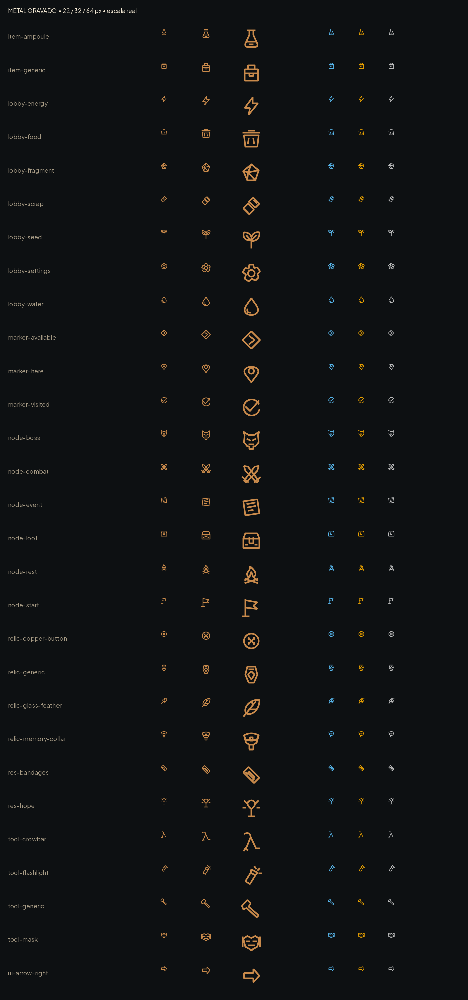

# Ícones de metal gravado — #17

29 SVG substituídos com os mesmos nomes. Referências: cards pintados da Estação, ferragens dos beliches e paleta de AHUiStyle. A silhueta é estampada; os cortes internos sugerem gravação sem ruído que desapareça em 22 px. Os nomes legados com hífen são preservados conforme a issue.

- Canvas/viewBox: 32 × 32; âncora central (16,16); sem 9-slice.
- Uso: 22/32 px; 64 px para inspeção. Traço 2,4 unidades; caixa útil [1,2]–[31,30], variável conforme a silhueta. Reserva recomendada de 4 px ao redor no HUD; distância do rótulo 8 px.
- Branco puro, sem fundo, sem texto e sem cor semântica embutida. O HUD aplica cobre, dourado ou cor de estado.
- As três colunas finais mostram azul/laranja do modo daltonismo e cinza, a 22 px. Identidade por forma: semente, água, comida, energia e fragmento têm contornos diferentes.
- Legendas são apenas da prancha; os assets não contêm texto.

## QA de design

Rodada 1 — VEREDITO: APROVADO. Conferidos SVG monocromático, nomes preservados, leitura rasterizada em 22/32/64 px e azul/laranja/cinza. Sem problemas altos ou médios. Observação baixa: os detalhes das relíquias são secundários em 22 px; a silhueta permanece distinta. Integração e avaliação no HUD ficam com Claude (#16).
