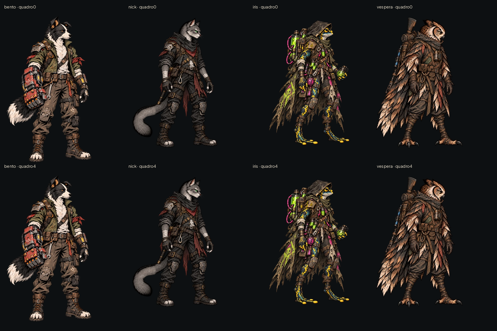
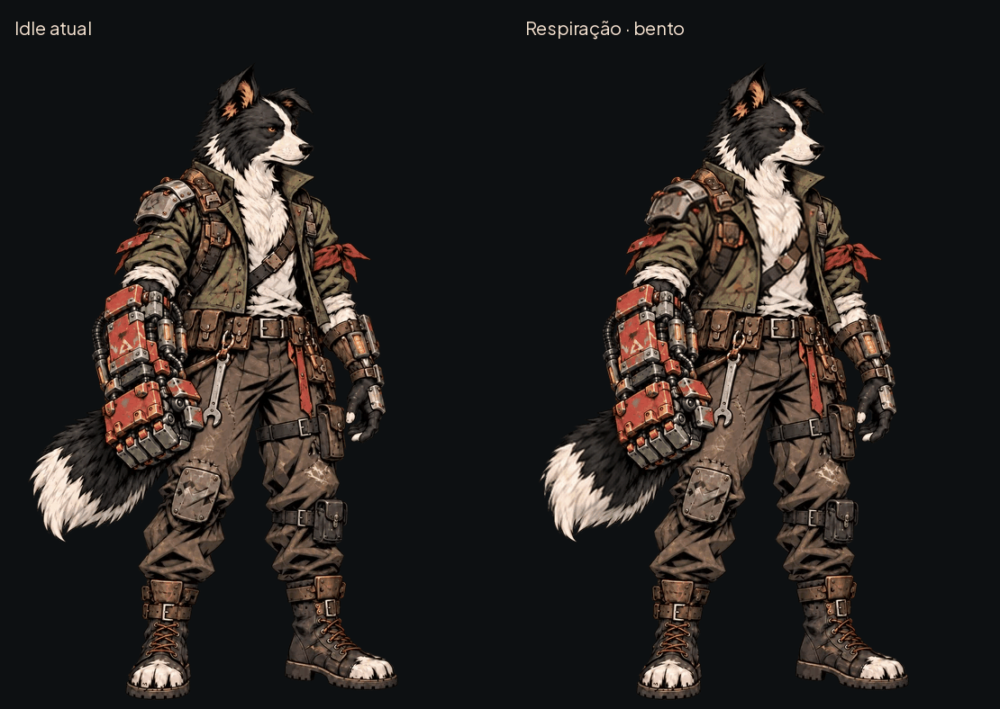
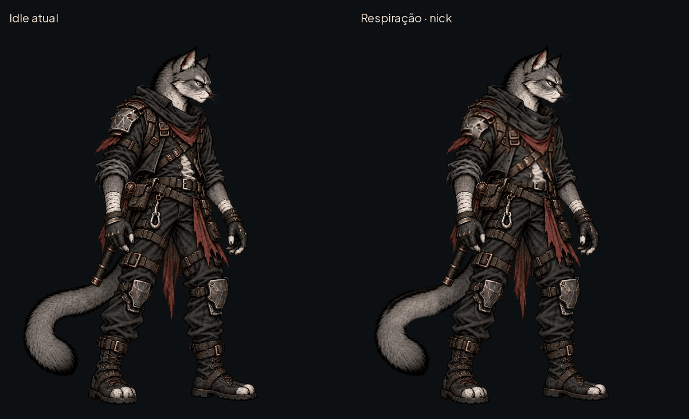
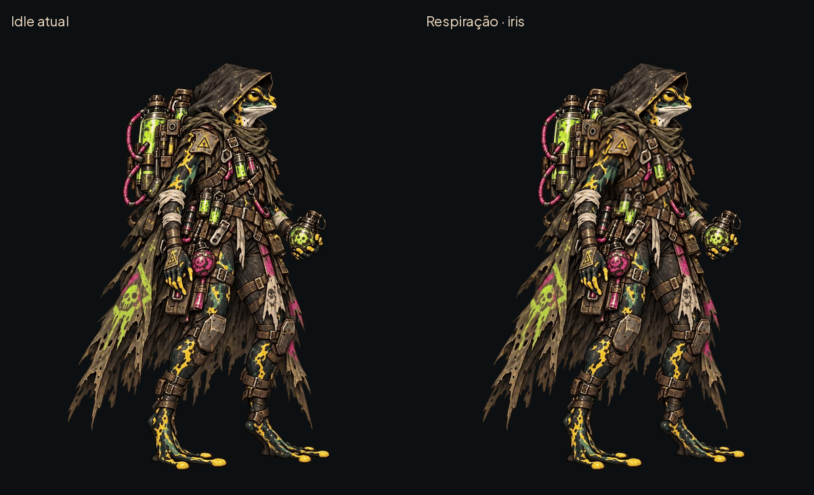
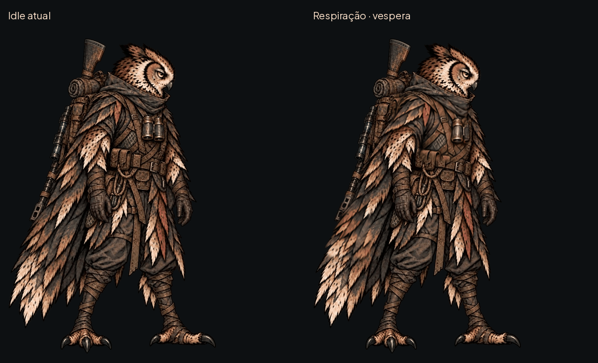

# Respiração dos quatro fundadores — #40

## Prévias em loop

### bento

### nick

### iris

### vespera

## Arquivos e medidas

Quatro PNG RGBA em art/combat/heroes/<herói>/idle_breathing.png. Oito quadros, grade4×2, leitura da esquerda para direita e depois segunda linha,4fps, duração2s por ciclo. Quadro inteiro, sem recorte automático por alfa; nenhuma margem extra entre células. Sem9-slice. Os arquivos idle.webp e o manifesto atual ficaram intactos.

| Herói | Quadro real px | Folha px | Âncora local px | Referência de corpo px |
|---|---|---|---|---|
| bento | 543×724 | 2172×1448 | (236.50, 714.50) | 709.50 |
| nick | 589×668 | 2356×1336 | (244.25, 643.00) | 627.50 |
| iris | 589×668 | 2356×1336 | (293.75, 632.00) | 604.00 |
| vespera | 589×668 | 2356×1336 | (225.50, 648.50) | 635.50 |

As âncoras e referências são as do manifesto atual multiplicadas pela razão entre a largura da textura atual e o canvas original(0,5). Conservar os meios/quartos de pixel: não arredondar ao centro geométrico. Nick/Íris/Véspera têm altura original1335px e textura668px por arredondamento da conversão; não usar a razão vertical para recalcular a âncora.

AHSpriteCard usa coordenadas reais da textura quando há frames; portanto a futura entrada da folha precisa destas medidas locais e body_reference_pixels reduzido, sem aplicar outra divisão por2. O canvas da folha é a dimensão total acima. Os rects(x,y,w,h) são:

- bento: `[[0, 0, 543, 724], [543, 0, 543, 724], [1086, 0, 543, 724], [1629, 0, 543, 724], [0, 724, 543, 724], [543, 724, 543, 724], [1086, 724, 543, 724], [1629, 724, 543, 724]]`.
- nick: `[[0, 0, 589, 668], [589, 0, 589, 668], [1178, 0, 589, 668], [1767, 0, 589, 668], [0, 668, 589, 668], [589, 668, 589, 668], [1178, 668, 589, 668], [1767, 668, 589, 668]]`.
- iris: `[[0, 0, 589, 668], [589, 0, 589, 668], [1178, 0, 589, 668], [1767, 0, 589, 668], [0, 668, 589, 668], [589, 668, 589, 668], [1178, 668, 589, 668], [1767, 668, 589, 668]]`.
- vespera: `[[0, 0, 589, 668], [589, 0, 589, 668], [1178, 0, 589, 668], [1767, 0, 589, 668], [0, 668, 589, 668], [589, 668, 589, 668], [1178, 668, 589, 668], [1767, 668, 589, 668]]`.

## Construção e limites

Os desenhos de respiração foram gerados a partir de cada idle. Na montagem, as células foram registradas na caixa visível da referência e só os recortes de peito/ombro e uma pequena área de cauda/capa entram no resultado. Todo o resto permanece o idle original, inclusive pés e cabeça. Não é deslocamento do sprite inteiro, nem novo código de balanço. A volta reutiliza os desenhos em ordem inversa para não cortar o loop numa pose diferente.

O movimento é deliberadamente pequeno: a folha conserva a silhueta base, a roupa muda dentro das regiões permitidas. Pode não ser perceptível abaixo do tamanho normal do personagem; não ampliar amplitude global nem mover pés para compensar. A resolução de origem dos recortes gerados é menor que o quadro final; não alegar detalhe nativo adicional. O GIF usa fundo opaco para evitar limitações de transparência/paleta do formato. Os PNGs mantêm alfa.

## Integração pelo Claude

Não alterei scripts/,data/ ou tests/. Registrar a folha pela tabela da ferramenta, preservar ids e as coordenadas acima; quando ela existir, retirar o balanço por código, sem somar as duas animações. O fallback deve continuar o idle estático atual. Não executar a sincronização global para importar apenas esta entrega sem revisar o que ela regrava. Nenhuma pose da #13 foi tocada.

## QA de design

A avaliação é registrada após inspeção das folhas e dos loops.

Rodada 1 — VEREDITO: REPROVADO. Alta: folhas geradas sem registro comum apresentavam variação de enquadramento e movimento nos pés/cabeça. Sugestão: registrar as células e restringir a montagem às áreas de respiração. Correção: regiões animadas recortadas e registradas sobre o idle original; fora delas os pixels não mudam.

Rodada 2 — VEREDITO: REPROVADO. Média: `idle_breathing_preview.png` cortava a parte inferior do Bento na segunda linha. Correção: altura da prancha ampliada para1600px, sem mudar quadros/folhas.

Rodada 3 — VEREDITO: APROVADO. Conferidos os quatro personagens lado a lado com os idles, oito quadros e GIFs de2s, canvas e medidas de âncora preservados. Verificação binária: faixa inferior20% de todos os quadros idêntica ao idle original; faixa da cabeça acima das áreas animadas também idêntica. Regiões de mudança limitadas ao peito/ombros e cauda/capa. Nenhum id, fonte idle ou pose da #13 foi alterado. Sem problema alto/médio restante. Observação baixa: movimento sutil e pequenas variações de textura nos recortes desenhados; conferir no tamanho final na Estação/arena ao integrar, sem somar balanço por código. Esta aprovação é da arte/montagem, não do comportamento de integração.

## Validação desta entrega

Godot4.7.2 importou as quatro folhas; `tests/run_all.gd` executou21 testes e reportou21/21 aprovados, incluindo a jornada completa e48/48 lutas de paridade. O processo terminou com código0, mas o log também registrou erros de chamadas diferidas `_restyle` ao desmontar cenas e recursos/RIDs retidos no encerramento. Não houve alteração no código de estilo/navegação; a triagem desses registros fica com Claude. Isso não é uma afirmação de execução sem mensagens de erro.
