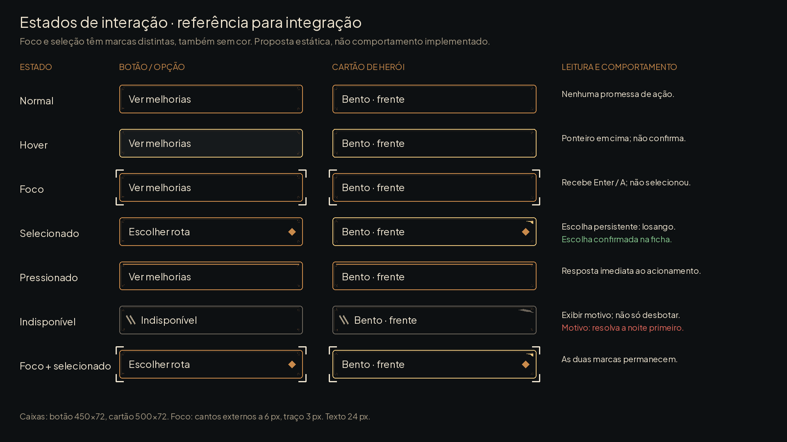
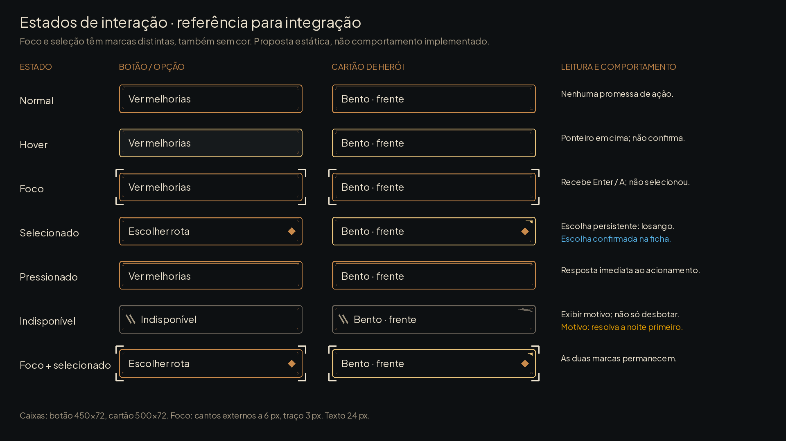
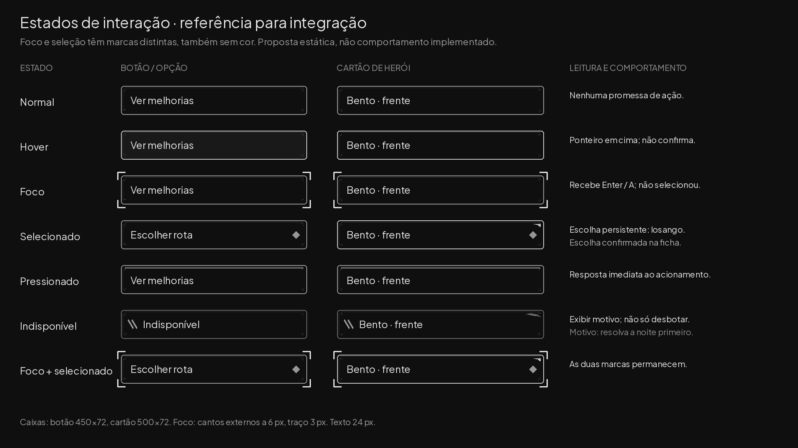
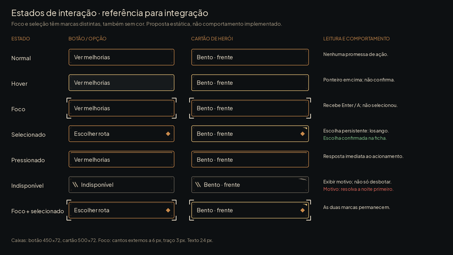

# Foco, seleção e bloqueio — #25

Complemento das #20/#21 para integração nas #5/#16. São propostas estáticas com as molduras existentes; nenhum asset anterior foi substituído. As legendas e os rótulos pertencem à documentação, nunca às texturas do jogo.

## O que cada marca comunica

| Estado | Forma além da cor | Significado |
|---|---|---|
| Normal | filete simples | comando disponível |
| Hover | moldura button_hover | ponteiro está sobre o alvo |
| Foco | quatro cantos externos claros | destino atual do teclado/gamepad |
| Selecionado | losango interno + canto de ability_selected | escolha persistente |
| Pressionado | filete interno de button_pressed | retorno imediato do acionamento |
| Indisponível | dois riscos + motivo textual | comando não pode executar |
| Foco + selecionado | cantos externos e losango juntos | foco e escolha coexistem |

Seleção persistente só para opções e cartões selecionáveis. Botão de comando comum não fica selecionado depois do clique. Foco nunca altera equipe nem consome item. Hover não tem informação exclusiva: toda dica necessária deve aparecer também no foco. A posição da marca de foco não deve causar deslocamento do conteúdo.

## Medidas para Claude

Canvas da prancha1920×1080, origem topo esquerdo(0,0), sem9-slice na proposta. Botões450×72, cartões500×72; conteúdo com inset24px horizontal e18px vertical, fonte24px. Em Texto Maior usar31px e permitir quebra/altura dinâmica; não encolher rótulo para caber.

Foco: quatro cantoneiras externas, distância6px da borda, traço3px, braços18px. Reservar16px no container para não recortar o foco. Seleção: losango18×18, centro28px antes da borda direita; reservar48px para a marca. Não usar o mesmo losango para indicar foco. Cantoneiras não são nova textura de jogo: especificação para desenho/StyleBoxOverlay pelo Claude. Molduras continuam usando9-slice16px e conteúdo da #20.

Na navegação: mover foco para o primeiro comando pertinente ao abrir modal; restaurar ao botão de origem ao fechar; motivo de indisponibilidade deve estar alcançável como informação mesmo que o comando não aceite ativação. Isso é orientação de UX, não implementação. Não decidir automaticamente qual item ou aliado o jogador deve escolher.

Celular: alvo recomendado mínimo48×48 pixels lógicos do dispositivo, não48px do canvas1920×1080; espaçamento mínimo8px lógicos. O layout de integração precisa converter escala, safe area e densidade. A redução40% verifica hierarquia e marcas, não promete legibilidade de todos os rótulos ou conformidade física de toque.

## Contraste medido

Razão de luminância sRGB sobre #0d1012, cores opacas; o jogo deve evitar fundo transparente atrás do texto.

| Cor | Razão |
|---|---|
| #efe5d1 | 15.27:1 |
| #a69a84 | 6.89:1 |
| #c98a4b | 6.56:1 |
| #e9c47c | 11.5:1 |
| #e2675b | 5.75:1 |
| #e69f00 | 8.48:1 |
| #86c98f | 9.79:1 |
| #56b4e9 | 8.27:1 |

Azul/laranja são as cores aprovadas, não simulação clínica de deficiência de visão. Cinza remove a distinção de matiz: cantos e losango ainda identificam foco/seleção. A prancha inclui mensagens junto dos alertas para não depender da cor.

## QA de design

A avaliação visual desta entrega é registrada depois da inspeção das pranchas.

Rodada 1 — VEREDITO: REPROVADO.

- Alta — `interaction_states_preview.png`: o glifo matemático de diferença não era renderizado corretamente pela fonte local e invertia a leitura da frase. Correção: frase por extenso, sem glifo especial.
- Média — cartão pressionado não tinha retorno visual distinto; hover de cartão também ficava igual ao normal. Correção: hover com borda dourada e pressionado com filete interno e texto deslocado 2 px, sem trocar assets da #20.

Rodada 2 — VEREDITO: APROVADO. Pranchas inspecionadas em escala real, cinza e 40%; foco e seleção conservam marcas diferentes. Contrastes calculados sobre fundo opaco, todas as cores textuais da prancha acima de 4,5:1. Sem problemas altos ou médios restantes. Observação baixa: só a integração pode confirmar foco real, ordem de navegação e alvos físicos em dispositivo; esta entrega especifica a aparência.
