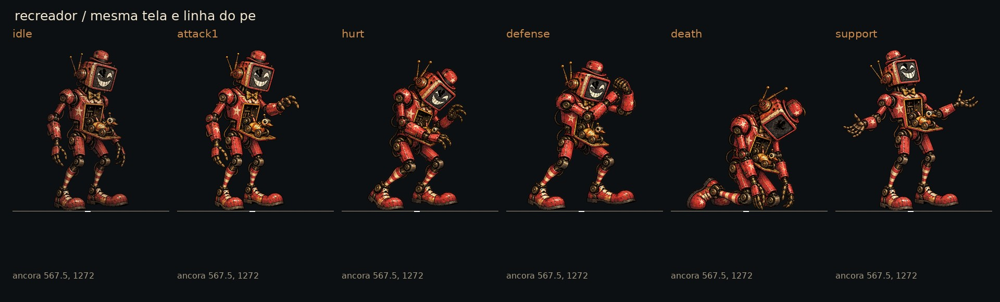
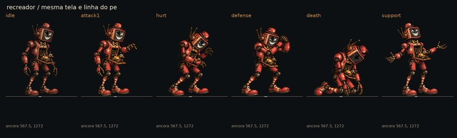
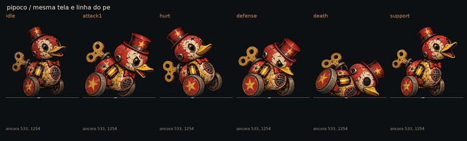
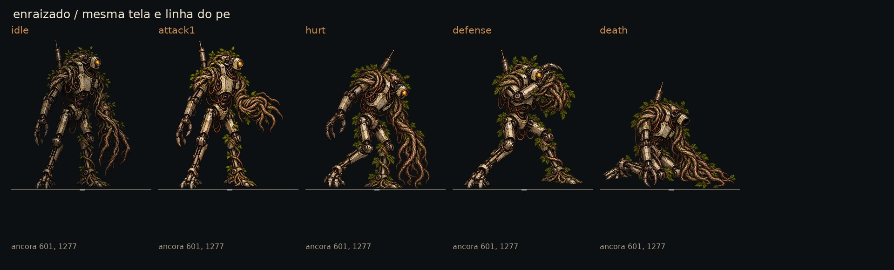
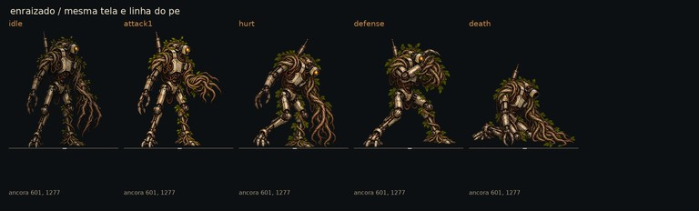
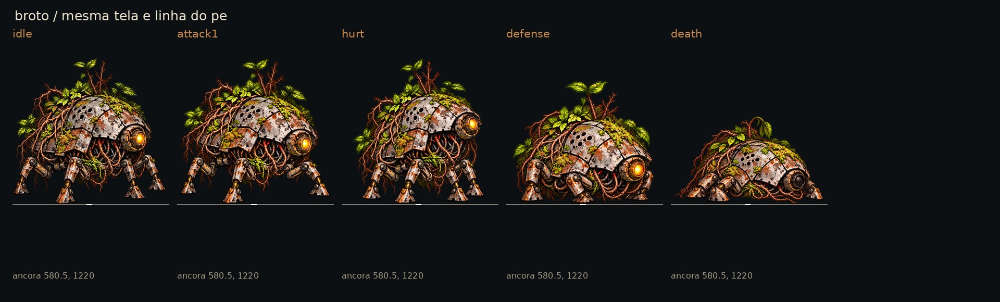
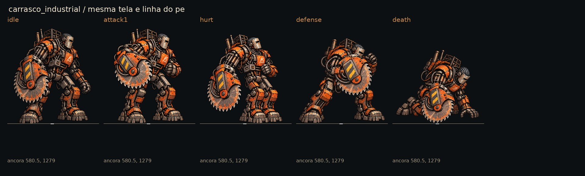
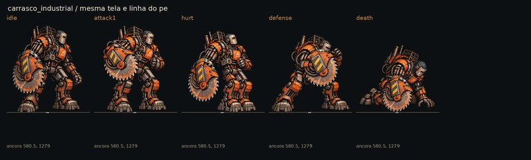
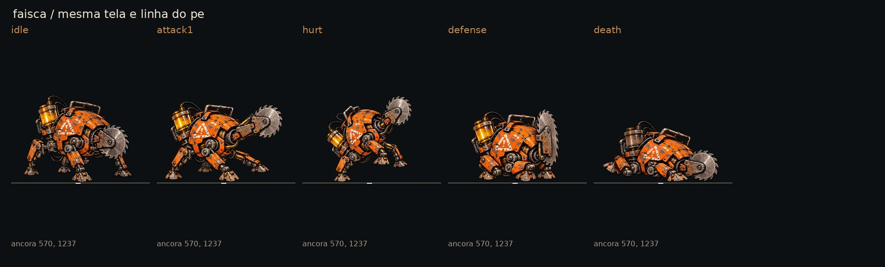
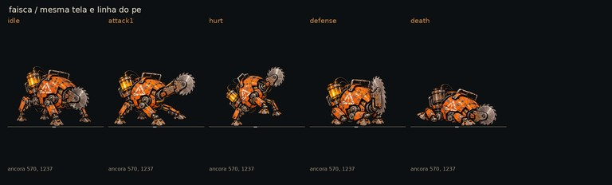

# Poses de combate dos vilões do John — #44

Entrega para integração pelo Claude. Seis personagens, **26 PNGs RGBA de 1178 × 1335 px**, voltados à direita: `attack1`, `hurt`, `defense`, `death` para todos e `support` para Recreador e Pipoco. Fontes em `art/combat/source/john/`; os nomes com hífen seguem o pedido da issue. A pasta tem `.gdignore`: fontes não são importadas nem exportadas como texturas do jogo.

## Referência e decisões

A referência visual é o idle aprovado que já existe em `art/combat/enemies/<id>/idle.webp`. Sua cópia local de 589 × 668 foi ampliada para comparação; ela não recupera detalhe da fonte original. Consultados apenas os textos README/DECISIONS de [John, 09/10](https://github.com/lucasyemz/After-Humans/tree/main/Docs/Art/Concepts/john-2026-10-09), pela API. Nenhum projeto ou imagem da Unreal foi baixado ou alterado.

As poses foram geradas com os idles como referência, separadas pelo alfa, limpas de partículas e registradas na tela de origem. Pintura envelhecida, tinta descascada, ferrugem, cabos e assimetrias preservados como direção. São ilustrações novas: não são extrações de animações antigas. Não há texto de interface, chão, sombra ou VFX incorporado aos PNGs. Estrelas, rosto da TV e sinal industrial pertencem ao desenho original.

- Recreador: alcance curto de pega-pega, recuo, antebraços em guarda e colapso ajoelhado; apoio apresenta a risada da TV e o brinquedo no peito.
- Pipoco: inclinação de avanço nas rodas, recuo, cabeça recolhida e derrota tombada; apoio abre o bico para a buzina **sem dano**, não deve disparar o ataque de avanço.
- Enraizado: braço de raízes armado em curva curta, recuo, guarda cruzada e colapso ajoelhado; sem inventar efeitos de controle ainda não integrados.
- Broto: avanço baixo, recuo, casco recolhido e patas dobradas na derrota; continua apenas com ataque básico.
- Carrasco Industrial: corte com a única serra, recuo, guarda com a proteção da serra e queda ajoelhada.
- Faísca: serra projetada, recuo, serra em guarda e colapso com reservatório apagado; quatro patas, sem rosto ou braços humanos.

Não há `attack2`: nenhum segundo golpe foi pedido para o kit atual. Os dois apoios usam `support`. A direção ajoelhada de Íris/Véspera (#13) e o Auto Sprite (#40) não são alterados nesta entrega.

## Medidas para integração

Origem `(0,0)` no canto superior esquerdo. Tela e área de textura **1178 × 1335**, uma imagem por pose, sem atlas ou 9-slice (margens de 9-slice: não se aplica). Sem recortar automaticamente ao converter. Âncora, linha do chão e altura de referência devem ser **as do idle**, para todas as poses, inclusive a derrota: medir a altura menor da derrota como um corpo novo faria a imagem crescer indevidamente. As poses agachadas mudam a altura aparente, não a unidade de escala do manifesto.

| Id | Âncora x,y (px) | Altura de referência (px) | Textura convertida a 50% |
|---|---|---|---|
| `recreador` | 567.5, 1272 | 1222 | 589 × 668 |
| `pipoco` | 533, 1254 | 1148 | 589 × 668 |
| `enraizado` | 601, 1277 | 1261 | 589 × 668 |
| `broto` | 580.5, 1220 | 1102 | 589 × 668 |
| `carrasco_industrial` | 580.5, 1279 | 1236 | 589 × 668 |
| `faisca` | 570, 1237 | 747 | 589 × 668 |

A largura é o fator de escala usado pelo `AHSpriteCard`: `589 / 1178 = 0,5`. Não usar `668 / 1335` para recalcular a âncora. Converter uma vez por `tools/sync_combat_art.py`; a ferramenta ainda precisa ser adaptada pelo Claude para ler estas fontes. O `gallery_enemies()` atual só conhece o idle. Ao integrar, gravar as medidas fixas acima, sem chamar `measured()` separadamente para cada reação.

Não modificar ids. Para cada personagem, `<id>-attack1.png` vai para a pose `attack1`, e assim sucessivamente. O apoio do Pipoco representa `pipoco.buzina_irritante`; o do Recreador representa `recreador.risada_gravada`. Arquivos de leitura aprimorada da #45 são variantes explícitas `*-readable.png`; preferi-los para os três ajudantes, conforme a página correspondente.

## Pranchas

Cada coluna mostra a **mesma tela**, com a mesma redução; não há ajuste individual para preencher a célula. Linha horizontal = âncora no chão. O idle está sempre à esquerda; versões de 40% testam o reconhecimento geral, sem pretender que as legendas técnicas sejam texto de jogo.

### recreador

### pipoco

### enraizado

### broto

### carrasco_industrial

### faisca

## Limites de conteúdo

Bounds abaixo são apenas a área visível (`alfa > 24`, direita/base exclusivas), **não** áreas para recorte nem novas âncoras. A área de conteúdo é a silhueta; todo o restante é transparente. Não desenhar nome, barra ou seleção dentro da textura.

| Arquivo em `art/combat/source/john/` | Bounds x0,y0,x1,y1 |
|---|---|
| `recreador-attack1.png` | 210, 52, 926, 1270 |
| `recreador-hurt.png` | 189, 127, 944, 1269 |
| `recreador-defense.png` | 154, 127, 982, 1267 |
| `recreador-death.png` | 114, 323, 1021, 1268 |
| `recreador-support.png` | 53, 52, 1082, 1270 |
| `pipoco-attack1.png` | 25, 202, 1153, 1251 |
| `pipoco-hurt.png` | 45, 109, 1020, 1250 |
| `pipoco-defense.png` | 24, 282, 1042, 1250 |
| `pipoco-death.png` | 23, 524, 1155, 1251 |
| `pipoco-support.png` | 22, 108, 1092, 1252 |
| `enraizado-attack1.png` | 145, 18, 1057, 1275 |
| `enraizado-hurt.png` | 150, 95, 1051, 1273 |
| `enraizado-defense.png` | 90, 96, 1110, 1273 |
| `enraizado-death.png` | 23, 364, 1154, 1273 |
| `broto-attack1.png` | 22, 120, 1154, 1218 |
| `broto-hurt.png` | 85, 120, 1076, 1218 |
| `broto-defense.png` | 46, 287, 1113, 1216 |
| `broto-death.png` | 23, 552, 1155, 1216 |
| `carrasco_industrial-attack1.png` | 124, 45, 1036, 1277 |
| `carrasco_industrial-hurt.png` | 90, 119, 1070, 1277 |
| `carrasco_industrial-defense.png` | 24, 166, 1154, 1276 |
| `carrasco_industrial-death.png` | 41, 319, 1119, 1274 |
| `faisca-attack1.png` | 62, 538, 1077, 1235 |
| `faisca-hurt.png` | 203, 493, 936, 1235 |
| `faisca-defense.png` | 191, 604, 948, 1235 |
| `faisca-death.png` | 69, 703, 1070, 1234 |

## QA de design

Avaliação em segunda persona com o checklist de [qa.md](qa.md), sem alterar o código do jogo.

**Rodada 1 — VEREDITO: REPROVADO.**

| Arquivo/etapa | Problema | Gravidade | Correção |
|---|---|---|---|
| Recreador/Enraizado, ataque bruto | Alcance lateral exigia reduzir demais o corpo para caber na tela. | Alta | Gerar ataques compactos individuais com cotovelo/raízes recolhidos, registrar novamente. |
| Broto/Carrasco, ferido bruto | Pés/mão encostavam na borda da folha gerada; risco de truncamento ao recortar. | Alta | Gerar reações individuais completas com folga. |
| Folhas brutas | Grade não exata e partículas destacadas. | Alta | Separar pelos componentes do alfa, remover detritos, exportar uma pose por PNG e manter a tela pedida. |
| Derrotas, primeira prancha | Normalização pela altura agachada diminuía demais as peças. | Média | Corrigir escala óptica comparando cabeça/casco/serra ao idle; manter referência fixa no manifesto. |

**Rodada 2 — VEREDITO: REPROVADO.** `carrasco_industrial-attack1.png` (alta) e `broto-attack1.png` (média): peças menores na prancha em relação ao idle, pois a ação larga ainda limitava a escala. Correção: gerar também esses dois ataques individuais compactos, mantendo torso/casco e ferramenta próximos à posição original. Os 26 PNGs passaram na verificação de tamanho, modo, margens, linha do pé e transparência; essa verificação sozinha não aprovou a arte.

**Rodada 3 — VEREDITO: APROVADO.** Reavaliadas as seis pranchas com idle ao lado, as reduções reais a 40% e a [prova em cinza](john_poses_gray_40.jpg). Ataques compactos, guardas e derrotas distinguíveis pela postura; apoios separados dos golpes. Cabeças/cascos e ferramentas conferidos visualmente contra o idle após as correções. PNGs individuais com alfa limpo, sem truncar membros, tela e linha de chão fixas; medidas e mapeamento documentados. Verificação automática repetida: 26/26 RGBA, 1178 × 1335, margens transparentes, linha do pé até 5 px do valor registrado e RGB zerado fora do alfa. Sem problema alto ou médio aberto.

Ícones a 22/32 px, texto de UI, cor de estados e 9-slice: não se aplicam a estes sprites. A redução a 40% é a prova de silhueta pertinente; as legendas técnicas não são texto de jogo. Observação baixa: variações finas de pincel/textura entre ilustrações novas e o WebP original; conferir as trocas em movimento na QA de integração.

## Verificação técnica

Godot 4.7.2: `tests/run_all.gd`, **21/21 testes passaram**, incluindo paridade **48/48** e jornada completa (60835 ms, código de saída 0). A execução registra erros diferidos de `_restyle` e avisos de ObjectDB/RIDs no encerramento, já presentes na rodada anterior; não são apresentados como execução sem erros. Nenhum arquivo em `scripts/`, `data/` ou `tests/` foi alterado. A QA de integração e a luta completa por vilão cabem ao Claude (#16).
