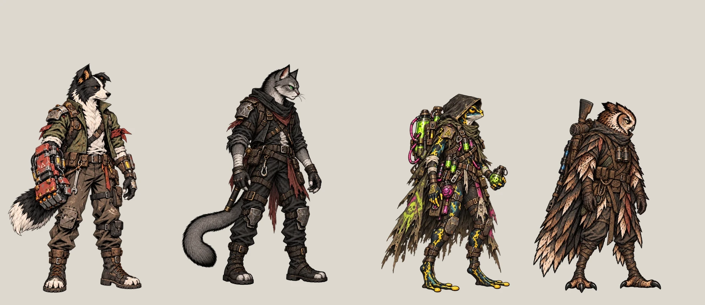
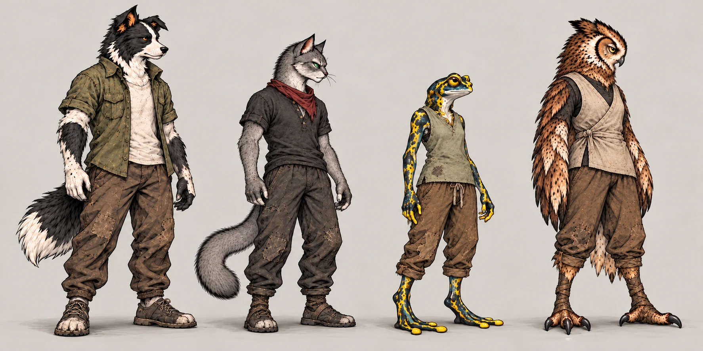
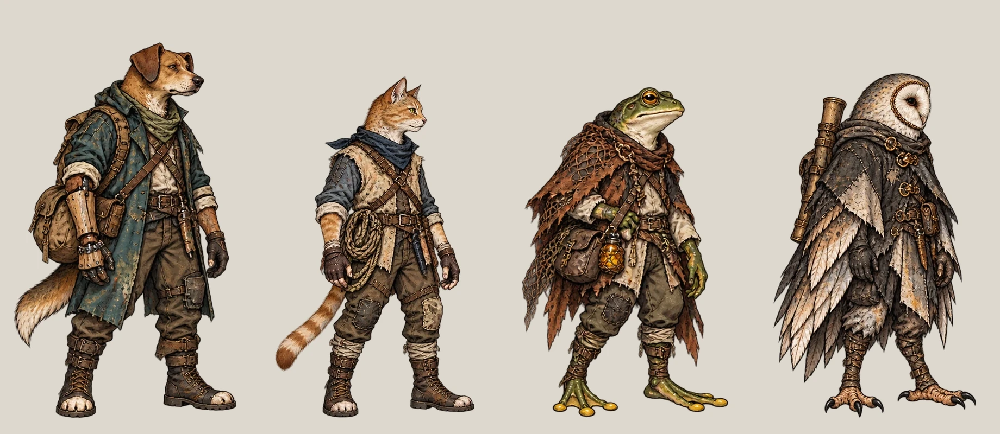
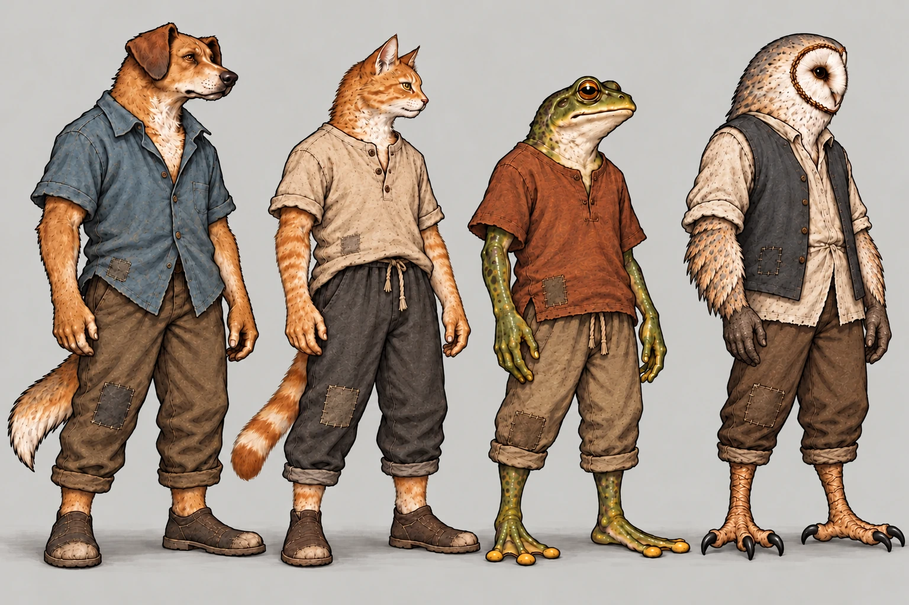
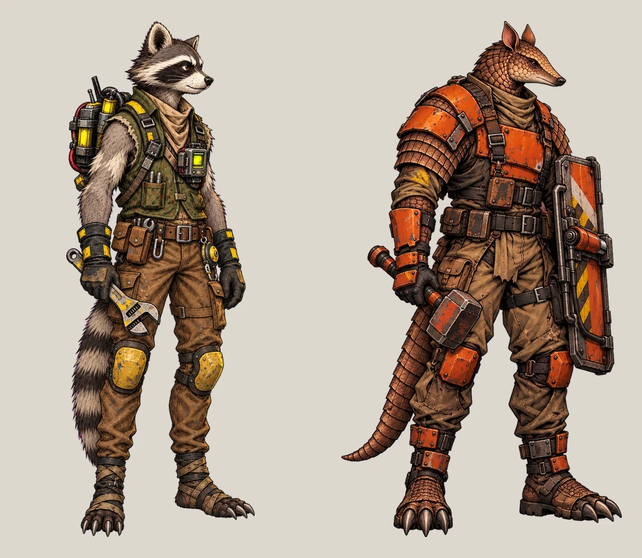
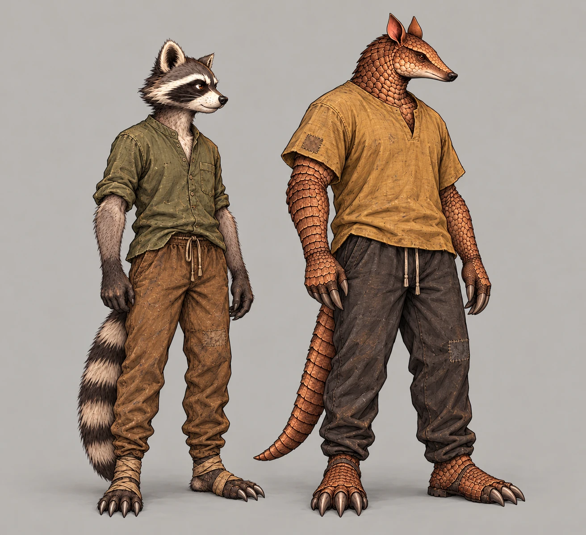
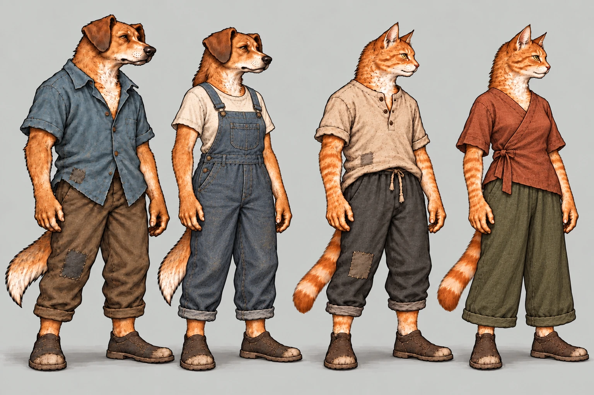
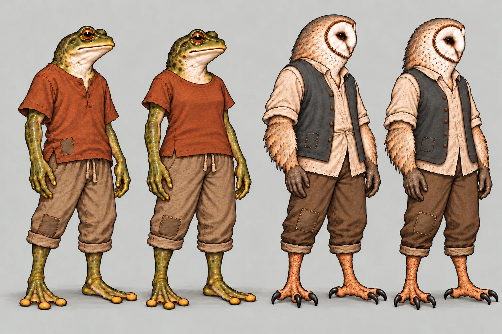
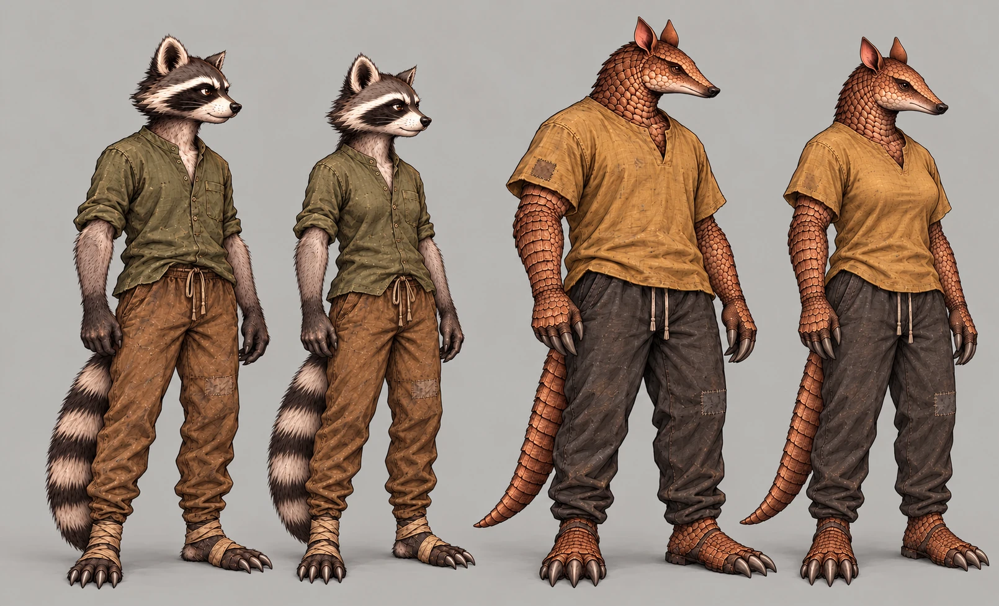

# Roupas confortáveis do lobby — proposta #243

**Lucas aprovou os figurinos dos quatro fundadores e dos seis recrutas após a correção dos braços das corujas.**
As seis versões femininas abaixo têm **roupas próprias**, conforme o novo pedido do Lucas, e ainda aguardam
aprovação antes das poses delas.
Este PR continua sendo de conceito; não integrar as pranchas como sprites.

A pedido do Lucas em 28/10/2026, o estudo de paletas foi cancelado (#242, #239 e PR #240). Esta proposta muda o
vestuário para a vida na Estação: tecido leve, lavado, remendos discretos e poucos acessórios. XCOM 2 é referência
para a separação entre roupa de descanso e equipamento de missão; os desenhos são próprios do After Humans.

## Fundadores

Da esquerda para a direita: **Bento, Nick, Íris e Véspera**.

Roupa original para comparação (arte canônica, não captura de jogo):

| Personagem | Roupa proposta | Identidade preservada |
| --- | --- | --- |
| Bento | Camisa oliva leve aberta, camiseta clara, calça marrom folgada e calçado baixo | Cabeça, peito branco, pelagem preta e branca e cauda; sem o punho equipado |
| Nick | Camiseta carvão com botões, calça confortável e pequeno lenço vermelho | Pelagem cinza, olhos verdes, cauda e lenço; sem lâminas, ombreiras e cintos de carga |
| Íris | Blusa verde-sálvia sem mangas e calça curta de tecido | Pele amarela e azul, mãos e pés anfíbios; sem capuz, capa, tubos e frascos |
| Véspera | Colete cruzado de tecido cru sobre blusa escura e calça curta | Disco facial, penas naturais e garras; sem rifle, binóculos e capa de equipamento |

As duas corujas têm **braços articulados, cotovelos, antebraços, punhos e mãos com dedos**, como nas artes
originais. As penas naturais cobrem ombros e braços, sem substituir as mãos por asas fechadas nem escondê-las.
A roupa do lobby não usa luvas; as duas mãos devem aparecer livres ao lado do corpo. Não acrescentar outro par
de asas ou membros. A capa de equipamento da expedição sai, a anatomia fica. O punho de sucata do Bento foi tratado aqui
como equipamento retirado, conforme a proposta aprovada pelo Lucas.

## Recrutas

Uma roupa por tipo de recruta, mantendo o desenho aprovado. A proposta não reabre o seletor de cores.

Da esquerda para a direita: **cão, gato, sapo e coruja**.

**Guaxinim e Tatu**, usando como referência o redesenho aprovado na #225, não os corpos antigos mais horizontais.

| Tipo | Roupa proposta |
| --- | --- |
| Cão | Camisa azul desbotada, calça marrom confortável e calçado leve |
| Gato | Camiseta de botões cor de tecido cru, calça carvão e calçado leve |
| Sapo | Camisa ferrugem leve, calça curta clara e pés livres |
| Coruja | Colete azul-acinzentado sobre camisa clara, calça curta e garras livres |
| Guaxinim | Camisa oliva de manga dobrada e calça marrom simples; sem rádio, ferramentas e mochila |
| Tatu | Camisa ocre desbotada e calça carvão; sem escudo, martelo e armadura pintada. Escamas naturais ficam |

Não estão incluídos novos figurinos de mercador, civis ou inimigos. Não há seletor de paletas nem novas
variações de pelagem neste pacote.

## Recrutas: versões femininas para aprovação

Lucas autorizou uma versão feminina para cada um dos seis tipos de recruta. Os modelos atuais são a referência
masculina nas comparações. Os figurinos masculinos já aprovados permanecem. Lucas pediu que as versões femininas usem **peças diferentes**,
não apenas as mesmas roupas ajustadas ao corpo. A revisão atual muda a construção e a silhueta do vestuário,
além dos traços do personagem. Não é um seletor de cores.

Todas são personagens adultas. Cão, gato, Guaxinim e Tatu podem ter busto discreto sob tecido opaco e uma silhueta
diferente de ombros/quadril, preservando a espécie e a robustez de cada corpo. Sapo e coruja usam outros traços de
face, corpo e corte, sem seios. São escolhas de desenho para estes indivíduos fictícios, não regras biológicas
universais das espécies.

Não acrescentar equipamento de expedição, joias, maquiagem ou cabelo humano como atalho. As corujas precisam manter
braços articulados e mãos visíveis. Os dois sexos usam roupa igualmente prática e confortável.

| Versão feminina | Roupa própria nesta revisão | Diferença em relação ao macho |
| --- | --- | --- |
| Cão | Jardineira índigo folgada sobre camiseta clara | Peitoral e alças de tecido no lugar da camisa azul abotoada |
| Gato | Blusa cruzada terracota e calça oliva de pernas largas | Fechamento lateral e caimento amplo no lugar da camiseta de botões |
| Sapo | Túnica sálvia até meia coxa com aberturas laterais e bermuda escura | Comprimento e combinação de peças diferentes da camisa ferrugem e calça curta |
| Coruja | Blusa sem gola ameixa desbotada e calça clara ampla até meia canela | Uma blusa leve, sem o colete do macho |
| Guaxinim | Colete ocre simples sobre camiseta clara e calça carvão | Sobreposição leve no lugar da camisa oliva |
| Tatu | Blusa azul sem gola e calça bege ampla abaixo do joelho | Frente abotoada, mangas e pernas com comprimentos diferentes da camiseta ocre |

Cada prancha traz dois pares: **macho à esquerda, fêmea à direita**, depois o segundo par na mesma ordem.

### Cão e gato

### Sapo e coruja

### Guaxinim e Tatu

As figuras masculinas nestas pranchas são redesenhos de comparação do conceito aprovado, não substitutos de sua
arte canônica. As alturas e âncoras de produção continuam sendo as do personagem; não extraí-las desta ilustração.
A implementação de sexo/aparência dos recrutas no recrutamento ou no save não está incluída nesta entrega.

## Quando vestir cada roupa

| Situação | Vestuário |
| --- | --- |
| Morador no lobby/Estação, depois da chegada | Confortável |
| Ação **Ver personagem** | Original de expedição |
| Preparação e saída para expedição | Original de expedição |
| Chegada de expedição | Ainda original; só depois troca para confortável |
| Exploração, luta e acampamento fora da Estação | Original de expedição |

A troca de roupa é uma regra de apresentação futura, não uma substituição da skin de missão salva. A integração
deverá manter a escolha original de expedição e evitar exibir roupa confortável na ficha **Ver personagem**.
Nenhuma dessas trocas foi implementada por esta entrega.

## Poses: aprovação registrada e limite do complemento

Leitura da main `5bb29281`: `scripts/station/station.gd` usa o idle para moradores andando/parados, `seat` na Cantina,
`sleep` no Dormitório/recuperação e `work` nos postos específicos dos fundadores. Não existe necessidade comprovada
de gerar uma sequência de caminhada só para esta skin.

Os figurinos iniciais já foram aprovados, liberando o levantamento das poses de lobby desses modelos.
As versões femininas novas aguardam confirmação visual antes de produzir suas poses. Levantar a cobertura real
por personagem e sala, reaproveitando apenas os encaixes necessários. O lobby usa âncoras diferentes por pose;
não copiar a âncora do idle para sentado ou deitado.
Não fazer ataques, habilidade, combate, item ou acampamento de expedição para estas roupas.

## Formato e limites desta etapa

As pranchas são **conceitos com fundo**, não sprites com alfa. A postura de pé serve apenas para comparar
figurinos; não é um novo idle pronto para o jogo. A escala entre figuras é ilustrativa: não usar a prancha para
extrair âncoras ou calcular alturas. As proporções e a escala finais serão conferidas com os corpos canônicos.

As imagens não contêm nomes nem textos gravados. Os nomes e decisões ficam nesta página. Há reduções reais a 40%
e em cinza para conferir a separação das silhuetas sem depender de cores. Tamanhos e hashes estão em
[assets.json](lobby_outfits/assets.json).

Como este PR reúne apenas conceitos e o complemento feminino ainda depende de aprovação, não há sprites
recortados, margens de 9-slice, âncoras novas ou captura de troca de roupa dentro da Godot. Não se apresenta uma montagem como prova de integração.
O antes/depois no jogo será exigido no pacote de poses após a aprovação, na mesma câmera e na mesma escala.

## QA de conceito

A QA aplica [qa.md](qa.md) ao escopo de aprovação de figurino. Não aprova integração, alfa ou âncoras que ainda
não foram produzidos. O aceite artístico dos figurinos iniciais foi recebido; o das novas versões femininas continua pendente.

### Rodada 1 — VEREDITO: REPROVADO

- **Média, fundadores:** o primeiro conceito da Íris tinha pontas e cordas demais; o Nick ainda tinha faixas de
  equipamento nos punhos. Corrigidos para blusa curta simples e braços livres.
- **Média, corujas:** a silhueta de penas ainda parecia uma capa longa. Reduzida para braços/alas compactos, sem a
  capa de expedição. As penas naturais continuam.
- **Média, recrutas:** luvas do gato, faixas do cão e costuras decorativas excessivas deixavam a roupa carregada.
  Removidos; mantidos apenas remendos pontuais e costuras de construção.

### Rodada 2 — APROVADO inicial, superado pela revisão do Lucas

A revisão inicial conferiu roupas, leitura reduzida e escopo, mas deixou passar um erro de anatomia nas duas
corujas: as penas escondiam os braços e as mãos. Lucas identificou o problema; o aceite inicial não vale para
aquelas imagens.

Observações para a próxima etapa: confirmar a mão sem o punho do Bento;
normalizar alturas com as referências; não copiar das pranchas uma anatomia ou âncora nova. O Guaxinim ainda
usa um pequeno pano nos tornozelos; Lucas pode pedir sua remoção junto com os ajustes do figurino.

### Rodada 3 — VEREDITO: REPROVADO (correção solicitada pelo Lucas)

- **Alta, `founders.webp` e `recruits.webp`:** Véspera e a coruja recruta não mostravam braços/mãos articulados
  como os originais. As penas foram tratadas como asas fechadas. Correção: restaurar dois braços com cotovelos,
  antebraços e mãos visíveis, sem luvas ou equipamento pesado. Usar também a Véspera trabalhando com livro
  (`art/station/poses/hero_coruja_vespera_work.webp`) como referência de articulação.

### Rodada 4 — VEREDITO: APROVADO para revisão de figurino

Conferidas novamente as duas corujas com os originais e com a Véspera segurando o livro: dois braços com
cotovelos/antebraços e duas mãos visíveis, sem os painéis de penas que os escondiam. As mãos continuam legíveis
a 40% e em cinza. Figurinos e identidades dos demais personagens mantidos. Sem problemas altos ou médios no
escopo do conceito. **Lucas aprovou estes figurinos no chat após esta correção.**

A correção continua restrita ao figurino ilustrado de pé. Não há novas poses de produção.

A entrega não modifica código nem arte de produção. A suíte completa já passou na mesma base `5bb29281`
(92/92, incluindo paridade 48/48); não foi repetida para estes documentos. As imagens, hashes e dimensões
foram verificados separadamente.

## QA do complemento feminino

Este complemento tem seu próprio ciclo de conferência; as quatro rodadas anteriores documentam os figurinos
iniciais, já aprovados pelo Lucas.

### Rodada 1 — VEREDITO: REPROVADO

- **Média, `frog_owl_variants.webp`:** o corte do colete da coruja fêmea sugeria um busto de mamífera e a diferença
  do sapo se apoiava demais na redução de altura. Sugestão: peito sem seios nas duas espécies; diferenciar
  face/marcações e corte/caimento, com altura comparável no par. Corrigido no refinamento.

### Rodada 2 — VEREDITO: REPROVADO

- **Média, `frog_owl_variants.webp`:** ainda havia sombreamento arredondado duplo na camisa da sapo. Corrigir
  apenas a frente da camisa para um caimento reto e solto, sem sugerir seios. Braços/mãos das corujas corretos.

### Rodada 3 — APROVADO técnico do desenho anterior, substituído pelo novo pedido de roupa

Conferidos seis pares com mãos/pés completos, roupa confortável sem equipamento e identidades de espécie;
corujas com braços articulados e mãos visíveis; sapo/coruja sem seios, com a frente da camisa da sapo reta e solta.
Verificadas reduções reais a 40% e em cinza, dimensões e hashes dos seis PNG e das pranchas WebP. Os três PNG e
WebP dos figurinos já aprovados continuam idênticos à r2. Sem problemas altos ou médios neste escopo.

Observação baixa: em sapo/coruja as diferenças são intencionalmente mais sutis; a legenda identifica os pares.
Lucas deve confirmar se rosto/marcações e corte da roupa distinguem o suficiente antes das poses. As alturas
na ilustração são aproximadas, não valores para integração. O aceite artístico das seis fêmeas ainda está pendente.

Não foram produzidos ataques, retratos novos ou poses de trabalho, sentado ou deitado destas variações.

## Revisão: roupas femininas próprias

Após ver a r3, Lucas pediu roupas diferentes. A aprovação técnica anterior não é aprovação artística das fêmeas;
esta revisão substitui aquelas propostas nas três comparações. As peças novas estão na tabela do complemento.

### Rodada 1 — VEREDITO: APROVADO para revisão de figurino

Conferidas as três comparações em tamanho normal, reduzidas a 40% e em cinza: jardineira versus camisa;
blusa cruzada versus camiseta de botões; túnica/bermuda versus camisa/calça; blusa sem colete versus conjunto
com colete; colete/camiseta versus camisa; blusa abotoada/calça ampla curta versus camiseta/calça comprida.
As diferenças são estruturais, não dependem de cor. Mantidos os braços articulados e mãos das corujas, os
pés/caudas visíveis e a roupa leve sem equipamento de missão. Sem problemas altos ou médios no conceito.

Seis PNG e 21 WebP com formato/dimensões/hash conferidos. Os três conceitos iniciais aprovados permanecem
idênticos à r2. O aceite artístico do Lucas para as seis roupas femininas continua pendente.

Critérios adicionais: cada fêmea precisa ter uma combinação de peças/cortes própria, distinguível em cinza e a
40%, mantendo conforto, braços/mãos das corujas e a anatomia de cada espécie. Nenhuma pose nova nesta revisão.

## Fontes e pranchas pequenas

As imagens PNG de conceito ficam fora da main, na tag `codex-pr244-originals-r4`, pasta
`art/combat/source/lobby_outfits_20261028/`: [Release](https://github.com/lucasyemz/after-humans-godot/releases/tag/codex-pr244-originals-r4) e
[ZIP](https://github.com/lucasyemz/after-humans-godot/archive/refs/tags/codex-pr244-originals-r4.zip). Nenhum desses PNG é origem
pronta para conversão direta em pose do jogo. As tags anteriores, até `codex-pr244-originals-r3`, permanecem como
histórico. A r4 troca apenas as três comparações femininas pelas propostas de roupas próprias, preservando
os três conceitos iniciais aprovados.

| Grupo | 40% | Cinza a 40% |
| --- | --- | --- |
| Fundadores | [Cor](lobby_outfits/founders_40.webp) | [Cinza](lobby_outfits/founders_gray_40.webp) |
| Recrutas | [Cor](lobby_outfits/recruits_40.webp) | [Cinza](lobby_outfits/recruits_gray_40.webp) |
| Guaxinim/Tatu | [Cor](lobby_outfits/raccoon_armadillo_40.webp) | [Cinza](lobby_outfits/raccoon_armadillo_gray_40.webp) |

| Complemento | 40% | Cinza a 40% |
| --- | --- | --- |
| Cão/gato M–F | [Cor](lobby_outfits/dog_cat_variants_40.webp) | [Cinza](lobby_outfits/dog_cat_variants_gray_40.webp) |
| Sapo/coruja M–F | [Cor](lobby_outfits/frog_owl_variants_40.webp) | [Cinza](lobby_outfits/frog_owl_variants_gray_40.webp) |
| Guaxinim/Tatu M–F | [Cor](lobby_outfits/raccoon_armadillo_variants_40.webp) | [Cinza](lobby_outfits/raccoon_armadillo_variants_gray_40.webp) |
