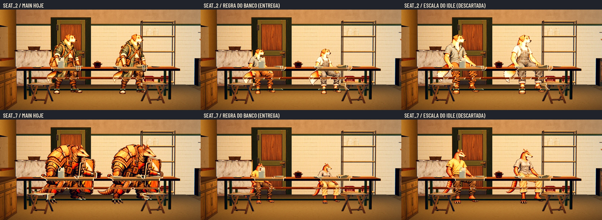

# Poses das roupas confortáveis do lobby — #249

**As 52 poses do lobby passam a ser as da Awesomic, feitas no gerador do ChatGPT.** O Lucas comparou, modelo por
modelo, a versão do Codex que entrou no PR #251 com a da Awesomic e escolheu a da Awesomic (30/10/2026). Esta entrega
substitui as poses do #251. O contrato, os nomes de arquivo, os canvas, as âncoras e o helper continuam os mesmos, então
a integração não muda: só as fontes, os hashes e as provas.

## Cobertura

- Quatro fundadores: `idle`, `seat` no banco, `sleep` no beliche e `work`, 16 sprites.
- Seis tipos de recruta, macho e fêmea: `idle`, `seat` no banco e `sleep` no beliche, 36 sprites.
- Figurinos da r4 do PR #244, as fêmeas com roupa própria. Sem equipamento de expedição, as corujas com braços e mãos.
- Trabalho: o Bento conserta um rádio, o Nick costura uma bolsa, a Íris mistura um frasco e a Véspera lê um caderno.
- A Estação move o idle ao caminhar; não há quadros de caminhada, ataques nem poses do acampamento nesta roupa. O
  pacote de expedição das recrutas femininas é a #250.


## Pranchas em escala métrica

Todas as pranchas usam a mesma escala, 330 px por metro, com o pé de cada pose na linha do chão: dá para comparar um
modelo com outro e uma pose com outra. As versões a 40% e em cinza são reduções reais. Sem texto nos PNG.

| Modelo | Poses | Prancha | 40% | Cinza |
| --- | --- | --- | --- | --- |
| Bento (1.72 m) | idle, seat, sleep, work | [Prancha](lobby_poses/bento.webp) | [Cor](lobby_poses/bento_40.webp) | [Cinza](lobby_poses/bento_gray_40.webp) |
| Nick (1.50 m) | idle, seat, sleep, work | [Prancha](lobby_poses/nick.webp) | [Cor](lobby_poses/nick_40.webp) | [Cinza](lobby_poses/nick_gray_40.webp) |
| Íris (1.38 m) | idle, seat, sleep, work | [Prancha](lobby_poses/iris.webp) | [Cor](lobby_poses/iris_40.webp) | [Cinza](lobby_poses/iris_gray_40.webp) |
| Véspera (1.66 m) | idle, seat, sleep, work | [Prancha](lobby_poses/vespera.webp) | [Cor](lobby_poses/vespera_40.webp) | [Cinza](lobby_poses/vespera_gray_40.webp) |
| Cão — macho (1.72 m) | idle, seat, sleep | [Prancha](lobby_poses/dog_male.webp) | [Cor](lobby_poses/dog_male_40.webp) | [Cinza](lobby_poses/dog_male_gray_40.webp) |
| Cão — fêmea (1.72 m) | idle, seat, sleep | [Prancha](lobby_poses/dog_female.webp) | [Cor](lobby_poses/dog_female_40.webp) | [Cinza](lobby_poses/dog_female_gray_40.webp) |
| Gato — macho (1.50 m) | idle, seat, sleep | [Prancha](lobby_poses/cat_male.webp) | [Cor](lobby_poses/cat_male_40.webp) | [Cinza](lobby_poses/cat_male_gray_40.webp) |
| Gato — fêmea (1.50 m) | idle, seat, sleep | [Prancha](lobby_poses/cat_female.webp) | [Cor](lobby_poses/cat_female_40.webp) | [Cinza](lobby_poses/cat_female_gray_40.webp) |
| Sapo — macho (1.38 m) | idle, seat, sleep | [Prancha](lobby_poses/frog_male.webp) | [Cor](lobby_poses/frog_male_40.webp) | [Cinza](lobby_poses/frog_male_gray_40.webp) |
| Sapo — fêmea (1.38 m) | idle, seat, sleep | [Prancha](lobby_poses/frog_female.webp) | [Cor](lobby_poses/frog_female_40.webp) | [Cinza](lobby_poses/frog_female_gray_40.webp) |
| Coruja — macho (1.66 m) | idle, seat, sleep | [Prancha](lobby_poses/owl_male.webp) | [Cor](lobby_poses/owl_male_40.webp) | [Cinza](lobby_poses/owl_male_gray_40.webp) |
| Coruja — fêmea (1.66 m) | idle, seat, sleep | [Prancha](lobby_poses/owl_female.webp) | [Cor](lobby_poses/owl_female_40.webp) | [Cinza](lobby_poses/owl_female_gray_40.webp) |
| Guaxinim — macho (1.44 m) | idle, seat, sleep | [Prancha](lobby_poses/raccoon_male.webp) | [Cor](lobby_poses/raccoon_male_40.webp) | [Cinza](lobby_poses/raccoon_male_gray_40.webp) |
| Guaxinim — fêmea (1.44 m) | idle, seat, sleep | [Prancha](lobby_poses/raccoon_female.webp) | [Cor](lobby_poses/raccoon_female_40.webp) | [Cinza](lobby_poses/raccoon_female_gray_40.webp) |
| Tatu — macho (1.56 m) | idle, seat, sleep | [Prancha](lobby_poses/armadillo_male.webp) | [Cor](lobby_poses/armadillo_male_40.webp) | [Cinza](lobby_poses/armadillo_male_gray_40.webp) |
| Tatu — fêmea (1.56 m) | idle, seat, sleep | [Prancha](lobby_poses/armadillo_female.webp) | [Cor](lobby_poses/armadillo_female_40.webp) | [Cinza](lobby_poses/armadillo_female_gray_40.webp) |

## Encaixes e conversão

O [contrato](lobby_poses/contract.json) traz por arquivo: PNG/SHA-256, a imagem do gerador de onde a pose saiu
(`generator_file`/`generator_sha256`), canvas, textura de destino, âncora, altura de referência, caixa do alfa, escala
uniforme, correção de registro e nome de saída. O [audit](lobby_poses/audit.json) conta 52 sprites, 16 modelos e
nenhum problema.

**Canvas, âncora e altura de referência são os mesmos do #251.** Fundadores: copiados da pose canônica
(`combat_art.json` no idle, `station_poses.json` nas outras), com os basenames que o jogo procura
(`hero_cao_bento_seat.webp`, `hero_gato_nick_work.webp` etc.). Recrutas: `idle`/`seat` em 1178×1335, âncora [589,1305],
referência 1240; `sleep` em 1774×886, âncora [887,738], referência 1240; texturas de 589×668 e 887×443. Seguir
`texture_canvas`, não reduzir tudo pela metade às cegas.

**Como cada pose foi encaixada** (só escala uniforme e translação, nada esticado):
- **De pé (`idle`, `work`):** a altura da cabeça ao pé é a altura de referência; o meio dos dois pés fica na âncora.
- **Banco (`seat`):** uma regra só para todos: a altura sentada, da cabeça ao pé, é a fração da altura em pé que a pose
  canônica do banco do fundador tem hoje (`station_poses.json`): Bento 0,72, Nick 0,76, Íris 0,70, Véspera 0,76. Cada
  recruta usa a do fundador da mesma família: cão, Guaxinim e Tatu a do Bento, gato a do Nick, sapo a da Íris, coruja a
  da Véspera. O meio dos pés fica na âncora. É essa altura que põe o quadril no banco da Cantina.
- **Por que o sentado fica menor que o em pé:** nas imagens do gerador o corpo sentado é mais alto que o de um corpo de
  verdade (a canela é longa). Com a cabeça do mesmo tamanho da pose em pé, o quadril sobe até a altura da mesa: veja a
  prova abaixo, na Godot. Com a regra do banco, a cabeça sentada fica com 86% a 92% da cabeça em pé no Nick, na Íris, na
  Véspera, no gato, na coruja e no Guaxinim; com 78% a 84% no Bento, no cão e no sapo; com 69% a 73% no Tatu. A medida
  é aproximada (a largura da cabeça pega orelhas e inclinação; por casamento de modelo a QA mediu o Tatu perto de 80%
  e os gatos perto de 97%). Os números por modelo estão no [audit](lobby_poses/audit.json), em `scale_checks`.
- **Beliche (`sleep`):** o comprimento do corpo deitado é a altura de referência, centrado na âncora, cabeça à esquerda.
  Na escala do idle o comprimento daria de 1% a 10% a mais (`scale_checks`), então o deitado não encolhe em relação ao
  em pé.
- **Correção de registro:** para caber no canvas canônico com 5 px de folga em cada borda, alguns corpos andam para a
  direita a partir da âncora: o Bento sentado 52 px (9 cm no jogo) e o Nick sentado 46 px (9 cm), por causa da cauda
  longa para trás; o Bento em pé 17 px (2 cm) e o Nick em pé 5 px (menos de 1 cm). Ninguém foi cortado.



O recorte tira o fundo magenta do gerador pela cor e apaga o ruído solto. No contorno, o magenta misturado é retirado:
por dentro, nenhuma cor da arte passa de 29 no excesso de magenta (min(R,B)−G), nem o ameixa da coruja, então o
recorte corta o excesso acima de 20 na imagem do gerador. Depois da redução, as pontas do pelo ainda guardam um leve
tom ameixa (excesso de até 20, acima disso só em pixels quase transparentes), que não se nota no tamanho do jogo. Pixels
francamente roxos (R−G e B−G acima de 40, alfa a partir de 32): 57 nas 52 fontes, no máximo 8 por sprite, contra
milhares por sprite antes da correção. Nenhum pixel com alfa zero tem cor (RGB zerado). As fontes são reamostradas das imagens do gerador (1024×1536 ou 1536×1024),
sem alegar detalhe maior que o da geração.

Para preparar os WebP no PC sem tocar na produção:

```sh
python -B docs/design/lobby_poses/prepare_webp.py --sources /caminho/lobby_poses_awesomic_20261030 --output /pasta/externa/lobby_ready
```

Exige Pillow. A saída tem que ser uma pasta nova, fora do repositório e das fontes. O helper confere 52 PNG, hashes,
RGBA, canvas e cobertura; gera 52 WebP lossless e `registration.json`. A [verificação](lobby_poses/preparation_checks.json)
comparou os 52 WebP byte a byte com os que entraram nas capturas da Godot, e conferiu a recusa de saída existente, de
saída dentro do repositório e de fonte com hash errado.

## Antes e depois na Godot

17 pares no mesmo processo, com a mesma câmera, as mesmas posições e o mesmo instante: a foto do antes, depois a troca
só da textura e das medidas, e a foto do depois. O cenário e os móveis são os da Estação; a campanha de teste abre os
cômodos só na memória. Antes: a arte da main `204f8f7`. Depois: os WebP do helper, carregados só em memória. Câmeras e
posições são as do #251 ([registro](lobby_poses/capture.json)). Para repetir:

```sh
python -B docs/design/lobby_poses/prepare_webp.py --sources <fontes> --output /tmp/lobby_ready
xvfb-run -s "-screen 0 1920x1080x24" "$GODOT" --path . --rendering-driver opengl3 --resolution 1920x1080 \
  -s res://docs/design/lobby_poses/capture_lobby.gd -- --out=/tmp/lobby_shots --ready=/tmp/lobby_ready --wait=1
```

**1920×1080, renderer Compatibility, Mesa llvmpipe, sem placa de vídeo.** Sem placa de vídeo cada quadro da Estação
leva perto de um minuto, por isso o script espera um quadro só antes de cada foto (`--wait=1`). Não é prova da troca
automática de roupa nem da integração.

A main não tem versões femininas nem poses de banco/beliche dos recrutas: nesses casos o antes mostra o idle masculino
de hoje, como no #251. O Guaxinim e o Tatu do antes têm a altura de hoje (1,30 e 1,35 m); o depois usa as do redesenho
#225 (1,44 e 1,56 m).

Na Cantina, o primeiro lugar do banco (x 17,6) fica atrás de um galão na mesa: a cabeça de quem senta ali fica em
parte escondida (a Íris no seat_1, o sapo macho no seat_4), como já acontece hoje com a Íris de expedição. É o lugar
do jogo, não a pose; o integrador pode afastar o galão ou o lugar.


| Captura | Figuras / pose | Antes e depois | 40% |
| --- | --- | --- | --- |
| idle_0 | bento, nick, iris, vespera / idle | [Par](lobby_poses/idle_0_before_after.webp) | [Redução](lobby_poses/idle_0_before_after_40.webp) |
| idle_1 | dog_male, dog_female, cat_male, cat_female / idle | [Par](lobby_poses/idle_1_before_after.webp) | [Redução](lobby_poses/idle_1_before_after_40.webp) |
| idle_2 | frog_male, frog_female, owl_male, owl_female / idle | [Par](lobby_poses/idle_2_before_after.webp) | [Redução](lobby_poses/idle_2_before_after_40.webp) |
| idle_3 | raccoon_male, raccoon_female, armadillo_male, armadillo_female / idle | [Par](lobby_poses/idle_3_before_after.webp) | [Redução](lobby_poses/idle_3_before_after_40.webp) |
| seat_0 | bento, nick / seat | [Par](lobby_poses/seat_0_before_after.webp) | [Redução](lobby_poses/seat_0_before_after_40.webp) |
| seat_1 | iris, vespera / seat | [Par](lobby_poses/seat_1_before_after.webp) | [Redução](lobby_poses/seat_1_before_after_40.webp) |
| seat_2 | dog_male, dog_female / seat | [Par](lobby_poses/seat_2_before_after.webp) | [Redução](lobby_poses/seat_2_before_after_40.webp) |
| seat_3 | cat_male, cat_female / seat | [Par](lobby_poses/seat_3_before_after.webp) | [Redução](lobby_poses/seat_3_before_after_40.webp) |
| seat_4 | frog_male, frog_female / seat | [Par](lobby_poses/seat_4_before_after.webp) | [Redução](lobby_poses/seat_4_before_after_40.webp) |
| seat_5 | owl_male, owl_female / seat | [Par](lobby_poses/seat_5_before_after.webp) | [Redução](lobby_poses/seat_5_before_after_40.webp) |
| seat_6 | raccoon_male, raccoon_female / seat | [Par](lobby_poses/seat_6_before_after.webp) | [Redução](lobby_poses/seat_6_before_after_40.webp) |
| seat_7 | armadillo_male, armadillo_female / seat | [Par](lobby_poses/seat_7_before_after.webp) | [Redução](lobby_poses/seat_7_before_after_40.webp) |
| sleep_0 | bento, nick, iris, vespera / sleep | [Par](lobby_poses/sleep_0_before_after.webp) | [Redução](lobby_poses/sleep_0_before_after_40.webp) |
| sleep_1 | dog_male, dog_female, cat_male, cat_female / sleep | [Par](lobby_poses/sleep_1_before_after.webp) | [Redução](lobby_poses/sleep_1_before_after_40.webp) |
| sleep_2 | frog_male, frog_female, owl_male, owl_female / sleep | [Par](lobby_poses/sleep_2_before_after.webp) | [Redução](lobby_poses/sleep_2_before_after_40.webp) |
| sleep_3 | raccoon_male, raccoon_female, armadillo_male, armadillo_female / sleep | [Par](lobby_poses/sleep_3_before_after.webp) | [Redução](lobby_poses/sleep_3_before_after_40.webp) |
| work | bento, nick, iris, vespera / work | [Par](lobby_poses/work_before_after.webp) | [Redução](lobby_poses/work_before_after_40.webp) |

As quatro poses de trabalho estão juntas no laboratório só para comparar os corpos; os postos continuam
Forja/Bento, Depósito/Nick e Pesquisa/Íris-Véspera, como no jogo.

## QA de design

Checklist de [qa.md](qa.md), com o limite de uma entrega de arte: não aprova a troca de roupa por contexto, o save
nem a integração.

### Rodada 1 — VEREDITO: REPROVADO

- **Alta, idle_0:** o par dos fundadores em pé saiu com placas brancas nos dois lados. O script pegava a entrada inteira
  do herói em `combat_art.json` em vez do `idle`. Corrigido em `capture_lobby.gd` e refeito.
- **Média, franja magenta:** milhares de pixels roxos por sprite no contorno. O recorte passou a tirar o excesso de
  magenta; sobram no máximo 8 por sprite.
- **Média, escala do sentado:** pedia uma regra só e prova do quadril no banco. A regra do banco foi escrita por
  modelo, e a prova na Godot entrou na página (`seat_scale_check`).
- **Média, Release:** os originais ainda não estavam publicados. Publicados, com o sha256 no contrato.
- **Baixa:** números da página, cauda a 2 px da borda (agora 5 px) e o cabeçalho do `registration.json`. Corrigidos.

### Rodada 2 — VEREDITO: APROVADO

Sem problema alto ou médio. Conferido: as 52 fontes (RGBA, canvas, hash, RGB zerado, nenhuma borda tocada, sem
pontos soltos, o ameixa da coruja intacto), registro e centímetros das correções, os 17 pares iguais às fotos brutas
com câmeras e posições do #251, a prova do sentado, as faixas da página contra o audit, a Release baixada e
convertida pelo helper em 52 WebP iguais byte a byte, e o escopo (só `docs/design/lobby_poses*`). Observações baixas,
para o Lucas decidir:
- o Bento, o cão e o sapo sentados ficam visivelmente menores que em pé (cabeça perto de 78%); dá para regerar esses
  sentados com a canela mais curta se incomodar no jogo;
- o galão da Cantina em x 17,6 cobre a cabeça de quem senta ali;
- um leve tom ameixa nas pontas do pelo, só visível com zoom.

A suíte inteira passou na mesma base `204f8f7`: 96 de 96, paridade 48 de 48.

## Originais e integração

Os 52 PNG encaixados, as 52 imagens do gerador e os scripts de recorte e encaixe ficam na Release
[`awesomic-249-lobby-originals`](https://github.com/lucasyemz/after-humans-godot/releases/tag/awesomic-249-lobby-originals),
nunca na main. Os originais do #251 continuam onde o Codex os deixou. Nenhum arquivo de `scripts/`, `data/`, `tests/`,
`tools/` ou `art/` foi alterado, nem ids.

O Claude deve escolher o figurino por contexto, sem substituir a skin de expedição gravada: lobby confortável;
**Ver personagem**, preparação/saída e chegada mantêm a roupa de expedição; troca depois da chegada. Exploração,
luta e acampamento fora da Estação usam a expedição. As variantes de sexo dos recrutas e as poses deles ainda precisam
ser registradas pelo integrador, sem alterar os ids dos personagens já salvos.
