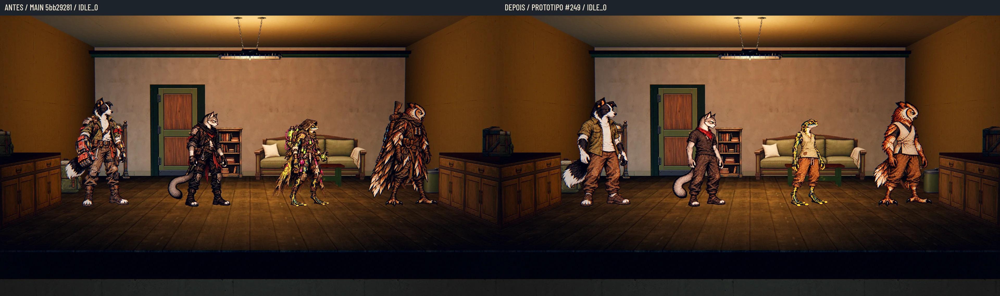
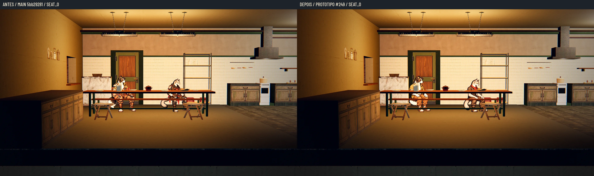
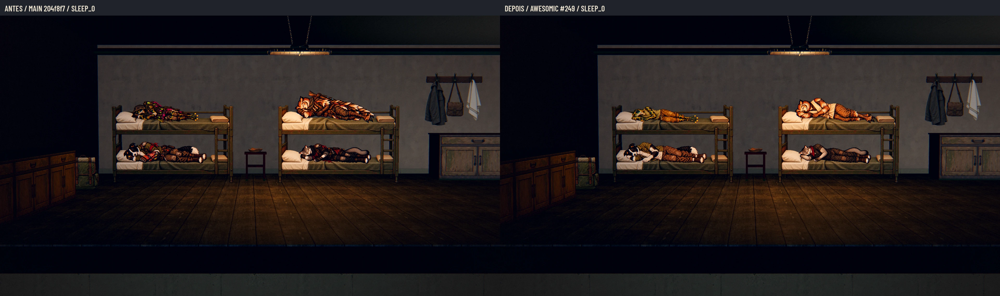

# Poses das roupas confortáveis do lobby — #249

**52 sprites prontos para revisão e integração, com QA de design aprovada.** Figurinos autorizados pelo Lucas
após o PR #244, incluindo as roupas femininas próprias da r4. Não há novas variantes de sexo dos fundadores.

## Cobertura

- Quatro fundadores: `idle`, `seat` no banco, `sleep` no beliche e `work` — 16 sprites.
- Seis tipos de recruta, macho e fêmea: `idle`, `seat` no banco e `sleep` no beliche — 36 sprites.
- A Estação move o idle ao caminhar; não foram inventados quadros de caminhada. Não há ataques nem poses do
  acampamento de expedição nestas roupas. O pacote de expedição das recrutas femininas é a #250.



## Pranchas em escala métrica

Cada página usa uma escala comum em pixels por metro e o pivô de cada pose; sentado/deitado não foram ampliados
para encher o quadrado. As versões a 40% e em cinza são reduções reais. Sem texto nos PNG dos personagens.

| Modelo | Poses | Prancha | 40% | Cinza |
| --- | --- | --- | --- | --- |
| Bento (1.72 m) | idle, seat, sleep, work | [Prancha](lobby_poses/bento.webp) | [Cor](lobby_poses/bento_40.webp) | [Cinza](lobby_poses/bento_gray_40.webp) |
| Nick (1.50 m) | idle, seat, sleep, work | [Prancha](lobby_poses/nick.webp) | [Cor](lobby_poses/nick_40.webp) | [Cinza](lobby_poses/nick_gray_40.webp) |
| Íris (1.38 m) | idle, seat, sleep, work | [Prancha](lobby_poses/iris.webp) | [Cor](lobby_poses/iris_40.webp) | [Cinza](lobby_poses/iris_gray_40.webp) |
| Véspera (1.66 m) | idle, seat, sleep, work | [Prancha](lobby_poses/vespera.webp) | [Cor](lobby_poses/vespera_40.webp) | [Cinza](lobby_poses/vespera_gray_40.webp) |
| Cão — macho (1.72 m) | idle, seat, sleep | [Prancha](lobby_poses/dog_male.webp) | [Cor](lobby_poses/dog_male_40.webp) | [Cinza](lobby_poses/dog_male_gray_40.webp) |
| Cão — fêmea (1.72 m) | idle, seat, sleep | [Prancha](lobby_poses/dog_female.webp) | [Cor](lobby_poses/dog_female_40.webp) | [Cinza](lobby_poses/dog_female_gray_40.webp) |
| Gato — macho (1.50 m) | idle, seat, sleep | [Prancha](lobby_poses/cat_male.webp) | [Cor](lobby_poses/cat_male_40.webp) | [Cinza](lobby_poses/cat_male_gray_40.webp) |
| Gato — fêmea (1.50 m) | idle, seat, sleep | [Prancha](lobby_poses/cat_female.webp) | [Cor](lobby_poses/cat_female_40.webp) | [Cinza](lobby_poses/cat_female_gray_40.webp) |
| Sapo — macho (1.38 m) | idle, seat, sleep | [Prancha](lobby_poses/frog_male.webp) | [Cor](lobby_poses/frog_male_40.webp) | [Cinza](lobby_poses/frog_male_gray_40.webp) |
| Sapo — fêmea (1.38 m) | idle, seat, sleep | [Prancha](lobby_poses/frog_female.webp) | [Cor](lobby_poses/frog_female_40.webp) | [Cinza](lobby_poses/frog_female_gray_40.webp) |
| Coruja — macho (1.66 m) | idle, seat, sleep | [Prancha](lobby_poses/owl_male.webp) | [Cor](lobby_poses/owl_male_40.webp) | [Cinza](lobby_poses/owl_male_gray_40.webp) |
| Coruja — fêmea (1.66 m) | idle, seat, sleep | [Prancha](lobby_poses/owl_female.webp) | [Cor](lobby_poses/owl_female_40.webp) | [Cinza](lobby_poses/owl_female_gray_40.webp) |
| Guaxinim — macho (1.44 m) | idle, seat, sleep | [Prancha](lobby_poses/raccoon_male.webp) | [Cor](lobby_poses/raccoon_male_40.webp) | [Cinza](lobby_poses/raccoon_male_gray_40.webp) |
| Guaxinim — fêmea (1.44 m) | idle, seat, sleep | [Prancha](lobby_poses/raccoon_female.webp) | [Cor](lobby_poses/raccoon_female_40.webp) | [Cinza](lobby_poses/raccoon_female_gray_40.webp) |
| Tatu — macho (1.56 m) | idle, seat, sleep | [Prancha](lobby_poses/armadillo_male.webp) | [Cor](lobby_poses/armadillo_male_40.webp) | [Cinza](lobby_poses/armadillo_male_gray_40.webp) |
| Tatu — fêmea (1.56 m) | idle, seat, sleep | [Prancha](lobby_poses/armadillo_female.webp) | [Cor](lobby_poses/armadillo_female_40.webp) | [Cinza](lobby_poses/armadillo_female_gray_40.webp) |

## Encaixes e conversão

O [contrato completo](lobby_poses/contract.json) traz por arquivo: PNG/SHA-256, canvas, textura de destino,
âncora, altura de referência, caixa do alfa, registro/escala uniforme e nome de saída. O [audit](lobby_poses/audit.json)
conta 52 sprites/16 modelos e nenhum recorte fora da tela.

**Fundadores:** canvas, âncora e altura de referência copiados da pose canônica (`combat_art.json` no idle e
`station_poses.json` nas outras). Os nomes de trabalho/banco/beliche mantêm os basenames que o jogo procura:
`hero_cao_bento_seat.webp`, `hero_gato_nick_work.webp` etc. Não renomear para `seat.webp`/`work.webp` nesses modelos.
A resolução da textura varia por legado: seguir `texture_canvas`, não reduzir todos os PNG pela metade às cegas.

**Recrutas:** os encaixes de Estação ainda não existem na main; o pacote registra `idle/seat` em 1178×1335,
âncora [589,1305], altura de referência 1240; `sleep` em 1774×886, âncora[887,738], referência 1240.
As texturas vão para 589×668 e 887×443. Banco é com pés para baixo; beliche é horizontal com cabeça à esquerda.
Não confundir essas poses com `seat` no chão do acampamento. As alturas são as das classes (Cão 1,72, Gato 1,50,
Sapo 1,38, Coruja 1,66), com Guaxinim 1,44/Tatu 1,56 do redesenho aprovado #225, cuja integração de altura ainda está pendente.

A normalização só usa escala uniforme e translação, sem esticar braços/tronco. O Bento sentado foi refeito mais
compacto para caber no canvas original. Correções horizontais de registro acomodam a silhueta mantendo o pivô
canônico; um ajuste uniforme inferior a 2% no trabalho do Bento evita cortar a cauda. Fundo/ruído de atlas e
contaminação de borda removidos no recorte; RGB zerado onde alfa é zero. As fontes são reamostradas dos atlas,
sem alegar detalhe nativo maior que o da geração.

Para preparar os arquivos no PC sem tocar na produção:

```sh
python -B docs/design/lobby_poses/prepare_webp.py --sources /caminho/lobby_poses_20261029 --output /pasta/externa/lobby_ready
```

Exige Pillow. A saída deve ser nova e ficar fora do repositório/fontes. O helper valida 52 PNG, hashes, RGBA,
canvas e cobertura; gera 52 WebP lossless e `registration.json`. A [verificação](lobby_poses/preparation_checks.json)
comparou os 52 WebP byte a byte com os protótipos da QA e conferiu rejeição de saídas inválidas.

## Antes e depois na Godot

17 pares capturados em 1920×1080 no mesmo processo, câmera, posições e instante pausado. Cenário e móveis reais da
Estação; campanha de teste isolada com salas abertas só em memória. Antes: arte da main `5bb29281`. Depois:
PNG processado para WebP carregado no protótipo externo, sem modificar arquivos do jogo. Renderer Compatibility,
Mesa llvmpipe/Xvfb, **sem placa de vídeo física**. Não é uma prova da troca automática de roupa ou da integração.

Na main não existem versões femininas nem poses de banco/beliche dos recrutas; nesses casos o controle mostra o
idle masculino atual, explicitamente como fallback. Não se apresenta uma pose feminina anterior inexistente.
Guaxinim/Tatu no antes ainda têm a arte/altura antigas da main; o depois usa o redesenho aprovado.





| Captura | Figuras / pose | Antes e depois | 40% |
| --- | --- | --- | --- |
| idle_0 | bento, nick, iris, vespera / idle | [Par](lobby_poses/idle_0_before_after.webp) | [Redução](lobby_poses/idle_0_before_after_40.webp) |
| idle_1 | dog_male, dog_female, cat_male, cat_female / idle | [Par](lobby_poses/idle_1_before_after.webp) | [Redução](lobby_poses/idle_1_before_after_40.webp) |
| idle_2 | frog_male, frog_female, owl_male, owl_female / idle | [Par](lobby_poses/idle_2_before_after.webp) | [Redução](lobby_poses/idle_2_before_after_40.webp) |
| idle_3 | raccoon_male, raccoon_female, armadillo_male, armadillo_female / idle | [Par](lobby_poses/idle_3_before_after.webp) | [Redução](lobby_poses/idle_3_before_after_40.webp) |
| seat_0 | bento, nick / seat | [Par](lobby_poses/seat_0_before_after.webp) | [Redução](lobby_poses/seat_0_before_after_40.webp) |
| seat_1 | iris, vespera / seat | [Par](lobby_poses/seat_1_before_after.webp) | [Redução](lobby_poses/seat_1_before_after_40.webp) |
| seat_2 | dog_male, dog_female / seat | [Par](lobby_poses/seat_2_before_after.webp) | [Redução](lobby_poses/seat_2_before_after_40.webp) |
| seat_3 | cat_male, cat_female / seat | [Par](lobby_poses/seat_3_before_after.webp) | [Redução](lobby_poses/seat_3_before_after_40.webp) |
| seat_4 | frog_male, frog_female / seat | [Par](lobby_poses/seat_4_before_after.webp) | [Redução](lobby_poses/seat_4_before_after_40.webp) |
| seat_5 | owl_male, owl_female / seat | [Par](lobby_poses/seat_5_before_after.webp) | [Redução](lobby_poses/seat_5_before_after_40.webp) |
| seat_6 | raccoon_male, raccoon_female / seat | [Par](lobby_poses/seat_6_before_after.webp) | [Redução](lobby_poses/seat_6_before_after_40.webp) |
| seat_7 | armadillo_male, armadillo_female / seat | [Par](lobby_poses/seat_7_before_after.webp) | [Redução](lobby_poses/seat_7_before_after_40.webp) |
| sleep_0 | bento, nick, iris, vespera / sleep | [Par](lobby_poses/sleep_0_before_after.webp) | [Redução](lobby_poses/sleep_0_before_after_40.webp) |
| sleep_1 | dog_male, dog_female, cat_male, cat_female / sleep | [Par](lobby_poses/sleep_1_before_after.webp) | [Redução](lobby_poses/sleep_1_before_after_40.webp) |
| sleep_2 | frog_male, frog_female, owl_male, owl_female / sleep | [Par](lobby_poses/sleep_2_before_after.webp) | [Redução](lobby_poses/sleep_2_before_after_40.webp) |
| sleep_3 | raccoon_male, raccoon_female, armadillo_male, armadillo_female / sleep | [Par](lobby_poses/sleep_3_before_after.webp) | [Redução](lobby_poses/sleep_3_before_after_40.webp) |
| work | bento, nick, iris, vespera / work | [Par](lobby_poses/work_before_after.webp) | [Redução](lobby_poses/work_before_after_40.webp) |

O [registro das capturas](lobby_poses/capture.json) inclui câmeras, posições, origens e hashes dos PNG brutos,
que ficam fora da main. Todas as 52 poses aparecem nessas provas em situações de parado, banco, beliche ou trabalho.
As quatro poses de trabalho estão juntas no laboratório apenas para comparar os corpos; os postos finais continuam
Forja/Bento, Depósito/Nick e Pesquisa/Íris-Véspera, como definidos no jogo.

## QA de design

Checklist de [qa.md](qa.md), com o limite da entrega de arte: não aprova a lógica futura de troca/contexto/save.

### Rodada 1 — VEREDITO: REPROVADO

- **Média, Nick/work:** a geração trouxe luvas da roupa de expedição. Refeito com mãos naturais livres.
- **Alta, Bento/seat:** silhueta não cabia no canvas ao manter a escala. Refeito com pernas/cauda mais compactas.
- **Alta, registro:** trabalho do Bento e alguns bancos passavam da borda ao alinhar só a ponta mais baixa do pé.
  Registro passou a considerar a região dos dois pés e a acomodar a silhueta por translação, sem deformação.
- **Média, pranchas:** ampliar cada pose para encher o quadro mascarava a escala. Pranchas refeitas em pixels por metro.

### Rodada 2 — VEREDITO: APROVADO

52 PNG RGBA com alfa, canvas e pivôs conferidos; nenhuma silhueta cortada; figurinos consistentes, braços/mãos
nas corujas e mãos livres no Nick; reduções em cor/cinza.17 pares reais na Godot conferem pé no chão, banco e
corpo apoiado nos beliches. Helper gera 52 WebP idênticos aos da prova. Sem problema alto ou médio nesta entrega.
Observação baixa: os controles de recruta usam fallback da main e os encaixes novos precisam ser ligados pelo
integrador; este PR não implementa esse fluxo. O aceite visual final continua com o Lucas.

A suíte inteira já passou na mesma base `5bb29281` (92/92, paridade48/48); não foi repetida para imagens em docs/,
que têm `.gdignore`. Captura/protótipo e validação de arte foram executados nesta entrega.

## Originais e integração

Fontes e tag vinculadas no PR. PNG de produção e atlas ficam só na tag/Release independente, nunca na main.
Nenhum arquivo de `scripts/`, `data/`, `tests/`, `tools/` ou `art/` foi alterado, nem ids existentes.

O Claude deve escolher o figurino por contexto, sem substituir a skin de expedição gravada: lobby confortável;
**Ver personagem**, preparação/saída e chegada mantêm roupa de expedição; trocar depois da chegada. Exploração,
luta e acampamento fora da Estação usam expedição. Não cadastrar a roupa confortável como uma troca global que
contamine esses contextos. As variantes de sexo dos recrutas e a integração de suas poses ainda precisam ser
registradas pelo integrador, sem alterar os ids dos personagens já salvos.
