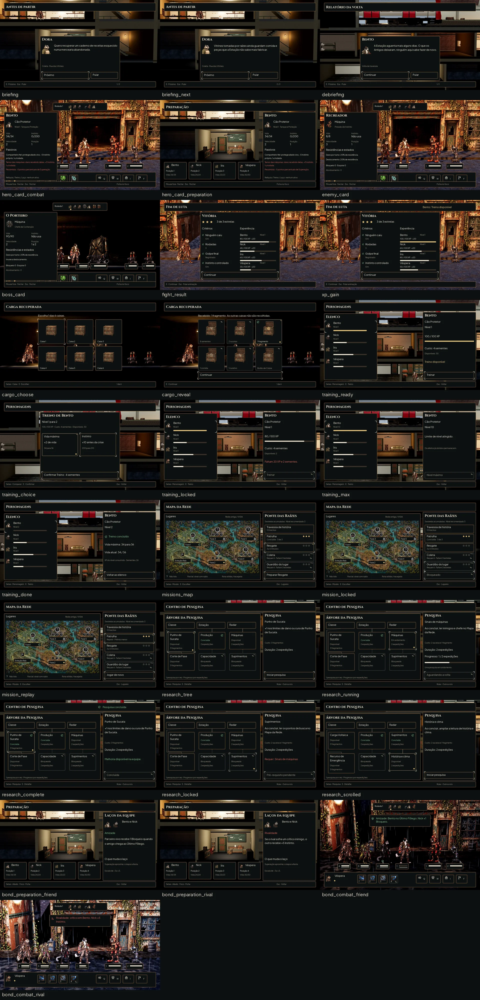

# Telas do novo laço — #96

> **Histórico — versão1.** O Lucas pediu revisão da linguagem visual em25/10/2026. Esta versão não deve orientar a integração visual. Primeiro aprovar a [prancha do kit v2](ui-kit/v2-style.md); depois refazer estas telas. A QA registrada abaixo se refere à entrega anterior.

Propostas de UI para aprovação do Lucas; integração nas issues #88–#94 pelo Claude. Montadas com o [kit #59](ui-kit.md), depois do [Mapa da Rede #86](phase-map.md). Não implementam progressão, recompensas ou pesquisa no jogo.

## Capturas, fidelidade e valores de exemplo

As [capturas e seus hashes](loop-screens/captures.json) documentam 9 situações em Normal e Maior: Personagens, Pesquisa, Preparação, mapa, combate, resultado, Porteiro e dois gatilhos de laço. Cada uma tem o antes em JPG, o mesmo frame sem HUD em WebP e os textos/atributos reais em JSON. PNG originais ficam fora do repositório. Novas propostas e provas desta entrega são WebP. Fundos e personagens vêm da Godot 4.7.2, sem redesenhar o cenário.

O encontro final e o painel de vitória foram preparados pelas APIs do jogo para captura; não são prova de uma travessia vencida. Os gatilhos de laço foram executados pelo motor: amigo no Último Fôlego dá 1 Bloqueio ao parceiro vivo; crítico inimigo no rival dá +5 Instinto ao outro. Evidências: [Normal](loop-screens/bond_evidence_normal.json) e [Maior](loop-screens/bond_evidence_large.json). A captura de rivalidade usa semente4771 para tornar o crítico reproduzível. A condição de amizade/rivalidade é um estado preparado, não a relação inicial dos fundadores.

Vida, instinto, velocidade, posições, passivos e resistências vêm das capturas e tabelas atuais. Bento34, Nick24, Íris23 e Véspera30 de vida máxima; velocidades2/6/5/3. Porteiro90, ocupa posições1–2; relés16 cada. Recreador8 no encontro escalado. Não substituir esses valores pelos máximos de outra fase. Ficha inimiga não inventa nível de herói nem Instinto.

**Exemplos, não balanceamento:** [fixtures.json](loop-screens/fixtures.json) separa XP80/40/60/30, ganho20, limiar100, custo4 sementes, melhoria+2 vida ou+10 limite de Instinto, estrelas3/6, custos/duração2 expedições e conteúdo das seis caixas. Os critérios/3 rodadas da vitória são uma composição de estado futuro, não o resultado medido de uma luta. A integração deve ler as fontes de #90/#91/#92/#94. Não há nova arma na Forja.

Textos do briefing usam a necessidade da Dora e a descrição da fase1; retorno usa o relatório existente dessa fase. Não há revelação nova de lore. Retrato da Dora segue o recorte canônico de `data/presentation/civilians.json`; heróis e inimigos reutilizam as artes aprovadas.

## Estados e prévias

Todos os estados abaixo têm quatro versões1920×1080: Normal, Maior, daltonismo e Maior+daltonismo. Acrescentar `_large`, `_colorblind` ou `_large_colorblind` ao nome antes de `.webp`. Cada estado também tem `_40.webp` (768×432) e `_gray.webp` (cinza do Maior+daltonismo).

| Fluxo | Estados Normal |
|---|---|
| Briefing e retorno | [Dora](loop-screens/briefing.webp), [continuação](loop-screens/briefing_next.webp), [retorno](loop-screens/debriefing.webp) |
| Ficha ao apontar | [aliado em combate](loop-screens/hero_card_combat.webp), [Preparação](loop-screens/hero_card_preparation.webp), [inimigo comum](loop-screens/enemy_card.webp), [chefe](loop-screens/boss_card.webp) |
| Fim de luta | [critérios e XP](loop-screens/fight_result.webp), [ganho e Treino disponível](loop-screens/xp_gain.webp) |
| Carga recuperada | [escolher1 de6](loop-screens/cargo_choose.webp), [escolhida e outras5 reveladas](loop-screens/cargo_reveal.webp) |
| Personagens / Treino | [disponível](loop-screens/training_ready.webp), [escolha1 de2](loop-screens/training_choice.webp), [recursos insuficientes](loop-screens/training_locked.webp), [nível10](loop-screens/training_max.webp), [concluído](loop-screens/training_done.webp) |
| Missões no mapa #86 | [Resgate](loop-screens/missions_map.webp), [chefe bloqueado](loop-screens/mission_locked.webp), [repetição](loop-screens/mission_replay.webp) |
| Pesquisa | [árvore](loop-screens/research_tree.webp), [em andamento](loop-screens/research_running.webp), [conclusão na volta](loop-screens/research_complete.webp), [pré-requisito](loop-screens/research_locked.webp), [rolagem](loop-screens/research_scrolled.webp) |
| Laços | [amizade na Preparação](loop-screens/bond_preparation_friend.webp), [rivalidade na Preparação](loop-screens/bond_preparation_rival.webp), [gatilho amizade](loop-screens/bond_combat_friend.webp), [gatilho rivalidade](loop-screens/bond_combat_rival.webp) |

## Medidas para integração

Coordenadas no canvas1920×1080, origem superior esquerda, todas em pixels. Fonte Plus Jakarta Sans no corpo e Cinzel nos títulos; mínimos18 Normal/23 Maior. Maior usa130%, sem reduzir texto para caber. Mesma geometria para os perfis de daltonismo. Todas as molduras existentes têm **9-slice16/16/16/16**, padding24, margem da tela48; foco externo e escolha com losango são estados separados. [Contrato do kit](ui-kit/contract.json).

| Composição | Medidas e âncoras |
|---|---|
| Cabeçalho / ajuda | (48,32)1824×104 / (48,976)1824×72 |
| Briefing | painel(480,432)960×536; retrato112 no conteúdo, texto à direita com144 de recuo; botões(504,864)560 e328, intervalo24; etapa e Pular permanentes |
| Ficha | (48,144)640×824 em combate; (1232,144)640×824 na Preparação; conteúdo592; retrato80; estatísticas em2 colunas com passo304; fecha ao sair do alvo/foco ou Esc |
| Vitória | (480,144)960×816; duas colunas432, intervalo24; critérios e heróis passo112; XP altura12; estrelas32, passo48; CTA em864 |
| Carga | grade3×2, origem(456,256) Normal/(456,232) Maior; cartão320×272/296; passo horizontal344 e vertical296/320; arte em(48,16) local; legenda localy232/256; CTA(456,864)1008 |
| Treino | elenco640 à esquerda e detalhe640 à direita; escolha central2 cartões432×240/272 emx504/960,y400; custo e confirmação separados; nível máximo10 desabilita Treino |
| Missões | mapa(48,160)1160×800; painel(1232,144)640×824; cinco linhas de88/104, intervalo8, inícioy328/296; CTA864; miniestrelas24 com contagem textual |
| Pesquisa | árvore(48,160)1160×800, detalhe640 à direita; três categorias344 emx72/440/808,y264; nós320 emx96/464/832,y384/640; alturas176/208 e208/240 quando o título quebra; ligações2 tracejadas bloqueadas/3 sólidas liberadas |
| Laço na Preparação | detalhe(1232,144)640×824; dois retratos80, passo104; nome, efeito e escala-3…+3 explícitos |
| Laço em combate | aviso(592,176)736×112/144; ícone32, texto624; desaparece sem interromper o turno; estado persiste nas fichas |
| Iniciativa | sequência existente, variante656×96 em(632,32), retratos48 passo56 emx824,y52; suporta8, inclusive Porteiro+2 relés; ator tem losango |

Ficha: apontar/foco abre sem clique; sair fecha. No toque, toque longo abre e tocar fora fecha. Fixar no lado oposto ao alvo; rolar internamente quando surgirem mais passivos/estados, sem cobrir o alvo observado. A ficha não avança turno nem muda seleção de habilidade.

Carga: escolher confirma uma única caixa; depois todas abrem e só a escolhida entrega o conteúdo. As outras cinco ficam desabilitadas e identificadas. Ordem/conteúdo vêm da semente persistida da rota; reabrir, carregar ou voltar à tela não sorteia novamente. Não há compra, troca ou segundo sorteio. A recompensa é material, não uma arma nova.

Treino: completar XP habilita o Treino, não sobe o nível automaticamente. Confirmar uma melhoria consome XP e sementes uma vez; a outra não é recebida. A prévia de vida34→36 não cura gratuitamente: concluído mostra34/36. Curva curta e aceleração de recrutas são dados da #90, não uma fórmula criada pelo mockup.

Mapa: manter Travessia de história, Patrulha, Resgate, Coleta e Guardião do lugar, sem retirar a exploração atual. Missões curtas indicam3–5 minutos; repetição tem recompensa menor, sem outra estrela grátis no exemplo. Exibir bloqueio com motivo e estrelas faltantes. Mapa, projeções e radar são os mesmos da #86.

Pesquisa: ramos Classe, Estação e Radar; uma pesquisa por vez, duração por expedições e conclusão na volta, sem relógio em horas. As quatro pesquisas atuais de classe conservam os ids `res_cao_punho_sucata`, `res_gato_corte_fase`, `res_sapo_carga_voltaica`, `res_coruja_recurso_emergencia` (classes `cao`, `gato`, `sapo`, `coruja`); as classes são escolhas independentes, não uma cadeia Cão→Gato. Rolagem mantém categorias e detalhe/custo visíveis. Nós novos e pré-requisitos precisam da tabela da #94; não converter esses nomes visuais em ids sem ela.

Laços: destaque de amigo/rival usa nome, ícone e efeito, além de cor. Amizade só dispara quando o amigo entra no Último Fôlego; rivalidade só no crítico inimigo. Não existe bônus genérico de dano nesta proposta. Superação aproxima e colapso afasta conforme a regra atual.

## Arte entregue

Quatro WebP RGBA em `art/ui/loop/`, sem letras rasterizadas. [Manifesto de origem/âncoras](loop-screens/assets.json).

- `cargo_closed.webp` e `cargo_open.webp`:224×192, âncora no apoio(112,184), mesma escala uniforme0,438902743; aberta e fechada derivam das caixas metálicas pintadas já usadas na rua, sem mudar os originais. Bbox fechada(45,55)–(179,184), aberta(45,8)–(179,184). São carga enferrujada reaproveitada, sem o acabamento de baú de fantasia.
- `star_filled.webp` e `star_outline.webp`:32×32, âncora(16,16); branco com alfa para tingimento do estilo. Cheia/vazia e a contagem numérica evitam depender de cor. Uso compacto24 nas linhas do mapa.

As famílias são Painel01, Cartão03, Barra05, Sequência09, Aviso, Seleção11 e os botões/fichas existentes; nenhuma nova moldura. A [prancha dos componentes](loop-screens/components.webp) foi aprovada antes da montagem.

## QA de design

Avaliação com o [checklist](qa.md), assumindo a segunda persona após montar as telas. Revisão visual de Normal/Maior, daltonismo, cinza e redução real a40%; arquivos, texto mínimo, âncoras, estados e escopo conferidos.

### Rodada1 — VEREDITO: REPROVADO

| Arquivo | Problema | Gravidade | Correção |
|---|---|---|---|
| `loop-screens/render.py`, combate | A base anterior supunha6 unidades e podia representar o chefe com inimigos/posições da primeira luta. | Alta | Renderizar iniciativa, vida, ator, inimigos e alvos a partir do snapshot do encontro; suportar8 retratos. |
| `loop-screens/render.py`, Pesquisa | Cadeia de classes sugeria um desbloqueio Cão→Gato; título longo podia invadir custo. | Média | Classes independentes e altura aumentada para quebra; custo segue o título medido. |
| `loop-screens/render.py`, laço | Aviso sobre estado inicial saudável não demonstrava o gatilho real. | Média | Recapturar Último Fôlego e crítico determinístico com o motor, guardar evidências. |
| `ui-kit/contract.json` | Variantes de carga/Pesquisa ainda sem todas as medidas. | Média | Registrar dimensões, âncoras e alturas antes da montagem final. |

### Rodada2 — VEREDITO: APROVADO

Conferidas as28 situações nos quatro perfis, com painel de comparação, inspeção dos estados Maior e provas de cinza/40%. As112 exportações têm1920×1080; os18 frames de origem e os quatro WebP RGBA passaram pelo [verificador](loop-screens/verification.json), sem texto fora do canvas ou link local ausente. Vida/posições do chefe e os gatilhos de laço correspondem aos snapshots. Custos e pré-requisitos de pesquisa são separados das classes independentes.

[Prova dos assets em22/32px, fundo claro e escuro](loop-screens/asset_readability.webp): estrela cheia/vazada distinta; caixas alinhadas no apoio, sem franja opaca, sem texto embutido. Caixas abertas deixam reconhecível a recompensa, a escolhida tem marca/losango e as demais ficam desabilitadas. Cobre, textura e tipografia pertencem ao kit existente; nenhum asset novo de moldura.

Sem problemas altos ou médios pendentes. Alguns estados neutros podem ser visualmente iguais no daltonismo: não recebem cor semântica artificial. Amizade/rivalidade, bloqueio/conclusão e estrelas têm texto e forma, além da cor. A aprovação é do design; a integração e a QA em jogo continuam com o Claude e o Lucas.

## Validação no projeto

Godot4.7.2 importou os quatro WebP e gerou os `.import`. `--headless --script tests/run_all.gd`: **43/43 testes**, paridade **48/48** (3351 passos), saída0 em237,014s. Persistem os avisos de recursos/ObjectDB/RID no encerramento. Não foi alterado código para tratá-los nesta entrega de design. Auditoria dos artefatos:112 composições,18 fontes reais e4 RGBA; nenhum limite de texto fora do canvas, nenhum link ausente.

## Reprodução

`python docs/design/loop-screens/build_assets.py` refaz os quatro WebP usando arte já versionada. `python docs/design/loop-screens/components.py` refaz a prancha do kit. Com Pillow instalado, `python docs/design/loop-screens/render.py --documented-frames` refaz as112 composições e as provas de leitura usando os18 frames limpos e seus metadados versionados. [checks.json](loop-screens/checks.json) registra os textos e limites por tela/perfil. Originais de captura não são necessários para reproduzir as composições. Nada em `scripts/`, `data/` ou `tests/` foi alterado.
