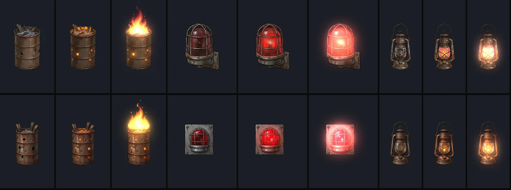
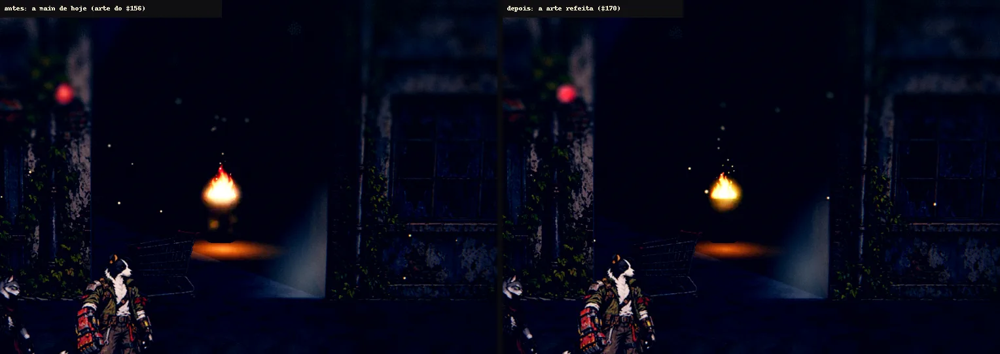
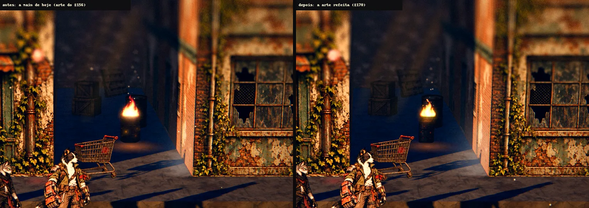
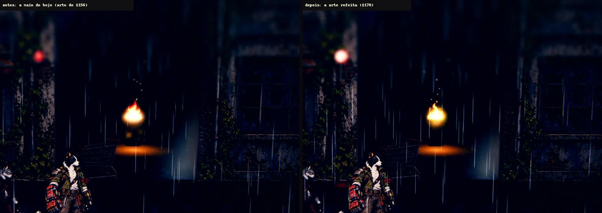
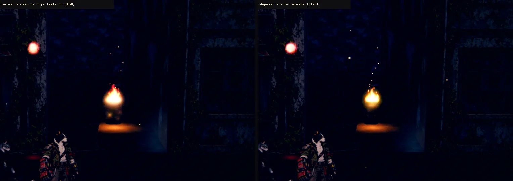
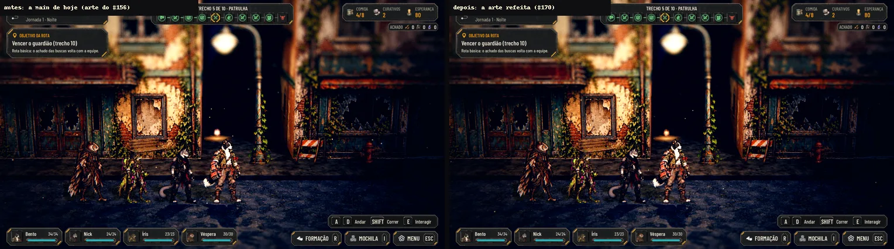

# A luz prática da Rua no estilo das fachadas (#170)

O pedido da #170: refazer, no estilo pintado das fachadas da Rua das Vitrines e **sem contorno**, as três fontes que a
#154 usa como ponto de partida, para trocar no jogo **sem mexer no código**:
- **o tambor com fogo** (`T_LP03`) e os quatro quadros do fogo (`T_LP03_Fire_0` a `_3`), a luz principal da cena;
- **a luz de emergência** (`T_LP06`), agora **de frente**: a cúpula vermelha numa chapa de parede;
- **o lampião** (`T_LP02`), o sinal de um sobrevivente escondido.

A poça (`T_LP_Pool`) não precisou mudar. Ficaram de fora, como pede a issue, a gambiarra, o letreiro, o drone pintado,
o robô e o sensor.

Só arte e docs: nada em `scripts/`, `data/` nem `tests/`. Os 13 arquivos **substituem** os de hoje em
`art/scenarios/`, com o mesmo nome e o mesmo `.import`.

## O kit, antes e depois

Em cima, a arte de hoje (do #156); embaixo, a refeita. Em cada fonte: apagada, acesa e acesa com o halo somado (no
tambor, com o fogo em cima, como no jogo).

- **O estilo:** a mesma pincelada e a mesma paleta enferrujada das peças da Rua (`art/street/alley-props-v1.webp`, o
  tambor e a lixeira de lá serviram de referência), sem a linha preta de contorno.
- **O fogo:** a pincelada grossa das fachadas, em vez das chamas lisas, com um ar quente em volta para o glow do jogo
  pegar. Os quatro quadros mudam só a lambida das chamas. O halo do tambor sai dos furos, das brasas e do fogo, em 75%
  (cheio, ele apagava o tambor pintado no escuro).
- **A chapa da emergência** fica um pouco avermelhada no aceso: é a luz da cúpula vazando na chapa. Se o Lucas preferir,
  dá para deixar a chapa igual à apagada.
- **A emergência:** vista de frente, a cúpula atrás da grade, centrada na chapa com quatro parafusos. O miolo aceso é
  vermelho com o centro quase branco (sem o rosa, que no jogo leria como o magenta do recorte).
- **O lampião:** o vidro fosco e esfumaçado (antes era transparente) e a chama pequena no pavio.
- **Sem texto e sem gente**, como pede a issue.

## O contrato com o jogo (nada muda no código)

O `scripts/world/practical_light.gd` da #154 lê a origem da luz e a boca do tambor como fração do card. Por isso cada
peça nova entra **no mesmo quadro da antiga, com a âncora no mesmo lugar**:

| Fonte | Card (px) | Âncora | Onde ficou |
|---|---|---|---|
| `T_LP03` (o tambor) | 232 × 398 | a boca do tambor em y = 95 (`fire_seat`) | a borda de trás do aro em y = 95, com as brasas logo abaixo; o pé no fundo do card; a luz medida em 115, 158 (os furos e as brasas) e a do jogo em 115, 107 (o fogo) |
| `T_LP06` (a emergência) | 207 × 279 | a cúpula em 88, 118 | a cúpula em 85, 117; a chapa com 170 px de largura |
| `T_LP02` (o lampião) | 185 × 406 | a chama em 91, 257 e a alça em 89, 0 | o lampião inteiro no card (3 px de folga dos lados) com o pé embaixo, porque ele fica no chão; a alça em 88, 27; a chama em 92, 271 (14 px, 1,4 cm no mundo) |

O fogo (`T_LP03_Fire_n`) agora tem 299 × 404 px (antes 299 × 448), com a base das chamas no meio de cada quadro (o fogo não desliza de um lado para o outro). O jogo tira a altura da proporção do quadro, e a
largura continua em 85% do card. Os halos têm o dobro do card, como antes. As medidas saem em
[cut_manifest_rua.json](luz-pratica/cut_manifest_rua.json).

**O tambor ficou mais estreito que o antigo:** o card continua com 0,92 m de altura, mas as tábuas que saem da boca
ocupam o alto dele. O corpo tem 187 dos 232 px de largura e uns 300 px de altura, cerca de 0,43 m por 0,70 m no
mundo. O antigo enchia o card. A colisão (80% da largura do card) continua a mesma.

## No jogo, antes e depois

Capturas da cena de verdade (`tools/capture_154.gd`, no branch `claude2-154` do PR #177), com a mesma câmera, a mesma
equipe e o mesmo momento. O antes é o jogo de hoje; o depois, só com estes 13 arquivos trocados.

**Sem placa de vídeo:** a nuvem da Awesomic roda a Godot em software, e o pedido de Forward+ cai no Compatibility. Por
isso as capturas mostram o halo e a poça desenhados, sem a luz da cena, a névoa com os raios e o reflexo no chão
molhado. **A prova no Forward+ fica para o Orquestrador PC**, como diz a #170.

## Como refazer

As folhas ficam fora do Git, em `images/luz-pratica-2/` do projeto na Awesomic (Nano Banana Pro, sobre magenta, com a
folha de peças da Rua como referência):
- `lp2-off.png`: as três fontes apagadas;
- `lp2-on.png`: a mesma folha, só com as luzes acesas;
- `lp2-fire.png`: os quatro quadros do fogo sobre preto.

Da raiz do repositório:
`python3 -B docs/design/luz-pratica/cut_lights_rua.py <pasta images/luz-pratica-2>`. O script recorta as peças, põe cada
uma no quadro e na âncora do card antigo, gera o aceso e o halo e grava o manifesto. Ele usa as funções de
`cut_lights.py`.

## QA de design

- **Rodada 1, reprovada:**
  - (alta) a boca do tambor estava errada: a medida pegava as tábuas abertas como se fossem o aro, e o fogo flutuava
    acima do tambor. Agora a boca é a primeira linha com um pedaço só na largura do corpo, e o tambor ficou uns 13%
    maior;
  - (média) o fogo deslizava de lado entre os quadros (a base mudava 62 px): cada quadro agora tem a base das chamas no
    meio;
  - (média) o lampião saía cortado na lateral do card: agora cabe inteiro, com o pé embaixo;
  - (baixa) a força do fogo: o halo do tambor passou de 60% para 75%;
  - (baixa) a chapa avermelhada da emergência fica como escolha do Lucas (acima); a tabela da página foi corrigida. A
    emergência nova só aparece de longe nas capturas da #154 (o ponto vermelho), e a prova no Forward+ continua com o
    Orquestrador PC.
