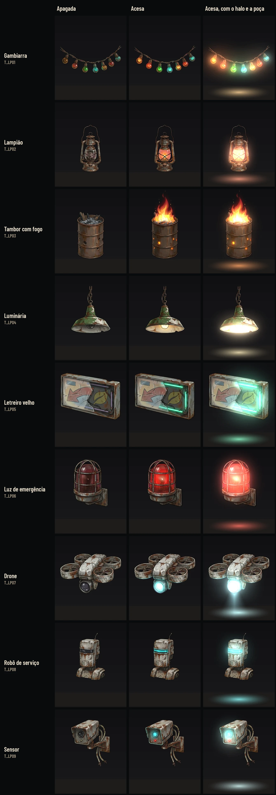
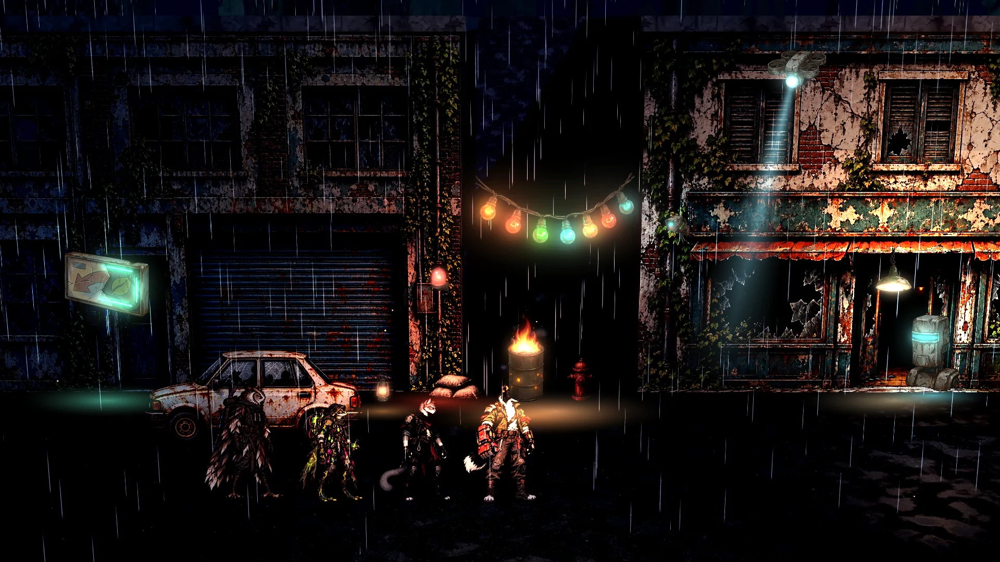

# A luz prática: o kit de fontes de luz e as luzes das máquinas (27/10/2026)

> **Revisão do Lucas (27/10/2026): não aprovado.** A montagem na Rua ficou feia e várias peças não fazem sentido. Nada
> desta página vale até ser integrado e conferido dentro do mapa, na captura do jogo. O registro está na #154.
>
> - **Descartadas e tiradas da `main`:**
>   - `T_LP01`, a gambiarra colorida: lê como enfeite de Natal;
>   - `T_LP05`, o letreiro: está em três quartos, e a Rua é vista de frente;
>   - `T_LP07` e `T_LP_Beam`, o drone e o cone: a perspectiva está errada;
>   - `T_LP08` e `T_LP09`, o robô e o sensor: o contorno preto grosso destoa das fachadas;
>   - a montagem 2D da Rua (`street_night_*` e `street_mock.py`), que não serve como prova.
>
>   As linhas delas abaixo ficam só como registro. As pranchas `kit_sheet*` ainda as mostram.
> - **Só como ponto de partida:** o tambor e o fogo (`T_LP03`, `T_LP03_Fire_0` a `_3`), a emergência (`T_LP06`), o
>   lampião e a luminária (`T_LP02`, `T_LP04`), se couberem, os halos e a poça (`T_LP_Pool`), e a seção "Para integrar"
>   (o halo somado, o pisca e o Baixo). Tudo será refeito no estilo pintado das fachadas, sem contorno.
> - **Como refazer:**
>   - poucas fontes por cena, com um ponto de luz principal e contraste quente contra frio;
>   - névoa com raios de luz, reflexo no chão molhado e luz que toca a parede e o chão;
>   - ajustar dentro do mapa, numa máquina com placa de vídeo (Forward+), e validar com o Lucas na captura do jogo
>     antes de aprovar.
>
>   As referências do REPLACED que o Lucas mandou não entram no repositório.

> **A Rua refeita (#170, 29/10/2026):** o tambor com o fogo, a emergência e o lampião foram refeitos no estilo das
> fachadas, sem contorno, no mesmo quadro e nas mesmas âncoras: [luz-pratica-rua.md](luz-pratica-rua.md).

A arte da fase 2 de [ambience.md](ambience.md), pedida na #154: cada fonte de luz é um objeto do cenário, **apagado e
aceso, com o halo**. A montagem no jogo (as luzes, o pisca, o piloto na Rua das Vitrines e a medição de desempenho) é do
Claude 2, na #154.

Só arte e docs: nada em `scripts/`, `data/` nem `tests/`. A arte segue o método dos cenários: Nano Banana Pro, as folhas
sobre magenta (#FF00FF) recortadas por código, sem texto nas imagens. O aceso é uma edição da folha apagada, no mesmo
quadro, então as duas versões têm o mesmo tamanho e o mesmo recorte.

## O kit

Reduções: [a 40%](luz-pratica/kit_sheet_40.webp) e [em cinza](luz-pratica/kit_sheet_gray.webp). Na prancha, os cards
saem com o corte do jogo (o alfa em 0,333, sem meio-termo), e o halo e o fogo do tambor são somados como no jogo.

| Fonte | Card (px) | Altura no mundo (m) | Cor da luz | Poça (m) | Origem da luz (px no card) | Fixação | Onde fica |
|---|---|---|---|---|---|---|---|
| A gambiarra de lâmpadas | `T_LP01` (580 × 265) | 1,05 (2,3 de largura) | as próprias lâmpadas: âmbar, vermelho, verde e ciano; a luz da cena em [1, 0,8, 0,6] | 3,4 | 284, 187 (o meio da fileira) | as pontas: 1, 48 e 578, 18 | atravessando um beco ou uma plataforma, presa nas duas pontas |
| O lampião | `T_LP02` (185 × 406) | 0,42 | [1, 0,62, 0,3] | 1,6 | 91, 257 (a chama) | a alça: 89, 0 | no chão ou num caixote: o sinal de um sobrevivente escondido |
| O tambor com fogo | `T_LP03` (232 × 398) | 0,92 | [1, 0,5, 0,2] | 3,2 | 115, 107 (a boca do tambor) | o pé no chão | no pé de uma parede, num beco ou embaixo de uma ponte |
| A luminária pendurada | `T_LP04` (353 × 418) | 0,62 (com a corrente) | [1, 0,88, 0,66] | 2,8 | 177, 377 (a lâmpada) | o topo da corrente: 167, 1 | sob um toldo, um teto ou uma marquise |
| O letreiro velho | `T_LP05` (430 × 337) | 0,95 (1,2 de largura) | o neon ciano-verde [0,45, 1, 0,85] | 2,6 | 294, 183 (o neon) | o meio, na parede | na fachada, preso na parede |
| A luz de emergência | `T_LP06` (207 × 279) | 0,34 | [1, 0,22, 0,15] | 2,2 | 88, 118 (a cúpula) | a chapa na parede, à direita | na parede, perto de portas e de quinas |
| O drone | `T_LP07` (485 × 316) | 0,55 (0,85 de largura) | o farol frio [0,7, 0,95, 1] | o cone (`T_LP_Beam`) | 207, 244 (a lente; a ponta do cone) | voa | no alto, ao longe, passando |
| O robô de serviço | `T_LP08` (336 × 542) | 1,25 | o visor ciano [0,4, 0,95, 1] | 1,8 | 125, 210 (o visor) | o pé no chão | parado numa porta ou repetindo uma rotina no fundo |
| O sensor | `T_LP09` (365 × 440) | 0,42 | a lente ciano; o ponto vermelho sem halo | — | 96, 149 (a lente) | o suporte na parede, à direita | na parede, no alto, de frente para a rua |

A origem da luz é o meio do que acende: ali ficam a OmniLight (ou a SpotLight) e o centro da poça, logo abaixo. As
âncoras estão também em [cut_manifest.json](luz-pratica/cut_manifest.json) (`light`, `top`, `left_end`, `right_end`),
em px do card, com a origem no canto de cima à esquerda. O ponto vermelho do sensor é pequeno demais para um halo
próprio: o `glow_sprite` de hoje (o disco) faz o dele, vermelho, com uns 4 cm.

Cada fonte tem três arquivos em `art/scenarios/`, no contrato de `tools/sync_scenarios.py` (WebP qualidade 88, até 1024
px no lado maior, a importação dos outros cenários, `lossy_quality` 0,75):
- **`T_LPnn`**: o objeto apagado, recortado com alfa (um card `masked`, como os de hoje);
- **`T_LPnn_Lit`**: o mesmo objeto aceso, do mesmo tamanho, no mesmo lugar e com o mesmo alfa. Só o que acende muda
  (o vidro, a lente, o neon, as brasas). O card troca uma textura pela outra, como o `_Open` dos interativos;
- **`T_LPnn_Halo`**: o halo, colorido sobre preto, sem alfa. Sai da própria luz da peça (o que acende entre o apagado e
  o aceso, desfocado em duas escalas), então tem a forma e a cor dela: a fileira de pontos coloridos na gambiarra, o
  retângulo do neon no letreiro, a faixa do visor; cada lâmpada da gambiarra acende por igual. O quad do halo tem **o
  mesmo centro do card e o dobro da largura e da altura, no mundo** (em pixels, os halos da gambiarra e do robô foram
  reduzidos ao limite de 1024 px, então a razão em px é menor; vale o tamanho do quad). O halo some antes da borda (o
  quad somado nunca mostra o corte).

E duas peças comuns, em cinza sobre preto, para tingir na cor da luz:
- **`T_LP_Pool`** (512 × 512): a poça de luz no chão, vista de cima, para um quad deitado no piso (a câmera da
  exploração achata);
- **`T_LP_Beam`** (512 × 1024): o cone do farol do drone, da lente (no alto, no meio) para baixo, abrindo e sumindo
  com a distância; o topo some em 24 px, e a ponta fica na lente (a origem da luz do drone).

E **o fogo do tambor**, à parte: `T_LP03_Fire_0` a `T_LP03_Fire_3` (299 × 448 cada), quatro quadros do mesmo fogo,
colorido sobre preto, para somar (blend_add) e trocar em ciclo. As chamas da edição acesa saíram translúcidas sobre o
magenta, e o corte do alfa em 0,333 as picotaria; somado, o fogo fica macio e ainda tremula. O quad do fogo assenta na
boca do tambor: o pé dele em y = 95 px do card `T_LP03`, centrado, com 85% da largura do card (`fire_seat` no
manifesto); a altura sai da proporção do quadro.

São 33 arquivos novos, 518 KB no total; o maior é o robô aceso (`T_LP08_Lit`, 35 KB).

## O piloto na Rua das Vitrines

Uma montagem para a direção de luz: a captura de noite com chuva da Rua (`hud-v2/before/explore-patrol_clean.webp`), com
as fontes montadas por cima em 2D, na escala dos heróis (cerca de 135 px por metro na faixa de andar). **Não é a cena
3D**: a luz nas paredes e no reflexo do chão molhado é a do motor, e aqui ela está só sugerida. A captura na Godot, de
dia, no fim de tarde, de noite e na chuva, é do Claude 2 ao montar.

[Apagadas e acesas, uma sobre a outra](luz-pratica/street_night_compare.webp) ·
[a 40%](luz-pratica/street_night_lit_40.webp) · [em cinza](luz-pratica/street_night_lit_gray.webp)

O contraste quente contra frio que a #154 pede para a Rua:
- **o quente** é da gente que se esconde: a gambiarra atravessando o beco, o tambor com fogo no pé dele, o lampião
  junto ao carro e a luminária sob o toldo;
- **o frio** é das máquinas e do que sobrou: o letreiro velho de neon, o sensor na parede, o visor do robô de serviço
  parado na porta e o farol do drone ao longe, varrendo a névoa;
- **o vermelho** da emergência marca a quina, como um aviso.

A faixa de andar fica livre: as fontes ficam no pé das paredes, na parede e no alto, e nenhuma fica entre a câmera e a
equipe.

**A narrativa** (`narrative-design.md`, §14): nada de gente de fundo. O letreiro não tem letra nenhuma, só uma seta e
uma folha desbotadas; as máquinas (o drone, o robô e o sensor) são da cidade e não lutam; o lampião e o tambor são os
sinais dos sobreviventes escondidos.

## Para integrar (é do Claude 2, na #154)

1. **Os cards:** `T_LPnn` como os cards de hoje (`masked`, a sombra ligada nos objetos de chão). Aceso e apagado trocam
   a textura do mesmo card, sem mexer no tamanho nem na posição.
2. **O halo:** um quad no mesmo centro do card, com o dobro da largura e da altura, de frente para a câmera, no material
   do `shaders/glow_sprite.gdshader` (`unshaded`, `blend_add`, `depth_draw_never`, `fog_disabled`), mas lendo a textura:
   `ALBEDO = texture(halo, UV).rgb * color * energy`, com `color` branco (a cor já está no halo) e `energy` entre 1,5 e
   3, para o glow do Environment pegar. O shader de hoje desenha um disco; ele precisa de uma versão com a textura (é
   código). Sem alfa e sem corte: o preto não soma nada.
3. **A poça:** `T_LP_Pool` num quad deitado 2 cm acima do piso, somado, tingido na cor da luz, com o lado da coluna
   "Poça" da tabela, centrado embaixo da origem da luz. Em Alto e Ultra, a OmniLight faz a poça de verdade; a desenhada fica mais fraca ou some. **No Baixo,
   só o halo e a poça desenhados** (a #154), sem a OmniLight.
4. **As luzes da cena:** uma OmniLight por fonte, na cor da tabela, a sombra pelo `lamp_shadows`; a luminária e o farol
   do drone como SpotLight para baixo. No Forward+, a névoa volumétrica pega o cone do drone; no Compatibility, o
   `T_LP_Beam` somado faz o mesmo, girando devagar (±25°) para varrer a névoa.
5. **O que se mexe** (com "Reduzir efeitos", fica parado e aceso):
   - **a gambiarra** balança um pouco (o card e o halo juntos, ±2°, num período de 3 a 4 s);
   - **o tambor** tremula: os quatro quadros do fogo em ciclo (uns 8 por segundo, numa ordem que não se repete à
     vista), a energia da luz e do halo entre 80 e 110%, rápido e irregular, com fagulhas subindo e o ar tremendo acima
     do fogo (partículas e um shader de calor; a fase 1 tem as partículas);
   - **o letreiro** pisca: o card troca `_Lit` por apagado e a luz some junto, em rajadas curtas e irregulares (por
     exemplo, 2 a 6 s aceso e duas ou três piscadas de 0,08 s);
   - **a emergência** pulsa: 0,6 s acesa e 0,4 s a 25%, como a do tutorial;
   - **o sensor** acende quando a equipe passa perto (troca para `_Lit`) e apaga depois que ela sai;
   - **o drone** atravessa o fundo, ao longe, com o farol aceso e o cone varrendo.
6. **Onde houver chão molhado,** o reflexo é o de hoje (o SSR com a chuva): as fontes acesas aparecem nele.

## Como refazer

As folhas brutas ficam fora do Git, em `images/luz-pratica/` do projeto na Awesomic: `lp-sources-off.png` (as seis
fontes apagadas) e `lp-machines-off.png` (o drone, o robô e o sensor desligados), e as edições acesas
`lp-sources-on.png` e `lp-machines-on.png` (a mesma folha com só as luzes acesas) e `lp-fire-frames.png` (os quatro
quadros do fogo sobre preto). A referência de estilo foi a folha de
objetos do mapa do tutorial (`images/tutorial/v2/tu2-props-sheet.png`).

Da raiz do repositório:
1. `python3 -B docs/design/luz-pratica/cut_lights.py <pasta images/luz-pratica>`: os 33 arquivos em `art/scenarios/` e
   as caixas de cada peça nas folhas em [cut_manifest.json](luz-pratica/cut_manifest.json);
2. `python3 -B docs/design/luz-pratica/kit_sheet.py`: a prancha e as reduções;
3. `python3 -B docs/design/luz-pratica/street_mock.py`: a montagem da Rua.

## QA de design

As rodadas seguem [qa.md](qa.md) e ficam registradas abaixo e no PR.

### Rodada 1: REPROVADO

A arte reproduz byte a byte pelos scripts; os pares têm o mesmo tamanho e o mesmo alfa; os `.import` são os dos
cenários; o letreiro não tem letra; a Rua lê a 40% e em cinza. Os problemas, todos corrigidos:
- **Alto: o tambor perdeu o fogo.** As chamas da edição acesa eram translúcidas sobre o magenta e saíram do recorte. O
  fogo agora é uma peça à parte, somada, em quatro quadros para tremular (`T_LP03_Fire_0` a `_3`), com o lugar dele na
  boca do tambor; a página dizia o contrário e foi corrigida.
- **Médio: um contorno arroxeado nos cards** (de 18 a 33% da borda). A borda (até 4 px para dentro do corte do jogo)
  perde o magenta que sobrou: agora fica entre 0 e 0,6%, como nos cards de hoje.
- **Médio: faltavam medidas.** A tabela ganhou a poça de cada fonte, a origem da luz e os pontos de fixação em px no
  card, e o manifesto guarda as âncoras.
- **Médio: o halo da gambiarra era desigual** (a ciano da ponta com um quarto do brilho da âmbar). O ganho agora é medido
  pelo maior canal, cada lâmpada é a peça de vidro inteira e cada luz vai ao mesmo pico.
- **Baixos:** o cone do drone sai da lente na montagem e o topo dele some em 24 px; a página diz que o dobro do halo é
  no mundo; o ponto vermelho do sensor fica com o `glow_sprite` de hoje; a emergência mais forte na Rua; o `.uid` solto
  da Godot fica fora do commit.

### Rodada 2: APROVADO

As correções da rodada 1 conferidas, e a arte e as provas reproduzem byte a byte numa cópia limpa. As observações
baixas, aplicadas: as laterais do fogo somem em 12 px (a base das chamas encostava nelas) e a coluna da fixação ficou
só "Fixação" (o tambor, o robô, o letreiro, a emergência e o sensor se prendem pelo pé ou pela chapa, não por um ponto).
Fica para o Claude 2 conferir no jogo: a chama é mais lisa que a pintura do tambor; somada e com o glow, funciona na
prancha e na Rua, mas vale olhar com os quatro quadros em ciclo.

