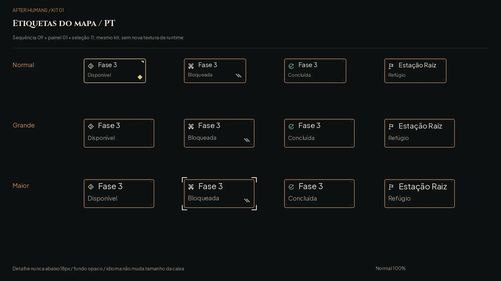
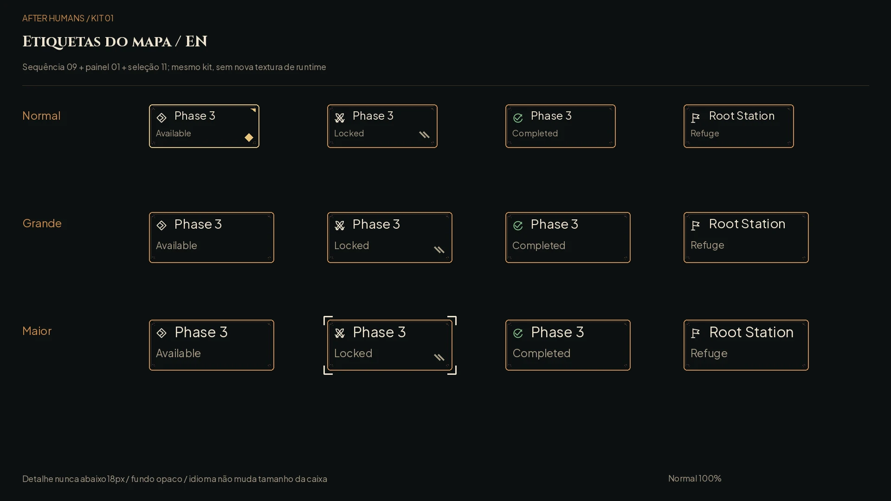

# Etiquetas do mapa ferroviário — #69

A tarja bege dá lugar ao painel escuro texturado do kit #59. É uma variante de **Sequência (09)**, composta com **Painel (01)** e **Seleção (11)**; nenhuma textura nova de produção. O Claude integra em `phase_map.gd` com a #60. Esta entrega não altera o jogo.

## Medidas de integração

Coordenadas locais, base 1920×1080; origem no canto superior esquerdo. Normal: **240×96**; Grande e Maior: **272×112**. Margem interna 16; 9-slice **16/16/16/16** das molduras existentes `panel_normal.png` e `ability_selected.png`. Âncora da etiqueta: centro superior sob o nó da fase; preservar o centro geográfico do nó. Se duas etiquetas se cruzarem, deslocar a etiqueta e ligar ao nó por filete; não deslocar os pontos do mapa nem reduzir a fonte.

| Elemento | Posição local | Medida |
|---|---|---|
| Ícone semântico | 16,18 | 24×24 |
| Título | 56,16 | 24/28/31 px, Plus Jakarta Sans |
| Estado | 16,56; 16,64 ampliado | 18/21/23 px |
| Escolhido | largura−24, altura−24 | losango 18×18 |
| Bloqueio | largura−40, altura−36 | duas barras oblíquas |
| Foco | 6 px fora da caixa | cantos 18 px, traço 3 px |

Disponível: marcador aberto + palavra. Bloqueada: armas cruzadas + palavra + barras. Concluída: visto + palavra; verde `#86c98f`, azul `#56b4e9` no daltonismo. Refúgio: bandeira + palavra. A borda dourada e o losango indicam escolha; os cantos claros indicam foco, inclusive numa fase bloqueada. Não confundir foco com disponibilidade. Texto `#efe5d1`, detalhe `#a69a84`, fundo `#0d1012`, filete cobre `#c98a4b`.

Português e inglês usam a mesma geometria. “Root Station” cabe no Maior; título e estado são duas linhas independentes, evitando a tarja corrida “Phase 3 · Locked”. Não rasterizar textos no asset de runtime: as pranchas são documentação.

## QA de design

Rodada 1 — **VEREDITO: APROVADO**. Conferidos quatro estados, português/inglês, Normal/Grande/Maior, foco independente da escolha, modo daltonismo e cinza. Nenhum problema alto ou médio. As reduções reais a 40% mantêm a distinção por ícones e formas; detalhes de leitura exigem ampliar a interface no dispositivo. A prancha usa exatamente as molduras e fontes do jogo. Não há alfa novo nem asset de produção a revisar. O contrato registra a variante antes das telas #58.

Evidências: [daltonismo PT](ui-kit/map_labels/labels_pt_colorblind.webp), [cinza PT](ui-kit/map_labels/labels_pt_gray.webp), [40% PT](ui-kit/map_labels/labels_pt_40.webp), [daltonismo EN](ui-kit/map_labels/labels_en_colorblind.webp), [cinza EN](ui-kit/map_labels/labels_en_gray.webp), [40% EN](ui-kit/map_labels/labels_en_40.webp), [checagem geométrica](ui-kit/map_labels/checks.json). Reprodução: `python docs/design/ui-kit/map_labels/render.py` (Pillow e CairoSVG).
