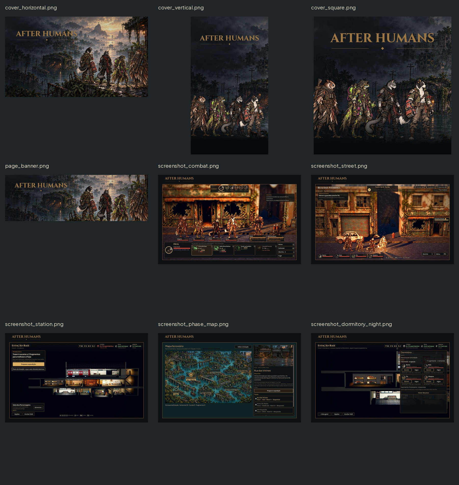
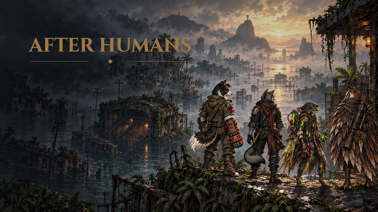
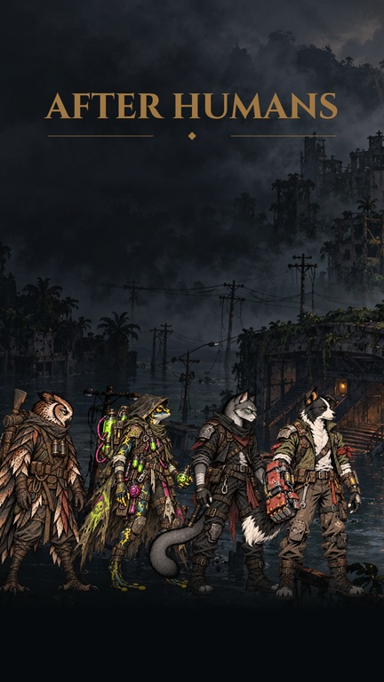
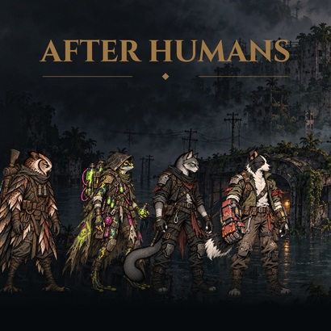
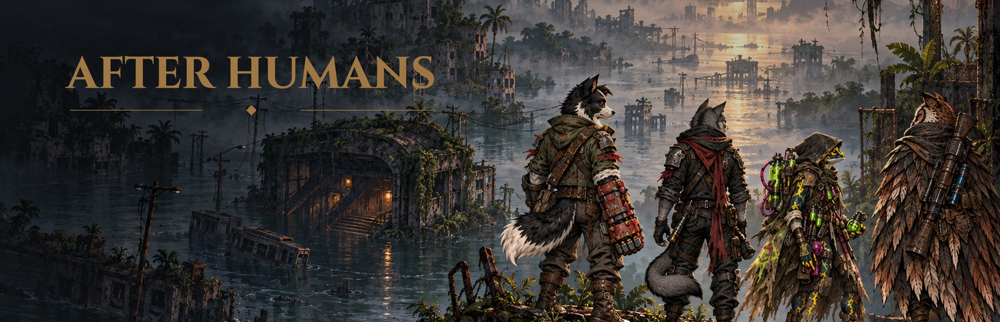

# Vitrine do After Humans — #42

Nove composições finais em art/marketing/ (JPG qualidade 92, sem subamostragem de cor; convertidas dos PNG entregues na integração, pela leveza do repositório). Capas e banner são peças promocionais; as capturas são imagens reais do jogo com moldura externa e assinatura, sem arte de funcionalidades ainda não integradas. O logo é o PNG aprovado da #19, sem redesenho.

## Arquivos e medidas

| Arquivo | Canvas | Conteúdo e área segura |
|---|---|---|
| cover_horizontal.jpg |1920×1080 RGB| logo(80,130),960×263; quatro heróis da pintura à direita; margem64px |
| cover_vertical.jpg |1080×1920 RGB| logo(60,200),960×263; quatro idles diante do cenário; base dos quadros y1700; margem segura54px |
| cover_square.jpg |1024×1024 RGB| logo(62,65),900×246; quatro idles, base dos quadros y930; margem segura48px para logo/rostos |
| page_banner.jpg |3840×1240 RGB| logo(140,110),1650×451; grupo à direita, enquadramento de busto/perfil; não aplicar novo crop automático |
| screenshot_combat.jpg |2048×1280 RGB| captura1920×1080 intacta em(64,136); logo480×131 em(64,0) |
| screenshot_street.jpg |2048×1280 RGB| mesma área interna |
| screenshot_station.jpg |2048×1280 RGB| mesma área interna |
| screenshot_phase_map.jpg |2048×1280 RGB| mesma área interna |
| screenshot_dormitory_night.jpg |2048×1280 RGB| mesma área interna |

Âncora dos layouts: topo esquerdo(0,0). Sem9-slice. Os cinco screenshots compostos mantêm a captura inteira em escala1:1, sem recortar HUD nem diminuir letras. Os originais 1920×1080 não entraram na main (repetiam a área interna das composições); estão na tag codex-pr43-originals (commit df75478), conferidos pelos hashes abaixo, e o roteiro de captura os refaz.

## Direção e composição

Cobre do logo sobre ambiente escuro e quente, com a pintura alagada da #19. A horizontal conserva os quatro heróis já pintados na key art; vertical/quadrada usam o recorte do ambiente sem personagens e os quatro idles canônicos do jogo, em ordem Véspera, Íris, Nick e Bento. Sobreposição de capas/caudas é composição de cartaz; rostos e identidades permanecem livres. A base do grupo na vertical/quadrada dissolve no fundo escuro como retrato de cartaz, para não sugerir personagens flutuando na água. Não são retratos de recrutas nem poses da #13.

Nenhuma frase de venda ou selo de disponibilidade foi gravado; só o logo pedido. O banner tem ampliação2× da pintura1920px, necessária para o canvas3840px; isso não cria detalhe nativo. As capas são montagem promocional e não devem ser chamadas de screenshot. As cinco imagens screenshot_* são capturas reais com assinatura/moldura, sem VFX da #41 ou folhas da #40, pois a integração ainda é do Claude.

## Capturas reais e reprodução

Base do jogo: commit7686613, após sincronizar codex-design com main. Godot4.7.2, renderer Compatibility, Mesa llvmpipe por software,1920×1080; modo desenvolvedor desligado. Sessão de captura e opções isoladas em /workspace/scratch/round2-user, saves em /workspace/scratch/round2-captures/save, sem tocar saves do jogador.

Roteiro: campanha de captura com semente20261022 e cômodos recuperados para mostrar a Estação; abrir mapa na fase1; simular o retorno pela regra existente para obter noite pendente e fotografar o Dormitório; nova expedição na fase1 para rua e combate. É estado encenado para captura, não uma afirmação de progressão de um jogador. No combate a dica foi fechada no HUD antes da captura para não cobrir personagens; pixels não foram apagados posteriormente. O runner confirmou as seis capturas, e uma recaptura de combate sem dica foi usada na composição final.

Não há correção seletiva de iluminação, recolorimento, substituição de personagem ou montagem de HUD nas capturas. As únicas adições são o fundo externo, filete de cobre e logo fora do retângulo do jogo. A renderização por software e este roteiro não certificam performance de hardware, exportação web ou QA de dispositivo móvel. Houve mensagens de recursos retidos no encerramento, preservadas no relato de validação.

Hashes SHA-256 dos PNGs originais entregues, para conferir a origem das composições:

| Captura | SHA-256 |
|---|---|
| combat.jpg | `b6221f42d9851f9fb84f90d900a19d46de5240ba81b6665126f0c22244f1915b` |
| street.jpg | `c3eeadf247eab79bf459561310a8929cc2857e806cda56b082ecc3e612a7f611` |
| station.jpg | `1468a69286e73d707b2d391c67093af2314a3a037c44100b3122e2c2e9cfe816` |
| phase_map.jpg | `8fea96c6fbf45f46d7289c39f78f0c45536ef2b5582e264af623160b2bbc0841` |
| dormitory_night.jpg | `f9f7a71665520b5ccf35f4ec393b88b03983231c7301e998c68e4d8e0d7fb851` |

## Integração

Claude escolhe os tamanhos finais na página web/README após aprovação visual do Lucas. Preferir cover_horizontal em16:9, vertical em9:16 e square em1:1; não usar crop central único para as três proporções. Screenshots devem ficar marcados como capturas do jogo, capas como arte promocional. Nenhuma alteração em scripts/,data/,tests/,README ou presets de exportação. art/marketing/.gdignore exclui apenas este novo pacote promocional do import/export da Godot, como docs/.gdignore já faz com as prévias; Claude deve copiar os PNGs explicitamente para a página web/README, fora do pacote de recursos do jogo.

## QA de design

Avaliação registrada após inspeção dos nove arquivos finais.

Rodada 1 — VEREDITO: REPROVADO. Média — primeira captura de combate: a dica de habilidade cobria personagens. Correção: recaptura real com a dica fechada pelo HUD, sem apagar pixels. Média — capas vertical/quadrada: pés sobre a água davam impressão de flutuação; correção: tratamento de cartaz com dissolução da base no fundo, preservando rostos e logo. Nenhuma dessas correções alterou o jogo.

Rodada 2 — VEREDITO: APROVADO. Conferidos os nove canvases pedidos/propostos, os quatro heróis e o logo original nas capas/banner, legibilidade a40%, cinco screenshots de cenas reais com HUD intacto e correspondência pixel a pixel do retângulo interno com o PNG de origem. Documentadas áreas seguras, hashes, estado de captura e distinção entre key art e screenshot. Sem problema alto/médio restante. Observação baixa: a versão3840px amplia a pintura existente2×; confirmar recorte responsivo na página web e obter aprovação visual do Lucas antes de publicar a vitrine.

## Validação

Os cinco originais têm1920×1080, e os cinco retângulos internos das composições são idênticos a eles em RGB. As três capas e o banner têm exatamente os tamanhos solicitados. O pacote e as prévias são excluídos da importação da Godot por `.gdignore`; a suíte do jogo não testa conteúdo promocional. Na validação desta rodada,21/21 testes do jogo passaram, com os registros de chamadas diferidas e recursos retidos já descritos nas entregas #40/#41. A sessão de captura terminou com saída0 e confirmação das cenas; as mensagens de encerramento também foram preservadas no relato, sem alegação de log limpo.
