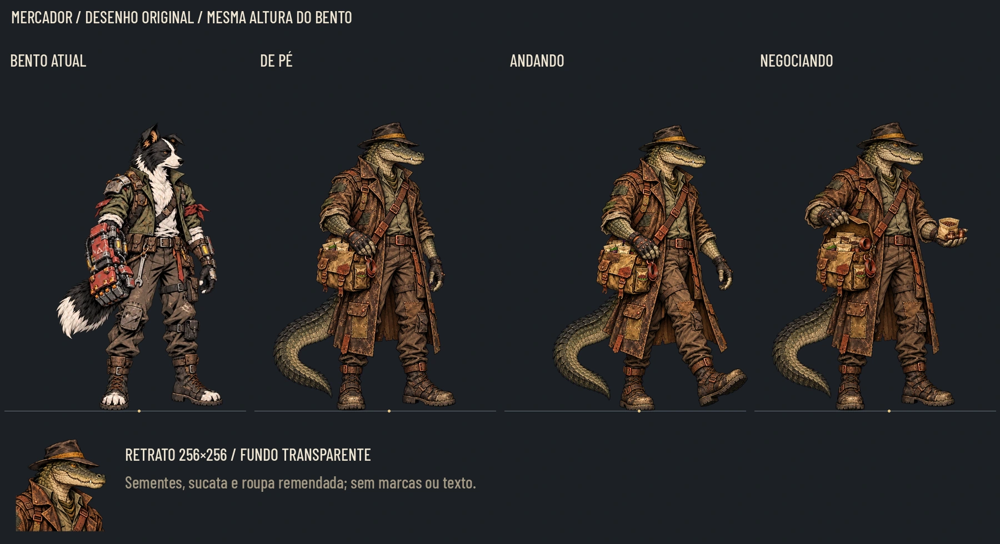
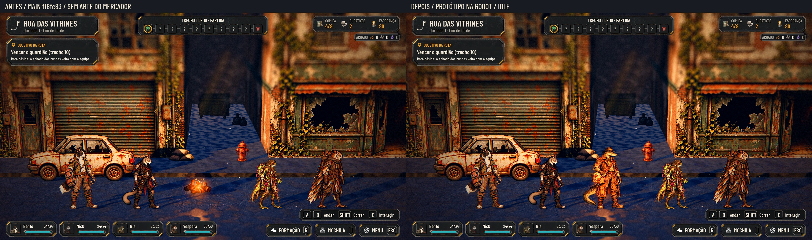
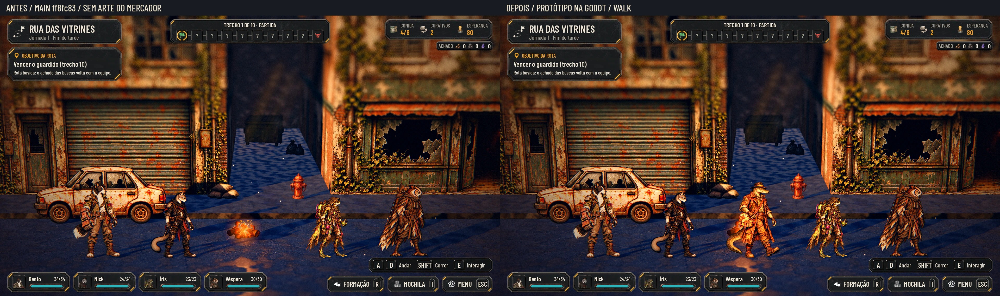
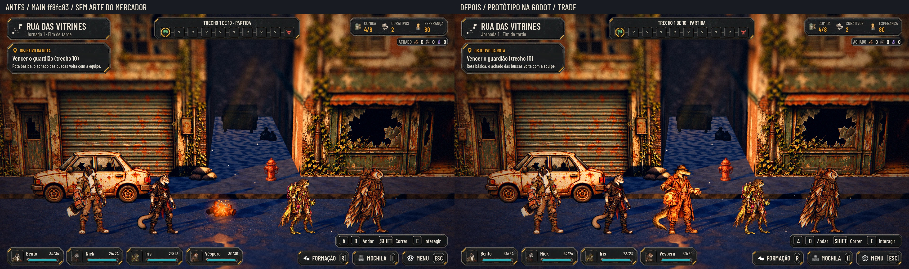

# O Mercador — jacaré mascate (#218)

Desenho original de um jacaré antropomórfico: focinho largo, escamas oliva/cinza, olho âmbar e sorriso discreto de canto. Jaqueta longa de couro/lona marrom, muitos bolsos remendados, camisa oliva, luvas sem dedos, botas fechadas gastas e fedora carvão com faixa ocre. A bolsa de lona leva pacotes sem rótulo de sementes e peças de cobre reaproveitadas. Cauda pesada e curva, sempre inteira no quadro.

Referências visuais: Bento, Nick e os recrutas do próprio repositório. Não foi usada imagem de personagem de outro jogo. O tom misterioso vem da aba do chapéu, do olhar lateral e da postura contida; não há capuz, robe, máscara, arma ou símbolo novo de facção.

[40%](merchant/poses_40.webp) · [Cinza a 40%](merchant/poses_gray_40.webp) · [Alfa/retrato reduzido](merchant/readability.webp) · [Contrato e hashes](merchant/contract.json) · [Auditoria](merchant/audit.json).

## As poses

- **`idle`:** postura de pé, mão junto à bolsa, ambas as botas apoiadas; olha para a direita em três quartos.
- **`walk`:** uma passada, bota de apoio firme, outra avançando levantada e braço acompanhando o movimento. É uma pose estática de caminhada, não uma folha de animação nem um ciclo novo de locomoção.
- **`trade`:** abre a bolsa e oferece um pacote de sementes com pequenas peças de cobre; gesto baixo, sem esconder rosto ou fedora. Sem mesa, efeito mágico ou placa de loja.
- **`portrait`:** rosto, chapéu inteiro, gola e alça; enquadramento quadrado com margem para o focinho, olho legível, fundo transparente.

Cabeça, escamas, fedora/faixa, costuras principais, bolsa, cobre, luvas e botas persistem entre as imagens. A oferta não inventa um item ou uma regra de compra: são os recursos já descritos no pedido. Não há texto desenhado nas artes.

## Medidas e integração

As três poses ficam em `art/civilians/merchant/{idle,walk,trade}.webp`, no padrão de placa de personagem. O retrato fica em `art/ui/portraits/merchant.webp`. Nenhum arquivo existente foi renomeado ou substituído.

| Pose | WebP | PNG de origem | Âncora no original x,y | Âncora na textura x,y |
|---|---|---|---|---|
| idle | 543×724 | 1086×1448 | 664,1429 | 332,714.5 |
| walk | 543×724 | 1086×1448 | 488,1429 | 244,714.5 |
| trade | 543×724 | 1086×1448 | 635.9,1429 | 317.95,714.5 |
| portrait | 256×256 | 1024×1024 | não se aplica | não se aplica |

Todos são WebP RGBA lossless; alfa limpo e sem sombra pintada. Sem 9-slice. **Altura de referência: 1,72 m e 1419 px no original**, como o idle do Bento. A silhueta do idle inclui o fedora nessa referência; a pose de passada pode baixar levemente a cabeça pelo gesto. O tamanho da cabeça não é recalculado pela largura total da cauda, do braço aberto ou da jaqueta.

O Mercador é um personagem novo: o canvas segue o Bento, mas cada âncora horizontal foi medida nas botas de apoio da própria pose. Não copiar a coordenada x do Bento, que cortaria a cauda deste desenho; nem trocar as três âncoras pela média. Na caminhada, a âncora está na bota plantada. O corpo continua com a mesma escala por pixel quando `show_art` troca a pose. O contato vertical corresponde a y714,5 na textura, dentro do arredondamento de rasterização.

`contract.json` contém os payloads de cada pose, as caixas do alfa, hashes e a normalização. `registration.json` das fontes registra a medida do fedora usada para conservar a escala entre poses. Uma caixa alternativa para recortar a cabeça no idle original é `[480,0,390]` (x,y,lado), mas o retrato dedicado é a opção principal.

**Claude 1 integra na parte 2 da #182:** registrar a nova arte/altura e o retrato WebP por `tools/sync_combat_art.py`, associar a aparição e a negociação ao sistema existente e conferir na tabela de alturas. Nenhum id de produção é criado nesta entrega: `merchant` identifica o grupo de arquivos. Não assumir a extensão PNG para o novo retrato. Nada foi alterado em scripts/data/tests.

## Antes/depois dentro da Godot

Main `ff8fc83`, Rua das Vitrines ao fim da tarde, os quatro fundadores na mesma linha de chão. **Antes:** a cena atual, sem arte do Mercador registrada. **Depois:** uma placa `AHSpriteCard` de protótipo, com o contrato da proposta, colocada ao lado dos fundadores; a loja e a aparição do trem ainda dependem da integração #182.

Cada par vem do mesmo processo, câmera, formação e instante pausado. Os fundadores usam a arte/altura atuais; o Mercador recebe 1,72 m, como o Bento. Os sprites não foram colados por um editor numa foto: ambas as imagens são renderizações da cena real na Godot.

Sem GPU física neste ambiente: Godot 4.7.2 em OpenGL Compatibility, Mesa llvmpipe/CPU e Xvfb, 1920×1080. Forward+ e a QA dinâmica de aparição/interação permanecem com a integração. Harness em `merchant/capture.gd`, câmera/posições em `merchant/capture.json`, sob `docs/.gdignore`.

## Coerência narrativa

Conferidos `docs/narrative/lore.md` (sociedade animal, Remendadores e vocabulário) e `narrative-design.md` §14. O traje e a mercadoria são reaproveitados; não há tecnologia fora do mundo, revelação dos Antigos, logotipo ou texto humano legível. A imagem não define de onde ele vem, a qual facção pertence ou uma explicação para aparecer de repente. Nenhuma fala, quest, poder ou recompensa nova foi criada. A identidade e o mistério permanecem como no pedido do Lucas.

## Originais fora da main

Tag `codex-pr<N>-originals`; pasta `art/combat/source/merchant_20261028/`. O Release da mesma tag fornece o ZIP automático, cuja árvore isolada contém somente os quatro PNG normalizados, registro de medidas e contrato. Os brutos da geração ficam fora do Git. Nenhum PNG entra no diff ou histórico do PR para a main.

Para reproduzir após extrair o pacote: `python docs/design/merchant/build_delivery.py --sources art/combat/source/merchant_20261028`. Dependências: Pillow, numpy e scipy. A normalização usa o utilitário de recorte existente em `docs/design/recruit_layers/prepare_layers.py`.

## QA de design

**Rodada 1 — VEREDITO: REPROVADO.** Gravidade média: a medida automática da cabeça incluía a gola da jaqueta e reduzia a pose de negociação. Sugestão: medir uma parte rígida comum às poses e conferir altura/cabeça no comparativo. Correção: referência pelo fedora, excluindo a gola; cabeça preservada e negociação recuperada para a mesma altura do idle. As capturas foram repetidas com essa saída.

**Rodada 2 — VEREDITO: APROVADO.** Conferidos idle/walk/trade/retrato, cabeça/fedora/focinho/olho/escamas e equipamento, mãos/botas/cauda inteira, material pintado, apoio, escala diante do Bento e dos quatro fundadores,40%/cinza e fundo escuro/claro. Retrato conferido em22/32/48/64/128 px; chapéu e focinho cabem no quadrado. Auditoria: quatro RGBA, dimensões corretas e zero resíduos magenta detectados. Nas capturas reais repetidas, o Mercador e o Bento recebem exatamente1,72 m; o gesto de negociação não encolhe o corpo. Sem problema alto ou médio pendente na arte. Observação baixa: papel/sementes e peças miúdas tornam-se manchas de material na escala de mundo; a oferta e a silhueta da bolsa continuam legíveis. A compra/identificação dos itens é da UI da #182. A aprovação artística final permanece com o Lucas.

## Validação técnica

Godot4.7.2: importação final e capturas reais do protótipo concluídas; runner completo desta branch **87/87 em598,190s**, paridade **48/48**. O log mantém avisos de foco/recursos e coroutine do tutorial ao encerrar; retorno zero. Auditoria das quatro imagens e hashes aprovada. Sem mudanças em scripts/data/tests ou ids e sem registro antecipado do NPC em produção.
