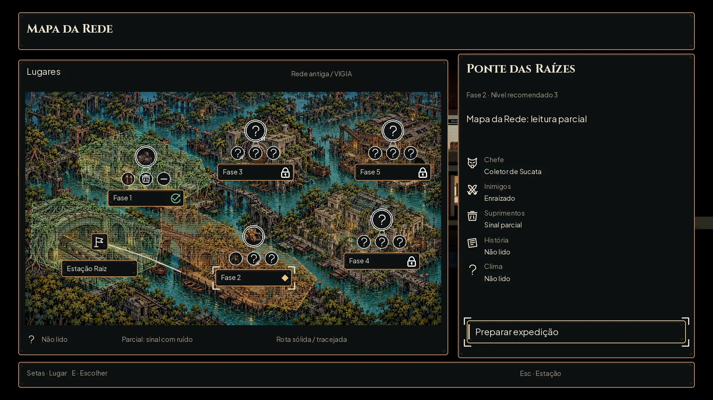

# Mapa da Rede — #86

[Sem escolha](phase-map/overview.webp) · [Bloqueada](phase-map/locked.webp) · [Progresso e Porteiro](phase-map/late.webp) · [Maior](phase-map/selected_large.webp) · [Daltonismo](phase-map/late_large_colorblind.webp) · [Cinza](phase-map/late_gray.webp) · [40%](phase-map/selected_40.webp).

A pintura mantém o bairro alagado, as raízes e a arquitetura envelhecida do jogo, agora com lugares distinguíveis pela silhueta. A projeção é do terminal antigo Mapa da Rede, lendo a VIGIA com falhas, conforme a decisão do Lucas. Não há tecnologia nova no mundo nem revelações sobre os humanos. A referência do Lucas orienta a vista da cidade e a escolha no lugar; painéis, botões, ícones, foco e cores continuam os do kit #59.

A lista da issue corresponde a **seis áreas interativas: Estação e cinco fases**, com oito marcos visuais: Cais e Ponte na mesma área; Depósito e Túneis na mesma área. Nenhum id de fase foi criado, renomeado ou trocado.

## Arte e coordenadas

Tudo novo fica em `art/ui/map/network/`. A pintura anterior `flooded-railway-map.webp` permanece intacta. Fundo novo **1120×630**, RGB, na resolução de uso. Outras64 texturas têm alfa:24 projeções (seis lugares × quatro estados),10 rotas,16 retratos,12 marcadores de leitura, ausência de sinal de história e cadeado. Origens pesadas PNG ficam em `/workspace/generated_images/`, fora do Git.

Origem0,0 no canto superior esquerdo da pintura. Na proposta1920×1080, a pintura fica em **68,248**, sem escala. Moldura48,160;1160×800. Painel lateral1232,144;640×824. Cabeçalho48,32;1824×104. Padding24,9-slice16. Fonte32/24/18, Maior42/31/23; Grande37/28/21 usa a mesma geometria do Maior. O sombreado do terminal é uma camada preta de62/255 sobre a pintura, não uma alteração do arquivo de arte.

| Área visual | Id existente | Âncora na pintura | Marcos |
|---|---|---|---|
| refuge | sem fase |200,405 | entrada da Estação, plataforma e trem |
| shop | fase_1 |325,215 | lojas, vitrines e rua |
| bridge | fase_2 |615,430 | ponte coberta de raízes e cais |
| shelter | fase_3 |620,145 | abrigo de concreto e porta lacrada |
| lab | fase_4 |960,385 | laboratório, vidro quebrado e triagem |
| depot | fase_5 |990,145 | galpão inundado, bombas e boca do túnel |

O [contrato completo](phase-map/contract.json) contém os polígonos de clique e, para cada camada recortada, arquivo, origem e tamanho. Para compor: posição na tela =68,248 + origem da camada. Para o clique: converter o ponto da tela para os pixels da pintura e testar o polígono. O rótulo é outro acesso; não é a única área clicável. Em outra resolução, aplicar a mesma transformação à pintura, às camadas e aos pontos; não passar estas imagens pela conversão à metade dos sprites de combate.

## Projeções e estados

As24 camadas são máscaras **brancas com alfa**, para multiplicar pela cor do `AHUiStyle`; não tingir retratos nem o fundo. A textura da construção, o ruído, o contorno quebrado e as linhas de varredura dão o aspecto de projeção defeituosa. Não são polígonos lisos sobre a cidade.

| Estado | Cor | Forma e sinal |
|---|---|---|
| disponível | azul informativo; claro neutro no daltonismo | projeção e rótulo acionável, sem cadeado |
| escolhido | cobre | projeção reforçada, losango do kit; foco em cantos é independente |
| concluído | bom86c98f;56b4e9 no daltonismo | visto no rótulo, além da projeção |
| bloqueado | a69a84 | projeção apagada, cadeado e motivo no painel; ação desabilitada |

Preparar expedição usa o botão principal do kit. A área escolhida fica em cobre para não disputar o dourado da decisão. O estado bloqueado da Estação é apenas uma variante gráfica da família, entregue para completar as camadas; a integração mantém o refúgio acessível.

## Marcadores e radar

Chefe: círculo64×64 com aro duplo; retrato48×48 no centro. Outros sinais: marcador48×48, exibido a40×40; retrato do inimigo comum28×28. Ícones vêm dos SVG atuais. Os retratos são recortes das poses existentes, inclusive do sensor central do Porteiro. As16 opções cobrem os `SpriteKey` atuais do catálogo de combate.

Âncoras dos marcadores em relação ao lugar: chefe(0,−40); inimigos(−48,+20); suprimentos(0,+20); história(+48,+20). Rótulo208×48 em(−104,+48). Cadeado/visto32 em(+64,+56). O refúgio usa só a bandeira e seu nome, sem chefe nem patrulha inventados.

**Não lido:** pergunta grande, sem rosto oculto por baixo. **Parcial:** pergunta com interrupção e barras de sinal; não mostra uma identidade antes da hora. **Conhecido:** rosto ou ícone. **Ausência conhecida de história:** traço no círculo, para não confundir “não há sinal” com “ainda não leu”. A mudança de cor sozinha não comunica leitura nem progresso.

O painel separa chefe, inimigos, suprimentos, história e clima. Não há um percentual fictício de certeza. Nos exemplos, a rota usa a semente4242: o guardião mostrado e a ordem dos inimigos provêm de [radar_snapshot.json](phase-map/radar_snapshot.json), exportado pelas regras reais. Empates na frequência têm desempate estável pelo id. Nas fases1–4, o retrato representa o primeiro guardião do grupo dessa rota, **não um chefe fixo por fase**. Na fase5, o exemplo corresponde ao Porteiro.

As flags de progresso e de leitura das pranchas são **estados propostos de interface**, não o save da campanha de captura. Fase jogada é conhecida. Suprimentos ficam parciais antes da visita; no exemplo avançado, a leitura é qualitativa. Os cenários atuais contêm pontos de busca (`props` com `loot`), mas `route.sites` ainda é populado por cena: o zero no exportador não prova ausência de buscas. A #87 deve consultar a rota plenamente preparada e os objetos do cenário, mantendo a mesma semente. Não usar o exemplo como tabela de distribuição nem revelar mais informação do que os cômodos/Pesquisa liberarem.

## Rotas

Cada um dos cinco destinos tem máscara1120×630 `remaining` (traços de8 a cada18px,3px de espessura) e `traversed` (linha contínua4px). Branco com alfa para tint. O percurso fica preso à pintura, não ao painel. A prancha mostra os dois padrões para testar o reconhecimento; a integração decide os trechos conhecidos/percorridos a partir do progresso. Não usar a máscara inteira sólida só porque o destino foi escolhido.

## Capturas, arquivos e reprodução

[Antes Normal](phase-map/before/map_normal.jpg) · [Antes Maior](phase-map/before/map_large.jpg). Capturas reais1920×1080, Godot4.7.2, commitf9fe25a, campanha e configurações isoladas. Interface original e fundo sem HUD vieram do mesmo frame pausado. [Hashes](phase-map/captures.json). A imagem nova substitui somente o mapa, que já é uma superfície da interface. Não foi feita integração no jogo.

Quatro estados de tela × Normal/Maior/daltonismo/Maior com daltonismo, todos WebP. Há reduções reais e cinza. `build.py` converte o original externo e constrói as máscaras; `render.py` monta as telas com o kit. O contrato e os exemplos são documentação; a integração é do Claude na #87. Nenhum arquivo de `scripts/`, `data/` ou `tests/` foi alterado.

## QA de design

**Rodada1 — VEREDITO: REPROVADO.** Média: a projeção era fraca sobre a pintura clara; reforçados varredura/contorno e o sombreado do terminal. Alta: recortes genéricos pegavam armas ou antenas, deixando Faísca/Rastejante pouco reconhecíveis e cortando o sensor do Porteiro; corrigidos os recortes nativos. Média: o cadeado podia ficar sob os sinais; repetido no rótulo. Média: o exemplo de fase bloqueada também fechava a fase1; mantida a primeira fase disponível. Média: leitura ampliada precisava distinguir ausência de sinal de história de desconhecido; incluído marcador de ausência.

**Rodada2 — VEREDITO: APROVADO.** Seis áreas e oito marcos reconhecíveis, quatro camadas por área, máscaras/posições completas, rostos corretos, leitura desconhecida/parcial/conhecida/ausente sem depender de cor, rota sólida/tracejada, Maior e daltonismo sem corte de texto. Cadeado, visto, foco e escolha distintos. Retratos/ícones conferidos a22 e32px; mapa e hierarquia conferidos a40% e em cinza. Originais fora do Git, WebP na resolução de uso, alfa limpo; arquivo anterior preservado. A validação interativa e a precisão final do radar são da #87.

Evidências: [ícones/retratos22/32/48 sobre claro e escuro](phase-map/markers_readability.webp) · [arquivos, dimensões, alfa e hashes](phase-map/checks.json). O cadeado é uma máscara para tint e usa placa escura no mapa; não aplicar branco diretamente num fundo claro. Validação Godot4.7.2:43/43 testes, paridade48/48, saída0 em239,3s; avisos de recursos no encerramento permanecem. Importação dos65 WebPs conferida.
