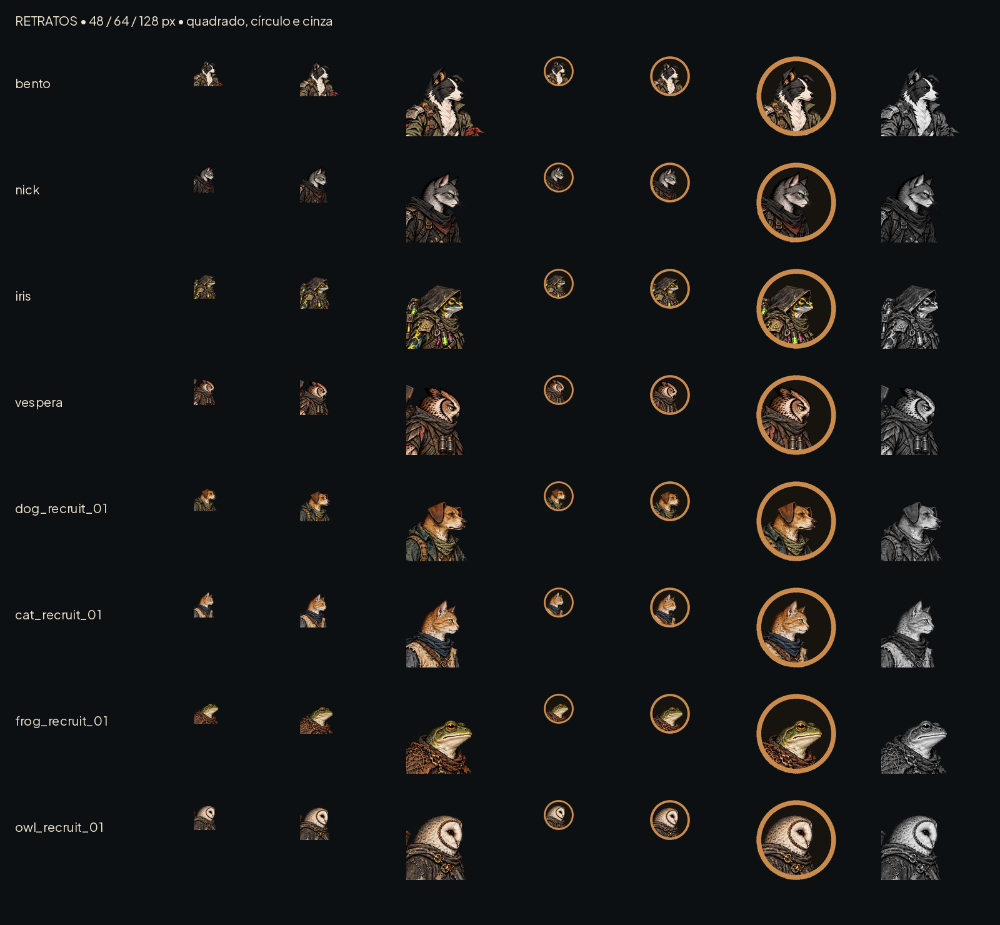

# Retratos dos fundadores e recrutas — #26

Oito PNG RGBA256×256 em art/ui/portraits/, recortados dos idles existentes; nenhum personagem redesenhado, nenhum nome/id do jogo substituído. São arquivos opcionais para integração por Claude, não alteração do retrato calculado atualmente por AHUiStyle.face_texture.

## Recortes reprodutíveis

Coordenadas na textura WebP real, origem superior esquerda, caixa(x0,y0,x1,y1) com extremo final exclusivo. Recortes que passam de y0=0 recebem transparência; não deslocar a caixa para baixo, pois isso desalinha os olhos.

| Retrato | Fonte | Recorte na fonte | Olho visível no PNG256 |
|---|---|---|---|
| bento.png | `art/combat/heroes/bento/idle.webp` | 157, -25, 417, 235 | (143.8, 104.4) |
| nick.png | `art/combat/heroes/nick/idle.webp` | 224, -8, 444, 212 | (144.3, 103.6) |
| iris.png | `art/combat/heroes/iris/idle.webp` | 245, -18, 475, 212 | (143.6, 103.5) |
| vespera.png | `art/combat/heroes/vespera/idle.webp` | 188, -12, 428, 228 | (144.0, 103.5) |
| dog_recruit_01.png | `art/combat/recruits/dog_recruit_01_idle.webp` | 208, -47, 478, 223 | (144.1, 104.3) |
| cat_recruit_01.png | `art/combat/recruits/cat_recruit_01_idle.webp` | 230, -10, 470, 230 | (144.0, 104.5) |
| frog_recruit_01.png | `art/combat/recruits/frog_recruit_01_idle.webp` | 205, -32, 445, 208 | (144.0, 103.5) |
| owl_recruit_01.png | `art/combat/recruits/owl_recruit_01_idle.webp` | 229, -24, 469, 216 | (144.0, 104.5) |

Âncora dos olhos alvo(144,104), tolerância1px pelo arredondamento. Todos voltados à direita. Âncora de layout do retrato(128,128); sem9-slice. Preservar aspecto1:1. Olhos e focinho dentro da área central; o ombro e pontas de orelha/capuz podem tocar a máscara.

Máscara circular: centro(128,128), raio128. O shader atual usa anel de0,06 da largura(15,36px na textura256), portanto raio interno112,64px. Reserva recomendada para rosto/olho: círculo de raio104px; aro do HUD continua separado e pode mudar por estado. Os PNG são quadrados transparentes e não têm borda, fundo, texto ou máscara circular gravada. A prancha simula o aro15px apenas para revisão.

Prancha com reduções reais48/64/128px, sem reampliar as miniaturas. À direita:128px em cinza. Referências: os próprios idles pintados em art/combat/heroes e os recrutas da #14. O cão é distinguível pela orelha caída, o gato pelo perfil/orelha e colete, o sapo por não ter o capuz da Íris, a coruja pelo rosto em coração; cores não são o único sinal.

O recorte-fonte mede220–270px e foi ajustado a256; no máximo1,164× de ampliação. Isso não acrescenta detalhe nativo. Não usar acima de256px sem revisar a fonte.48px é o menor uso conferido, não22px (esses são retratos, não glifos). Nos cartões, o nome em português e a classe continuam como texto do jogo, mínimo18px na base1080p.

Integração #16: usar os retratos segundo a arte já escolhida para o personagem, sem deduzir identidade apenas da classe. Preservar fallback para saves sem variação e os ids atuais. Não editei manifesto, save ou código. Os retratos dos recrutas dependem da publicação do lote da #14 no mesmo branch.

## QA de design

Avaliação registrada após inspeção das miniaturas.

Rodada 1 — VEREDITO: APROVADO. Prancha inspecionada em 48/64/128 px, em máscara circular de proporção equivalente ao shader e em cinza. Oito personagens continuam distintos; nenhum olho ou focinho é cortado pelo aro. Conferidos PNG RGBA256×256 e âncoras de olhos com tolerância de1px. Sem problemas altos ou médios. Observação baixa: os retratos dos recrutas dependem dos idles da #14 ainda locais; a integração deve escolher a variação, preservando fallback e ids. Uso abaixo de48px não validado.
