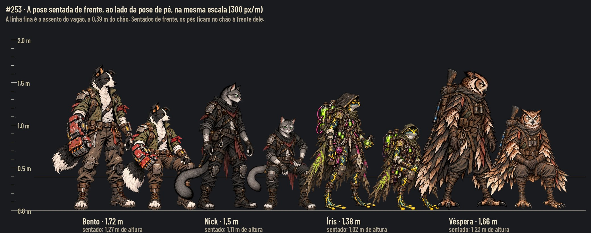
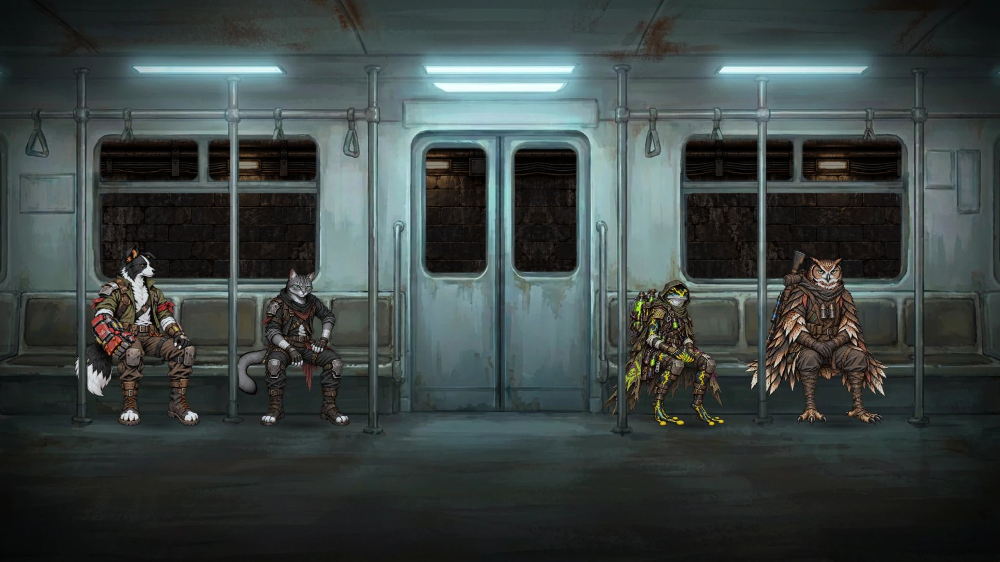
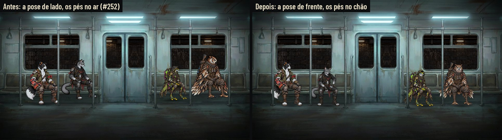

# A pose sentada de frente — #253

A pose sentada **de frente** dos quatro fundadores, para os bancos encostados no fundo (o vagão da passagem e, depois,
qualquer banco visto de frente). Empilhado no #252 (o trem 2D), que passa a usar esta pose na passagem.

**Decisões do Lucas (29/10):** de lado, no banco do fundo do vagão, a equipe ficava esquisita e com os pés no ar. A
pose de frente entra quando sentar de lado não faz sentido. Na folha, os pés ficam retos, as duas solas na mesma linha,
nenhum pé recuado ou levantado (o Nick e a Íris eram os exemplos). Aprovada com essa correção.

## Antes e depois

As duas da Godot (Compatibility, sem placa de vídeo), a mesma cena de passagem do #252 (o antes sai da branch dele,
porque a passagem 2D ainda não está na `main`), a mesma equipe e o mesmo quadro
(`docs/design/trem-2d/capture_train.gd -- --passage --stills`). À esquerda, as poses de lado de hoje: o quadril no
assento deixa os pés do Nick, da Íris e da Véspera 10 a 13 cm no ar. À direita, as de frente: os quatro com os pés no
chão, à frente do banco.

## A arte e os dados

| Pose | Arquivo | Tela | Pé (âncora) | Quadril (no assento) |
|---|---|---|---|---|
| Bento | `art/station/poses/hero_cao_bento_seat_front.webp` | 498 × 716 | (333, 707) | (333, 455) |
| Nick | `art/station/poses/hero_gato_nick_seat_front.webp` | 534 × 716 | (328, 707) | (328, 418) |
| Íris | `art/station/poses/hero_sapo_iris_seat_front.webp` | 594 × 716 | (428, 707) | (428, 393) |
| Véspera | `art/station/poses/hero_coruja_vespera_seat_front.webp` | 593 × 716 | (388, 706) | (388, 445) |

Em `data/presentation/station_poses.json`, cada uma entra como `<herói>_seat_front`, com os campos de sempre (`file`,
`canvas`, `anchor`, `body_reference_pixels`) e dois novos:

- **`facing`:** `front` nas novas e `side` nas `*_seat` de hoje. É o campo que a cena usa para escolher a pose, sem
  código especial.
- **`hip`:** o ponto da pose que vai na linha do assento, em px da tela da pose. De frente, o quadril de verdade fica
  escondido atrás das coxas, que vêm para a câmera; por isso o `hip` não é medido no corpo. Ele foi **posto para o pé cair
  no chão à frente do banco**, 0,458 m abaixo da linha do assento na tela (`hip.y = anchor.y − 0,458 ×
  body_reference_pixels ÷ altura`), e fica no x do meio dos pés. É a composição que o Lucas aprovou. Por isso ele cai em
  alturas diferentes do corpo de cada um (perto do joelho no Bento, perto do colo na Íris), e pode cair fora da figura
  (no Bento, entre os joelhos): é um ponto de composição, não o lugar da sombra de contato.

**A escala:** `body_reference_pixels` = 946 nas quatro. É a altura de pé equivalente: sentado, de frente, cada um tem
74% da altura de pé (como uma pessoa num banco normal). A escala no jogo é a de sempre, altura (m) ÷
`body_reference_pixels`, com as alturas de `scripts/world/character_heights.gd`.

**A proporção:** a folha põe cada pose ao lado da pose de pé, na mesma escala, com a régua; a cabeça, o tronco e a
roupa batem com a de pé (`docs/design/characters.md`). As pernas foram acertadas para as duas solas ficarem na mesma
linha, esticando a canela da perna levantada (na pintura de origem, o Bento tinha uma bota 61 px acima da outra; o Nick,
29 px; a Íris, 26 px; a Véspera, 20 px). Agora as duas solas de cada um ficam na mesma linha (a diferença é de 0 a 1 px).

**De onde vem cada pose:** o Nick e a Véspera são pinturas novas, de frente. O Bento e a Íris saíram da pose sentada de
lado deles, retocada: o corpo e as pernas vêm para a frente, mas o Bento continua com a cabeça de perfil (como na pose
de pé) e a Íris com o corpo um pouco em três quartos. Foi assim que o Lucas aprovou a folha. Para os dois, a de frente e
a de lado têm orientação parecida; a diferença é a perna, que na de frente chega ao chão.

## Quando usar cada uma

- **De frente (`facing: front`):** o banco encostado no fundo e a câmera de frente: os bancos do vagão (a passagem do
  #149), um banco de plataforma visto de frente, um sofá ou banco contra a parede.
- **De lado (`facing: side`):** quando sentar de lado faz sentido: a cantina da Estação (a mesa vista de lado, onde a
  `station.gd` já usa a `*_seat`), a fogueira do acampamento, um banco perpendicular à câmera.

## As poses de lado

Ficam como estão nesta entrega. Na cantina, a única cena que as usa hoje, a figura é posta pelo pé no chão
(`_sit_down`), então ninguém flutua lá. A perna curta só aparecia ao sentar pelo quadril num banco de frente, o caso que
a pose de frente resolve. Esticar a canela delas mudaria a altura do quadril na cantina; se o Lucas quiser, vira uma
issue à parte, com a captura da cantina.

## Para a integração (Claude)

0. **`tools/sync_assets.py` regrava `station_poses.json` inteiro** (`STATION_POSES` e `station_poses()`): as entradas
   `*_seat_front` e os campos `facing` e `hip` não estão na tabela dela, e a próxima sincronização apaga tudo em
   silêncio. A ferramenta precisa aprender essas entradas e campos antes de rodar de novo.
1. **A passagem (#149, `AHWagonRide`):** usar `*_seat_front` pelo contrato de `docs/design/trem-2d/contract.json`
   (os lugares já apontam para elas, com a escala, o canto do sprite e onde cai o pé).
2. **A escolha pela cena:** quem senta num banco de frente pede a `facing: front`; a cantina continua com a de lado.

## Não verificado

- **Forward+:** as capturas são do Compatibility.
- **Skins:** a Ronda do Bento (`art/skins/bento/watch/`) não tem a pose de frente; com ela vestida, a passagem mostra a
  pose padrão do Bento até a skin ganhar a sua.
- **O jogo:** o `wagon_ride.gd` de hoje ainda usa a `*_seat` pelo pé; a pose de frente aparece no jogo quando a
  passagem do #149 for integrada.
- **Recrutas:** ficam para a segunda leva (o Guaxinim e o Tatu da #225, e o gato, o cão, o sapo e a coruja).

## Origens

As pinturas de origem e os scripts do corte ficam fora do Git, no projeto da Awesomic (`images/poses-frente/`).

## Rodadas da QA de design

- **Rodada 1, REPROVADO.** Médias: a Íris tinha um pé 17 px acima do outro (a página dizia que não); a página não dizia
  que o Bento e a Íris de frente são as poses de lado retocadas; o `tools/sync_assets.py` apagaria as entradas novas do
  JSON. Baixas: o `hip` era descrito como medido no corpo, a âncora da Íris fora do meio dos pés, a legenda da folha
  coberta, o campo `existing_seat_file` enganoso no contrato, o antes saindo da branch do #252. **Correções:** a canela
  da Íris esticada (solas em 707/707); "De onde vem cada pose" na página; o aviso do `sync_assets.py` em "Para a
  integração"; a regra real do `hip` com a fórmula e o `hip.x` no meio dos pés; as âncoras pelo meio da base visível; a
  legenda da folha no topo; `file` no contrato; o antes declarado.
- **Rodada 2, APROVADO.** Observações baixas: o `hip` do Bento cai entre os joelhos (fora da figura, registrado acima);
  com os pés no meio do vão, o tronco do Bento e o da Íris ficam um pouco à esquerda e as barras cruzam a cauda e a
  capa; o contrato da #79 ainda usa o nome antigo `existing_seat_file` (fora do escopo).

