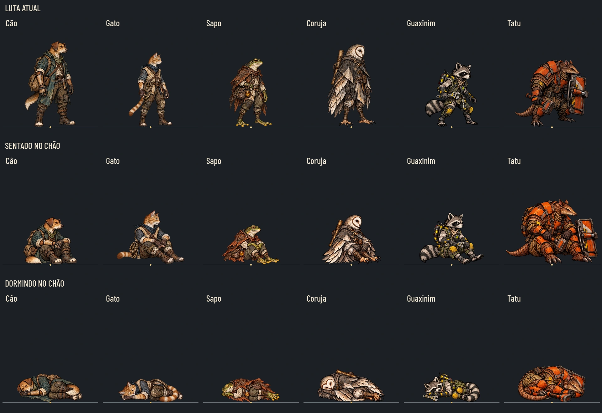
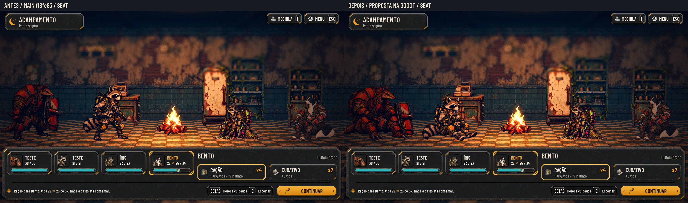
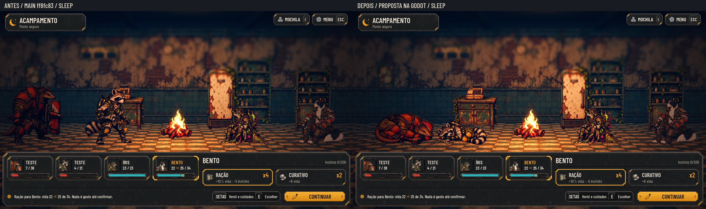

# Guaxinim e Tatu: descanso no chão — #210

Quatro poses novas: Guaxinim e Tatu sentados no chão (`seat`) e dormindo de lado (`sleep`). Mesma espécie, rosto, roupa, paleta, ferramentas e proporção da arte de luta atual. Nenhuma pose de luta é substituída.

[40%](recruit_camp/poses_40.webp) · [Cinza a 40%](recruit_camp/poses_gray_40.webp) · [Contrato desta entrega](recruit_camp/contract.json) · [Contrato completo do acampamento](camp/contract.json) · [Auditoria](recruit_camp/audit.json).

## Desenho e apoio

- **Guaxinim:** sentado sobre as ancas, joelhos dobrados, mãos na chave apoiada no colo, pés para a frente; dormindo enrolado, cabeça nos antebraços e cauda junto às pernas. Mantidos máscara, cauda anelada, roupa oliva, joelheiras amarelas, luvas e mochila com cilindros. A chave fica baixa e segura.
- **Tatu:** sentado sobre as ancas, mãos/martelo no colo e escudo apoiado ao lado; dormindo de lado, braço sob a cabeça, cauda recolhida, ferramentas baixas. Mantidos focinho, orelhas, carapaça natural e placas externas laranja riscadas. O idle já é bastante agachado: não reduzir o personagem inteiro para obrigar a pose sentada a ficar tão baixa quanto a de um cão.

Sem banco, cama, almofada, plataforma ou sombra desenhada. As fontes não têm piso: a iluminação, sombra e chão são da Godot. O ponto inferior de apoio fica junto à âncora canônica, com tolerância de arredondamento de até 1 px na textura. O personagem não é recentrado pelo volume da cauda ou do escudo. Dormir é descanso de lado, não queda de combate.

## Arquivos e medidas

| Arquivos em `art/camp/` | WebP final | PNG de origem | Âncora canônica x,y | Âncora na textura x,y | Referência do corpo |
|---|---|---|---|---|---|
| `raccoon_recruit_01_seat.webp`, `raccoon_recruit_01_sleep.webp` | 589×668 | 1178×1335 | 601.5,1184 | 300.75,592 | 999 px no original |
| `armadillo_recruit_01_seat.webp`, `armadillo_recruit_01_sleep.webp` | 589×668 | 1178×1335 | 601,1087 | 300.5,543.5 | 807 px no original |

Os dois estados vão em `art/camp/`, como os outros recrutas já consumidos por `tools/build_camp_poses.py`; a linguagem da pose deitada segue as da Estação. Sem cópia duplicada em `art/station/poses/`. WebP RGBA lossless, sem texto, 9-slice não se aplica.

`docs/design/camp/contract.json` recebe somente as quatro entradas novas. `show_art` reutiliza `canvas`, `anchor` e `body_reference_pixels` do idle canônico; a conversão das coordenadas usa a razão uniforme da largura, inclusive na altura ímpar. O canvas final explícito evita arredondar 667,5 para o lado errado. O corpo mantém a escala do idle quando o motor aplica a altura de 1,30 m do Guaxinim e 1,35 m do Tatu.

**Integração pelo Claude 2:** executar `tools/build_camp_poses.py` depois do merge para gerar o manifesto de produção e sua caixa visível. A entrega não modifica `data/`, `scripts/`, `tests/` ou ids. O contrato de documentação já é compatível com a ferramenta existente. Nenhuma regra de vida/descanso foi alterada.

## Antes/depois dentro do jogo

Capturas da Godot 4.7.2, main `ff8fc83`, equipe Bento/Íris/Guaxinim/Tatu, mesma câmera, formação e instante por par. O antes usa o manifesto de produção da main sem alteração; o depois carrega somente as quatro propostas no dicionário de poses em memória, pelo harness de captura. O tempo fica pausado entre as fotos. Não são sprites colados numa captura antiga.

**Ambiente:** sem GPU física. Renderização real em OpenGL Compatibility por Mesa llvmpipe/CPU, com Xvfb, 1920×1080. A QA de luz final no Forward+ e a integração do manifesto permanecem com o Claude/Lucas.

O harness e a identificação das capturas ficam em `recruit_camp/capture.gd` e `capture.json`; não entram na produção por estarem sob `docs/.gdignore`.

## Originais fora da main

Tag `codex-pr<N>-originals`; pasta `art/combat/source/recruit_camp_20261028/`. O Release da tag fornece o ZIP automático de uma árvore isolada contendo somente os PNG normalizados, contrato e instruções. Os atlas/brutos da geração ficam fora do Git; nenhum PNG é incluído no PR ou no histórico da branch para a main.

Após extrair o pacote: `python docs/design/recruit_camp/build_delivery.py --sources art/combat/source/recruit_camp_20261028`. Dependências: Pillow, numpy e scipy; o recorte compartilha o utilitário já existente em `docs/design/recruit_layers/prepare_layers.py`.

## QA de design

**Rodada 1 — VEREDITO: REPROVADO.** Gravidade média: na captura com os dois dormindo, a ponta do escudo do Tatu encostava na cabeça do Guaxinim. Sugestão: recolher cauda/equipamento e conferir a ocupação dos dois lugares, sem reduzir a escala do corpo pelo volume da cauda. Correção: Tatu redesenhado numa curva compacta, escudo deitado atrás, cauda envolvendo as pernas; enquadramento da cabeça do Guaxinim conferido contra o idle e normalizado. Mantidos canvas, âncoras e referência do corpo.

**Rodada 2 — VEREDITO: APROVADO.** Conferidas quatro poses e o comparativo com os quatro recrutas existentes: rosto/espécie, equipamento, mãos/garras, cabeça, escala, apoio, alfa no claro/escuro, 40%/cinza, nomes/arquivos e contrato. As capturas reais repetidas mostram os dois estados com apoio no chão, sem o contato entre escudo e cabeça. Sem pendência alta ou média na arte. Observação baixa: a cauda da pose sentada do Tatu chega à borda esquerda no enquadramento atual do acampamento; não foi cortada na textura. A câmera de produção e a luz Forward+ serão conferidas na integração. Aprovação artística final das pranchas pelo Lucas.

**Validação:** Godot 4.7.2; runner completo **87/87 em 601,989 s**, paridade **48/48**. O teste de retratos agora passa na main. Importação final e checker do contrato: 16 payloads iguais aos idles, incluindo os quatro novos. O log registra avisos de foco/recursos e coroutine do tutorial ao encerrar; o runner retorna zero. Nenhuma mudança em scripts/data/tests ou ids.
